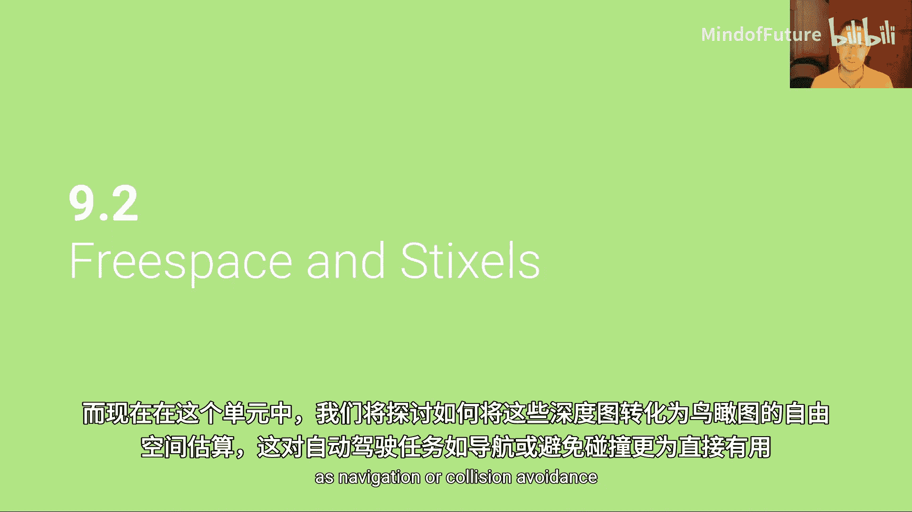
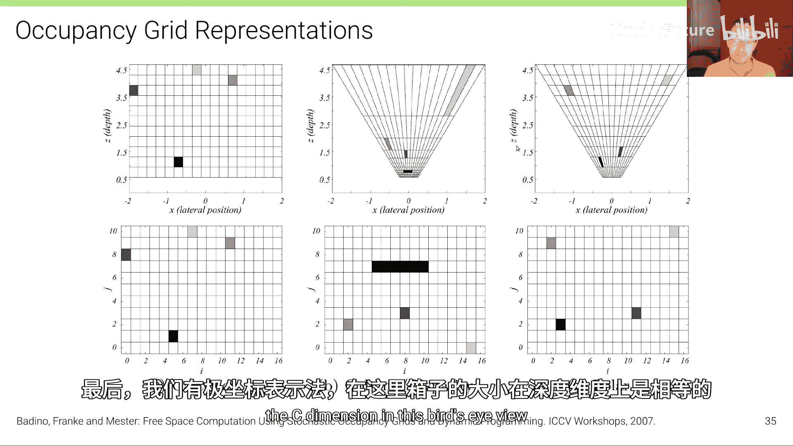
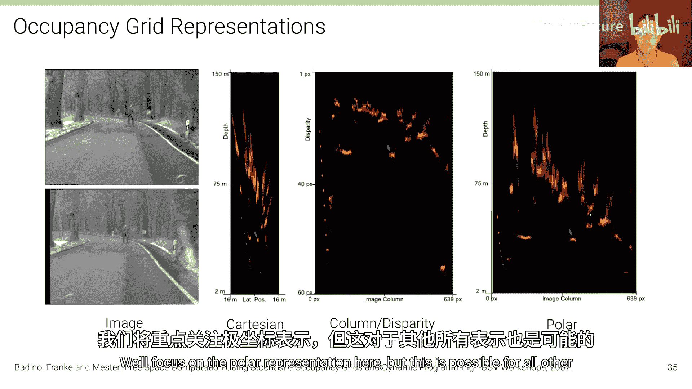
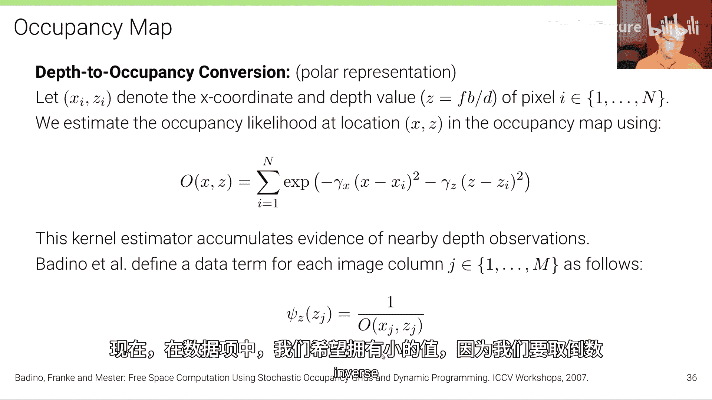
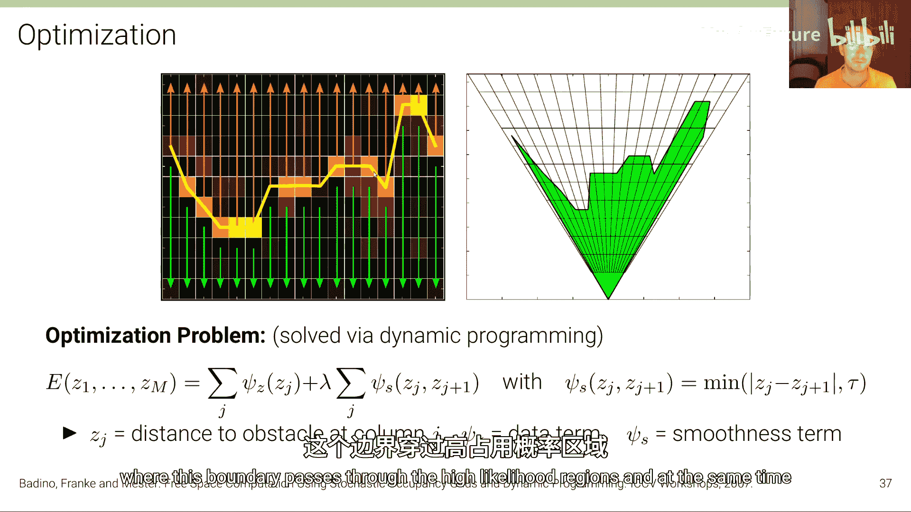
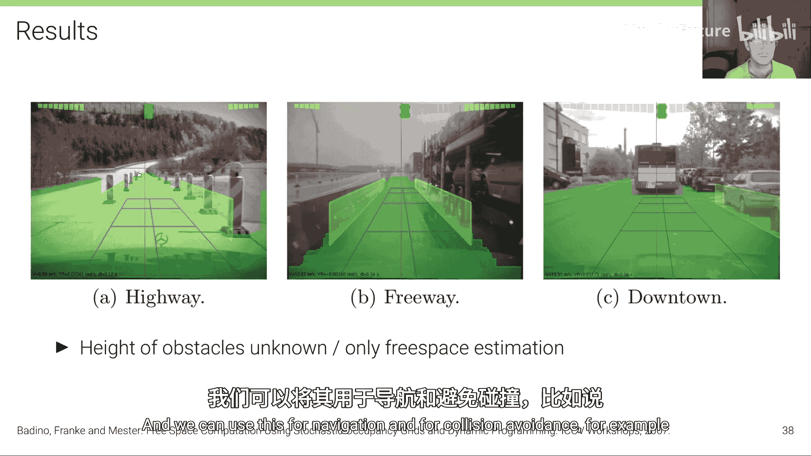

# 033：从深度图到自由空间与Stixel估计 🚗

## 概述

在本节课中，我们将学习如何将立体视觉或激光雷达生成的深度图，转换为对自动驾驶任务（如导航和碰撞避免）更直接有用的鸟瞰图自由空间估计。上一节我们介绍了如何从图像估计视差图和度量深度图，本节中我们来看看如何进一步处理这些深度信息。

## 从深度图到鸟瞰图自由空间估计

输入是一系列深度图（每帧一个），可能来自立体视觉重建或激光雷达直接测量。输出是鸟瞰视角下的自由空间估计，为局部路径规划或碰撞避免提供关键信息。

本单元简要讨论的论文（Badino et al.）所采用的方法是：
1.  首先，通过视觉里程计对齐多帧视差图，进行时间上的融合，以获得更鲁棒、噪声更少的视差估计。
2.  然后，将这些深度测量值转换为鸟瞰图占据概率图。
3.  最后，基于此鸟瞰图占据概率，通过能量最小化来优化自由空间分割。

## 占据栅格表示的选择

以下是论文中考虑的三种不同计算需求的占据栅格表示方法：

*   **笛卡尔占据栅格**：在横向（x方向）和深度方向（z方向）使用等大小的栅格单元。这是最直观的鸟瞰图表示。
*   **列-视差表示**：基于图像列和视差维度进行离散化，导致栅格单元大小不等，且所有单元都朝向相机坐标原点。
*   **极坐标表示**：栅格单元同样遵循透视投影，但在鸟瞰图的深度维度上是等大小的。

以下是这些鸟瞰图占据概率图可能呈现的示例。可以看到，在每种表示中，行人（由绿色箭头标出）都显示为一个黄色的斑点。

## 从深度图推导占据概率

我们将重点介绍极坐标表示，但该方法同样适用于其他表示。

设 `(x_i, z_i)` 表示图像域中的x坐标和深度值（深度 `z = fB/d`，其中d为视差）。我们使用一个核估计器来累积附近深度观测的证据，从而估计占据图中位置 `(x, z)` 的占据概率。

具体公式为：
`P_occ(x, z) = (1/N) * Σ_i exp(-((x - x_i)^2 / σ_x^2) - ((z - z_i)^2 / σ_z^2))`

其中，`N` 是观测总数。这个公式意味着，如果有大量观测值接近我们正在计算占据概率的特定 `(x, z)` 坐标，则指数项的值将接近1，总和会很大。反之，如果没有接近的观测值，总和就会很小。这本质上是一个累积附近深度观测证据的核估计器。

基于此概率，论文为每个图像列 `j`（假设有M列，例如VGA图像的640列）定义了一个数据项 `D_j(z)`，简单地取占据概率的倒数：`D_j(z) = 1 / P_occ(x_j, z)`。在后续优化中，我们希望数据项的值较小（即占据概率较大）。

## 自由空间分割的优化

现在，我们可以将分割自由空间（绿色区域）和非自由空间/被遮挡区域（红色区域）表述为一个优化问题。我们希望找到一条边界，使其穿过基于视差图计算出的高占据概率区域（如上图所示），同时这条边界本身应该尽可能平滑，以克服噪声的影响。

为此，我们求解一个能量最小化问题，其能量函数类似于之前立体匹配中见过的形式：
`E({z_j}) = Σ_j D_j(z_j) + λ * Σ_j |z_j - z_{j-1}|`

该能量函数包含：
1.  **一元数据项** `D_j(z_j)`：鼓励边界经过低数据成本（即高占据概率）的区域。
2.  **平滑项** `λ * Σ_j |z_j - z_{j-1}|`：例如使用截断L1惩罚，鼓励相邻图像列的边界深度 `z_j` 变化平缓。

由于这是一个一维图模型（本质上是一条链），我们可以使用动态规划高效地找到最优解。输出就是自由空间的估计，其边界穿过了高概率区域，同时被强制保持平滑。

## 算法结果与分析

现在让我们看看该算法在一些具体输入数据上的结果。

可以看到，算法能正确识别车辆为非自由空间区域。但例如在人行道这里，由于人行道在深度坐标上与道路非常接近，自由空间算法无法确定，因此将人行道也包含在了自由空间区域内，尽管中间有路缘石。这说明仅使用立体视觉来区分自由空间和道路是困难的。

同时需要注意，障碍物的高度是未知的，我们实际上只估计了自由空间（地面区域），这可以用于导航和碰撞避免。

## 扩展：Stixel世界模型

该模型有一个重要的扩展，称为 **Stixel世界**。在同一作者的另一篇论文中，他们估计多个这样的“Stixel”。Stixel是垂直方向拉长的“小棍”像素，因此得名。

这是一种更紧凑的环境表示，因为不需要表示每个单独的像素，只需将这些Stixel作为变量。他们将此表述为一个分割问题，试图基于视差和语义分割输入，将图像分割成多个Stixel。这些Stixel不仅在下部分割自由空间和非自由空间，也在顶部正确地将物体与背景分割开。因此，他们实际上为每个图像列估计了多个Stixel。

下图是该算法早期版本的一个输出示例，可以看到为汽车和背景中的树木生成的Stixel，以及它如何将障碍物检测与自由空间估计结合起来。

## 总结

本节课中，我们一起学习了如何将深度图转换为鸟瞰图自由空间估计。我们首先探讨了不同的占据栅格表示方法，然后介绍了通过核密度估计从深度图生成占据概率图的过程。接着，我们将自由空间分割问题形式化为一个包含数据项和平滑项的能量最小化问题，并利用动态规划求解。最后，我们了解了该方法的实际效果及其重要扩展——Stixel世界模型，它能以更紧凑的方式同时表示自由空间和垂直障碍物。这些技术为自动驾驶车辆的实时环境理解提供了基础。