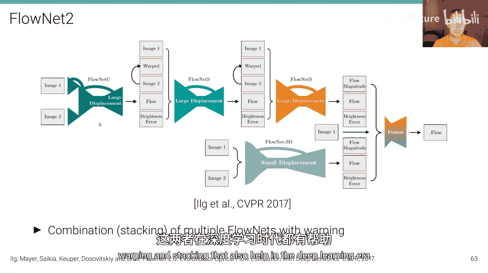
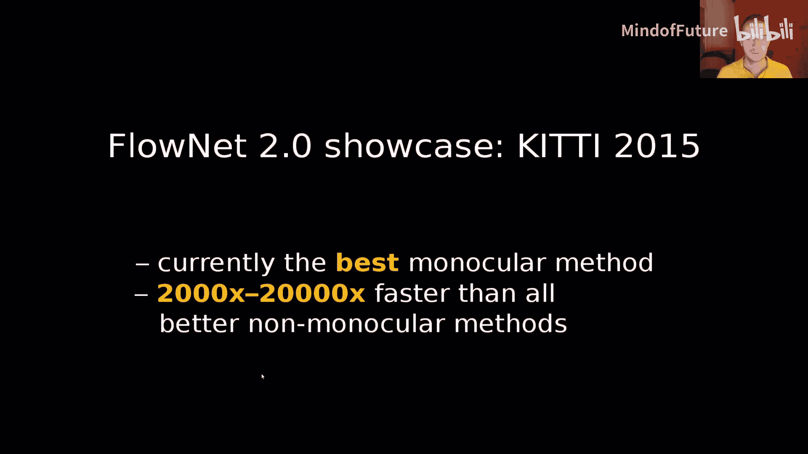

# 034：光流与运动估计

在本节课中，我们将从三维重建转向运动估计，并首先探讨二维图像域中的运动估计，即光流。

## 概述

光流是由观察者与场景之间的相对运动引起的物体、表面和边缘在视觉场景中的表观运动。了解过去或当前的运动有助于我们预测未来。例如，通过了解或外推车辆过去的运动，我们可以预测其一秒后的位置。然而，光流预测是在图像空间中进行的，而非我们真正感兴趣的三维空间。对于三维运动估计（我们称之为场景流），我们需要更多的观测数据，因此我们首先从经典的光流问题入手，然后在第四单元转向场景流。

## 光流简介

在上图中，你可以看到两个由小箭头表示的光流场示例。对于场景图像中的某些点，我们展示了它们在图像域中运动的方向和大小。左侧示例中，观察者正朝着这个扩张点移动。右侧示例中，观察者是静止的，而交叉车流正从左向右移动，如这些绿色小箭头所示。

这些箭头仅显示了某些位置的光流。在实践中，我们希望像立体视觉一样，估计一个密集的光流场，但这很难可视化。稍后，我们将看到用颜色编码的可视化方法。这里仅稀疏地显示了这些箭头，但实际上我们拥有的是密集的光流场。

## 光流与立体视觉的对比

上一节我们介绍了光流的基本概念，本节我们来比较光流与立体视觉。在立体视觉中，我们处理的是同一时刻的两张图像。而在光流中，我们处理的是两个不同时间步的两张图像。通常，我们只有一个摄像头捕捉视频序列，我们考虑该序列中的两帧，并希望估计相邻两帧之间图像域中的运动。

这意味着，在立体视觉中，我们只考虑相机运动；而在光流中，我们同时考虑相机和物体的运动。因此，立体视觉是一个一维估计问题，而光流是一个二维估计问题。与立体视觉不同，我们无法在此利用极线几何约束。物体可能任意移动，我们没有可以利用的约束，因此这是一个更难的问题。

这两种情况都有生物学上的例子。例如，猴子的眼睛像人类一样朝向前方，因此它们有较大的重叠视野区域，可以用来进行立体视觉。相比之下，松鼠的眼睛朝向两侧，它们的重叠视野非常小，因此比猴子更少使用立体视觉。但它们拥有几乎360度的环绕视野，可以利用光流来探测周围几乎所有的运动。

## 运动场与光流场

在考虑光流时，我们必须区分光流场和运动场。那么这两者是什么呢？

*   **运动场**：代表了物理世界中实际三维运动在图像平面上的投影。例如，考虑一个三维点从A移动到B，它在图像平面上的投影点p从A‘移动到B’。这就是所谓的运动场。它可能是相机运动、物体运动或两者共同作用的结果。这是我们真正感兴趣的内容。
*   **光流场**：这是我们能够测量的内容，因为它描述了图像中表观运动的二维速度场。例如，它是看起来相似的像素的位移。

然而，光流场和运动场不一定相同。为什么？你能想到它们不同的情况吗？

让我们做一个小实验来更好地理解这一点。

**实验一：旋转的朗伯球体**
考虑一个朗伯球体在三维空间中绕其垂直轴旋转。那么二维运动场看起来是什么样的？运动场是物体物理运动在图像平面上的投影，这意味着球体顶部会有从左向右的小箭头，靠近赤道时箭头变大（因为速度变大），然后底部箭头再次变小。那么二维光流场看起来是什么样的？球体是朗伯体且无纹理，光源不变，这意味着图像看起来总是一样的。因此，光流场处处为零。这里我们有一个场景，其中运动场明显不同于光流场。

**实验二：静止的镜面球体与移动光源**
考虑另一个情况：一个静止的球体，但它不是朗伯体而是镜面体，并且有一个移动的光源围绕它旋转，改变了镜面高光的位置。二维运动场看起来是什么样的？球体是静止的，所以显然为零。那么二维光流场呢？它并非处处为零，因为这个镜面高光在球体表面移动，在图像中产生了一些表观运动。因此，我们会有一个由这个在球体表面移动的高光产生的速度矢量。

这说明了运动场和光流场之间的区别。当然，在实践中，我们总是对运动场感兴趣，但我们只能测量光流场。然而，场景在自然界中通常具有丰富的纹理，因此在大多数感兴趣的情况下，两者变得相当一致。

## 光流场的意义与孔径问题

光流场告诉我们关于世界三维结构、观察区域内物体运动以及观察者自身运动的一些信息（可能具有模糊性）。例如，在上面的案例中，我们只有观察者的运动，并且我们观察到一个三维平面结构。我们可以看到纯平移运动、纯旋转运动以及平移和旋转组合产生的这些流场。

与立体视觉相比，我们无法利用极线几何约束，因此需要处理一个更难的二维估计问题。对于参考图像中的每一个点，我们需要估计一个完整的二维运动矢量。这也通过著名的“孔径问题”得以说明。

我们通过一个小孔观察一个几何元素（例如一条线），并思考这一个测量是否足以描述这条线的移动方向。这是一个很好的思维实验。我们有一个小孔，观察后面的几何结构。现在移动这条线，问你它向哪个方向移动？大多数人可能会说这条线看起来是沿对角线方向移动。但这实际上是一种错觉，因为我们并不知道这条线是如何移动的。现在移开遮挡物，显示这条线实际上是水平从左向右移动的，而不是对角线方向。

这说明了仅凭单次观测来估计运动的问题，这是不充分的。这种现象也被用于吸引注意力，例如著名的理发店旋转柱错觉。你可能在美国的理发店见过这种柱子，它有一个彩色的旋转柱，但它产生的运动实际上是垂直方向的平移。

## 如何计算光流：Horn-Schunck算法

到目前为止，我们介绍了光流的背景。现在，让我们看看如何实际确定光流。我们已经知道这是一个二维估计问题，每个像素的单一观测信息是不够的，因为我们至少需要两个信息。我们能做什么呢？

我们将要看的算法是最具开创性的一个，即著名的Horn-Schunck光流算法，发表于1981年，距今已有40多年。

考虑图像I是连续变量X、Y和T的函数。考虑U(x,y)和V(x,y)为连续的光流场。因此，我们首先对所有内容进行连续建模，然后再进行离散化。U和V是连续流场，它们是x和y的函数。

Horn-Schunck算法或公式旨在最小化以下能量泛函。它是一个泛函，因为该能量不依赖于变量，而是依赖于待优化的函数。

**能量泛函公式**：
`E = ∫∫ [(I(x+u, y+v, t+1) - I(x, y, t))^2 + λ (||∇u||^2 + ||∇v||^2)] dx dy`

换句话说，第一项是对亮度变化的二次惩罚，第二项是对流场变化的二次惩罚。第一项是数据项，第二项是空间正则化项。你可以看到，每个像素需要两个观测值这个不适定问题，正是通过这个通常需要设置较大λ值的强正则化项来解决的。这是我们添加的额外约束。

数据项非常简单。它只是一个对亮度变化的二次惩罚，表示：在考虑了U方向（基本上是x方向）和V方向的光流位移后，下一时刻在位置(x+u, y+v)的强度，减去当前时刻在位置(x, y)的强度。如果光流估计正确，我们期望这个差值非常小。换句话说，我们希望亮度在跟随正确光流时保持不变。我们希望将图像相互扭曲，使它们看起来最相似。当然，这也与我们之前讨论的直接视觉里程计方法相关。但在这种情况下，我们不是估计结构和运动并假设静态场景，而是真正地估计每个像素的光流。

这是一个能量泛函，包含数据项和平滑度正则化项，并且目前是连续形式。直接最小化这个能量是一个难题，因为该能量是高度非凸的，并且有许多局部最优解。为什么它是非凸的并且有许多局部最优解？它看起来是二次的，似乎是一个简单的问题。这种非凸性和局部最优解从何而来？它并非来自正则化项，而是来自数据项。因为我们有一个二次项，但我们估计的变量U和V（这些流场函数）是作为参数出现在图像算子内部的。当然，图像通常是非常复杂的。如果你绘制一个以图像强度为第三维度的三维图，它会有很多山峰和山谷。如果U和V流作为参数出现，这意味着它通过了这个高度非凸的图像算子，这就是非凸性的来源。它不是来自平方运算，二次函数本身是凸的。

那么解决方案是什么？解决方案是线性化亮度恒定假设。当我们不知道该怎么办时，线性化总是一个办法。当我第一次在卡尔斯鲁厄上光流课时，光流领域的先驱之一Hans-Hellmut Nagel告诉我，每当科学家和工程师不知道下一步该怎么做时，就假设一切都是高斯和线性的，事情就会变得简单。当然，这是一个非常强的假设，但在这种情况下是一个有用的假设。因此，我们线性化亮度恒定假设来解决这个问题。我们将看到为了使这有效我们需要做什么。

## 线性化与离散化

我们如何线性化？让我们考虑一阶多元泰勒级数。我们可以将一个函数用一阶近似表示，去掉所有高阶项。因此，我们在坐标(a, b)附近线性化该函数。我们计算f在(a, b)处的值，然后加上关于x的导数乘以(x-a)，再加上关于y的导数乘以(y-b)。

如果我们将这个泰勒级数公式应用于我们想要线性化的表达式，我们得到底部的这个表达式。这只是公式的直接应用。现在我们可以将这个表达式代回之前的函数中。这样就得到了线性化方程。如果我将这个代入，你可以看到I(x, y, t)项（这里带负号，那里带正号）会抵消掉。剩下的只是右边的这个项。这就是这个项。你可以直接看到它是线性化的，因为现在U和V作为线性项出现在这个二次项内部。

接下来我们要做的是在空间上离散化这个方程。这是上一页的线性化方程，它导致了以下离散化的目标函数。我们不再使用能量泛函，而是得到一个关于离散化光流场U和V的能量函数。U和V基本上是光流在U方向和V方向的图像，每个像素有一个值。因此，积分被替换为求和，并且函数U(x, y)被简单地替换为对这个U流图的索引U[x, y]，V类似。

现在，这个目标函数在流图U和V上是二次的，因此具有唯一的最优解。所以，它只是一个非常高维的“抛物线”。我们可以对U和V求导，并将梯度设为零来求解。这导致了一个非常大但幸运的是稀疏的线性系统。因此，我们可以使用标准技术（如高斯-赛德尔或逐次超松弛法）来求解。

然而，现在的问题是，我们做了线性化假设，因此这实际上只适用于小运动，因为线性化只在小范围内成立。目前，光流领域采用的使其也能处理大运动的解决方案是迭代线性化：线性化，计算光流的估计，然后扭曲图像，再重新线性化并计算光流的另一个估计。通过迭代进行，你可以在一定程度上克服线性化的问题。

另一个技巧是采用由粗到精的估计策略：将图像下采样到图像金字塔中。我们从低分辨率开始，可能是原始分辨率的1/16。因为在较低图像分辨率下，光流会更小，我们在那里估计光流。然后我们使用这个光流在下一个分辨率级别上预扭曲图像，以便需要求解的光流场不再那么大。这些技巧在一定程度上有效，但像这种由粗到精的估计通常会过早丢失精细结构，而这些结构在后续阶段无法恢复。因此，它也有其问题。

## 结果与可视化

让我们看一些结果。如前所述，我们处理的是一个密集的二维矢量场，用箭头很难可视化。因此，我们使用这个漂亮的颜色图进行可视化。它通过颜色编码光流的U和V方向。你可以看到，这个方向的光流将被编码为红色，而这个方向的光流将被编码为蓝色。光流的大小被编码为颜色的饱和度或强度，其中零光流是白色，光流越强，颜色越浓。

这是一个结果。这里有一个著名的Middlebury场景，是最早的光流基准测试之一。你可以看到这些场景纹理非常丰富，运动非常小，因此与自动驾驶场景相比非常容易。这是由Horn-Schunck算法估计的光流场。你可以看到，总体上光流看起来是合理的，但在边界处存在问题。

使用Horn-Schunck计算光流的一个问题正是它使用的二次惩罚项，因此有许多后续工作。例如，Black和Anandan的工作，以及Sun等人那篇描述所有小技巧和不同惩罚项如何有益于光流估计的精彩论文。通过不使用二次惩罚假设并使用其他一些技巧，他们得到了这里显示的更好得多的结果。

这是KITTI数据集图像对应的示例，你可以看到它效果不是那么好。在自动驾驶中，光流是一个难题，因为运动矢量通常相当大，并且场景中有许多部分纹理很少。因此，这确实是一个难题。与这些在实验室环境中捕捉的场景不同，这是一个困难得多的问题，而且比立体视觉更难，因为我们必须估计二维流。

目前，KITTI排行榜上的最先进技术是基于深度学习的光流。虽然早期的深度学习方法还无法与经典技术相媲美，但现在它们已经以相当大的优势超越了经典技术。这里是最早使用深度神经网络进行光流估计的例子之一，其架构基本上与U-Net架构相同：有一个带卷积层和步长卷积的编码器，以及一个带上卷积和跳跃连接的解码器。他们还使用多尺度损失来更好地通过网络传播梯度，并通过课程学习在大量合成数据上训练，然后在真实数据上微调。

Flownet的一个更近的版本叫做Flownet2，它基本上是结合了多个带扭曲的Flownet。因此，它再次使用了光流文献中的经典思想（在这种情况下是扭曲和堆叠），这些思想在深度学习时代也有帮助。

这是该算法对同一张KITTI图片的结果。你可以看到，虽然它仍然不完美，但比经典技术噪声少得多。当然，以视频形式展示光流结果很难可视化，但你可以看到一些估计的结构，例如这里的这辆车。

## 总结

在本节课中，我们一起学习了光流的基本概念。我们从光流的定义和与立体视觉的对比开始，明确了光流是图像域中的表观运动。我们深入探讨了运动场与光流场的区别，并通过思想实验理解了它们并非总是一致。接着，我们分析了光流估计的核心挑战——二维估计问题和孔径问题。为了解决这些问题，我们详细介绍了经典的Horn-Schunck算法，其核心是通过亮度恒定假设构建数据项，并引入平滑正则项来约束解空间。为了求解这个非凸问题，我们学习了如何通过泰勒展开进行线性化，以及如何离散化并最终求解线性系统。我们还了解了处理大运动的实用技巧，如迭代线性化和由粗到精的金字塔策略。最后，我们观看了光流的可视化结果，并看到基于深度学习的方法如何在该领域取得显著进展，尤其是在处理如自动驾驶这样的复杂真实场景时。光流是理解场景动态和实现运动预测的基础，尽管挑战重重，但持续的研究正在不断推动其性能边界。