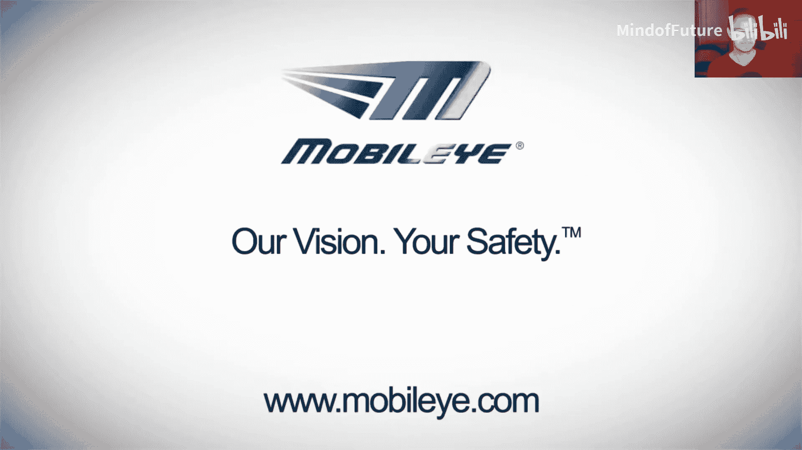
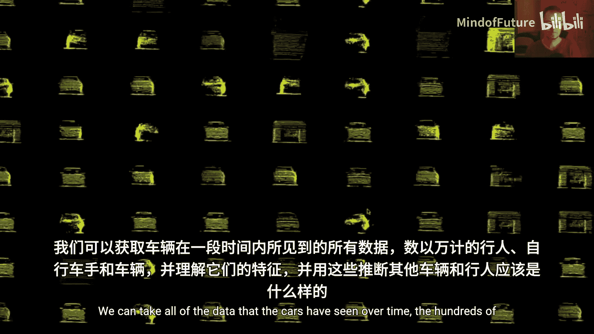
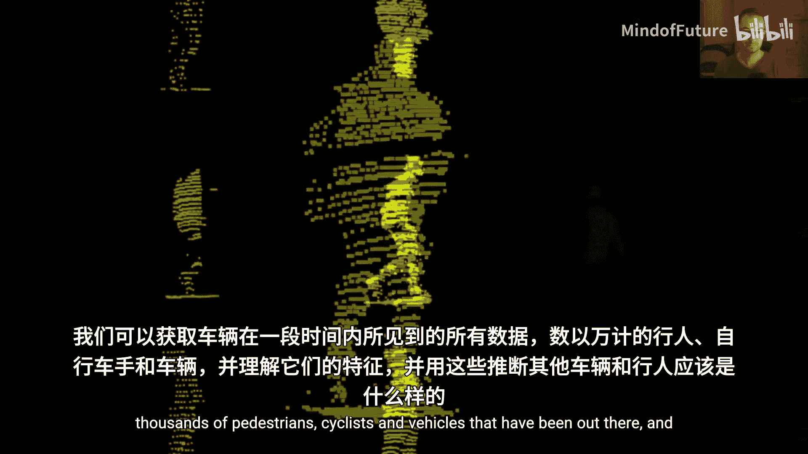
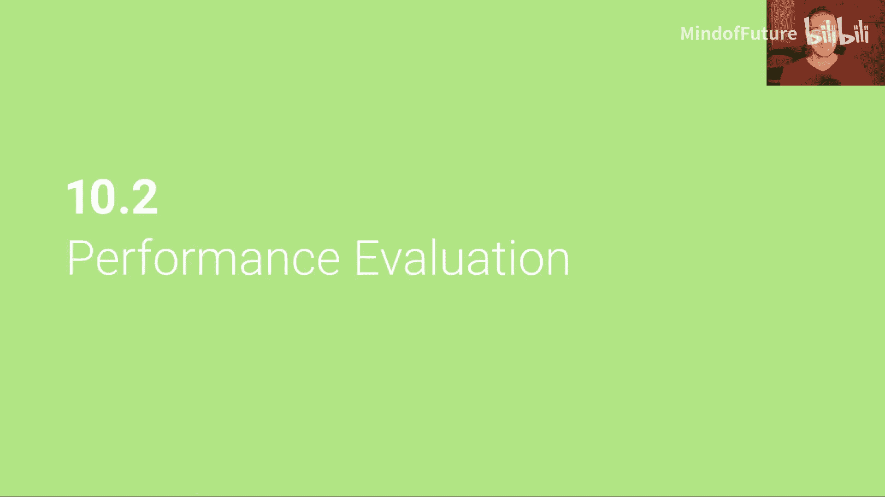

# 036：目标检测 - 引言 🚗

在本节课中，我们将学习目标检测。目标检测是自动驾驶系统中的一项核心技术，它负责在图像或点云中定位并识别出感兴趣的物体，如车辆、行人和骑行者。

上一讲我们探讨了如何重建场景的三维结构并估计运动，这些过程与场景中存在何种物体无关。本节中，我们将聚焦于目标检测，即在二维或三维空间中定位物体并识别其类别。

本讲内容分为五个单元。第一单元介绍目标检测问题及其面临的挑战。第二单元关注性能评估，这对于选择适合特定任务的检测器至关重要。第三和第四单元将分别介绍经典的以及更先进的基于深度学习的目标检测算法，它们主要在二维图像域工作。最后，第五单元将探讨如何从图像和激光雷达扫描中进行三维目标检测。

## 目标检测问题定义 📸

目标检测是计算机视觉中的一个识别问题。我们可以将识别问题大致分为四类：

*   **图像分类**：为整张图像分配一个类别标签（例如，“这是一张街景图”）。这对自动驾驶来说还不够具体。
*   **语义分割**：为图像中的每个像素分配一个语义标签（例如，哪些像素属于道路区域）。我们在之前的课程中已经接触过。
*   **目标检测**：定位（通常用边界框表示）并分类图像中的所有物体，如下图所示。
*   **实例分割**：为图像中每个物体的像素同时分配语义标签和实例标签，这结合了语义分割和目标检测。

本节课我们专注于**目标检测**问题，它对自动驾驶至关重要。我们也会简要了解如何将目标检测器扩展为实例分割算法。

## 目标检测的重要性 🎯

为了说明目标检测的重要性，我们来看两个例子。

第一个例子来自Mobileye公司，他们为高级驾驶辅助系统生产智能摄像头。他们的系统持续扫描车辆前方区域，检测路径上的所有类型车辆（包括摩托车），计算相对速度，并在可能发生碰撞时发出警告。

第二个例子来自前谷歌自动驾驶项目负责人Chris Urmson的TED演讲。他展示了自动驾驶汽车如何通过目标检测来理解世界：车辆首先通过地图和传感器数据对齐来确定自身位置，然后实时感知周围环境。视频中，紫色方框代表其他车辆，红色物体代表骑行者，远处的锥桶也被识别出来。车辆不仅要检测物体，还要预测它们的行为（例如，一辆皮卡因为前方道路封闭而准备变道），并据此规划自身的轨迹。从简单的公路场景到复杂的城市街道（包含行人、交通灯、施工区、警车、校车等），目标检测的难度急剧增加。系统还需要理解手势（如骑行者举手示意）和特殊规则（如避让警车）。通过车辆间共享数据，系统可以学习物体的典型外观和运动模式，从而更好地预测未来行为。

这些例子充分说明了目标检测对于自动驾驶问题的重要性。

## 问题形式化与挑战 ⚙️

现在，让我们更正式地审视这个问题。目标检测的**输入**通常是一张RGB图像或激光雷达扫描。我们需要推断的**输出**是一组带有类别标签和置信度分数的二维或三维边界框。

例如，在图像中，我们可能检测到一个“人”，并用一个边界框标出，同时给出94%的置信度。几乎所有目标检测器都会提供置信度，因为基准测试和下游应用需要根据检测置信度来做决策或评估算法性能。

本质上，我们试图在图像中以边界框的粒度找出“什么物体在哪里”。在三维场景中，则是在激光雷达点云中检测三维边界框。

这个任务面临几个固有挑战：
1.  **边界框数量巨大**：即使将坐标离散化为整数像素位置，可能的边界框数量依然极其庞大。
2.  **物体数量未知**：我们甚至不知道需要预测多少个物体实体，这增加了问题的难度。

除此之外，识别问题本身还面临诸多挑战：

以下是目标检测面临的主要挑战：

*   **类别繁多**：在通用场景中，物体类别可能多达数万种。幸运的是，在自动驾驶场景中，频繁出现的类别较少，主要是行人、骑行者、摩托车手和车辆。
*   **类内差异**：同一类别的物体（例如不同的椅子）在像素级别上可能看起来截然不同。
*   **视角变化**：同一个物体（例如推土机）从不同角度观看，其图像差异巨大。
*   **光照变化**：光源位置改变会导致像素强度发生剧烈变化，尽管场景内容本身未变。
*   **背景干扰**：当物体与背景相似或不够突出时，识别会变得困难。
*   **形变**：物体（尤其是动物和人）会发生形变，导致外观不同。
*   **遮挡**：物体可能被部分或完全遮挡（例如，一排停放的汽车）。
*   **上下文依赖与误导**：上下文信息对识别有帮助（例如，在办公桌环境中更容易识别键盘），但过度依赖上下文可能导致误判（例如，将相似的色块在不同背景下识别为不同物体）。我们需要在利用上下文和防止被其误导之间取得平衡。

## 总结 📝

本节课我们一起学习了目标检测的引言部分。我们明确了目标检测在自动驾驶中的核心作用，即定位并识别二维或三维空间中的物体。我们形式化地定义了该任务的输入（图像/点云）和输出（带标签和置信度的边界框集合），并深入探讨了该任务面临的一系列主要挑战，包括海量可能的检测框、未知的物体数量、类内差异、视角与光照变化、背景干扰、形变、遮挡以及复杂的上下文依赖关系。理解这些挑战是设计和评估有效目标检测算法的第一步。在接下来的单元中，我们将学习如何评估检测器的性能，并探索解决这些挑战的各类算法。