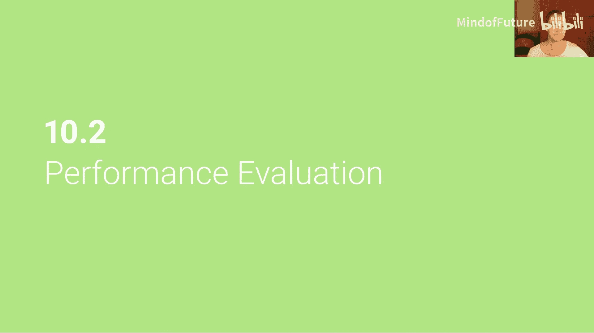
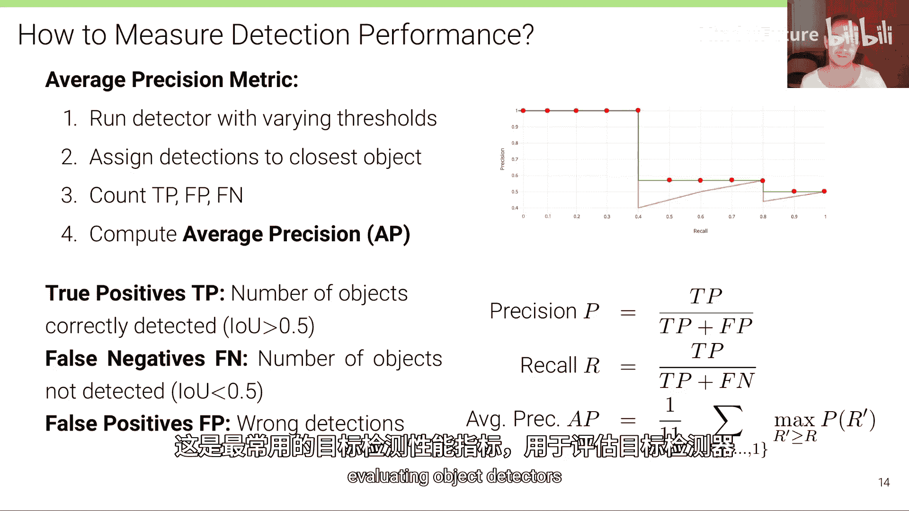

# 037：目标检测性能评估 🚗

在本节课中，我们将学习如何评估目标检测算法的性能。我们将从最简单的单目标场景开始，逐步深入到更复杂的多目标场景，并介绍业界最常用的评估指标——平均精度。

## 单目标检测评估 🛑

上一节我们介绍了目标检测的基本概念，本节中我们来看看如何量化一个检测结果的好坏。首先考虑场景中只有一个目标的情况。

例如，图中有一个停车标志。绿色的边界框是**真实标注框**，这是由人工标注员标注的。红色的边界框是目标检测算法**预测的边界框**。

那么，如何为这个检测结果关联一个“匹配度”分数呢？我们可以考虑使用所谓的**交并比**，它衡量的是两个边界框重叠区域的面积与它们并集面积的比值。

**公式**：`IOU = Area(Intersection) / Area(Union)`

从定义可以直接看出，IOU可能获得的最高分是1，这发生在预测框和真实框完全重合的情况下。最低值是0，表示两个框完全不相交。

我们可以为IOU设定一个特定的阈值，并以此判断检测是否成功。例如，在2D目标检测评估中，通常使用**IOU阈值 = 0.5**。如果检测框与真实框的IOU大于等于0.5，则视为正确检测；反之，则视为不正确。

## 多目标检测评估 🔢

单目标的评估相对简单，但如何公平地衡量多目标场景下的检测性能呢？这并不容易，因为检测数量取决于检测器的置信度阈值，而这是检测器特定的。

目标检测器会输出一组边界框，每个框都带有语义类别标签和一个**置信度分数**。根据我们选择的置信度阈值，我们可以控制被算作有效检测的边界框数量。因此，检测数量依赖于这个阈值，我们应该考虑一整个阈值范围，因为没有单一阈值是最优的。

这正是用于评估多目标检测算法结果的**平均精度**指标所做的事情。

## 平均精度计算步骤 📊

以下是计算平均精度的主要步骤：

1.  **运行检测器并变化阈值**：我们在一个阈值范围内运行检测器，从高阈值（不返回任何检测框）到低阈值（返回大量检测框）。

2.  **将检测框分配给真实框**：对于每个阈值下的检测结果，我们将检测框分配给最接近的真实边界框，通常每个真实物体最多只与一个检测框关联。这个过程通常使用二分图匹配技术，如匈牙利算法。

3.  **统计结果数量**：我们计算以下数量：
    *   **真正例**：正确检测到的物体数量（即IOU ≥ 0.5）。
    *   **假负例**：未被检测到的物体数量（即IOU < 0.5或没有检测框与之匹配）。
    *   **假正例**：错误的检测数量，即那些未被分配给任何真实物体的剩余检测框（可能是冗余检测或检测到了不存在的物体）。

4.  **计算精确率与召回率**：基于上述统计，我们计算两个关键指标：
    *   **精确率**：衡量检测结果的准确性。
        **公式**：`Precision = TP / (TP + FP)`
    *   **召回率**：衡量检测器找出所有真实物体的能力。
        **公式**：`Recall = TP / (TP + FN)`

高精确率意味着检测算法找到的物体大多是**正确**的。高召回率意味着**大多数**真实存在的物体都被找到了，但它不考虑是否有误检。在实践中，我们希望两者都高，但存在权衡：如果检测器返回太多框，召回率会高，但会产生误检，导致精确率低；如果只返回最确信的框，精确率高，但会漏掉一些物体，导致召回率低。

## 绘制PR曲线与计算AP 📈

精确率和召回率可以针对我们变化的每一个检测阈值进行计算。

当我们变化检测阈值时，可以在“精确率-召回率”空间中得到一系列点，并连成一条曲线（PR曲线）。通常，随着阈值降低，我们会从**高精确率、低召回率**的点移动到**低精确率、高召回率**的点。

由于这条曲线通常是锯齿状的，我们会通过取每个召回率水平右侧的最大精确率值来平滑它，得到一条单调递减的曲线。

为了计算一个统一的指标——**平均精度**，我们简单地计算这条平滑后的PR曲线下的面积平均值。可以将其视为对曲线进行积分并取平均。

**核心概念**：`AP = ∫ Precision(Recall) dRecall` 的近似计算（通常对0到1之间的11个等间隔召回率点采样求平均）。

这个AP值独立于特定的检测阈值选择，因为它考虑了整个阈值范围。因此，**平均精度**是当前评估目标检测器性能最常用和最重要的指标。

## 总结 🎯

本节课中我们一起学习了目标检测的性能评估方法。我们从单目标的**交并比**评估入手，理解了其原理和阈值判断。随后，我们深入探讨了多目标评估的复杂性，并详细介绍了**平均精度**的计算流程：通过变化置信度阈值、匹配检测框与真实框、统计真正例/假正例/假负例，计算并绘制**精确率-召回率曲线**，最终通过计算曲线下面积得到AP值。AP是一个综合性的指标，能够全面、公平地衡量目标检测器在不同操作点上的性能。