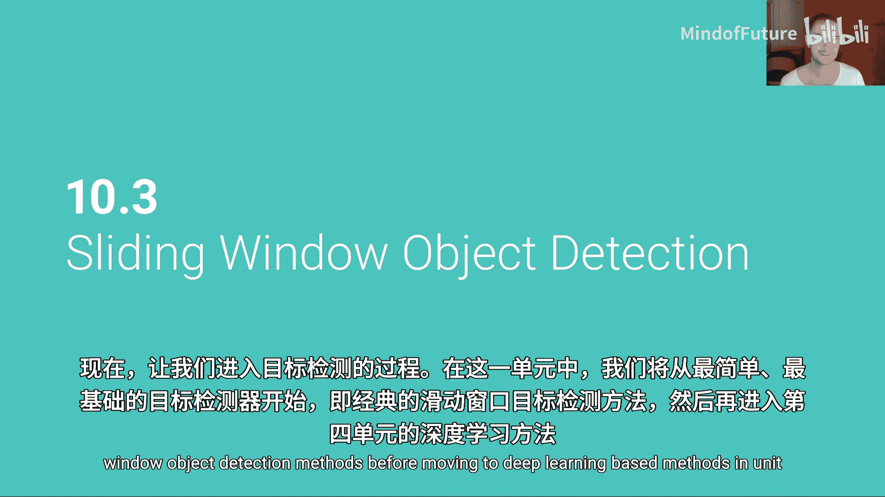
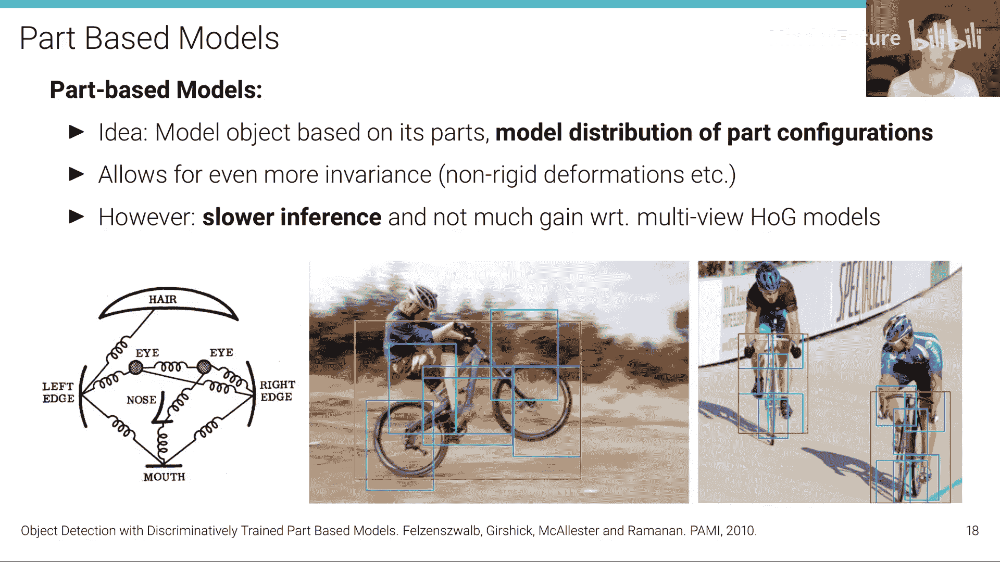

# 038：滑动窗口目标检测

在本节课中，我们将学习目标检测的基本过程。我们将从最简单、最基础的目标检测器形式——经典的滑动窗口目标检测方法开始，为后续学习基于深度学习的方法打下基础。

## 概述

目标检测的任务是在图像中定位并识别出感兴趣的物体。滑动窗口检测法是一种经典且直观的解决方案。本节我们将详细拆解其工作原理、核心步骤以及早期广泛使用的特征描述子。

## 滑动窗口检测的工作原理

上一节我们介绍了目标检测的基本概念，本节中我们来看看滑动窗口检测法是如何具体运作的。

滑动窗口目标检测的工作流程如下：
1.  我们在图像上以固定步长滑动一个固定大小的窗口（图中以绿色框示意）。
2.  对于每个窗口或图像裁剪区域，我们提取其特征。
3.  然后，我们使用一个基于这些提取特征的二分类模型（例如，物体 vs. 背景，或行人 vs. 其他任何东西）对每个窗口进行分类。用于此问题的分类模型可以是支持向量机、随机森林、基于提升的技术或深度神经网络。

为了检测不同大小或距离的物体（由于透视相机的影响，近处的行人看起来比远处的大），我们还必须搜索不同宽高比和尺度的检测框。这变成了一个相当详尽的搜索问题。为了在可行的时间内完成此任务，我们必须以一定的步长进行搜索。

至此，我们有效地将目标检测问题转化为了一个分类问题，而我们知道如何使用机器学习分类技术来解决它。

最后一步是应用非极大值抑制或聚类，以**为每个物体只保留一个预测**。问题是，当我们滑动窗口遍历所有可能的位置时，在红色目标物体附近的一些窗口也会获得较高的分类得分（例如，来自支持向量机的输出），因为它们接近行人，预测“几乎正确”。但我们当然不希望保留所有这些检测结果，我们只想为场景中的每个物体保留最好的一个。这就是非极大值抑制的作用：它是一种聚类启发式方法，会查看边界框的重叠情况，如果重叠度很高，则只保留置信度最高的那个边界框。因此，它最终只保留目标检测算法对每个物体的一个预测。

## 特征空间的选择

接下来我们必须回答的问题是：应该在哪个特征空间上，让支持向量机对这些小图像块进行分类？

最简单的做法当然是使用RGB像素空间，但正如我们在介绍单元中已经看到的，这既不具备视角不变性，也不具备光照不变性，因此不是一个好的选择。

一个更好的选择是使用**方向梯度直方图**，简称**HOG**。在超过十年的目标检测研究中，它一直是事实上的标准，由Dalal和Triggs的论文《Histograms of Oriented Gradients for Human Detection》推广普及。

其核心思想是**用代表梯度角度的直方图（以梯度幅值为权重）来描述图像块**。

让我们用一个来自MNIST数据集的简单数字“8”的例子来说明。
1.  首先，我们计算这个裁剪图像在x和y方向上的空间导数，然后计算梯度幅值和梯度角度。
2.  梯度幅值如上图所示。梯度角度则如下图所示，我们将梯度角度量化为八个不同的方向（这是一种相当粗略的方向分箱）。例如，在数字“8”的左侧，有朝左的梯度（红色），右侧则有朝右的梯度（蓝色）。
3.  下一步，我们将图像细分为多个**单元格**。单元格是图像中具有一定像素宽度和高度的子区域，例如本例中的8x8或6x6像素。
4.  之后，对于每个单元格，我们计算一个直方图，累加每个角度方向上的梯度幅值权重。例如，对于某个单元格，我们从朝向橙黄色方向的像素获得贡献，但不会从绿色像素（该均匀区域的梯度幅值为0）获得证据。观察另一个单元格，我们可以看到来自橙黄色像素和蓝色像素的贡献。
5.  我们对所有定义的单元格重复此过程。

与直接使用RGB像素空间相比，HOG的优势在于：
*   **对微小形变具有鲁棒性**：图像可以轻微平移、缩放、旋转或施加一点透视变换，梯度不会发生太大改变，因为它们是整个区域的汇总统计量，且梯度角度已被量化为非常粗略的离散分箱表示。
*   **对亮度变化具有不变性**：由于直方图仅基于梯度计算，而不依赖于原始强度信息，因此它独立于绝对亮度。例如，改变相机的增益或快门速度，HOG特征基本保持不变。

正是这两个方面促成了方向梯度直方图的成功：它们捕获了相关的边缘方向信息，同时对平移、缩放、旋转有一定灵活性，并且对亮度变化具有不变性。

## 基于部件的模型扩展

基于方向梯度直方图思想的一个扩展是Felzenszwalb和Girshick等人于2010年提出的**基于部件的模型**。其思想是基于物体的部件来建模，然后对部件配置的分布进行建模。这个想法实际上可以追溯到20世纪70年代，并已得到应用。在这里，它与图模型和HOG特征结合使用，用HOG特征描述每个部件。

使用基于部件的模型允许实现**更多的 invariance**，因为我们可以通过简单地调整不同部件之间的关系，并在图模型分布的配置空间中对这种关系进行建模，从而允许物体发生一些非刚性形变。

然而，这些模型会导致**推理速度变慢**，因为我们需要在推理时解决图模型中的推断问题。同时人们也发现，与简单地针对我们可能感知到的物体的每个不同视角分别训练一个多视角HOG模型相比，基于部件的模型并没有带来巨大的性能提升。

## 性能展示

尽管如此，对于像汽车这样相对容易检测的物体，这些基于简单方向梯度直方图特征和非深度学习的图模型推理算法，已经能够实现令人印象深刻的性能。以下是在KITTI数据集上的一些结果。可以看到，检测虽然不够超级精确，但能够检测出相当多的物体。

## 总结

本节课中，我们一起学习了经典的滑动窗口目标检测方法。我们了解了其将检测转化为分类问题的核心流程，深入探讨了方向梯度直方图这一关键特征描述子的计算方式及其具备平移、亮度不变性的优点，并简要介绍了基于部件的模型扩展及其利弊。这些方法为后续深度学习目标检测算法的发展奠定了重要基础。