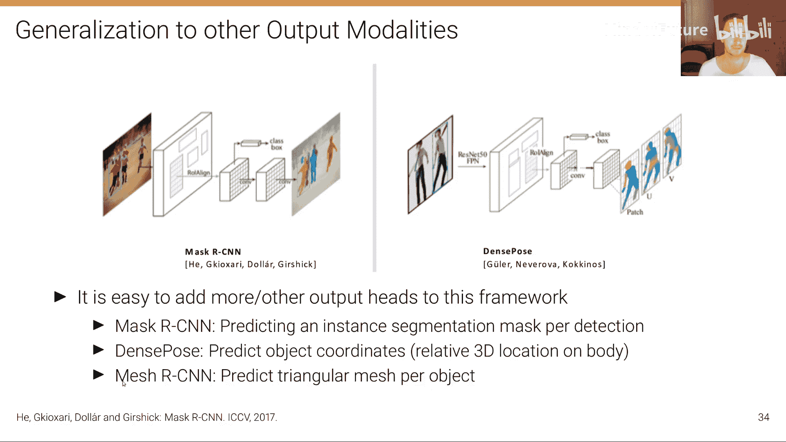
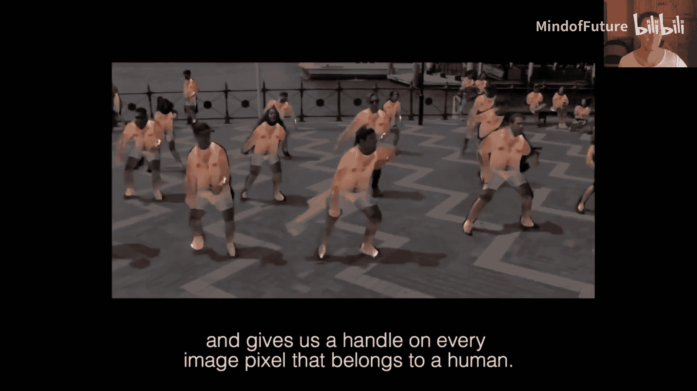
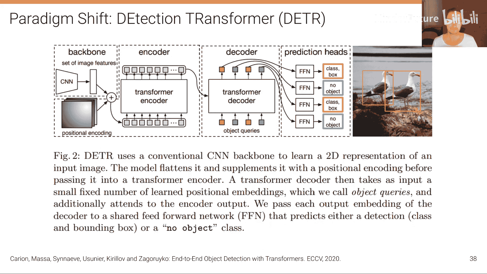

# 039：基于区域的卷积神经网络 (R-CNN) 🚗

在本节课中，我们将要学习基于深度学习的物体检测方法，特别是被称为“两阶段”或“基于区域”的卷积神经网络。这些方法是目前最强大的深度学习技术之一，也是物体检测领域的事实标准。

## 概述

上一节我们介绍了经典的物体检测方法。本节中，我们将转向基于深度学习的方法，并重点探讨基于区域的卷积神经网络。这些方法通过将检测任务分解为两个阶段，极大地提升了检测的精度和效率。

## 从经典方法到深度学习

正如我们在上一单元所见，经典方法并未在物体识别领域带来重大突破。它们仅在特定非安全关键任务（如相机人脸检测）中取得了巨大成功，至少在应用层面如此。

为什么经典方法难以突破？第一个也是最困难的问题是，计算机视觉特征非常难以手工设计。我们人类并不知道一个好的特征应该是什么样子，一个好的表示应该如何构成尚不明确。此外，滑动窗口方法在实践中通常很慢，因为它们必须在所有可能的边界框构成的巨大空间中进行搜索。在复杂的基于部件的图模型中进行推理，不仅没有改善情况，反而使这些方法变得更慢。上一单元视频中展示的结果，每帧大约需要一分钟的计算时间，原因是计算通常无法被高效简化，而且有时需要图模型中的复杂推理。

幸运的是，深度学习改变了这一切。现在，识别任务也成为了一个成功的故事。

以下是一张概述进展的幻灯片。我们可以将输入图像的RGB像素直接通过一个分类器。我们有一个可训练的模块，并直接将图像作为表示。但正如我们所见，这效果并不好。一个更好的解决方案是计算梯度，并将这些梯度通过一个分类器。这里我们有一些手工设计的特征（黄色部分）和一个训练好的组件（绿色部分）。更好的方法是获取梯度并形成直方图，然后将这种手工设计的表示通过一个学习到的分类器，或者在这些直方图之上进行一些操作，例如K-means或稀疏编码。一个曾被广泛使用的流行表示叫做“fisher向量”。但所有这些方法都存在一个问题：这些中间表示、中间处理层都是手工设计的，没有考虑最优性。

因此，深度学习的区别在于，我们现在尝试学习所有这些特征。现在所有这些方框（这里用绿色方框表示）都是可训练的。我们学习所有这些低级特征（这是我们深度神经网络的早期层）、中级特征和高级特征（后期层），甚至分类器本身，所有这些都是一个端到端训练的大型神经网络。这确实带来了性能的 dramatic 提升。

在2005年至2010年左右，物体检测技术的性能曾停滞不前。在我们上一单元看到的那个 formidable 基于部件的模型上，特定基准测试的平均精度仅为5。而使用第一个基于深度学习的模型，如使用非常简单的骨干网络（如AlexNet）的Fast R-CNN，我们已经将平均精度提高了三倍。在基于深度神经网络的检测方法发展的两年半内，我们又获得了三倍的提升。在非常短的时间内取得了巨大的进步。

本单元的内容基于Ross Girshick的幻灯片，他是接下来我将描述的基于区域的深度神经网络物体检测系列算法的主要贡献者之一。因此，我想在此感谢Ross的幻灯片。

## 基于深度神经网络的物体检测原理

那么，我们如何使用深度神经网络检测物体呢？

一个朴素的想法是使用一个分类深度神经网络对图像中所有可能的框进行分类。但正如我们所见，这是不可行的，因为框的数量太多了。即使空间被离散化，我们也无法做到。

一个更好的想法是首先检测一组可能包含物体的候选边界框。并非所有候选框都是正确的，但其中一些是。我们实际上是在量化空间。当然，我们应该选择这组候选边界框（例如2000个）是过完备的，我们应该包含更多的框，但应确保这组框包含所有真实标注框。

这是第一阶段。它是一个两阶段检测器，因为它还有第二阶段：我们获取所有这些候选框（比如2000个），现在使用一个深度神经网络将它们分类为一组标签（不同的物体或背景类别），并同时细化这些框的位置。因为我们在之前已经减少了候选边界框的数量，现在我们需要有机会和能力来细化位置，以使检测器的输出边界框更加精确。这就是两个阶段。因此，这种方法被称为基于提议或两阶段的物体检测器。

请注意，我们现在将原始的物体检测问题拆分成了两个代理任务：检测一组较小的候选边界框的任务（或边界框空间的量化任务），以及分类和细化这组候选边界框的任务。

这里再次进行了说明。通过用有限的一组边界框进行近似，我们可能会得到这里所示的量化误差。我们有一张恐龙的图片，我们有一个量化后的框，这个框还可以，但并不完美。因此，相对于真实框，我们存在这个量化误差。我们现在想在第二阶段做的是，通过回归位置偏移量来细化框的位置，以预测从绿色提议框到最终预测（虚线绿色框）的增量，从而恢复因量化而损失的定位精度。当然，我们也会使用非极大值抑制来移除冗余的预测。就像我们在基于滑动窗口的技术中所做的那样，因为这里可能有多个提议框回归到同一个物体，所以我们希望只保留最自信的那个，每个真实标注只保留一个预测。

## R-CNN：首个深度学习方法

现在，让我们深入了解第一个用于物体检测的深度学习方法，它被称为R-CNN，在论文《用于精确物体检测和语义分割的丰富特征层次结构》中描述。

R-CNN代表基于区域的卷积神经网络，因为其思想非常简单：我们计算这些提议区域，然后对每个区域应用一个卷积神经网络分类器。

我们首先使用一个现成的区域检测器/提议算法。在当时，有一些算法可用，如选择性搜索或边缘框。这些是非常简单的通用算法，不考虑物体的类别（无论是马、骑手、自行车手还是任何东西），但它们是为检测通用物体而训练的。它们做得还可以，但通常生成的预测非常不精确。因此，我们需要采样更多的框，我们需要对置信度应用一个较低的阈值，以便获得大量稍后可以分类的框。

我们运行这些经典技术之一来获得一组框。然后，我们将原始图像裁剪并变形为固定大小的表示，并将这个固定大小的表示前向传播通过一个卷积神经网络（一个标准的卷积神经网络）以获得特征表示。然后，我们有两个输出头：一个用于对该区域进行分类（例如，将其分类为“骑马者”），另一个用于回归边界框的偏移量，以细化它们，使其比原始那些相当粗糙、嘈杂且不精确的提议更好地拟合真实标注。

这里你还可以看到，这个黄色区域表示仅需要每图像计算的组件。我们只计算一次，只为该图像计算一次框。但这个绿色区域表示需要每区域计算的组件。每个区域，我们都需要裁剪和变形；每个区域，我们都需要运行一个卷积网络。这里你已经可以看出为什么这很慢了，因为我们需要为选择性搜索算法提出的每个提议（例如2000个）运行一个完整的卷积网络。

## 通用框架与R-CNN的局限性

我们现在可以将这个表示、这个框架概括为更通用的形式，我们将看到，理解原始R-CNN算法之上的创新是有用的。

我们看看这两个区域：每图像计算和每区域计算。在这个通用框架中，我们首先将输入图像转换为特征化表示。然后，我们有一个从该图像计算物体区域提议的机制。我们称之为R(I)。所以我们有特征F(I)，这是特征图。这里我们有从该图像计算的区域R(I)。然后，我们有一个函数，它接收特征和区域，并计算每个提议区域的特征化表示。然后，我们对每个提议特征应用额外的处理，并有多个头来做出特定于任务的预测。

现在，如果我们看R-CNN，这个基于深度学习的两阶段物体检测的第一个最简单版本，在这个框架中，它看起来是这样的。这里的特征映射只是恒等函数，所以它将图像复制为特征表示。对于这个从图像计算区域的函数，我们简单地使用一个现成的经典、传统的非深度学习算法，如选择性搜索。然后，这个组合函数只是一个裁剪和变形操作。接着，这个每区域计算是一个完整的卷积网络。然后我们有两个头：一个用于分类，一个用于边界框细化（回归任务）。

R-CNN有什么问题？第一个问题是我们有较重的每区域计算。我们需要进行2000次完整的网络评估，对于每个提议，我们需要运行一个完整的AlexNet或ResNet架构来进行预测。所以它相当慢。此外，我们没有利用计算或特征共享，因为我们真的是独立进行的，我们独立地将2000个输入通过这个网络进行推理。另一个缺点是，我们有一个缓慢的区域提议方法，增加了运行时间。所以这些确实是经典技术，不使用深度学习，它们在CPU上运行，相当慢。因此，如果我们以帧率、实时物体检测为目标，这并不理想。然后，我们有通用的区域提议技术或这些经典技术，它们的召回率相当有限。尽管选择了低阈值，它们仍然无法预测所有真实标注物体的框。

## Fast R-CNN：更快的两阶段检测器

这个两阶段物体检测家族的下一个版本叫做Fast R-CNN。它的不同之处在于，它拥有更轻量级的每区域计算。它实际上是R-CNN的一个端到端可训练版本。

这里进行了说明。在第一步中，我们现在做的不同之处在于，我们不只是将图像复制为特征表示，而是运行全卷积网络骨干来从该图像生成特征。但我们只对每张图像做一次。所以这里我们共享计算。我们将这个输入图像映射到一个较低分辨率的空间特征图。在第二步中，我们应用感兴趣区域池化，它将每个区域转换为一个固定维度的表示。然后，因为我们已经在这个每图像部分做了很多处理，我们只需要一个轻量级的多层感知机来处理每个这些区域特征图。然后我们像以前一样有一个分类头和一个框回归头。

与之前的主要区别在于，现在很多计算已经从绿色的纯区域部分转移到了黄色的每图像部分。这使得处理速度更快。这就是为什么它被称为Fast R-CNN。

让我们更详细地看看这些单独的模块。首先是这个FCN块。这是一个我们用作骨干的标准卷积网络，可以是AlexNet、VGG、ResNet、Inception、DenseNet等。实际上，识别骨干越强，特征就越好，这确实是所有这些论文的结论：无论你在顶部做什么，你的骨干越强，你的物体检测结果就越强。从这些骨干中移除的一个东西是最终的全局池化层，它将空间维度减少到1，因为在原始架构中，我们感兴趣的是每图像分类问题，但现在我们想创建一个具有空间范围的特征图。所以我们创建一个输出，其空间维度与输入空间维度成比例。例如，如果我们有一个大小为宽度×高度的输入图像，那么输出特征图可能有512个通道，并且我们可能有一个宽度为W/16、高度为H/16的特征图。所以我们在每个维度上减少了16倍，但仍然保留了一些空间分辨率。

Fast R-CNN的第二个创新是这个RoI池化操作。现在的想法当然是，基于提议机制检测到的这些区域，从这个特征图中提取特征。这是早期工作SPP-Net的关键创新之一。

想法相当简单。我们有一个来自这个提议检测器的提议区域，我们也有特征图（在背景中用蓝色表示）。当然，这个提议区域可能无法与这个低分辨率特征图的空间网格完美对齐。所以我们做的是，将RoI对齐到最接近的、网格对齐的特征子图。换句话说，我们将任意大小的提议转换为这个固定维度的表示，然后我们在这里应用最大池化。我们计算特征值作为输入单元的最大值，以获得固定大小的表示。在这种情况下，从这个4×3的区域得到一个2×2的特征图。

这就是RoI池化中所做的一切。我们将提议区域对齐到特征图的网格，然后我们池化到一个固定的2×2空间分辨率，然后将其作为输入馈送到这个轻量级MLP。所以现在的优势当然是，我们不再有任何繁重的每区域计算，我们不再需要2000次完整的网络评估，而是将这个负担卸载到了骨干网络，我们只需要每个区域进行这个轻量级MLP评估。所以我们实际上利用了特征共享和计算共享。

但我们仍然有这个缓慢的区域提议方法增加了运行时间，并且我们仍然有一个内置在这个模型中的、召回率低的通用区域提议技术。

## Faster R-CNN：引入区域提议网络

这个两阶段检测器家族的下一个变体叫做Faster R-CNN。请注意，这一切都发生在非常短的时间内。你也可以意识到所有这些扩展都相当简单。我记得当Ross在一次会议上做这个演讲时，在会议上，他已经展示了下一个版本、论文的下一个创新，而不是会议上实际发表的内容。是的，所以今天的研究进展很快。

那么Faster R-CNN有什么不同？它的不同之处在于，它不使用这种通用的区域提议机制（经典方法），而是使用学习到的提议。它通过一个与整个图像网络共享计算的网络来计算提议。所以，我们不是使用这个箭头，而是使用从骨干特征的特征图出发的箭头。它直接回归深度提议，并联合端到端地训练整个模型。

这个区域提议网络是什么样的？就是这部分。在Faster R-CNN中的实现方式是一个简单的3×3卷积核，在这个卷积特征图上滑动扫描。这是这里的特征图，这是骨干的输出。它扫描特征图，寻找有趣的通用物体，并定义一个锚框。预测是相对于这个框的，而不是3×3的滑动窗口。选择这个锚框比3×3滑动窗口大的原因是，当然，存储在这个3×3滑动窗口中的特征具有更大的感受野。所以它们看到更多。仅仅看这个小的红色区域，我们仍然有来自这个区域的信息，因为我们有一个卷积骨干，它扩展了感受野，这在卷积网络中很常见。

因此，我们基于这些特征预测一个相对于这个锚框的边界框。对于这个区域提议网络，我们再次有一个物体分类器（不是物体类别分类器，只是一个“物体性”分类器），我们只想分类：是否有东西（无论其类别）？或者它是背景？然后我们有一个框回归器，预测相对于锚框的偏移量。例如，在这种情况下，“物体性”分类器可能会产生高分，因为我们位于这个恐龙的中心。而框回归器预测锚框的偏移量，以更精确地拟合这个物体。这是另一个例子，其中“物体性”分数会较低，因为我们没有位于物体的中心。

在实践中，Faster R-CNN的实现使用多个锚框以适应物体的多种宽高比。这里我们可以看到三个不同的锚框：一个是正方形的，两个是矩形的，作为偏移预测的基础。所以在这个过程中，我们基本上有K个分类问题和K个框回归问题。每个区域有K个“物体性”分类器和K个框回归器。

另一个被证明非常有影响力的创新是特征金字塔网络。Faster R-CNN基本上已经消除了缓慢的区域提议方法增加运行时间以及这些召回率低的通用技术的问题。所以它不受召回率的限制，并且运行时间也 dramatically 增加了。所以我们真的有了一个现在以每秒10帧左右运行的方法。但在这个基础上，一个额外的技巧提高了性能，那就是特征金字塔网络的想法。

这里的想法是，通过使其多尺度化，可以改进这里的整个图像特征表示。这意味着什么？特征金字塔网络的目标是改进尺度等变性。记住，检测器需要在很宽的尺度范围内对物体进行分类和定位。例如，这只猫可能出现在相机附近，也可能出现在很远的地方。所以我们希望无论其大小如何都能检测到这只猫。特征金字塔网络提高了这种能力。

那么，为了检测不同尺度、不同大小的物体，我们能做什么？最简单的想法，我们已经在上一单元讨论过，就是使用图像金字塔来下采样图像到不同分辨率，然后在这些不同分辨率上运行完全相同的物体检测算法。所以我们计算特征，然后进行预测。但这当然很慢，因为对于每个图像金字塔层级、每个分辨率，我们都需要运行整个Faster R-CNN算法。所以这不理想。

第二种策略是简单地使用多尺度特征，就像在Fast或Faster R-CNN中那样，把所有事情都交给特征。现在这当然快得多，因为我们只需要运行一个网络，并在这个骨干的最终层以Ca分辨率获取这些特征，并用它们进行预测。但这并不最优，因为我们无法同等地检测所有尺度的物体。

我们可以使用的第三种策略是网络内部金字塔，我们使用内部金字塔，并在每个单独的特征尺度上应用或进行预测。现在这也很快，但仍然不是最优的。原因在于，第一个金字塔层级，直到那里只发生了相对较少的处理，所以我们只有高分辨率和弱特征，而在较低层级（处理了更多卷积层的地方）只有强特征。所以对于较小的物体，我们只能用很少的层来检测它们，而对于大的物体，我们将用很多层来检测，所以我们可以更好地检测那些。因此，我们在低分辨率有强特征，在高分辨率有弱特征。

现在改进这个的想法是一个简单的单元，基本上，它被称为特征金字塔网络。我们有一个自上而下地丰富高分辨率特征的过程，这仍然很快，但没那么次优。所以这个想法真的只是一个单元，我们有一个编码器和跳跃连接，然后我们有一个解码器。在这种情况下，我们在高分辨率和低分辨率都有强特征，因为在高低分辨率，我们都接收来自网络所有尺度、所有特征尺度的信息。然后我们可以用这些来进行预测。

## 检测结果与扩展应用

这样的物体检测器的结果是什么样的？这里有一个应用于KITTI序列之一的例子，你可以看到，嗯，它有点闪烁，因为没有时间连续性，但你可以看到，汽车大多数时候被正确检测到，但也有一些其他物体在这种情况下被错误地分类为汽车。

我们在这个视频中已经看到的一个好处是，我们可以很容易地将这个框架推广到其他输出模式。很容易向这个框架添加更多的输出头。例如，2017年的Mask R-CNN，它为每个检测实例预测一个分割掩码。DensePose预测物体坐标，在这种情况下，是人体上的相对坐标。如果你有一个标注了这些的数据集，你也可以预测它。Mesh R-CNN为每个物体预测三角网格。

让我展示给你看。这在当时是一个惊人的结果，DensePose的结果，其中并行、实时地预测这些物体坐标，然后可以转换为人体的姿态估计。这里进行了说明。所以你可以看到许多物体在并行移动，以及这个方法在这里的预测。

我们社区的另一件好事是，几乎所有这些最先进的方法都是免费可用的。你可以下载它们，并且有好的软件框架可用。例如，Facebook Research发布了Detectron和Detectron 2，它们实现了所有这些技术以及不同的输出模式，正如你在这里看到的。所以我鼓励你，如果你好奇的话，可以自己尝试一下。

## 训练挑战与单阶段检测器

最后，我想强调的一个问题是在训练物体检测算法时出现的前景-背景不平衡。问题是正样本框和负样本框的数量严重不平衡。事实上，图像中通常只有少数物体，但我们可以从背景中采样到更多的负样本框，这些框不包含感兴趣的物体。

因此，在量化之前，当我们考虑连续的边界框坐标时，存在无限的不平衡。但即使在量化之后，在选择了离散框的子集之后，我们仍然只有0.01%到0.1%的前景框。换句话说，我们有99.9%的背景框。从如此不平衡的数据中学习分类器非常困难，因为分类器（如果你曾经训练过这样的分类器，你会意识到）将简单地忽略少数类，因为通过将所有东西预测为背景，它将获得接近100%的准确率。

那么，如何改进这个问题？一个解决方案是使用一个关注困难样本的损失函数，这里一个突出的例子是所谓的焦点损失。它带来了物体检测性能的显著提升，你可以在这里看到蓝色的交叉熵损失曲线，它仍然对分类良好的样本分配了显著的惩罚。然后是这个修改版本，它是这个损失函数的一个非常简单的修改。它进一步压低了这条曲线。例如，对于伽马值等于5，我们有这条绿色曲线，这样分类良好的样本受到的惩罚更少，而更多地关注分类较差的样本。

另一个我们已经广泛看到的解决方案是级联的想法。所以，基于提议的检测器的想法，我们首先选择一组提议，然后在第二阶段，分类器看到更平衡的数据，当然也有帮助。这可以与焦点损失的想法结合起来。最后，我们可以执行更极端的量化形式，这就是单阶段检测器所做的。它们通过构造简单地减少了不平衡。我也想简要强调一下这类检测器，因为它们真的很快。它们比例如Faster R-CNN检测器快得多，而Faster R-CNN已经比2000年代的经典模型快得多了。

单阶段检测器的想法是在一次前向传递中预测物体框。这类单阶段检测器的例子有YOLO和SSD。这里的想法真的是，给定输入图像，在一个非常粗糙的分辨率（在这种情况下只有7×7）预测类别概率，并从这里的每个单元格回归边界框，加上一个置信度得分，直接导致最终的检测。通过这种极端的量化，我们可以在一个阶段完成整个处理，而且速度极快。但一般来说，由于输出空间的 dramatic 子采样，性能较差。并且大的量化误差在实践中难以纠正，这通常导致比我们之前看到的两阶段检测器更低的AP指标。

## 最新趋势：DETR等替代范式

最后，最近出现了物体检测的替代范式的趋势。一个突出的例子叫做DETR，它使用一个Transformer编码器和一个Transformer解码器。所以这是一种非常不同的使用深度神经网络的方式。它受到语言模型的启发，这些模型现在使用很多Transformer，其中输入图像通过一个骨干网络，然后被标记化。Transformer为这些标记生成一组特征。然后这些特征被输入到一个解码器，然后我们不仅联合学习这些特征，还学习一组物体查询，这些查询随后被解码为单独的预测。

## 总结

本节课中，我们一起学习了基于区域的卷积神经网络在物体检测中的应用。我们从最初的R-CNN开始，了解了其通过独立处理每个候选区域进行检测的基本思想，但计算成本高昂。接着，我们探讨了Fast R-CNN如何通过引入感兴趣区域池化和共享卷积特征计算，大幅提升了效率。然后，我们学习了Faster R-CNN的核心创新——区域提议网络，它将提议生成也集成到深度学习框架中，实现了端到端的训练和更快的速度。我们还介绍了特征金字塔网络如何通过多尺度特征融合来提升对不同大小物体的检测能力。最后，我们简要讨论了训练中的前景-背景不平衡问题及其解决方案（如焦点损失），并概述了更快的单阶段检测器（如YOLO、SSD）以及最新的基于Transformer的检测范式（如DETR）。这一系列发展展示了深度学习如何推动物体检测技术不断向前，在精度和速度上取得显著突破。