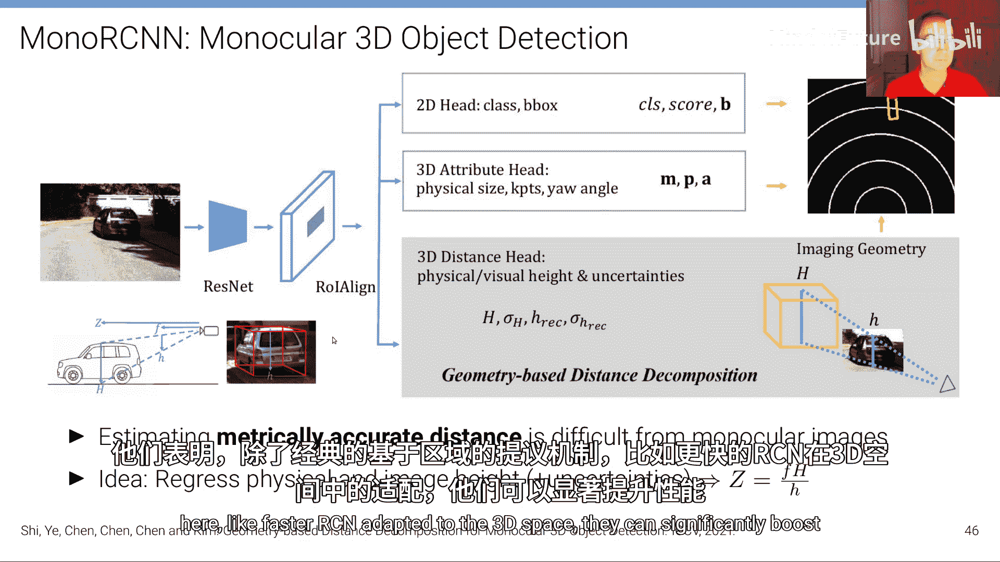
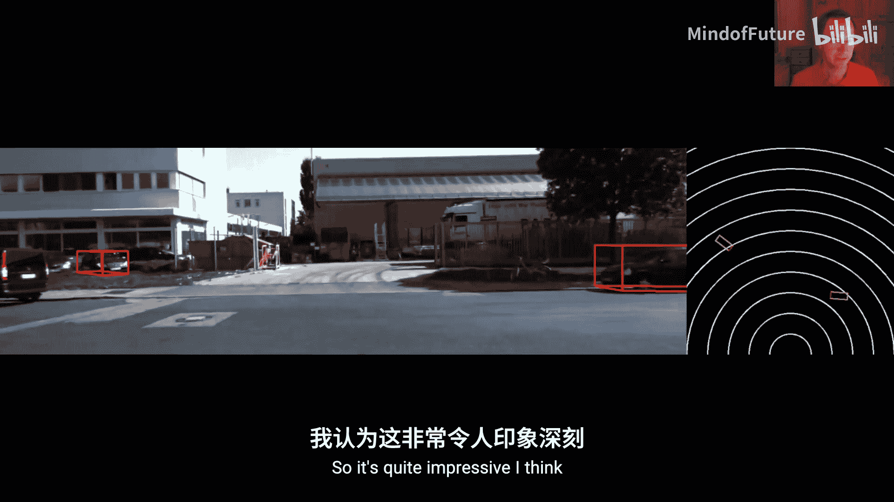
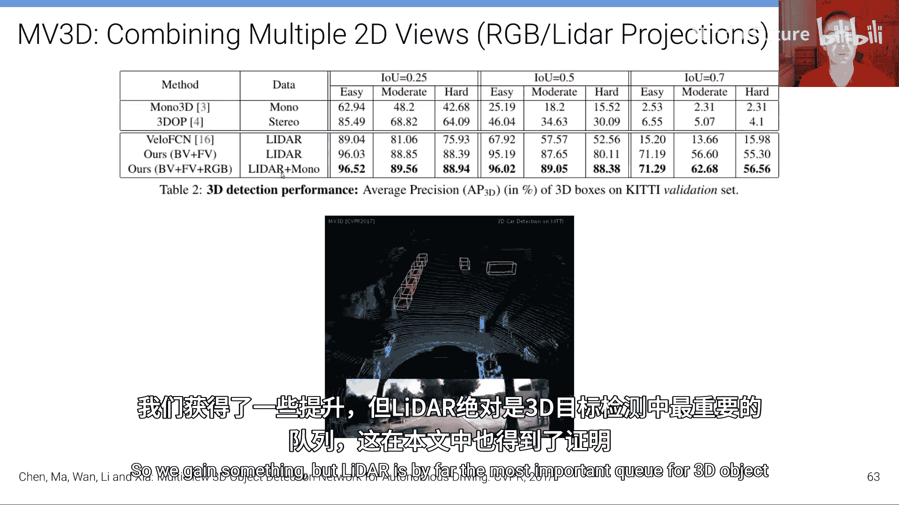
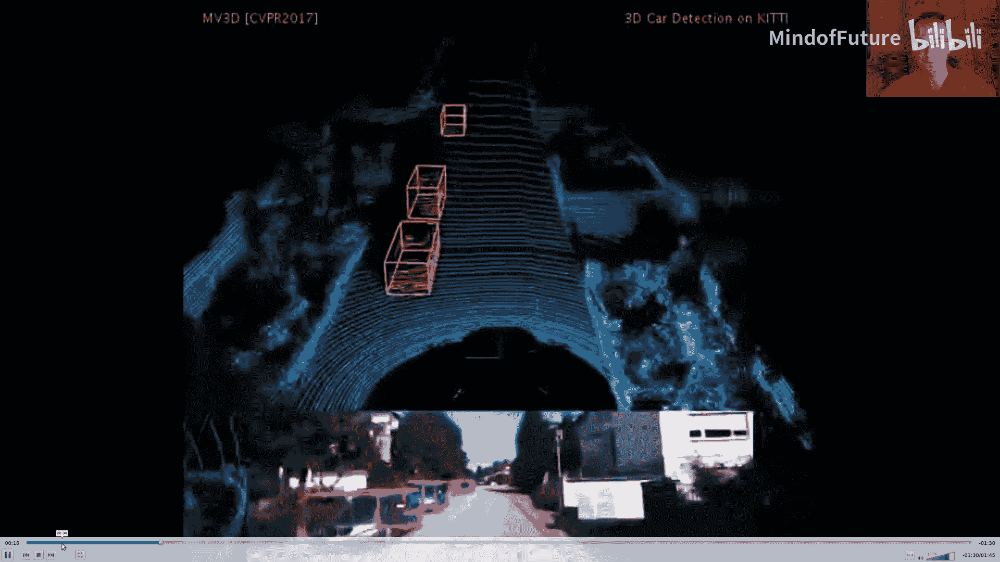
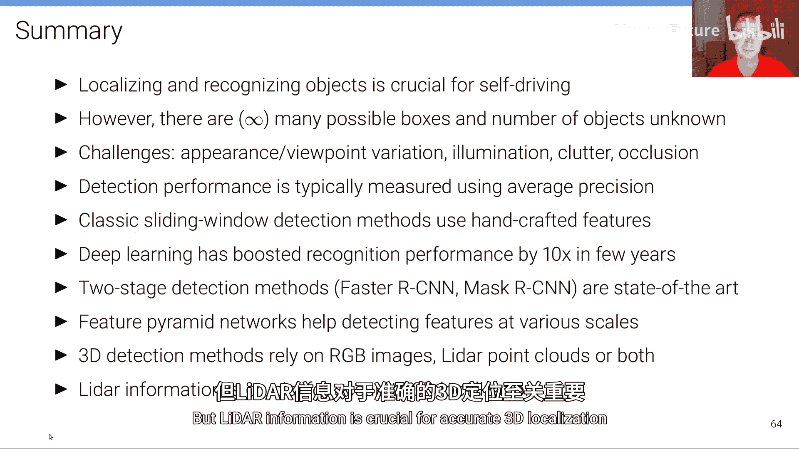

# 040：3D目标检测 🚗

在本节课中，我们将要学习3D目标检测。我们之前讨论了2D目标检测技术，但现实世界是三维的。因此，对于自动驾驶汽车来说，在三维空间中感知环境并检测物体至关重要。这引出了我们将在本单元讨论的3D目标检测。

## 概述

3D目标检测的目标是为场景中每一个感兴趣的物体预测一个三维边界框。例如，右侧的橙色3D框是预测结果，而绿色框表示该特定物体的真实标注。

3D目标检测算法的性能评估方式与2D情况类似，通过定义一个3D交并比（IoU）度量，并基于该3D IoU计算平均精度。这里的交集计算不再是针对2D情况下的2D框面积，而是针对这两个立方体的3D体积（图中黄色高亮部分）。

## 2D与3D检测的参数化对比

首先，我们来看看2D和3D目标检测的不同参数化方式。

在2D情况下，目标是找到一个2D框，可以用图像域中的X、Y位置以及框的宽度和高度来参数化。

在3D情况下，位置是一个三维坐标（X, Y, Z）。3D框有宽度、高度和长度参数。此外，还有三个旋转参数：**翻滚角（Roll）、俯仰角（Pitch）和偏航角（Yaw）**。因此，在一般的3D目标检测中，我们需要估计九个参数。

然而，在考虑自动驾驶时，一个常见的假设是物体（车辆）在道路平面上行驶。因此，我们可以假设翻滚角和俯仰角为零，从而移除这两个参数，只估计偏航角。这样就将估计问题简化为一个七维的估计问题。

尽管如此，3D检测仍然困难得多，参数更多，问题也更复杂，出错的几率也更高。此外，难度还取决于输入数据。例如，仅从2D图像（即投影到图像域）回归3D框，比从激光雷达（LiDAR）3D点云进行检测要困难得多。

## 单目图像3D检测的挑战

这一点在此处也有说明。图像中的一个2D框（例如这里的红色框）对应于三维空间中的一个视锥体。物体可以位于该视锥体内的任何位置。一般来说，图像中可见的物体可以位于相机视锥体内的任何地方。这意味着不同尺度和距离的物体可能看起来完全相同。

例如，观察这只兔子。如果一只兔子距离很近，它看起来很小。如果我现在增大兔子的尺寸并将其放在更远的地方，它会投影到完全相同的像素值、完全相同的图像上，因此这里存在尺度模糊性。

幸运的是，在自动驾驶的情况下，我们可以通过机器学习来学习解决这个问题。因为汽车通常有典型的尺寸（例如长度在4到6米之间）。通过了解物理世界中汽车的典型尺寸，我们仍然可以通过观察汽车2D投影的大小来获取关于其距离的线索。

尽管如此，难度仍然取决于输入模态。迄今为止最困难的任务是从单目图像回归3D框，因为这需要非常好的物体尺寸先验知识，尤其是在远距离时，仅从单目RGB图像预测3D框的位置非常困难。

如果我们有两张图像（立体相机），这当然有助于在3D空间中定位框。但根据三维重建课程的内容，误差会随距离呈二次方增长。因此，它仍然不如我们拥有来自雷达或激光雷达扫描仪的3D点云那样精确。

## 不同传感器模态的优劣

与图像传感器相比，激光雷达传感器虽然稀疏，但在远距离也能提供良好的3D精度，因此定位变得容易得多。然而，由于其稀疏性，它们的分辨率较低，因此检测像行人这样的小物体可能更困难。我们稍后会看到这一点。

这就是为什么一些方法也尝试结合两种模态，因为它们提供了互补的线索和信息。它们试图结合图像和激光雷达数据。

现在，让我们逐一查看这些类别中的例子。我们将从基于图像的3D目标检测类别开始，这是最困难的。

## 基于图像的3D目标检测方法

为了从单个图像预测度量3D边界框。

我想展示的第一个方法名为《Monocular 3D Object Detection for Autonomous Driving》（CVPR 2016）。这里的想法是在地平面采样候选3D框，并移除所有非道路区域的3D框。

该方法参考输入图像的语义分割结果，并假设相机处于一定高度和倾斜角（可能已预先校准）。因此，我们有一个可以假设的虚拟地平面。然后，我们将这个语义分割投影到该地平面上（如图所示）。我们忽略道路区域，并采样典型尺寸的3D汽车框。因此，我们构建了一个具有典型3D汽车尺寸的3D汽车模型，并在这些灰色区域采样这些汽车。

现在，我们在3D空间中有了位于合理3D位置且具有合理3D尺寸的汽车采样，但这只是大量的3D框提议。为了提取特征，我们将它们投影到图像平面。在这项早期工作中，使用了一种基于特征的评分机制，这些特征包括语义类别信息、语义实例信息、轮廓、形状和上下文。

这些是简单的特征，考虑了形状和上下文信息，以及关于车辆典型位置的非常通用的先验。如果你有一个大数据集，当然可以生成像这里鸟瞰图和图像中车辆通常出现位置的热力图。基于这些特征，他们对这些假设进行重新排序。然后，对于排名靠前的假设，他们使用快速的R-CNN在2D图像域进行最终评分和细化，以保留最有可能的3D提议。

这基本上是一种首先在3D空间采样，并通过该采样过程自动将汽车的位置和尺寸约束在合理范围内，但随后在2D图像空间进行分类和检测的技术。

## 更先进的单目3D检测技术

一个更近期的技术名为《Geometric-based Distance Decomposition for Monocular 3D Object Detection》（ICCV 2021）。这里的想法是改进单目3D目标检测中最困难的部分——定位。主要问题是回归深度真的非常困难。

因此，他们观察到物体距离、物体的实际3D高度以及2D边界框在图像域中的高度之间存在关系。他们所做的是同时回归物理高度（H）和图像高度（h），以及它们的不确定性。然后以最优方式融合这些信息，以产生更好的深度估计。

他们表明，除了这里经典的基于区域的提议机制（如适应3D空间的Faster R-CNN）外，他们可以通过这种方式显著提升性能。

以下是该技术的一些结果。请记住，所有这些都是仅从单目RGB图像（即左侧看到的图像）计算出来的。我认为这相当令人印象深刻。

## 从深度图生成伪点云

另一个想法是使用单目图像或立体图像对，首先使用立体匹配算法（如果是单目图像则使用单目深度网络，如MonoDepth）预测深度图。然后将该深度图反投影成3D点云，作者称之为伪激光雷达点云。因为这样你就可以将标准的基于点的激光雷达3D检测算法直接应用于这个伪激光雷达点云。

这篇名为《Pseudo-LiDAR from Visual Depth》的论文声称，这种方法的性能可以与基于激光雷达的检测器竞争。这篇论文在社区引起了很大轰动，因为人们普遍认为从单目图像进行3D检测比基于激光雷达的检测困难得多，因此这对许多人来说确实令人惊讶。

但最近，围绕这个话题有了一些讨论，因为这种方法实际上并没有融入太多先验知识，这里没有魔法发生。那么，为什么通过深度图的方法会比直接从图像回归3D框效果好得多呢？最近发现，其中一些改进实际上是通过评估中的一些技巧获得的，并不对应于实际的性能提升。如果你对这个讨论感兴趣，我很乐意推荐你阅读Simon等人发表在ISV 2021上的这篇论文。

但这是另一个例子，说明如何利用单目或立体图像首先计算3D点云，然后在该3D点云上应用3D目标检测算法。

## 基于激光雷达的3D目标检测

这直接将我们带到了基于激光雷达的3D目标检测，其输入是这种伪激光雷达点云或来自激光雷达扫描的真实激光雷达点云。

然而，与从图像学习相比，使用点云学习带来了一些独特的挑战，我们知道如何使用2D卷积来处理图像域。

第一个挑战是学习模型必须适应任意大小的点云。如果我下采样点云，如果我移除每隔一个点，我仍然希望得到相似的结果、相似的答案。当然，不同的激光雷达点云具有不同数量的点。首先，我的算法必须能够处理这一点。例如，多层感知机（MLP）就不行，它假设一个固定维度的输入向量。所以这不是一个可行的模型。

第二个挑战是学习模型需要对所有n!种排列保持不变性，如图所示。如果我们有这个点云，它基本上是一个集合。如果我们有这个集合作为输入，那么它代表与这个相同的集合，它不依赖于每个点在我的模型输入空间的输入表示中具有哪个索引。因此，我们构建的模型需要以完全相同的方式处理这两者。

例如，最大池化（max）算子是一个对排列不变的函数，平均或加法算子也是不变的。但当然，仅此还不够，它不是一个神经网络，我们不能仅凭此学习任何参数。

最后，学习模型还应该对点云的旋转保持不变性，因为无论我如何定向它，物体总是相同的，所以我们也应该考虑到这一点。

## PointNet：点云深度学习的奠基工作

这正是从一篇名为《PointNet》的论文开始的一切，它尝试将深度神经网络应用于点云，完成三个任务：分类、部件分割和语义分割。在分类中，目标是预测整个点云的类别标签；在语义分割中，我们想预测点云中每个点的语义类别标签。这并不直接是3D检测问题，但它是许多基于激光雷达点云的3D检测模型的基础，这就是为什么首先理解它很重要。

那么，PointNet是如何工作的？这是PointNet的架构。PointNet对每个点应用一个多层感知机（这些是这里的小方框）。它们共享参数，但独立应用于每个点。因此，它们获取单个三维点并将其投影到64维特征空间，并且对每个点独立进行此操作。但该模型的参数是共享的。

在这里，在算法的第二阶段，它们获取该点的65维特征向量，并再次将其转换为1024维特征向量，同样是独立于每个点。之后，PointNet应用一个最大池化操作，这就是排列不变性发挥作用的地方，以获得相同维度（1024）的全局特征向量。然后是一个最终的全局MLP来进行分类，或者获取这些全局特征（这是针对分类任务）。但如果你想进行语义分割，你可以获取这些全局特征，并将它们与一些每点的局部特征连接起来，然后通过更多的PointNet层来预测每个点的输出分数。

此外，这里还有输入变换和特征变换块。在这些块内部，再次使用了被称为T-Net的小型PointNet。这些T-Net就像是这里整个蓝色块的复制品，但更小更浅。它们预测一个变换，在这个例子中是一个3x3变换，在另一个例子中是一个64x64变换，因此它们预测一个仿射变换，该变换再次独立应用于每个点。这有助于学习这些几何不变性，例如旋转不变性。

这是一个有趣的模型，值得稍作思考。为什么它实际上有效？尽管我们在这里独立地对每个点进行一些处理步骤，同时共享网络的特征，将这些点连续投影到更高维的特征空间，然后应用这个最大池化操作来产生全局特征，再通过MLP投影到类别标签，但端到端训练这个模型效果相当好。

PointNet的一个缺点是它不捕获局部结构，并且依赖于全局坐标。这里的每个点都是全局点坐标。

## PointNet++：引入层次化结构

来自同一团队的一个后续创新是PointNet++，它递归地应用PointNet，如图所示，对点集进行嵌套分区。例如，这个点有一个由虚线指示的感受野，而这个点有一个由虚线指示的感受野。因此，它连续聚合来自嵌套分区的更强特征，并学习具有不断增加上下文尺度的特征。你可以将其视为一个多尺度的PointNet。与PointNet类似，它有一个用于语义分割的解码器或用于分类的MLP。

现在，这是关于物体或点云分类和语义分割的。我们如何将其用于3D检测呢？

## PointRCNN：点云上的Faster R-CNN

我想在这个背景下展示的一个方法叫做PointRCNN（《3D Object Proposal Generation and Detection from Point Cloud》）。我称之为点云上的Faster R-CNN，因为它基本上做的与Faster R-CNN完全相同，但是针对点云。它有一个蓝色的提议阶段，生成一组3D框提议，理想情况下是过完备的。然后它有一个3D框细化阶段，预测3D框偏移量以及置信度，以产生最终的3D检测。

现在让我们分别来看这两个阶段。这是第一阶段，顶部部分。我们这里有什么？首先，这里有一个主干网络，即点云编码器和点云解码器，它使用标准的PointNet++来学习有区分度的逐点特征。所以这只是一个给我们提供每点特征的PointNet++。

然后我们有一个3D框提议回归模块，类似于Faster R-CNN及其两阶段中的第一阶段，但用于点云。还有另一个模块预测前景与背景。他们使用的是回归和分类加回归损失的组合。通过分类加回归，我的意思是，例如，对于鸟瞰图中的空间坐标，他们为每个点定义一个局部坐标系，然后离散化该局部坐标空间。首先对物体的位置进行分类（判断它应该在哪个区间内），然后进行额外的回归（确定在该区间内的确切位置）。这是一个常见的技巧，当直接回归效果不好时（因为我们必须处理多模态分布等），可以使用这个技巧。他们就是这么做的，他们称之为基于区间的损失。

好的，所以他们进行这个3D框提议回归，然后将前100个最自信的提议传递给下一个框细化阶段，如图所示。你可以看到它以点坐标、语义特征、前景掩码和提议的3D感兴趣区域作为输入。

然后，在第一阶段，它基于3D框提议汇集所有3D点特征，简单地聚合任何这些3D提议框（如这里的橙色框）内的所有特征。这产生了一组语义特征和局部空间点。

在第二阶段，这些局部空间点坐标被转换成一个相对于该橙色框的局部3D框相对坐标表示，使它们处于规范坐标系中，然后与语义特征合并，并作为输入馈送到点云编码器，该编码器随后通过预测残差（类似于Faster R-CNN的第二阶段）进行3D框细化，并且再次使用回归和分类加回归损失的组合。这给出了最终的3D框作为输出。

以下是该方法的一些结果，你可以看到它能够很好地检测3D物体。当然，它仅使用点云作为输入。这里是在KITTI数据集上评估的，图像是可用的，因此我们也可以将3D框投影到图像中，但图像并未用作模型的输入。

从这个底部的表格中可以看到一个有趣的观察结果，其中显示了不同IoU阈值下的平均精度数值。这个PointRCNN方法通常优于多模态方法。这里有一些结合RGB和激光雷达的方法，而这种方法比那些先前的方法更好。除了行人，因为行人很小。所以对于行人，有时很难在激光雷达点云中检测到它们，因为落在这些物体上的点太少了。因此，如果你有图像信息，那可能会有所帮助。

但总的来说，激光雷达是迄今为止最重要的输入模态。除了非常小的物体，添加图像信息几乎没有什么增益，至少在你拥有昂贵的HDL-64线激光雷达的情况下。

## 体素化与鸟瞰图表示

除了我刚才展示的PointNet模型之外，另一种方法是将点编码为体素表示，然后使用3D卷积。这是在论文《VoxelNet: End-to-End Learning for Point Cloud Based 3D Object Detection》中采用的方法，该论文在CVPR 2018上也受到了相当多的关注，因为它是苹果团队为数不多的论文之一。苹果公司通常不以发表大量成果而闻名，但这是他们发表的一篇论文，显然出自他们的自动驾驶项目。

他们所做的基本上是首先将输入空间划分为一组体素，然后将落入这些体素的点转换为这些体素的特征，然后在该体素空间上应用3D卷积。然后他们有一个基本上基于这些特征的单阶段检测器。他们在这里说这是一个区域提议网络，但实际上区域提议网络直接提议3D框输出，所以它不是一个两阶段检测器，而是一个单阶段检测器。当然，这需要大量的内存和计算，因为你必须在一个大的3D体积中工作。

另一个想法是使用2D鸟瞰图表示，这更加内存和计算高效，例如在名为《PIXOR》和《HDNet》的工作中采用。这个想法是表示激光雷达信息，可能还包括可以用作辅助信息以帮助目标检测的道路图，正如HDNet所示。因此，地图可以提供强大的先验，可以提升3D检测性能。

对于激光雷达，实现这一点的方法是将Z维度视为特征通道，将Z坐标离散化为不同的区间，并将这些用作特征通道。因为这样你就可以使用高效的2D卷积，而不是应用3D卷积。是的，例如在HDNet中就是这样做的，利用高清地图进行3D目标检测。但也有研究表明，如果你用地图（例如高清地图）来补充这个激光雷达点云，并且你已在该地图中定位了自己，那么这个地图先验可以帮助你移除3D检测器中不合理的或无效的3D检测，从而获得更好的性能。

## 多模态融合的3D目标检测

现在，在本单元的最后部分，我想展示一些在多模态融合或多模态3D目标检测领域的工作。

第一个工作名为《Frustum PointNets for 3D Object Detection from RGB-D Data》（CVPR 2018）。这里的想法是首先在RGB图像中生成2D物体提议。

他们所做的是获取激光雷达扫描，将激光雷达点投影到图像域（如顶部所示，颜色编码表示深度）。然后，你可以将这个激光雷达图像投影与RGB图像结合，并使用标准的2D CNN（如Faster R-CNN）来获得2D物体提议。

然后，他们计算对应于提议2D边界框的物体视锥体（如图所示），并考虑位于该视锥体内的所有3D点，从这些点预测一个3D边界框。

因此，它在第一个物体提议检测步骤中进行了一些融合。当然，它也使用RGB颜色为点云着色。但这实际上是一个两阶段机制，第一阶段在图像域生成提议，然后在3D域使用PointNet验证这些提议。

这里有更多细节。3D框预测问题分为三个阶段。在第一阶段（此处红色高亮），该方法将RGB点云分割为物体和背景，基本上试图提取物体并移除杂波（如图所示，这是输入，这是输出）。然后在第二阶段，平移点云，使点云的质心与3D框中心对齐，因为如果你在这个规范空间中学习，那么学习3D检测当然更容易。所以我们尝试端到端地联合学习这种对齐。然后在最后的第三步，进行3D边界框回归，我们回归X, Y, Z, 宽度、高度、长度以及偏航角，以产生最终的3D边界框。

另一个多模态融合的例子是《MV3D: Multi-View 3D Object Detection Network for Autonomous Driving》。同样，这是一个基于流行的两阶段目标检测框架的工作，我们在最后有一个3D提议网络和一个基于区域的融合网络。

在第一步中，该方法从激光雷达鸟瞰图生成3D提议。因此，我们在这个提议生成步骤中生成一组3D提议。然后将它们投影到激光雷达鸟瞰图、激光雷达前视图（这基本上是一个对应于RGB图像的图像，但域对应于RGB图像。我们在这里看到的是投影到该图像域的激光雷达点，这被称为激光雷达前视图）。我们还将这个3D提议投影到RGB图像中。

当然，这三种不同的输入模态中的每一种都有一个卷积网络来提取特征。然后我们可以应用RoI池化（就像在Faster R-CNN中一样）来提取这些投影区域中的特征。然后我们使用这个融合机制融合来自所有模态的RoI池化特征。该机制在分支之间进行拆分、在每个分支上进行一些计算，然后对这些模态进行平均池化之间进行迭代。所以我们有这个特定的融合机制，最后我们有一个输出头，用于重新分类和框残差回归。所以，这又是一个经典的提议加细化的两阶段流程。

这里我们可以看到一些结果，同样从这个表格中我们可以看到，如果我们将单目图像线索添加到激光雷达线索中，我们会有所收获，但并不像我们希望的那么显著。例如，在交并比阈值为0.5（这是一个标准阈值）时，我们在这里可能获得0.8个百分点，在这里获得1.5个百分点。所以我们确实有所收获，但激光雷达是迄今为止3D目标检测最重要的线索，正如这篇论文也发现的那样。

以下是一些结果。不幸的是，质量不是很好。但我想你明白了要点。

## 总结

本节课到此结束。让我总结一下。

在本节课中，我们看到，对于自动驾驶来说，定位和识别物体至关重要。然而，如果我们考虑连续值，那么可能的框有很多，甚至有无穷多个。而且，物体的数量是未知的，这使得这个问题变得困难。此外，我们还必须处理外观和视角变化、光照变化、杂波、遮挡以及所有其他挑战。

我们还看到，检测性能通常使用我们称之为平均精度的指标来衡量。经典的滑动窗口检测方法使用手工制作的特征，这些特征不是最优的。

我们已经看到，深度学习在短短几年内将识别性能提升了10倍。两阶段检测方法，如Faster R-CNN和Mask R-CNN，或其3D变体，如今占据主导地位。

我们还看到，特征金字塔网络有助于检测各种尺度的特征。

最后，在本单元中，我们讨论了3D检测方法要么依赖于RGB图像，要么依赖于激光雷达点云，或者两者兼用。但激光雷达信息对于精确的3D定位至关重要。