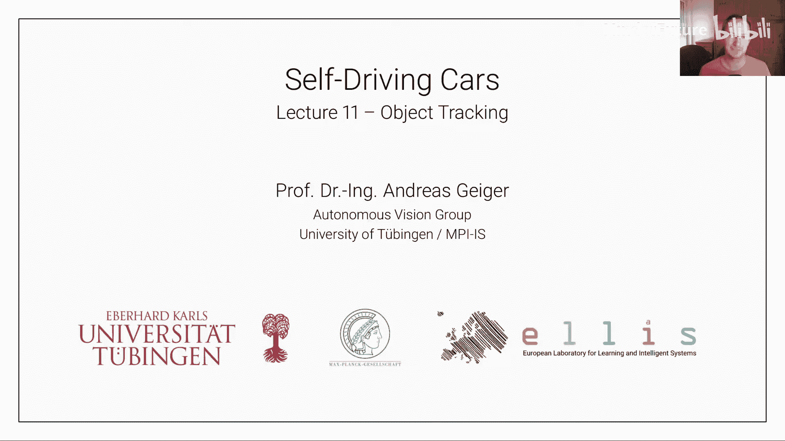
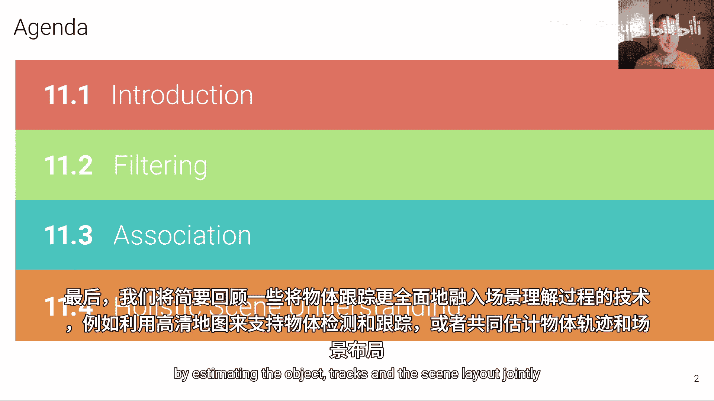
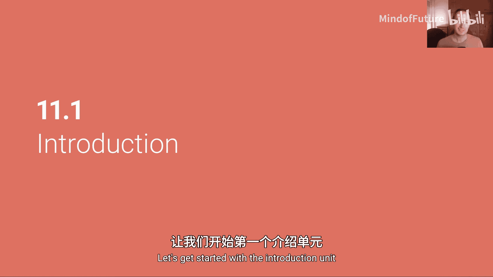
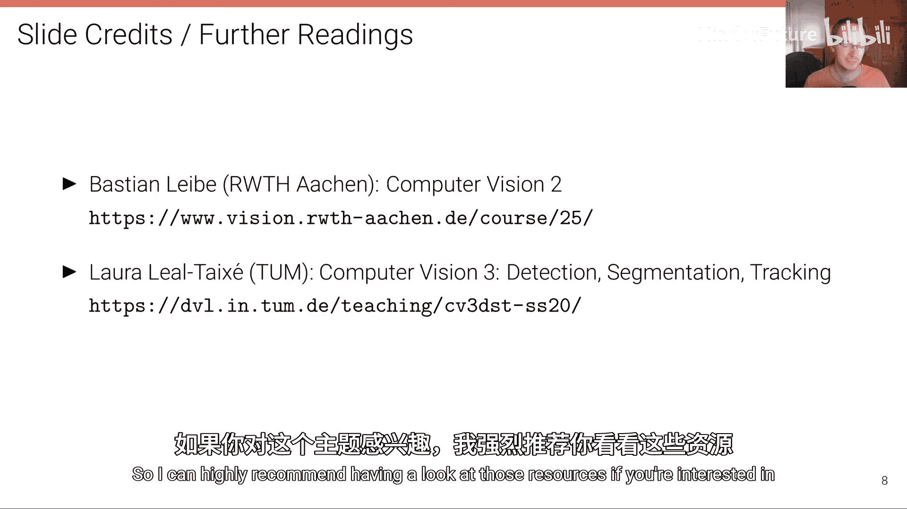

# 041：目标跟踪 - 引言 🚗

在本节课中，我们将要学习目标跟踪。目标跟踪是自动驾驶系统中的关键环节，它负责将不同时刻检测到的物体关联起来，并估计其状态，从而理解物体的运动轨迹和意图。

在上一单元中，我们学习了多种用于目标检测的算法，包括在二维图像空间和三维空间中的检测。然而，仅仅在每一帧中独立地检测物体，并不足以理解物体正在做什么以及它们将去向何方。因此，我们还需要将这些检测结果在时间上进行关联，这就是目标跟踪的任务：估计物体随时间变化的状态，并将新帧中的新观测结果与已有的物体轨迹关联起来。

本节课的结构分为四个单元。在第一单元中，我们将更精确地介绍跟踪问题，并了解其基本要素。在第二单元中，我们将讨论滤波，这本质上是给定物体随时间变化的多个观测值进行状态估计。我们可以获得比检测器给出的位置更精确的物体状态估计。我们将利用观测模型和运动模型来找到更精确的状态，这被称为滤波。在此背景下，我们将特别讨论所谓的贝叶斯滤波器，这是一个非常通用的框架。在第三单元中，我们将转向关联问题：如何将当前帧中的检测结果与之前帧中已有的物体轨迹关联起来？最后，我们将简要概述将目标跟踪更全面地整合到场景理解过程中的技术，例如利用高清地图来辅助和支持目标检测与跟踪，或者联合估计物体轨迹和场景布局。

现在，让我们从第一单元开始。

## 什么是跟踪？🎯

跟踪的目标是：给定有噪声的物体检测结果（例如，以2D或3D边界框表示），对于序列的每一帧，我们希望将属于同一物理物体的检测结果关联起来。此外，我们希望剔除那些误报的检测结果。物体检测器会犯错，会产生误报。我们当然不希望将这些误报整合到我们的物体轨迹中。因此，我们需要一种机制来剔除它们。同样，我们需要有启动和删除物体轨迹的可能性。当我们观察图像或视频序列时，可能会有物体因为从其他物体后面或图像边界进入场景而出现，也可能会有物体因为不再可见而消失。因此，我们需要一种机制来启动和删除物体轨迹。正如已经提到的，我们还需要估计物体状态。物体检测只是一个有噪声的观测，而我们感兴趣的是真实的物体状态。那么，我们如何通过考虑观测模型或运动模型，并利用例如贝叶斯滤波器将这种先验知识整合到估计过程中，从而更精确地估计物体状态呢？

下图展示了两个目标跟踪结果的示例视频。左侧是一个带有静态摄像头的行人场景，你可以看到物体周围被平滑跟踪的边界框。你还可以看到，在某些情况下，一个物体出现在观测区域，轨迹启动；然后一些行人移出该区域，物体轨迹被删除。这些视频来自最早和最流行的评估目标跟踪器的基准测试之一，称为PETS。右侧是另一个非常不同的应用示例：在蜂巢中跟踪蜜蜂。

## 跟踪的要素 🧩

跟踪包含两个或三个要素，这取决于你是否将检测视为跟踪的一部分。在这里，我们将采用“基于检测的跟踪”范式，即检测是跟踪问题的一个组成部分。因此，我们有三个问题：检测、关联和滤波。

检测问题我们已经在上一讲中讨论过。这里要回答的问题是：每一帧中候选物体的位置在哪里？与之前不同的是，我们现在考虑的不是单张图像，而是传感器记录的连续视频或3D点云序列。因此，我们在该序列的每一帧上运行物体检测器。如果是视频，就在视频的每一帧上运行物体检测器。存在不同类型的跟踪算法，例如，有些算法在第一帧中手动选择一个物体周围的框作为任务，然后跟踪器的任务是在视频序列中尽可能长时间地跟踪该物体。这不是我们在这里考虑的范式。我们在这里考虑的是在每一帧运行物体检测器，然后必须估计状态并将这些检测结果在时间上关联起来的设置。这可以说是自动驾驶场景中最主要、最重要的目标跟踪或多目标跟踪范式，被称为“基于检测的跟踪”。

我们必须解决的第二个问题，即跟踪的第二个要素，是关联问题。这里我们要问的问题是：哪个检测结果对应哪个物体？例如，这里我们将一个物体预测到未来一帧，红色表示预测结果，我们有两个观测值。现在我们需要弄清楚这些观测值中哪一个是同一个物体，以便将该检测结果与该物体轨迹关联起来，并继续估计该物体的状态。

最后，我们还有滤波问题。问题是：什么是最可能的物体状态？例如，物体的位置或大小，这取决于状态的定义或用户感兴趣的内容。通常，我们感兴趣的是位置，可能还有边界框的大小。请记住，检测结果是有噪声的，检测器是有噪声的。因此，我们在这里试图通过利用我们对同一物体有多个观测值这一事实来最小化这种噪声。与上一讲只考虑单帧物体检测不同，那时每个物体只有一个观测值；但现在我们处理的是跟踪问题，我们在多帧中观测物体，我们可以利用这一点来改进对物体状态（例如物体位置）的估计。我们通过整合一些先验知识、一些假设、一些归纳偏置来实现这一点，例如利用概率观测模型和运动模型。例如，我们可以假设该物体以恒定速度运动。我们可以使用将要学习的贝叶斯滤波器来整合这一点。

以下是一个示例。X轴是时间，Y轴是物体位置（我们称之为状态），这里是一个一维示例。红色曲线是物体随时间移动的真实状态，但我们不知道这个，这是我们想要估计的。我们唯一有的是这里用这些小轴表示的有噪声测量值。如果我们只是对这些测量值进行插值，我们会得到这条虚线所示的锯齿状有噪声曲线。现在我们可以做的是，整合关于物体运动的假设，例如恒定速度。这样，我们可以过滤掉噪声，在这种情况下得到绿色的状态估计。它并不完美，也不完全是真实状态，但比单独的有噪声测量值要好。这就是滤波背后的核心思想。

## 在线跟踪与离线跟踪 ⏱️

跟踪有两种不同类型。第一种称为在线跟踪，第二种称为离线跟踪。

它们的区别是什么？在线跟踪中，我们根据当前和过去的观测值来估计当前状态。这里我用绿色表示当前观测值或当前状态，用红色表示过去的状态或观测值。我们基于过去的观测值和当前的观测值来估计当前状态，这就是“在线”的含义，因为我们可以为当前帧执行此操作，我们不需要知道未来就能处理当前帧。相反，离线跟踪器根据所有观测值来估计所有状态，因此我们需要知道整个序列，需要知道所有帧的所有观测值。这也是为什么有些人称之为批处理模式跟踪，我们需要知道整个批次，序列就是批次。当然，使用这种离线跟踪算法，通常实时性要求也低于在线跟踪。在线跟踪中，你希望实时知道结果，因为你想实时做出决策；但在离线跟踪中，你可以离线运行并提供离线结果，因为没有实时性要求。因此，离线跟踪器因为可以“看到”未来，并且没有时间限制，通常可以提供更好的结果。当然，在自动驾驶中，这是不可能的，所以在本节课中，我们将主要关注在线跟踪。

## 延伸学习资源 📚

如果你对目标跟踪更感兴趣，我想提两个很好的资源，我在制作这些幻灯片时也部分使用了它们，因此也在此致谢。第一个是来自亚琛工业大学的Bastian Leibe教授的课程“计算机视觉2”，你可以在这里找到公开的幻灯片链接。第二个是来自慕尼黑工业大学的Laura Leal-Taixé教授的课程“计算机视觉：检测、分割和跟踪”，她在线提供了幻灯片和视频讲座。如果你对这个主题感兴趣，我强烈推荐你查看这些资源。

本节课中，我们一起学习了目标跟踪的基本概念、核心要素（检测、关联、滤波）以及在线与离线跟踪的区别。我们了解到，跟踪对于理解动态场景至关重要，它通过整合多帧信息来提供更稳定、更准确的物体状态估计，是自动驾驶感知系统的关键组成部分。