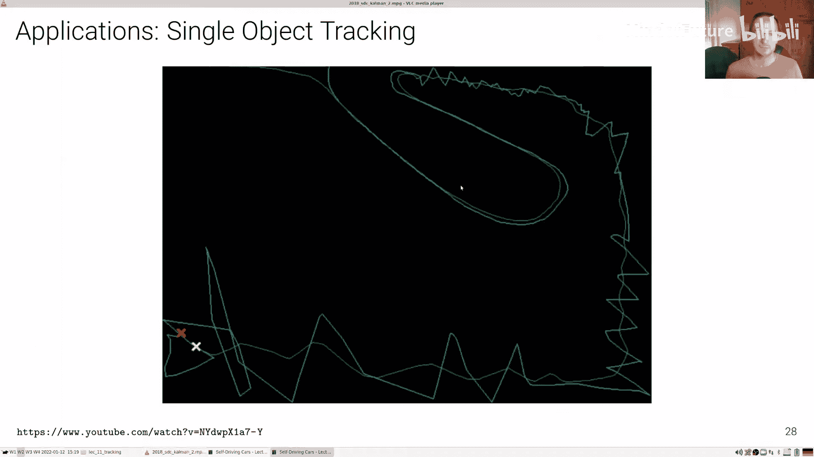
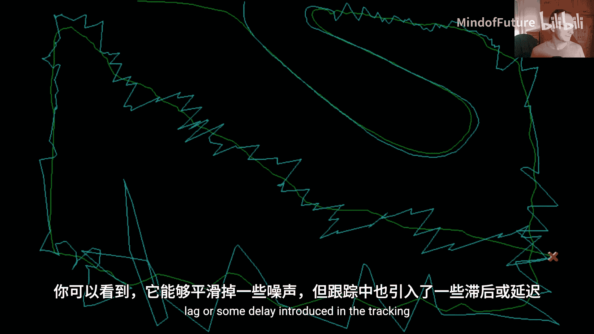
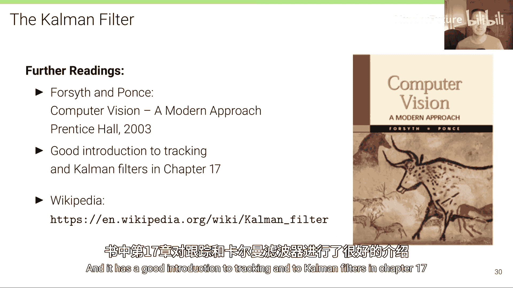

# 042：目标跟踪 - 滤波

在本节课中，我们将要学习目标跟踪中的核心问题——滤波或状态估计。我们将从理解状态与观测的区别开始，逐步推导出递归贝叶斯估计（贝叶斯滤波）的通用框架，并了解其最著名的特例——卡尔曼滤波。我们将学习如何通过预测和校正两个步骤，利用带噪声的观测来估计我们感兴趣的、可能无法直接观测的系统状态。

## 状态与观测

在开始滤波问题之前，我们首先需要更好地理解状态与观测之间的区别。

**隐藏状态**是我们感兴趣的参数，例如，物体在2D或3D空间中的位置或速度，或者人体关节的角度等。

**观测**则相反，它是我们能够直接观察到的东西，也就是测量值。

现在，隐藏状态和观测不一定相同。首先，观测通常是真实状态的一个带噪声版本，因为我们的传感器存在噪声。我们无法精确估计位置，物体检测器的结果是带噪声的，我们必须接受这一点。

此外，并非状态的所有方面都能被直接观测到。状态可能只能被部分观测。例如，我们可能对跟踪球的**速度**感兴趣，但我们只能观测到球的**位置**。

这就是为什么我们想要随时间跟踪的隐藏状态，在大多数情况下，与观测并不相同。当然，这也是我们需要滤波和状态估计的原因。

## 单目标跟踪问题建模

现在，让我们假设我们只有一个想要跟踪的单个目标。这也是我们在整个单元中都会做的假设。

感兴趣的运动物体由一个底层状态 **X** 来表征。这里的 **x**（粗体）表示一个向量，即状态向量。状态 **X** 会产生测量值或观测值，我们称之为 **Y**。因此，对于每个状态，我们都有一个对应的测量向量 **y**。

在每个时间 **t**，状态从 **x_{t-1}** 变为 **x_t**。同时，我们在该时间接收到一个新的观测，称为 **y_t**。换句话说，我们只是使用时间索引 **t** 来索引时间维度。

现在，给定一个观测序列 **Y**（我们在这里用大写字母 **Y** 来总结），我们的目标是恢复状态序列 **X**（用大写字母 **X** 总结）。所以，**Y** 是所有时间实例（所有帧）的观测集合，而 **X** 是所有帧的状态集合。

在下方，你可以看到这个过程的图模型，我们将在几页幻灯片后详细讨论。但你已经可以看到，这对应着我们想要解决的问题：我们有一个隐藏的状态序列（用未填充的圆圈表示，这些是我们想要估计且未知的变量）。例如，时间 **t** 的状态通过某个运动模型依赖于时间 **t-1** 的状态。而我们观察到的测量值（这个用灰色高亮的节点）则依赖于对应时间实例的状态。因此，时间 **t** 的测量依赖于时间 **t** 的状态，时间 **t-1** 的测量依赖于时间 **t-1** 的状态，而时间 **t** 的状态又依赖于时间 **t-1** 的状态，如此在时间上前后延续。

现在，这反映在我们已经见过的简单例子中。在这种情况下，测量值将对应虚线（我们称之为 **Y**），而估计状态将对应绿线。

## 概率论回顾

在跟踪中，我们处理的是不确定性，即状态和检测中的不确定性。因此，我们通常追求的是概率估计，而不是点估计。我们想要随时间跟踪**分布**，例如，物体位置随时间的分布。

这就是为什么我们现在要做一个简短的概率论回顾，以便快速重温概率知识，并为我们将在本单元中考虑的、严重依赖贝叶斯公式的所谓**贝叶斯滤波**通用框架做准备。

以下是回顾内容。

在概率论中，我们考虑随机变量。例如，从标签集中取值的离散随机变量。在这种情况下，**x** 取值为 **c** 的概率记为 **P(x = c)**。

我们还有连续随机变量。在跟踪中，最常考虑的是连续状态空间（并非总是如此，也存在这些滤波器的离散版本，但在本单元中我们主要考虑连续变量，所以这与我们相关）。**x** 在其定义域的一个子集 **A** 中取值的概率记为 **P(x ∈ A)**。

随机变量上的分布我们写作 **P(x)**，两个随机变量的联合分布我们记为 **P(x, y)**，这基本上是 **P(x = c, y = d)** 等的简写。

概率论有两个基本性质或公理：第一个称为求和规则或边缘化规则，第二个称为乘积规则。

**边缘化/求和规则**告诉我们，**P(x)** 等于对 **y** 的所有状态求和后的联合分布 **P(x, y)**。或者等价地，对于连续情况，**P(x)** 等于 **P(x, y)** 对 **y** 的积分。

**乘积规则**简单地告诉我们，联合分布 **P(x, y)** 等于条件分布 **P(x|y)** 乘以 **P(y)**。

基于乘积规则 **P(x, y) = P(x|y)P(y)**，我们有以下关系。首先，我们有 **P(x, y) = P(x|y)P(y)**。当然，我们也可以颠倒这个概率分布中两个随机变量的顺序，这不会改变任何东西。但这意味着我们也可以用 **P(y|x)**（给定 **x** 时 **y** 的条件分布）乘以 **P(x)** 来表示这个乘积。注意，这里我们有 **x|y**，而这里有 **y|x**。

如果我们现在求解中间这个表达式，即解出 **P(x|y)**，换句话说，如果我们把 **P(y)** 放到等式另一边的分母上，我们就得到了著名的**贝叶斯规则**：后验概率 **P(x|y)** 等于似然 **P(y|x)** 乘以先验 **P(x)**，再除以 **P(y)**。

类似地，我们可以考虑三个随机变量的联合分布 **P(x, y, c)**。我们可以再次交换 **x** 和 **y**，得到这个方程。然后我们可以通过将这个项放到分母上来求解 **P(x, y|c)** 的表达式，得到这个表达式。

现在，如果我们看这个表达式，我们可以看到，这里我们可以通过乘积规则将这两项替换为 **P(x|c)P(c)**，而这里，**P(y|c)P(c)**，我们只是对这两项应用了乘积规则。然后我们看到 **P(c)** 被约掉了。因此，我们得到：**P(y|x, c)P(x|c) / P(y|c)**。

我们为什么要这样做？因为我们现在看到，贝叶斯规则在**以另一个随机变量 c 为条件**时也适用。这个公式中唯一的变化是，我们在表达式左右两边的所有项中都添加了一个相同的额外条件。因此，我们在任何变量上条件化，贝叶斯规则仍然适用。

我们这样做当然是有原因的，因为我们需要这个规则来推导贝叶斯滤波器。所以请记住这一点。

## 贝叶斯滤波器

现在让我们转向贝叶斯滤波器，它也被称为递归贝叶斯估计。

在递归贝叶斯估计中，我们假设只有一个想要跟踪的单个目标。此外，假设每帧恰好有一个带噪声的观测可用，因此我们没有关联问题。我们想要进行概率状态推断，即我们想要估计分布。

递归贝叶斯估计或贝叶斯滤波方法是一种概率方法，用于随时间递归地估计未知的概率密度函数，使用传入的测量值（例如来自物体检测器的检测到的物体位置）和一个系统过程模型（例如恒定速度运动模型）。

它涉及两个交替的步骤。第一步是**预测步骤**，我们基于先前的状态预测物体在下一帧中应该在哪里。例如，如果先前的状态包括位置和速度，基于此，我们可以预测下一个状态中的位置。第二步是**校正步骤**，我们基于当前观测来修正预测。预测还不知道任何关于当前观测的信息，因此我们将当前观测整合回预测中。你可以将其视为在运动模型的预测和实际观测之间建立一个加权和。

作为一个小备注，一个好的运动模型不仅对于做出易于校正的良好预测是必要的，而且显然对于关联也很重要。因为如果我们有很多检测，并且我们的预测非常准确，那么就很容易在下一帧中找到与每个预测对应的正确检测。

因此，虽然我们在这里首先推导通用滤波器（或贝叶斯滤波器，卡尔曼滤波器是一个特例），但当然，一旦我们解决了关联问题，我们就可以将这个贝叶斯滤波器应用于所有已关联的物体。这并不意味着这个滤波器只适用于单个物体，但在不考虑关联且只考虑单个物体时，问题更容易分析。

在正式定义贝叶斯滤波器之前，让我们先看看我们在这里所做的假设。思考我们为所考察的某些模型所做的假设总是很重要的。

我们所做的一般假设是：相机不会瞬间跳跃到新的视点，它具有某种平滑性；物体不会在场景中消失并在不同位置重新出现；相机和场景之间的姿态变化是渐进的。这意味着事情是平滑发生的，物体平滑移动。这就是为什么我们可以利用模型，例如运动模型。

我们所采用的运动和观测模型也有某些假设。例如，贝叶斯滤波器假设状态遵循一个马尔可夫过程。我们实际上是在建模一个**隐马尔可夫模型**。**卡尔曼滤波器**是最简单的连续贝叶斯滤波器之一，具有封闭形式的解，它进一步假设了**线性和高斯**的运动与观测模型。这看起来相当严格，确实，对于许多应用来说，它太严格了。因此，人们开发了更高级的模型，例如扩展卡尔曼滤波器、无迹卡尔曼滤波器或粒子滤波器，它们的限制更少。

## 贝叶斯滤波器的形式化定义

现在让我们开始正式定义贝叶斯滤波器。

令 **x_t** 表示系统在时间 **t** 的真实隐藏状态。**x_t** 是一个维度为 **m** 的实数向量。

进一步令 **y_t** 表示在时间 **t** 对 **x_t** 的某个带噪声的测量。

贝叶斯滤波器假设状态序列是一个未被观测到的马尔可夫过程，而观测值是对应的测量值。

在这里，你可以再次看到来自前一页幻灯片的所谓图模型，其中状态依赖于前一时刻的状态，而观测依赖于对应时刻的状态。但状态不直接依赖于更早时间步的状态，观测也不依赖于更早时间步的状态或观测。这就是所谓的**马尔可夫性质**。这就是为什么它被称为隐马尔可夫模型。我们这里有一个隐藏层，即我们想要估计的未知状态，并且我们遵守刚才提到的马尔可夫性质。

这意味着这个模型的概率公式化非常简单。整个序列中所有状态和所有观测的联合分布可以简单地分解为：序列开始时的状态先验分布，乘以从时间 **t-1** 到时间 **t** 的运动模型的乘积（乘积遍历所有时间步），再乘以每个时间步的观测模型的乘积。

这是一个有向图模型（贝叶斯网络），这是该贝叶斯网络对应的分解。

现在的目标是执行推断，换句话说，在这个隐马尔可夫模型中从 **y** 估计 **x**。我们如何做到这一点？

对于这个递归状态估计问题，我们利用贝叶斯规则。更准确地说，我们利用的正是我们刚刚推导出的条件化形式的规则。

让我们考虑后验概率。后验概率是给定从时间1到时间 **t** 的所有观测时，状态 **x_t** 的概率。这就是我们想要估计的，可以说是推断问题的解。因为这个分布告诉我们，给定所有先前观测和当前时间的观测，时间 **t** 的状态概率是多少。

现在，我们可以使用这个条件化形式的贝叶斯规则来重新表述它，如下所示。在这里，我们以 **y_{1:t-1}** 为条件。这个符号表示我取所有的 **y**，即从1到 **t-1** 的所有观测的集合（类似于MATLAB的记法）。所以这是条件变量，在之前的简单例子中是红色的。

然后我们在这里应用了贝叶斯规则，即 **P(y_t|x_t)** 乘以 **P(x_t)** 除以 **P(y_t)**，对吧？所以这只是之前公式的形式。

现在，我们在这里观察到，在分母中，我们有一个常数，因为 **x** 没有出现，我们没有任何随机变量，这些只是观测值，所以我们可以将这个常数吸收到这里的比例符号中。这意味着后验概率正比于观测分布乘以预测分布。这是第一项，这是第二项。

你看到的是，这一项与这里这一项略有不同。为什么会这样？嗯，那是因为我们利用了我们已经假设的马尔可夫性质。我们知道，变量 **y_t** 在以 **x_t** 为条件时，换句话说，这个变量在给定 **x_t** 的条件下，独立于所有其他先前的变量。这意味着这个分布等于 **P(y_t|x_t)**，而这简单地就是观测模型。然后在这里，我们右边有预测分布，它估计了给定所有先前测量时 **x_t** 的分布。

右边的这个预测分布可以进一步分解，如下所示。我将其标为红色以便更好地说明。这是我们想要分解的那个。

我们将按如下方式分解它。我们首先将这个预测分布视为边缘分布（看，我们在这里进行边缘化，因为我们有一个随机变量 **x_{t-1}** 的积分，我们在条件符号之前将其插入到左边）。根据求和规则，这里的这两个表达式是相似或相同的。

所以我们没有改变任何东西。我们只是边缘化了 **x_{t-1}** 以得到预测分布。

现在我们可以再次应用乘积规则。因此，我们应用乘积规则将这个分布分解为 **P(x_t | x_{t-1}, y_{1:t-1})** 乘以 **P(x_{t-1} | y_{1:t-1})**。

现在，我们再次可以利用马尔可夫性质。我们知道 **x_t** 给定 **x_{t-1}** 和 **y_{1:t-1}** 等于 **x_t** 给定 **x_{t-1}**。因为如果我知道 **x_{t-1}**，并且我想估计这里的这个预测分布，那么我不需要知道这里的先前变量。在这个有向图中，所以这又是我们利用的马尔可夫性质。

因此，这里的这个表达式简化为这里的这个，正如我们现在看到的，它简单地就是运动模型。它告诉我们给定先前状态时，当前状态是如何分布的。这就是我们所说的运动模型。我们还看到，在右边这里出现了先前的后验分布。这与我们开始时的表达式完全相同，只是索引 **t** 被替换为索引 **t-1**。所以它是前一时刻的后验。

现在你可以看到我们如何得到这个两步过程，我们在预测和校正之间交替。我们得到了一个递归状态估计算法。预测步骤是我们刚刚得到的第二个公式，我们推导了预测分布。校正步骤则是这里的第一个方程，我们从观测和预测中得到时间 **t** 的后验。

因此，我们在每一帧、每一个新观测到来时交替进行这两个步骤。我们首先对状态进行预测，然后整合该观测以获得后验，然后在下一帧重新开始。所以滤波器是在线运行的，我们每帧进行一次更新。

## 卡尔曼滤波器

现在，贝叶斯滤波器有一些特例，其中最著名的是著名的**卡尔曼滤波器**。

如果运动模型和观测模型都是**线性**且**正态分布**的，我们就得到卡尔曼滤波器。在这种情况下，我们跟踪的是一个高斯分布，所以我们跟踪的是参数，即均值向量和协方差矩阵。

卡尔曼滤波器的解以封闭形式给出，因为乘积和边缘分布都是高斯的。所以我们假设运动模型和观测模型都是高斯的。并且因为在这些方程中，我们只进行边缘化和计算乘积，所以我们得到的结果也是一个高斯分布。这也意味着最大似然解简单地对应于一个最小二乘拟合。

我在这里省略了公式，因为它们有点技术性，但我们得到了一个封闭形式的解，这是关键信息。所以形式非常简单。但是，当然，它做出了很强的假设，它假设运动模型和观测模型是线性且高斯的。

卡尔曼滤波器在最小二乘意义下是最优滤波器。但也有非线性扩展，如前所述，例如扩展卡尔曼滤波器（EKF）或无迹卡尔曼滤波器（UKF）。而卡尔曼滤波器无法处理的多模态问题（因为我们跟踪的是单峰高斯分布），可以通过诸如粒子滤波器之类的扩展来处理，后者计算状态后验的基于采样的近似。

因此，如果你期望有一个高度多模态的分布需要跟踪，那么卡尔曼滤波器当然不行。你需要像粒子滤波器这样更高级的方法。最近，基于学习的运动模型，例如神经网络，也已被探索，因此你可以联合学习它们。

回到卡尔曼滤波器，跟踪一个高斯分布，状态表示为一个高斯分布。这里有一个简单的例子：我们从这个分布开始。假设这是物体位置 **x** 的分布。我们做的第一件事是应用一个确定性漂移，这基本上对应于预测。我们还有一个随机扩散，因为预测会变得对状态更加不确定。所以你会看到方差增加了。

但随后我们也整合了新的测量值，正如你所看到的，现在方差再次减小，分布更接近观测值。所以，可以说是对预测和观测的效果进行了平均。

## 模型示例

运动和观测模型的例子，例如，在恒定速度的情况下：一个简单的设置，其中状态向量是位置和速度。所以我们有 **x_t = [位置_t, 速度_t]^T**。

然后我们可以将运动方程写为：**x_t = A * x_{t-1} + ε_m**，其中 **ε_m ~ N(0, Σ_m)**。这实际上意味着 **位置_t = 位置_{t-1} + Δt * 速度_{t-1} + 噪声**。所以这是确定性部分加上这个随机部分。

类似地，我们有一个观测模型，在右边给出，在这种情况下，我们简单地从状态向量中选取位置分量，这就是我们的 **y_t**，同样被一些高斯噪声破坏。

类似地，我们可以定义一个具有恒定加速度的1D示例，其中现在状态向量包括位置、速度和加速度。状态转移通过这个3x3的状态转移矩阵发生。同样，我们对于运动的状态转移和这里的观测都有高斯噪声。

所以这是两个可以通过卡尔曼滤波器最优求解的情况，因为我们有一个线性模型用于运动模型和观测模型，并且两者都是高斯的。

然而，在现实世界中，有许多情况不适用，这些情况是非线性的，需要非线性模型。例如，这里你可以看到一个具有非线性动力学的例子：行人不是线性行走，而是上下弹跳，还有这个弹跳的球。如果你使用，例如，一个恒定加速度模型，那么在这个点，我们会预测下一帧中球的位置在这里。但实际上，它弹了回来。所以预测会离真实位置太远，无法在校正步骤中产生有意义的校正，并且会严重违反线性模型。

## 结果与应用

现在让我们看一些结果。在这里，我们可以看到跟踪一只狗的结果。在背景中，白色方块对应检测结果，你可以看到它在跳动，因为它是有噪声的。平滑的版本是红色框，这是这里卡尔曼滤波器的输出。所以这再次说明，滤波器正在滤除噪声，这也是其名称的由来。

这里是另一个例子，其中跟踪器跟随这里的观测（观测为红色），而跟踪结果（估计值）为白色。你可以看到它是如何能够平滑掉一些噪声的，但跟踪中也引入了一些滞后或延迟。

卡尔曼滤波器已在许多应用中使用，其中最著名的之一是登月任务。这里有一个有趣的引述我想展示给你。在这篇出版物中，工程师们寻求卡尔曼滤波器的指导。卡尔曼滤波器被用于20世纪60年代的Ranger、Mariner和Apollo任务中，特别是引导阿波罗11号登月舱降落到月球的机载计算机就有一个卡尔曼滤波器。

根据航空航天工程师William Lear的说法，在阿波罗11号预定发射前大约九个月，NASA联系了他，因为他们基于地球的跟踪程序无法工作。Lear编写了一个21状态的卡尔曼滤波器程序，该程序被用于多普勒雷达系统。Lear回忆说，该程序的最终检查是在阿姆斯特朗、奥尔德林和柯林斯起飞前一天完成的。所以我想，不只是我们在截止日期前工作。

我希望阿姆斯特朗、奥尔德林和柯林斯不知道这件事。

## 总结与延伸阅读

好了，让我们以一些进一步阅读的指引来结束本单元。如果你对卡尔曼滤波器的技术细节更感兴趣，维基百科当然是一个很好的资源。但也有这本由Forsyth和Ponce所著的《Computer Vision: A Modern Approach》一书，其第17章对跟踪和卡尔曼滤波器有很好的介绍。

在本节课中，我们一起学习了目标跟踪中的滤波问题。我们从区分状态与观测开始，理解了为何需要概率估计。随后，我们深入探讨了递归贝叶斯估计（贝叶斯滤波）的通用框架，它通过交替进行预测和校正两个步骤，在线地估计状态的后验分布。作为该框架在**线性高斯**假设下的特例，我们介绍了著名的卡尔曼滤波器，它提供了一种高效且最优（在最小二乘意义下）的跟踪方法。我们还了解了其局限性以及更高级的非线性扩展（如EKF、UKF和粒子滤波器）。最后，我们通过实例看到了滤波器的实际效果，并了解了其重要的历史应用。