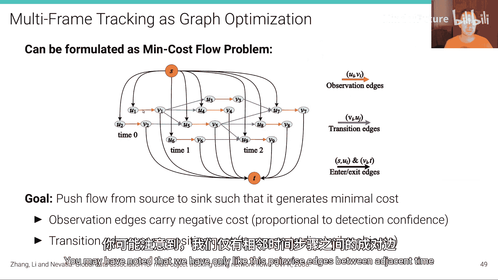
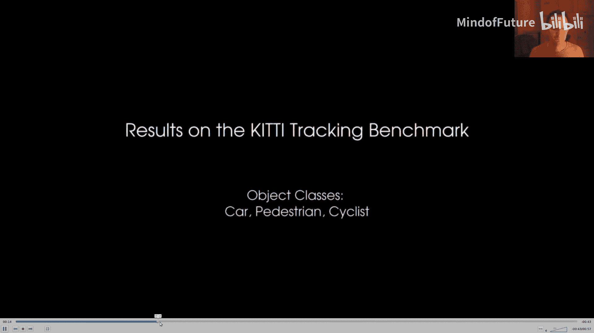

# 043：目标跟踪 - 关联问题

在本节课中，我们将要学习多目标跟踪中的核心挑战：关联问题。我们将探讨如何将新帧中的检测结果与先前帧中已有的目标轨迹正确匹配，并介绍解决此问题的多种方法。

---

## 关联问题概述

到目前为止，我们考虑的是单个目标以及每帧只有一个检测的情况。我们无需进行关联，因为我们假设该检测就是对应那个目标的。但在自动驾驶中，我们通常需要同时跟踪多个目标，并且每一帧都有许多检测结果。因此，问题就出现了：我们如何将新帧中的这些检测结果与先前帧中已有的目标轨迹关联起来？

多目标跟踪算法通常可以概括为以下步骤：
1.  使用运动模型，将先前帧中的目标预测到当前帧。
2.  同时，在当前图像中检测目标。
3.  将检测结果与目标轨迹进行关联，并在必要时初始化和删除轨迹。
4.  使用观测结果（例如，通过卡尔曼滤波器）来修正预测。

上一节我们介绍了跟踪的基本流程，本节中我们来看看其中的关键步骤——关联。

---

## 关联度量方法

对于第二步，即关联步骤，我们需要一个度量标准来判断两个连续帧中的观测结果是否属于同一个目标。以下是几种可能的度量方法：

*   **边界框重叠度**：通过运动模型预测边界框，并测量其与检测框的重叠程度。
*   **颜色直方图比较**：比较图像块的颜色直方图。
*   **归一化互相关**：在图像块之间执行归一化互相关计算。
*   **光流一致性**：估计光流并测量其一致性。
*   **边界框相对位置和大小**：比较边界框的相对位置和大小，假设目标在帧间不会剧烈收缩或增长。
*   **目标朝向比较**：例如，要求像 Fast R-CNN 这样的目标检测器也输出被检测车辆的朝向。

以上是一些非常简单的关联度量方法。然而，我们可以做得更好。

---

## 使用深度学习进行关联

我们可以使用深度学习，特别是度量学习来改进关联。其核心思想是使用卷积网络来学习图像块 `I` 的目标表示 `f_θ(I)`。这里，`f_θ` 是具有参数 `θ` 的神经网络，它以图像块作为输入，并为该图像块计算一个特征向量。

一个好的表示会将同一目标的图像映射到相似的特征，而将不同目标的图像映射到不同的特征。例如，我们有一个显示目标的图像块，称之为锚点 `A`。我们有一个正样本 `P`（来自不同帧的同一目标）和一个负样本 `N`（不同目标）。我们希望学习一个排序，使得同一目标（`A` 和 `P`）的特征向量之间的距离，小于不同目标（`A` 和 `N`）的特征向量之间的距离。

我们可以使用所谓的**三元组损失**来实现这一点。其公式如下：

```
L = max(0, d(A, P) - d(A, N) + m)
```

其中 `d(·, ·)` 表示距离（如欧氏距离），`m` 是一个确保损失专注于困难样本的边界项。这个损失函数有效地尝试让正样本比负样本更接近锚点至少一个边界 `m` 的距离。

训练这种三元组损失时，可以使用诸如**难负样本挖掘**等技术，即不是随机采样图像块，而是采样那些可能难以区分但仍不同的样本（例如，相似但不同的白色汽车）。最近，Laura Leal-Taixé 团队发表的论文《The Group Loss for Deep Metric Learning》也解决了三元组损失的高效学习问题。

---

## 关联中的歧义与挑战

即使找到了好的关联度量或学习了好的特征表示，仍然存在歧义和困难。以下是可能遇到的一些情况：

*   **预测无测量支持**：预测存在，但没有对应的观测。问题是目标消失了、被遮挡了，还是检测失败了？
*   **出现意外测量**：预测存在，但没有一个检测结果与之接近。这些是新出现的可见目标还是误检？我们应该初始化新的目标轨迹吗？
*   **多个测量匹配一个预测**：一个预测轨迹，有多个检测结果都与之接近。哪个测量是正确的？其他的又该如何处理？
*   **一个测量匹配多个预测**：一个检测结果同时与多个预测轨迹都匹配良好。这个测量应该分配给哪个目标？

---

## 最近邻关联及其局限性

解决这个问题最简单的方法是**最近邻关联**。在最近邻关联中，我们首先将测量限制在预测周围的某个“门控区域”内。我们认为距离很远的检测不太可能对应于该轨迹。然后，我们从检测集合 `Y_t` 中关联一个与预测 `x_t` 最接近的检测。

数学上可以表述为寻找使 `||y_t - x_t||_2` 最小的 `y_t`。如果我们有一个像卡尔曼滤波器中的高斯预测模型，我们可以考虑在该预测模型下最可能的检测，即最大化似然的那个。这对应于**马氏距离**，它考虑了预测的不确定性（协方差矩阵），可以用于定义门控区域。

然而，简单的最近邻方法存在严重问题。考虑一个两个目标（蓝色和红色）移动的例子。在某些情况下，仅根据位置相似性选择最近邻会导致错误的关联，甚至可能将一个检测同时分配给两个轨迹。在实践中，情况可能更加严重和困难。这表明简单的最近邻方法通常不是一个好主意。

---

## 二分图匹配

为了超越最近邻方法，我们可以使用**二分图匹配**。我们有效地利用图论工具来帮助我们。

给定一个二分图（节点分为两个集合，边只连接不同集合的节点），一个匹配是边的一个子集，使得每个顶点恰好属于其中一条边。帧到帧的跟踪可以表述为二分图匹配问题。它通过定义，在相似度矩阵的每一行和每一列中至多选择一个匹配，同时最大化总得分。

例如，我们有三个目标轨迹（行）和下一帧的三个检测（列），以及它们的相似度得分。我们希望将每个轨迹只关联到一个检测，反之亦然。解决方案是选择一组匹配（每行每列一个），使得这些匹配对应的相似度得分之和最大。

现在的问题是，如何解决这个二分图匹配问题？

---

## 解决二分图匹配问题

首先正式定义问题：给定一个 `M x N` 的关联得分矩阵 `S`，确定一个二元的 `M x N` 矩阵 `C`，以最大化总得分 `∑∑ S_{ij} * C_{ij}`。约束条件是：在二元矩阵 `C` 的每一行和每一列中，恰好有一个元素为 1，其余为 0，且 `C_{ij} ∈ {0, 1}`。这是一个整数线性规划问题，但幸运的是，在这个特定情况下，存在多项式时间算法。

可能的分配数量是 `N!`，对于大量检测，穷举搜索变得不可行。

最简单的算法是**贪心算法**：
1.  从一个未标记的矩阵开始。
2.  对于 `i = 1` 到 `n`，标记不在已有标记行或列中的最大值。
3.  关联该匹配，并划掉对应的行和列。

贪心匹配易于实现、运行快速，并能找到较好的解，但它通常不能产生最优解。

为了找到最优解，可以使用图论中的算法，例如具有二次复杂度的**匈牙利算法**，或者后来提出的具有立方时间复杂度的算法。这些算法可以快速交付解决方案，因此被频繁用于帧到帧的跟踪二分图匹配。

---

## 处理轨迹起始与终止

在实际中，轨迹和观测的数量通常不同，轨迹可能结束，也可能有新的轨迹开始。我们可以使用一个简单的技巧：引入额外的“吸收节点”来吸收这些匹配，并设置一个阈值。这样，如果一个轨迹与吸收节点关联，就意味着该轨迹终止；如果一个检测与吸收节点关联，就意味着可能开始一个新的轨迹。我们可以通过扩展矩阵，使用相同的算法（如匈牙利算法）来解决这个问题。

---

## 多帧关联与网络流方法

以上都是关于帧到帧匹配的。二分图匹配只能将当前帧的检测与上一帧的目标轨迹（或检测）进行匹配，但这对于更长的序列不一定是最优的。错误的关联在后续帧中无法撤销。

因此，我们需要考虑多帧情况。目标是在序列的所有帧中解决所有关联问题。一个开创性的想法是将问题转化为**最小代价流网络问题**。

其思想是：每个检测在图（网络）中创建两个节点，并用一条边连接它们，该边携带与检测置信度成比例的负成本。然后，将这些检测与下一帧的检测连接起来（链接边携带正成本，以分离不同的目标）。此外，将检测的第一个节点连接到图的源点 `S`，第二个节点连接到汇点 `T`。

目标是尝试从源点 `S` 到汇点 `T` 推送“流”，使得沿边的总成本最小。由于观测携带负成本，流被鼓励通过高置信度的观测。链接边携带正成本以分离不相似的目标。通过这种表述，我们可以处理多帧序列，并自动确定轨迹何时开始和结束。

该问题的最优解可以通过称为“连续最短路径算法”的多项式时间算法找到。然而，这种方法只能建模相邻时间步之间的成对关系，无法直接建模跨越多个帧的遮挡，并且只能使用非常简单的运动模型。

---



## 先进的基于图的模型



更先进的模型尝试联合训练检测和跟踪。例如，有工作通过线性程序（解决最小代价流问题）进行反向传播，将整个流程视为神经网络中的一层，从而实现端到端的训练。

另一个更近期的、取得了先进成果的想法更简单：既然我们有一个基于图的问题，而图神经网络近年来取得了巨大进展，那么自然可以尝试直接用图神经网络来解决这个问题。这种方法将输入用卷积神经网络编码为特征，然后在该图上进行神经消息传递，并将问题表述为一个简单的边分类问题（属于同一轨迹的边被分类为正）。这种方法非常直接，易于用现代框架实现和端到端训练。

---

## 多目标跟踪的评估

最后，我们来讨论如何评估多目标跟踪。评估的第一步是使用类似于评估目标检测器时所用的二分图匹配技术，将预测轨迹与真实轨迹关联起来。

最突出和最古老的跟踪评估指标是**多目标跟踪准确度**。其计算公式为：

```
MOTA = 1 - (∑_t (FN_t + FP_t + IDSW_t)) / ∑_t GT_t
```

其中，`FN_t` 是漏检数，`FP_t` 是误检数，`IDSW_t` 是ID切换次数（即一个真实轨迹被不同跟踪ID关联的次数），`GT_t` 是真实目标数。这是一个简单的度量，但也有许多缺陷。

一个更近期的、避免了一些问题的度量称为 **HOTA**，它也被集成在先进的评估框架中。

先进的算法在基准测试上进行评估，例如自动驾驶领域的 **KITTI 基准测试**就包含目标跟踪任务，参与者可以在排行榜上提交结果并查看排名。

---


## 总结

在本节课中，我们一起学习了多目标跟踪中的关联问题。我们从简单的关联度量（如边界框重叠）和最近邻方法开始，认识到其局限性。然后，我们引入了更强大的**二分图匹配**方法，将其形式化为一个优化问题，并介绍了贪心算法和匈牙利算法等解决方案。为了处理轨迹的起始与终止，我们探讨了引入吸收节点的技巧。接着，我们超越了帧到帧匹配，介绍了基于**最小代价流网络**的多帧全局关联方法及其变体。最后，我们简要了解了使用深度学习（如三元组损失和图神经网络）进行端到端关联的先进方法，并讨论了多目标跟踪的评估指标（如 MOTA 和 HOTA）和基准测试。掌握这些关联技术对于构建鲁棒的多目标跟踪系统至关重要。