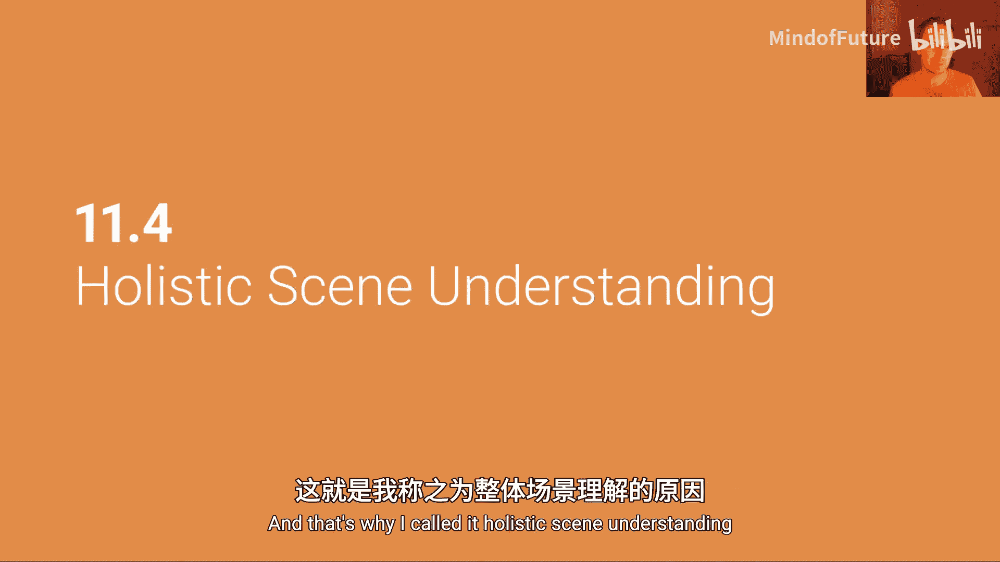
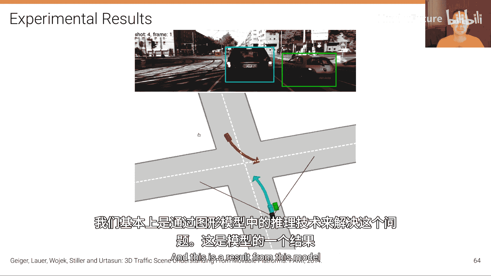
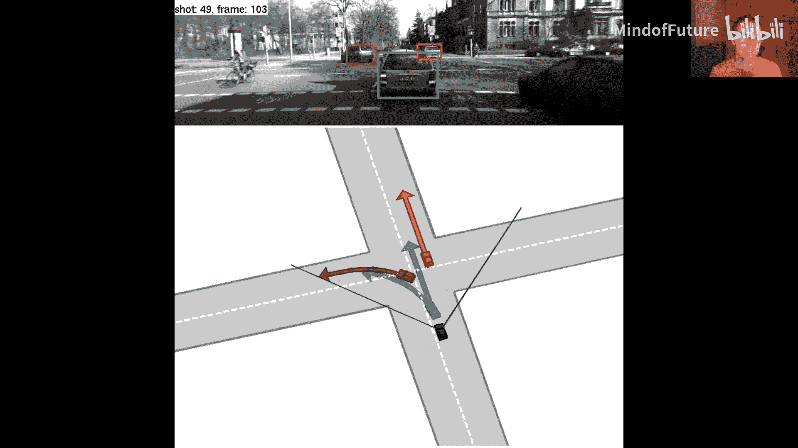
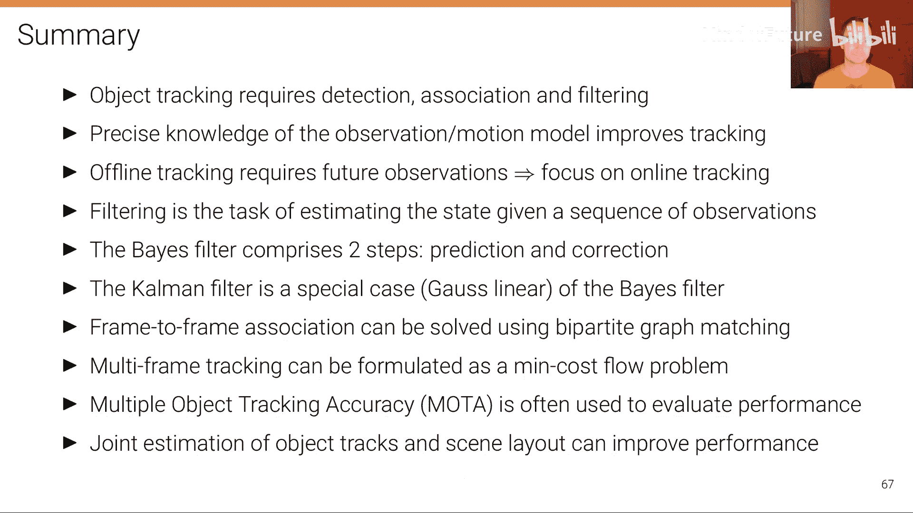

# 044：整体场景理解与追踪 🚗

在本节课中，我们将学习如何将物体追踪技术融入到自动驾驶感知系统的更广泛任务中，即整体场景理解。我们将探讨融合多种信息源（如传感器数据、地图和场景线索）如何能带来更鲁棒和准确的场景理解。

---

在上一节中，我们讨论了物体追踪的基础技术。本节中，我们来看看如何将追踪置于更宏观的“整体场景理解”框架下。

为了理解交通场景，仅仅检测车道线是不够的。在高速公路等简单场景中，车道保持或许只需车道检测。然而，面对复杂的十字路口，仅从车道检测器的视角出发几乎无法理解全局。

因此，需要融合各种线索来获得完整、整体的理解，例如车辆的位置与动向、车道与道路、建筑物、天空、消失点等。只有综合考虑所有这些因素，才能获得对场景的整体理解。融合多种线索能带来更鲁棒的估计。

## 多线索融合示例

首先，我们通过一个简单的双传感器融合例子来理解基本原理。假设我们通过两个传感器（例如相机和激光雷达）获得对同一物体的检测。

设 **X** 为未知的物体真实位置。
设 **C1** 和 **C2** 分别为相机和激光雷达的带噪声测量值。

根据贝叶斯定律，在给定两个测量值的条件下，物体位置的后验概率分布可计算为：

**P(X | C1, C2) ∝ P(C1 | X) * P(C2 | X) * P(X)**

如果我们假设两个测量值相互独立（这通常是一种简化），并且假设先验分布 **P(X)** 是均匀的（即无信息先验），那么公式可简化为：

**P(X | C1, C2) ∝ P(C1 | X) * P(C2 | X)**

这是一种融合来自不同传感器或同一传感器不同检测器信息的简单方法，也是我们尝试融合场景各方面信息的基础。

## 整体场景理解项目

接下来，我们介绍一个旨在实现整体场景理解的研究项目：“基于移动平台的3D交通场景理解”。

该项目的目标是从短时立体视频序列（不使用地图或激光雷达）中推断出：
*   场景的拓扑结构与几何形状。
*   语义信息，如当前的交通状况、交通模式。
*   交通灯状态（通过观察物体的运动间接推断）。
*   并生成一个融合了多种线索的城市场景概率生成模型。

这种方法的优势在于可以利用大量先验知识。例如，我们知道十字路口通常具有特定的几何形状，因此物体更可能遵循某些轨迹。我们还可以利用交通规则（如靠右行驶）等信息。

该项目通过一个复杂的概率图模型来实现上述目标。该贝叶斯网络融合了场景光流、占据栅格、语义标签、消失点等观测数据，并将追踪片段（Tracklets）作为一个隐马尔可夫模型嵌入其中，试图在联合推断出的场景情境下预测每个车辆的个体状态。

以下是该模型的一个输出结果示例：

上图展示了输入的单目图像序列（顶部）以及模型推断出的交通状况（底部）。可以看到模型如何评估物体沿特定方向移动的可能性，并将其与整体交通状况联系起来。这是一个具有挑战性的问题，因为仅从单目图像测量距离非常困难，但通过将车辆运动置于特定的交通情境中，可以有效地缩小不确定性。这体现了整体建模的优势。

## 利用高精地图辅助追踪

另一种将额外信息整合到追踪问题中的方法是使用高精地图。例如，CVPR 2020的论文《Perception and Prediction with Tracking in the Loop》就采用了这种方法。

其核心思想是结合高精地图和激光雷达数据，来支持物体检测器和追踪器，并执行联合的感知、追踪和运动预测（即轨迹估计）。一旦追踪到物体并建立了良好的运动模型，预测物体未来的运动就会变得容易得多，这对于后续的行为建模和规划阶段至关重要。

## Argoverse数据集

最后，我们介绍Argoverse数据集，这是一个用于3D追踪和运动预测的最新数据集，其特点是包含了丰富的高精地图信息。

该数据集为自动驾驶研究公开提供了包含激光雷达点云、RGB图像以及精确定位信息的序列数据。如今，它常被用于评估追踪和运动预测技术的性能。

> 相关链接：Argoverse官方网站（包含排行榜等更多信息）。

---

## 总结 📝

本节课中，我们一起学习了如何将物体追踪融入整体场景理解。

我们回顾并总结了以下核心要点：
*   物体追踪需要**检测、关联和滤波**三个步骤。
*   精确的**观测模型**或**运动模型**知识可以改进追踪效果。
*   离线追踪需要未来观测值，而自动驾驶的关注点自然是**在线追踪**。
*   **滤波**是根据观测序列估计状态的任务，贝叶斯滤波包含**预测**和**更新**两个步骤。
*   卡尔曼滤波是贝叶斯滤波在高斯线性假设下的一个特例，具有闭式解。
*   帧间关联可以通过**二分图匹配**解决。
*   多帧追踪可以表述为**最小代价流**问题。
*   多目标追踪精度（MOTA）常被用来评估性能。
*   对**物体轨迹和场景布局进行联合估计**，有助于提高系统的鲁棒性和性能。

