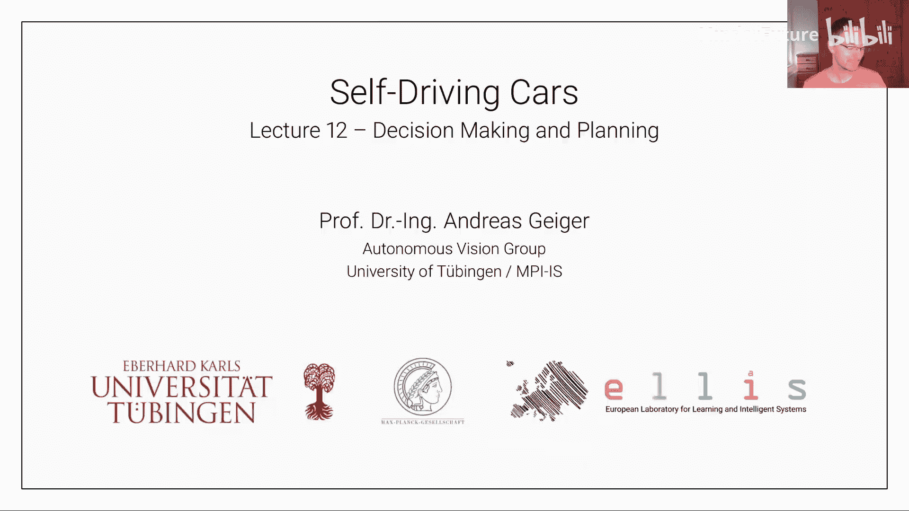
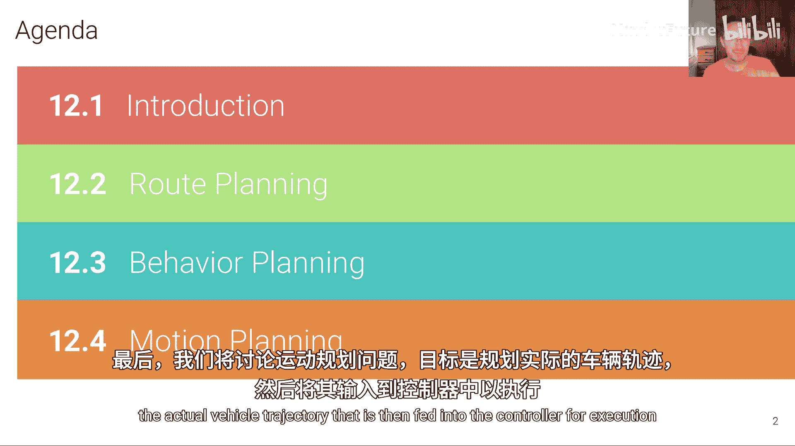
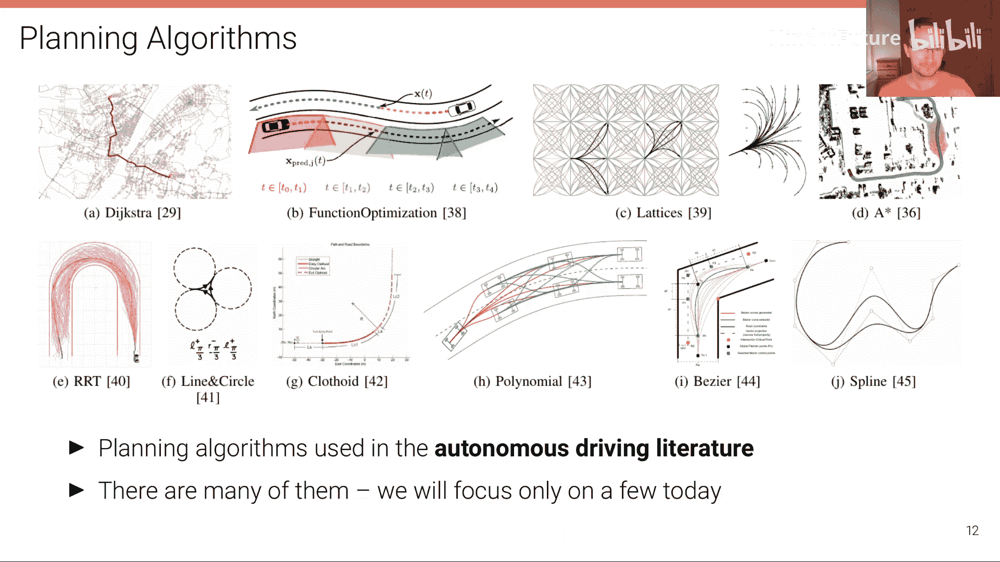
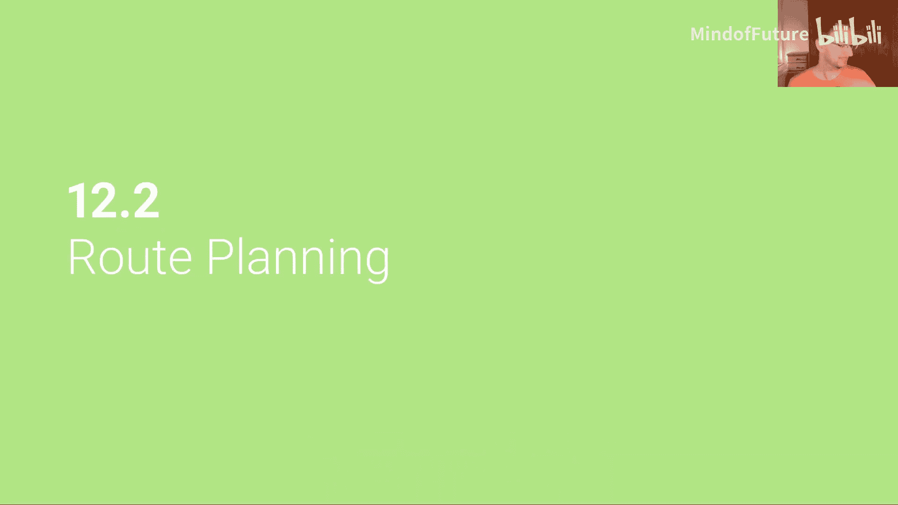

# 045：决策与规划 - 引言 🚗

在本节课中，我们将要学习自动驾驶流程中的最后一个关键环节：决策与规划。这是整个课程的最后一次讲座，我们将探讨如何让车辆从当前位置安全、高效地抵达目的地。

## 概述

决策与规划阶段的目标是，在考虑静态基础设施和周围动态物体的前提下，找到并跟随一条从车辆当前位置到目的地的路径。其输入是感知系统提供的车辆与环境状态，输出则是传递给车辆控制器的参考轨迹。

然而，驾驶场景和行为非常复杂，难以将其建模为单一的优化问题。因此，我们通常将这个复杂任务分解为一系列更简单的子问题。

## 课程结构

本次讲座分为四个单元：
1.  首先，我们将介绍决策与规划阶段及其在自动驾驶流程中的位置。
2.  接着，我们将探讨三个规划问题中的第一个：**路径规划**。这是最高层级的规划问题，类似于GPS导航系统在城市中寻找从A点到B点的路线。
3.  然后，在第三单元，我们将学习**行为规划**。我们将了解如何将自动驾驶车辆可能遇到的不同情况，分解为典型的基于图结构的表示。
4.  最后，我们将研究**运动规划**。其目标是规划出实际的车辆轨迹，以供控制器执行。

上一节我们介绍了课程的整体结构，本节中我们来看看决策与规划在自动驾驶流程中的具体位置。

## 决策与规划在流程中的位置

下图是我们之前见过的简化版自动驾驶流程示意图，它抽象地展示了不同模块：低级感知、语义理解、路径规划和车辆控制。

在第5和第6讲中，我们讨论了车辆控制部分。在第5到11讲中，我们讨论了低级感知和语义理解部分。现在，我们将要讨论从感知到控制的连接环节，即这里的决策与路径规划阶段。

## 问题定义与分解动机

决策与规划阶段的目标是找到并跟随一条从车辆当前位置到目的地的路径，同时考虑静态基础设施和周围的动态物体。输入是感知系统提供的车辆与环境状态，输出是传递给车辆控制器的参考轨迹。

然而，驾驶场景和行为可能非常复杂，因此很难将整个决策与规划问题建模为单一的优化问题。我们通常的做法是将这个复杂任务分解为一系列更简单的子问题。

以下是几个需要将问题分解的驾驶场景示例：

*   **速度跟踪**：车辆试图以设定的目标速度（例如30英里/小时）在车道内行驶。
*   **减速停车**：车辆需要减速，以便在到达交叉路口时停下。
*   **等待红灯**：交通灯为红色时，车辆需要保持停止状态，并观察交通灯以确定何时可以再次启动。
*   **启动通行**：交通灯变绿后，车辆开始行驶。
*   **让行观察**：在没有交通灯但有让行标志的交叉口，车辆需要观察周围的车辆和其他交通参与者，并为来车让行。
*   **紧急制动**：车辆前方出现障碍物或发生紧急情况时，车辆需要尽快完全停止。

这仅仅是车辆可能遇到的众多情况中的一小部分。因此，我们的思路不是将整个决策与规划模块建模为一个单一问题，而是将其分解为如下图所示的层级结构，其中每个问题都针对其范围和抽象层级进行了定制。

在这个层级结构中，左侧意味着更高的抽象层级。例如，在路径规划阶段，我们希望找到从车辆当前位置到目的地的大致路线。而在较低层级，例如运动规划阶段，我们试图以更精细的分辨率规划车辆的轨迹或路径，以执行特定的机动动作。这个参考轨迹随后被输入到本地反馈控制器中。我们将要阐述的每一个优化问题，都有其独特的约束和目标函数。

## 规划层级详解

让我们更详细地看看这个层级结构。我们从最抽象、最高层级的左侧开始。

1.  **路径规划**：首先，用户指定的目的地被传递给路径规划器。给定一个高清道路地图，它会生成一条穿过道路网络的路线，类似于您车辆中的GPS导航系统，但精度更高，因为它拥有高清地图，所以也知道车道级别的信息。路径规划器会生成一些车辆应遵循的路径点。
2.  **行为层**：这些路径点被传递给行为层。行为层根据环境进行推理，并生成一个运动指令。为了做到这一点，它需要观察环境，访问感知系统的信息，例如场景中的车辆、障碍物或标志信息。行为层通常使用**有限状态机**来实现。
3.  **运动规划**：运动指令进入运动规划器，运动规划器求解出一个可行的运动，以完成来自行为层的运动指令。
4.  **本地反馈控制**：最终产生的参考轨迹被输入到本地反馈控制器中。控制器调整执行变量（如转向、油门和刹车），以纠正执行参考路径时的误差。它获取车辆状态的估计值以执行本地反馈控制。

## 各阶段核心概念

现在，让我们更深入地了解这些模块中的每一个。

*   **路径规划**：在此阶段，道路网络通常被表示为一个**有向图**。该图包含节点和带有方向箭头的有向边，边指示车辆允许行驶的路径。这通常是一个**加权有向图**，其中边的权重对应于路段长度或行驶时间，可以被路径搜索算法考虑在内。这个问题被转化为一个**最小成本图网络问题**，可以使用图论中的标准搜索算法来解决，例如 **Dijkstra** 或 **A\* 算法**。

*   **行为层**：行为层根据当前的车辆或环境状态选择驾驶行为。例如，在停车线处停车，观察其他交通参与者，然后通过交叉路口。行为层通常使用**有限状态机**建模，其状态转换由感知信息驱动。它也可以使用概率模型建模，例如我们早期课程中见过的**马尔可夫决策过程**。

*   **运动规划**：运动规划阶段接收运动指令并产生一条参考轨迹。其目标是基于运动指令，找到一条可行、舒适、安全且快速的车辆路径或轨迹。精确解的计算在大多数情况下是计算上难以处理的，因此通常使用数值近似方法。我们将简要讨论的典型方法包括**变分法**、**图搜索法**或**增量树搜索法**。

*   **本地反馈控制**：本地反馈控制器接收来自运动规划阶段的路径或轨迹并执行它，同时纠正由于车辆模型不准确而产生的误差，正如我们在车辆控制讲座中看到的那样。控制阶段的重点当然是鲁棒性、稳定性和舒适性。如今，我们的大多数车辆已经配备了复杂的低级控制器。

因此，今天讲座的内容是前三个模块，因为最后一个模块我们已经在第5和第6讲中讨论过了。

## 算法概览

需要说明的是，自动驾驶文献中使用了许多规划算法。如下图所示，数量众多。当然，我们今天只会有时间关注其中最经典的几种。

那么，接下来我们将要做什么呢？

## 总结

本节课中，我们一起学习了自动驾驶决策与规划模块的引言部分。我们了解了该模块在整体流程中的位置，明确了其目标是生成安全可行的行驶轨迹。由于问题的复杂性，我们将其分解为**路径规划**、**行为规划**和**运动规划**三个层级，并简要介绍了每个层级的核心任务和常用方法（如图搜索、有限状态机等）。这为我们后续深入探讨每个具体的规划问题打下了基础。