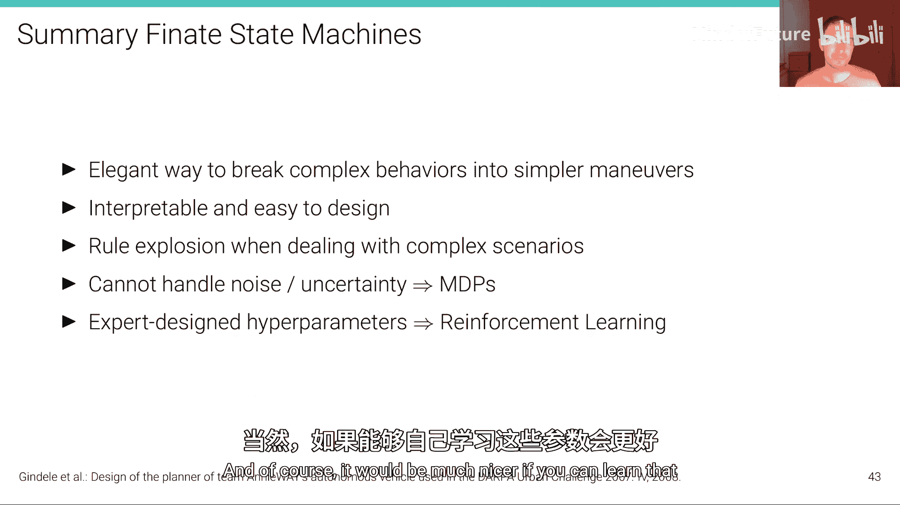

自动驾驶汽车课程：12.3：行为规划 🚗

在本节课中，我们将要学习自动驾驶决策与规划中的行为规划阶段。我们将了解行为规划的作用、常用模型，并重点探讨确定性有限状态机的工作原理及其在自动驾驶中的应用。

---

给定一条规划好的路线后，车辆需要跟随该路线行驶。这个过程进一步分为两个子任务：行为规划和运动规划。

本节我们将深入探讨行为规划阶段。为了跟随规划路线，车辆必须执行各种驾驶操作，正如我们在课程开始时所见。

以下是几种常见的驾驶操作示例：
*   速度跟踪
*   跟车行驶
*   停车
*   并道

为所有操作联合设计一个运动或路径规划器是困难的。因此，行为规划阶段将行为离散化为更简单的原子操作，每个操作都可以由专用的运动规划器单独处理。

行为层必须考虑交通规则、静态和动态障碍物。行为规划器的输入包括我们之前见过的高级路线规划（例如，使用A*算法规划的结果）以及感知系统的输出。行为规划阶段的输出则是运动规划器的约束条件，例如行驶走廊、车辆附近的物体、速度限制、目标位置等。

行为规划常用的模型，在离散或确定性情况下是有限状态机及其变体；在概率性情况下是马尔可夫决策过程或部分可观测马尔可夫决策过程。在本节中，我们将重点讨论确定性的有限状态机。

一个有限状态机在数学上由一个五元组定义，如下所示：
`FSM = (Σ, S, s0, F, δ)`
其中：
*   **Σ** 是输入字母表（例如，本例中的 {α, β, γ}）。
*   **S** 是非空的状态集合（例如，本例中的 {s0, s1}）。
*   **s0 ∈ S** 是初始状态。
*   **F ⊆ S** 是可能为空的最终状态集合。
*   **δ: S × Σ → S** 是状态转移函数，它根据当前状态和输入字符映射到下一个状态。

例如，如果处于状态 `s0` 并接收到输入 `γ`，则保持在状态 `s0`；如果处于状态 `s0` 并接收到输入 `α`，则转移到状态 `s1`。

这是一个简单的非自动驾驶例子：想象一个孩子的状态。大多数时候他们处于“开心”状态。随着时间的推移（尤其是在晚上），他们可能变得疲倦并转入“不开心”状态。那么如何从“不开心”状态回到“开心”状态呢？通常，“糖果”这个输入可以触发状态转移。

现在，让我们看一个自动驾驶的例子。这是一个简单的车辆行为有限状态机，包含三个状态：
1.  **绿色 - 跟踪速度状态**：车辆正常行驶。
2.  **黄色 - 减速至停止状态**：车辆正在减速。
3.  **红色 - 停止状态**：车辆已停止。

我们从“跟踪速度”状态开始。只要车辆位置未接近交叉路口或停止线，就保持此状态。一旦感知系统检测到正在接近停止线，就转移到“减速至停止”状态。只要速度不为零，就保持减速状态。当速度降至零且已达到目标位置（停止线）时，则转移到“停止”状态。在此状态下，车辆必须至少停止三秒钟。如果停止时间少于三秒，则保持停止状态。只有当停止时间达到或超过三秒且确认可以安全通行时，才转移回“跟踪速度”状态。

当然，这是一个非常简化的示例。在实践中，有限状态机要复杂得多。例如，在一个四向交叉路口场景中，状态可能包括“接近停车标志”、“在停车标志处等待”和“通过交叉路口”。

这是一个来自斯坦福大学Junior车队在DARPA挑战赛中使用的真实高级有限状态机示例。可以看到，它有“定位车辆”、“行驶”、“通过交叉路口”、“停车”、“在停车场导航”等状态，以及它们之间的转移关系。

现在的问题是，如何将这些简单的有限状态机扩展到更复杂的操作，特别是如何处理多种不同场景（例如交叉路口场景和高速公路驾驶场景），因为其中的状态和转移可能差异很大。如果扩展单个有限状态机，会导致规则数量爆炸式增长。

更好的方法是使用所谓的**分层（或分级）有限状态机**，如下图所示。我们拥有元状态（例如“交叉路口场景”状态和“车道行驶场景”状态），可以在这些元状态之间转移。同时，在每个元状态内部，又包含一系列子状态（图中的黄、红、绿状态），可以在这些子状态内部进行转移。

这种方法的优点是结构更简单、更高效，也更容易理解。但缺点是一些规则可能会重复，因为在交叉路口和直道上都可能需要减速和停车等操作。

这是一个来自卡内基梅隆大学Boss车队在DARPA挑战赛中使用的分层有限状态机实例。图中顶层的“行驶”状态本身又包含“车道行驶”、“变道”、“转弯”等子状态。

---

**总结**

本节课中我们一起学习了行为规划的核心概念。有限状态机是将复杂驾驶行为分解为简单原子操作的一种优雅方法。它们具有可解释性，易于设计。然而，在处理复杂场景时，需要避免规则爆炸，否则会降低可解释性，增加理解难度和代码出错的风险。此外，有限状态机无法处理噪声或不确定性，若要处理这些问题，则需要转向如马尔可夫决策过程之类的概率模型。最后，许多已部署的有限状态机（例如在DARPA城市挑战赛中）大量依赖专家设计的超参数，而更理想的方式是通过强化学习等方法来自动学习这些参数。