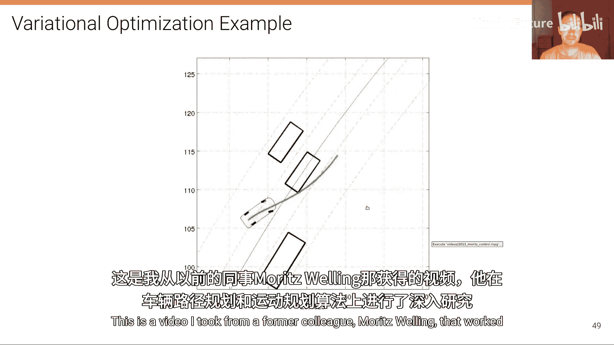
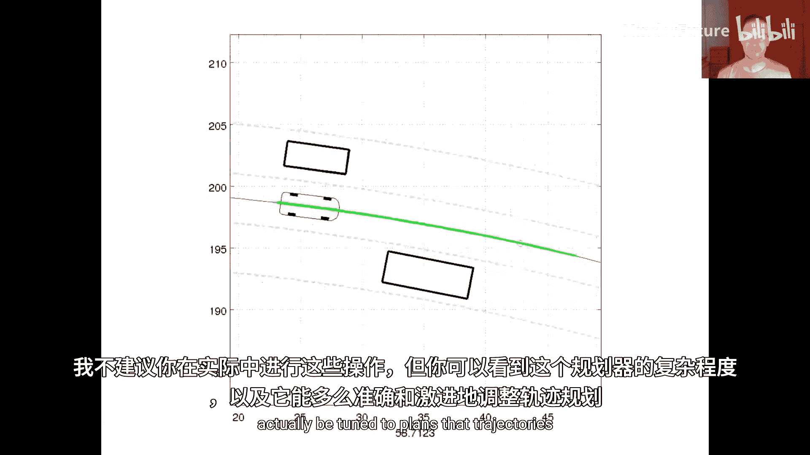
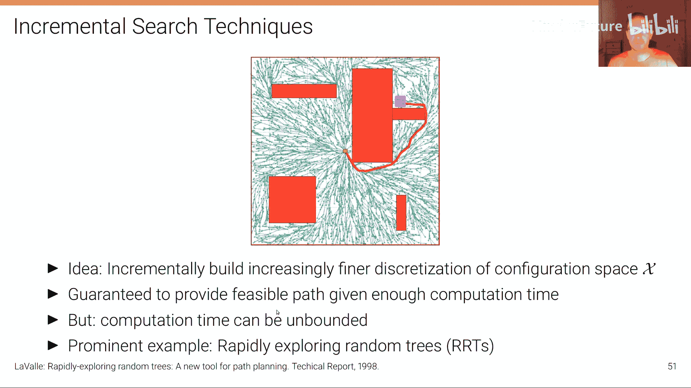
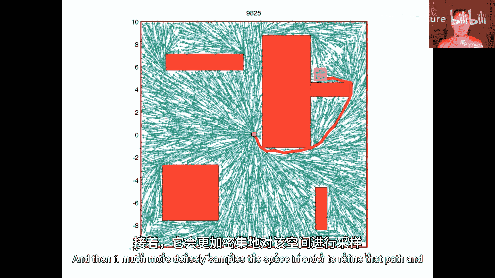
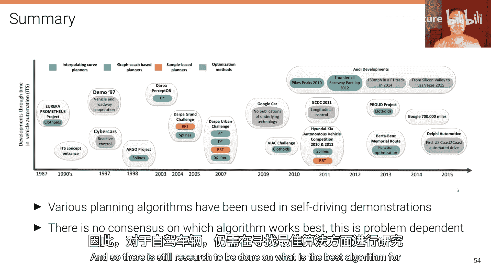

# 048：运动规划 🚗

在本节课中，我们将学习自动驾驶规划层级中最精细的阶段——运动规划。运动规划接收行为层的指令，并生成可供控制器执行的局部路径。

## 概述

上一节我们介绍了行为规划，本节我们将深入探讨运动规划。运动规划的目标是基于行为层的输出，从车辆的当前构型到局部目标点，计算出一条安全、舒适且可行的轨迹。我们通常只进行非常局部的规划，例如规划车辆前方几米处的车道中心点、下一个停车线或停车位。

运动规划器以车辆周围的静态和动态障碍物作为输入，并尝试生成无碰撞的轨迹。

## 输出表示

运动规划器有两种基本的输出表示形式。

第一种输出表示称为**路径**，我们用 **σ(L)** 表示。它将一个从0到1的标量（即归一化的路径长度L）映射到构型空间 **X**。换句话说，路径表示不指定速度，只指定车辆应遵循的路径。

第二种输出表示称为**轨迹**，我们用 **π(t)** 表示。它将从0到规划时域 **T** 的时间t映射到构型空间 **X**。与路径不同，轨迹输出表示明确考虑了时间，它要求控制器在任意指定时间t，使车辆接近该函数预测的对应构型。而对于路径，控制器自身必须提供逻辑来确定正确的速度。

其中，**T** 称为规划时域，**X** 是车辆的构型空间，在简单情况下包括车辆的位置和航向角。

## 规划方法

解决运动规划问题主要有三种主流方法：变分法、图搜索法和增量搜索法。我们将逐一简要了解。

### 变分法

变分法，正如你在数学中所知，旨在最小化一个泛函。这里我们试图最小化依赖于轨迹π的泛函 **J**，其最小值在所有可能的轨迹π中寻找，因此被称为泛函（即函数的函数）。

我们最小化从0到时域T的积分：**min J(π) = ∫₀ᵀ F(π(t)) dt**。其中，**F** 整合了软约束（如关于空间位置的约束）以及额外的硬约束（如车辆的最小转弯半径、起始位置和终点位置）。起始位置是车辆在时间0的构型，目标位置是车辆在时间T的构型。

这个问题通常使用标准的数值优化技术求解。但在几乎所有情况下，这都是一个困难、非线性且非凸的优化问题，因此会收敛到局部最小值。为了避免这种情况，有时会从不同的初始值开始求解，并使用其他技术来克服此问题。

下图展示了一个没有任何额外约束的简单变分函数优化问题。你可以看到被优化的函数、不同的迭代过程，以及通过泛函F整合的软约束（如空间位置约束）。随着时间的推移，函数朝着这个“山谷”的最小值移动，从起始位置到达目标位置，最终的迭代结果是图中的红色轨迹。

这是一个车辆规划的具体示例视频截图，展示了此类算法能够规划出非常精确和敏捷的轨迹。

### 图搜索法

变分法的一种替代方案是使用我们之前讨论过的图搜索方法，例如Dijkstra或A*算法。但为了使用它们，我们首先必须将构型空间 **X** 离散化为一个由顶点和边组成的图。文献中有多种构建此类图的算法。

以下是一个简单的示例。左图是一个停车操作的示例，构型空间基于网格结构进行了离散化。右图是高速公路上的不同车道，车道变换操作基于构型空间的离散化进行建模。每一条灰色和黑色的轨迹都是车辆可以采取的轨迹。通过这种离散化，我们现在可以将其表述为一个图搜索问题。

这是另一个十字路口的示例，展示了不同车道和通过十字路口的可能性如何被离散化。例如，这辆车可以直行或右转，如果右转，它还可以选择进入这条车道或那条车道。

### 增量搜索法

最后，还有增量搜索技术。其思想是增量式地构建越来越精细的构型空间 **X** 离散化。只要有足够的计算时间，这些方法能保证找到可行路径，但计算时间可能无界。此类算法的一个突出例子是快速探索随机树算法。

如下图所示，开始时，它随机探索空间并找到一条通往目标的粗略路径。然后，它对空间进行更密集的采样，以细化并优化该路径。

这是使用A*算法进行规划场景的另一个示例。这实际上是Stanley车辆的一个例子，他们使用了所谓的混合A*算法，这是A*的一个变体，能保证路径的运动学可行性。规划会随着车辆探索环境而持续重新进行。

实际应用结果显示，车辆从这里开始，面对真实的障碍物（这些是停放车辆的激光扫描数据），目标位置在那边。虽然曲线不是非常平滑，但通过这个对A*算法微小但重要的修改，它仍然能够找到一条连续且可行驶的曲线到达停车位置。

A*算法还有其他一些修改，这里无法详述。下图展示了一个机器人在模拟中尝试导航停车场的典型过程。你可以看到搜索中扩展的树。每次遇到阻碍，它都会进行一次新的A*搜索。可以看到地图随着机器人移动而被获取。在机器人的状态等价表示中，它不仅考虑了X、Y和航向，还允许机器人前进和后退，而倒车是与前进不同的状态。现在你可以看到它如何倒车、找到新路径，并最终通过一个实际开口到达目标位置。

这个迷宫被设计得很困难以测试算法。好处是这些算法几乎实时运行，构建整个搜索树只需不到十分之一秒。机器人能够非常高效地导航这个停车场。这实际上是我在DARPA城市挑战赛中见过的最快的运动规划算法之一，甚至是我一生中在机器人领域见过的最快算法之一。

同样的算法被应用到一个实际的停车示例中，使用我们的机器人Junior。它希望从这里到达那里。你可以看到它精确地倒车进入这里的停车位，然后沿着这里的线向前移动。我们的状态空间是四维的，包括X、Y、航向方向以及车辆是前进还是倒退。改变方向有成本，因此它不会太频繁地改变方向。你可以看到它导航到一个安全位置。需要指出的是，规划器生成的轨迹随后会使用二次平滑器进行平滑，以消除扭结，从而使车辆行驶得更平稳。但完成所有工作、找到最佳路径的核心算法是经过修改的混合A*算法。

在最后一段视频中，我们看到车辆在左侧有很多交通锥的停车场中导航。右侧可以看到内部地图和路径规划器。它试图将自己停在左侧的指定位置。

## 总结

本节课我们一起学习了运动规划。我们看到驾驶场景和行为可能非常复杂，因此将问题分解为更简单问题的层次结构（如路线规划、行为规划和运动规划）是一个好主意。每个问题都针对其范围和抽象级别进行了定制。

道路网络可以表示为加权有向图，并且我们已经看到Dijkstra算法可以在这样的图中找到最短路径。然而，A*算法效率更高，它利用规划启发式来提高效率。我们还看到行为规划可以使用有限状态机实现，而对于运动规划，变分法和图搜索法经常被使用。

各种规划算法已被用于自动驾驶演示中。目前对于哪种算法效果最佳尚无共识，这真的取决于具体问题。因此，每个问题可能需要不同的算法，关于什么是自动驾驶的最佳算法，仍有待研究。

你已经完成了整个自动驾驶课程的学习。感谢你一直以来的参与，希望你和我一样享受这个过程，并从这门课中学到了一些东西，也希望你在实现我们的小型自动驾驶智能体时获得了一些乐趣。最后，祝你考试顺利，希望在未来讲座或研讨会中再次见到你。