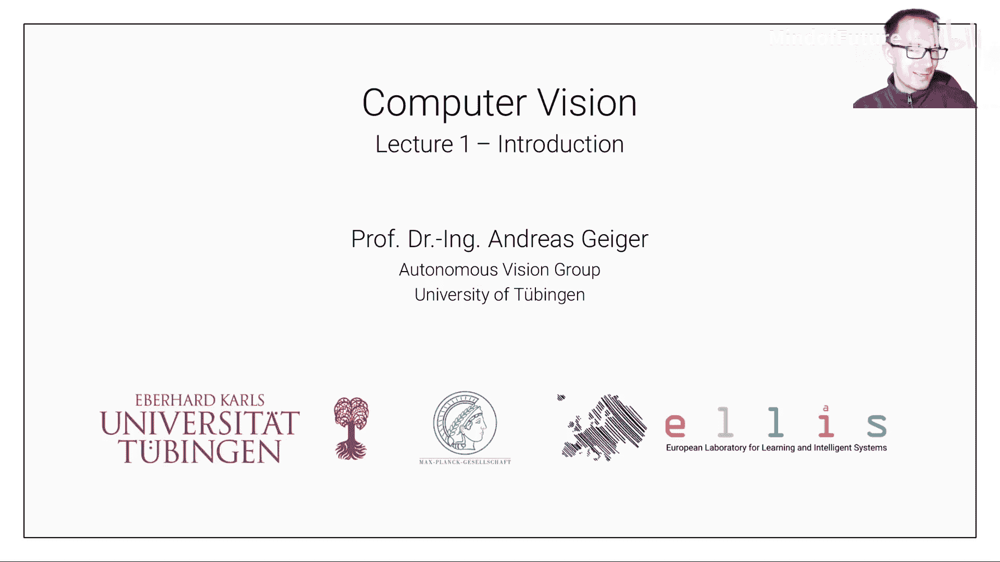
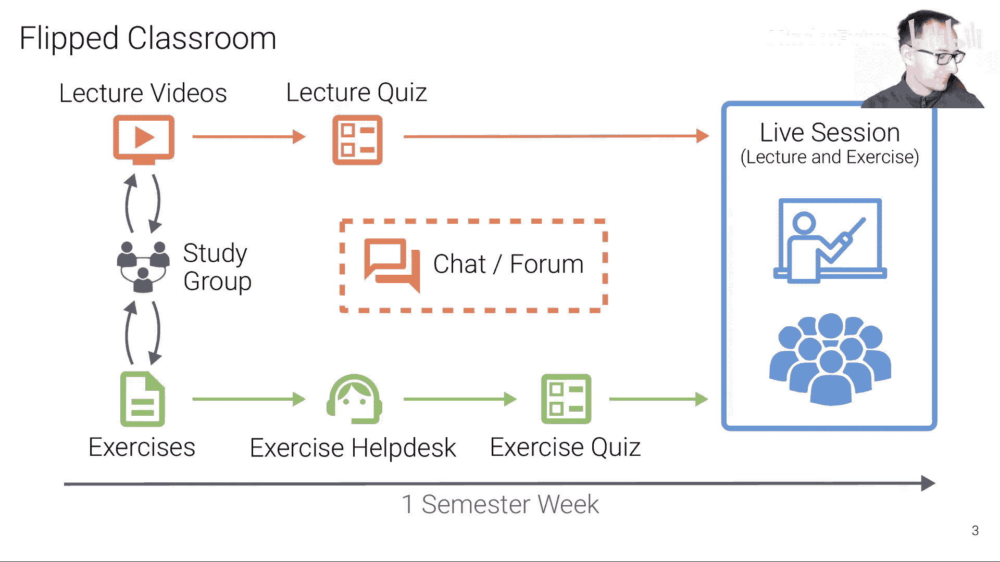

# 001：课程介绍与组织方式 🎯

在本节课中，我们将了解计算机视觉的基本概念以及本课程的组织与学习方式。

## 什么是计算机视觉？

计算机视觉旨在让机器复现人类卓越的感知能力。简而言之，我们关注如何将**光**转化为**意义**。

例如，给定一张二维图片，我们希望检测或分割其中的物体。或者，给定一组图像，我们希望通过处理和分析三维世界在二维平面上的投影，来重建世界的三维结构。

## 一个令人惊叹的例子

为了让大家对计算机视觉的能力有一个直观感受，请看以下视频。这项名为“Nerf in the wild”的工作，正是关于如何从无结构的二维图像集合中重建三维世界。

该系统以一个场景（例如柏林的勃兰登堡门）的无约束照片集作为输入，并能够输出该场景的新视角图像，其中摄像机可以移动，场景的外观也可以改变。

从视频中可以看到，仅使用无结构的图像集合作为输入，系统就能为这些场景生成高质量的新视角渲染图。这非常神奇。在本课程中，我们将一起探索其背后的原理。

## 课程组织：翻转课堂模式 🏫

上一节我们介绍了计算机视觉的宏伟目标，本节中我们来看看本课程的具体组织方式。

本课程采用“翻转课堂”模式进行教学。这意味着，我不会在实体课堂时间内直接讲授材料，而是会提前提供讲座视频供大家观看。

在观看视频后，我们将参加“直播课”。在直播课中，我们将有大量时间讨论特定讲座中有趣或困难的内容。

以下是本课程学习流程的具体说明：

*   **课前准备**：你的任务是在实际直播课前观看YouTube上的讲座视频，并记下你的问题，带到直播课中。
*   **小组学习**：我们鼓励你与同学组成学习小组，提前讨论课程内容和材料。
*   **课前测验**：我们提供了讲座测验，这有两个目的：一是帮助你自我评估；二是你可以为期末考试赢得少量加分。同时，测验也能帮助我们了解哪些是难点，以便在直播课中重点讲解。

## 练习与支持 💪

除了讲座，我们还会持续以练习的形式提供作业。

如果你对视频内容或练习有疑问，可以在我们提供的聊天区中提问。特别是对于练习，我们每周会提供一次在线的练习辅导课，我们强烈建议你参加。

同样，我们也为练习提供了测验，用于自我评估、自我激励，并帮助我们了解困难的主题。

## 典型的一周学习流程

以下是你在典型一周内需要完成的事项：

1.  **观看教学视频**。
2.  **完成相关练习**。
3.  **通过聊天区、学习小组或练习辅导课**，与老师及其他同学互动交流。
4.  **完成测验**。
5.  **参加直播课**，在讲堂中共同讨论主题和难点。讨论形式可能包括我向你提问，你向我提问，或者我们一起完成一些小任务。

## 总结

本节课中，我们一起学习了计算机视觉的核心目标——**将光转化为意义**，并了解了本课程采用的**翻转课堂**组织模式。你需要**课前观看视频、完成练习和测验**，并积极参与**直播课讨论**和各种**学习支持活动**。

我非常期待在我们的第一次直播课上与大家见面。到时见！