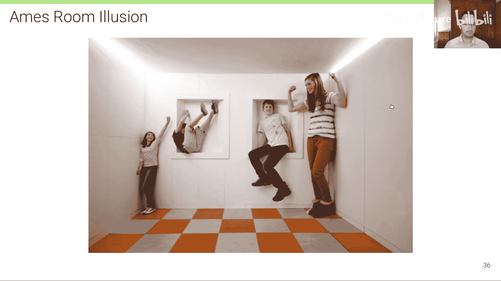
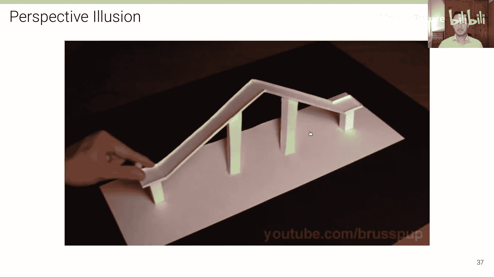
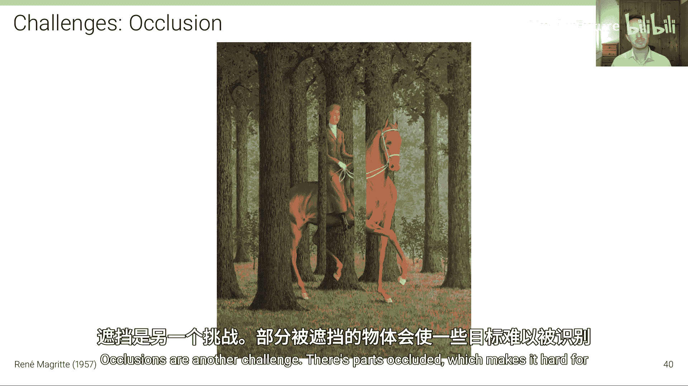
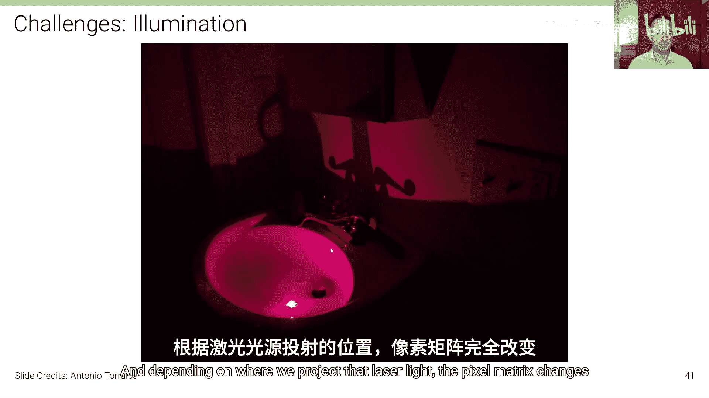
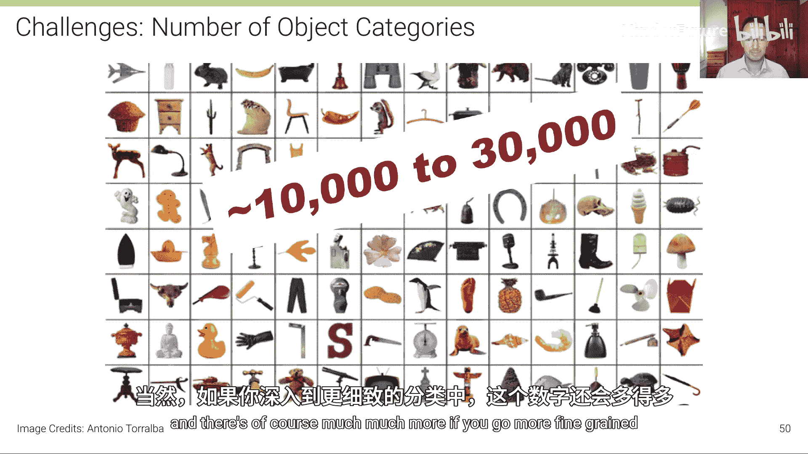
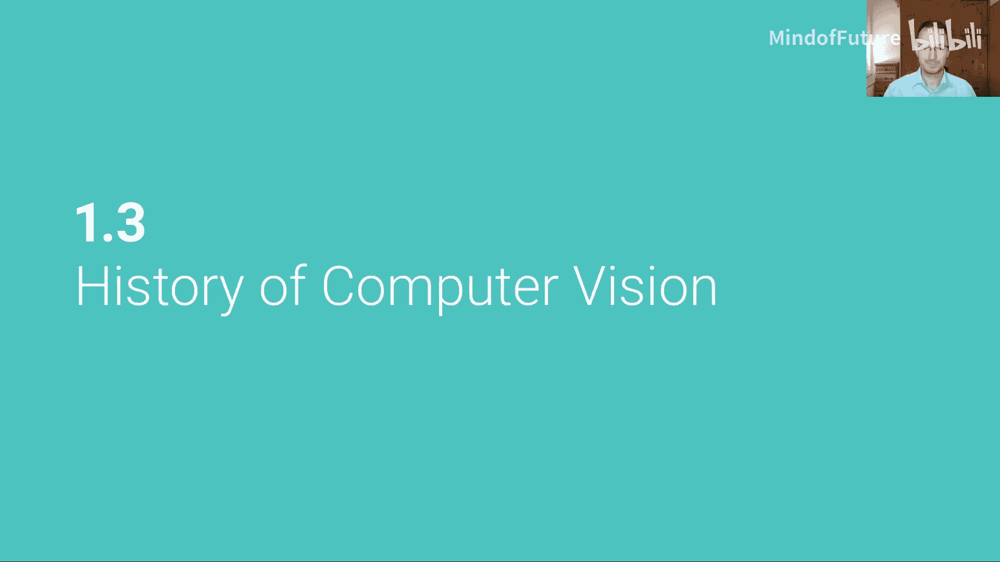

# 002：引言与挑战

在本节课中，我们将介绍计算机视觉的定义，并探讨该领域面临的一些核心挑战。

## 概述

计算机视觉是人工智能的一个重要分支，其核心目标是让机器能够通过“看”来理解世界。我们将从定义出发，探讨其与相关领域的关系，并深入分析为何视觉感知是一个如此困难的问题。

## 计算机视觉的定义与背景

上一节我们介绍了课程的整体框架，本节中我们来看看计算机视觉的具体定义及其在更广阔领域中的位置。

计算机视觉通常被视为人工智能的一个方面。人工智能先驱约翰·麦卡锡将其定义为：**“试图找到让机器使用语言、形成抽象概念、解决目前人类专属的各类问题，并进行自我改进的方法。”** 这当然也包括对环境的视觉感知。

人工智能的子领域包括机器学习、计算机视觉、计算机图形学、自然语言处理、机器人学等。这些领域相互关联，正如我们将在本课程中看到的那样。

例如，如果我们想构建一个机器人系统，该系统必须感知世界或环境，并相应地更新其对世界的内部表征，以便做出适当的决策来最小化某个目标。

计算机视觉可以非常概括地描述为 **“将光转换为意义”**。这种意义可以是几何上的（重建场景的几何结构），也可以是语义上的（识别我们所见的某些方面）。但本质上，计算机视觉接收的输入仅仅是对光模式的一种特定采样。

## 视觉的本质

那么，什么是“看”？大卫·马尔在其著名的视觉著作中写道：“普通人（和亚里士多德）的答案会是：通过看来知道‘什么’在‘哪里’。” 这正是计算机视觉的常见定义：**我们希望计算机通过看来知道什么在哪里**。

用我们的话说，就是从图像中发现世界中存在什么、事物在哪里、正在发生什么动作，并预测和预知世界中的事件。这更偏向机器人学方面，为了执行动作，我们需要预测周围正在发生什么，也需要对未来做出预测。

## 计算机视觉的应用与关联领域

计算机视觉有众多应用，其中许多已经商业化。

以下是部分应用领域：
*   **机器人学**：环境感知与交互。
*   **医学**：医学影像分析。
*   **媒体管理**：构建3D模型、整理照片集。
*   **自动驾驶**：环境理解与决策。
*   **移动设备与无障碍技术**：人脸识别、场景描述等。

正如前面提到的，计算机视觉领域与许多邻近领域有联系。

*   **神经科学与生物视觉**：许多计算机视觉算法从生物视觉中获得灵感。事实上，人类大脑超过50%的处理能力都用于视觉信息，这说明了该任务的重要性和难度。
*   **计算机图形学**：这是计算机视觉的“逆问题”。计算机图形学是给定一个由物体、材质、语义、姿态和运动构成的3D场景，渲染出该场景的逼真2D图像。而计算机视觉则试图解决**逆问题**：从2D图像中恢复出原始的3D场景信息。因此，视觉是一个**病态逆问题**，大量原始信息在投影过程中丢失，需要被恢复。
*   **图像处理**：图像处理关注图像的底层操作，如颜色调整、边缘检测、去噪、图像变形等，这些都发生在2D层面。计算机视觉在早期就与图像处理分道扬镳，因为它更关注获得更整体的场景表征和理解，特别是恢复世界潜在的3D结构。
*   **机器学习**：机器学习工具在当今计算机视觉的各个领域被广泛使用，并使其在现实应用中取得成功。反过来，计算机视觉也为机器学习提供了强大的动机、范例和用例，极大地推动了机器学习（包括语言处理等其他领域）的研究突破。

## 深度学习的革命性影响

在过去的十年里，深度学习彻底改变了计算机视觉，同时计算机视觉也构成了深度学习革命的基础。

一个典型的例子是ImageNet图像分类问题的进展。该数据集包含100万张图像，分为1000个类别，目标是将每张图像分类到正确的类别。在2010年之前，这个问题的进展一度停滞，直到首次证明深度学习可以显著提升其性能。到2015年，算法在该问题上的表现已经超越了人类水平（尽管这对人类来说也非易事）。错误率（Top-5错误率）自2011-2012年以来急剧下降。

计算机视觉开始在相关问题上的有效应用，也增加了该领域的关注度并加速了其发展。例如，顶级会议CVPR的投稿和接收论文数量在过去十年左右急剧增长，参会人数也从2008-2009年左右的约1000人增长到现在的上万人。

由于一些任务现在可以通过计算机视觉解决，围绕计算机视觉已经形成了一个庞大的产业，相关算法被用于各种问题。

## 为什么视觉感知如此困难？

在许多领域，其难度在最初都被低估了。有一个著名的例子是西蒙·派珀特提出的“夏季视觉项目”，他计划用一个夏天的时间让实习生们基本解决计算机视觉问题。事实证明，我们今天仍在研究这个问题，因为它并不容易。问题无法完全分解为独立的子问题，且每个子问题都比最初预期的要困难。

为什么视觉感知很难？对人类来说它似乎很容易，婴儿能快速学习与环境互动。一个关键原因是：当我们人类看一张图片时，能在几毫秒内立即理解图片中发生了什么；而计算机看到的只是一个**像素矩阵**。我们需要解释这个像素矩阵，才能得出关于图像内容的假设，而这种解释是困难的。

挑战之一已经提到：当我们把一个3D场景投影成图像，然后想从图像中重建那个3D场景时，大量信息在投影过程中丢失了。我们面对的是一个病态逆过程，**单个2D图像对应着许多可能的3D解释**。

爱德华·阿德尔森和彭特兰的“工作室隐喻”论文很好地阐释了这一点。为了解释一张2D图像在反射率、光照和形状方面的成因，画家、灯光设计师和雕塑家可能会给出三种不同但都合理的解决方案。画家可能直接在2D平面上作画；灯光设计师可能创建一组光源，将光投射到白墙上，形成完全相同的轮廓和阴影；雕塑家可能创作一个雕塑，通过其相对于入射光方向的不同倾斜角度来呈现图片中的阴影。事实上，存在无限多种解决方案，这正是计算机视觉问题如此困难和病态的原因。

以下是视觉感知面临的其他具体挑战：

*   **视角变化**：同一物体，视角不同，像素矩阵会发生巨大变化。算法需要恢复这种不变性，识别出这是同一个物体。
*   **形变**：许多物体是非刚性变形的，会产生新的像素组合。目标仍然是能够解释这仍是同一个物体。
*   **遮挡**：物体部分被遮挡，使得识别变得困难。
*   **光照变化**：光照与材质之间存在复杂的相互作用。同一场景、同一视角，在不同光照下会产生完全不同的图像，我们对场景的理解也会完全不同。
*   **运动**：运动会产生模糊，使物体更难识别。同时，运动本身也是我们希望恢复的有用线索。
*   **感知与测量的差异**：人类感知到的与物理测量结果可能大相径庭。例如“棋盘阴影错觉”中，A和B方格看起来颜色不同，但测量显示它们灰度值完全相同。还有“卡尼萨三角形”等错觉，表明我们需要整体地、而非局部地观察轮廓来解释场景。
*   **局部歧义与上下文**：局部特征可能是模糊的，但结合整体上下文就变得清晰。有时仅从局部无法区分物体是什么，但纵观整个场景就一目了然。这也说明了我们对场景的先验知识非常强大，甚至可能导致我们在模糊图像中“看到”并不存在的物体。
*   **类内差异**：同一类别的物体外观差异可能很大（例如各式各样的椅子）。算法需要将所有这些差异巨大的个体正确归类到同一类别下。
*   **类别数量庞大**：世界上存在并可命名的物体类别数量极其庞大（估计在1万到3万个高级类别），如果考虑更细粒度的分类，则数量更多，这使得分类问题极具挑战性。

## 总结

本节课我们一起学习了计算机视觉的基本定义，它作为人工智能的核心组成部分，旨在让机器理解视觉世界。我们探讨了其广泛的应用场景以及与神经科学、计算机图形学、图像处理和机器学习等领域的紧密联系。更重要的是，我们深入分析了视觉感知之所以困难的诸多根本原因，包括病态逆问题、视角、光照、遮挡、形变等变化，以及感知与测量的差异、上下文依赖和庞大的类别数量等挑战。理解这些挑战是设计有效计算机视觉算法的第一步。