# 003：计算机视觉简史 📜

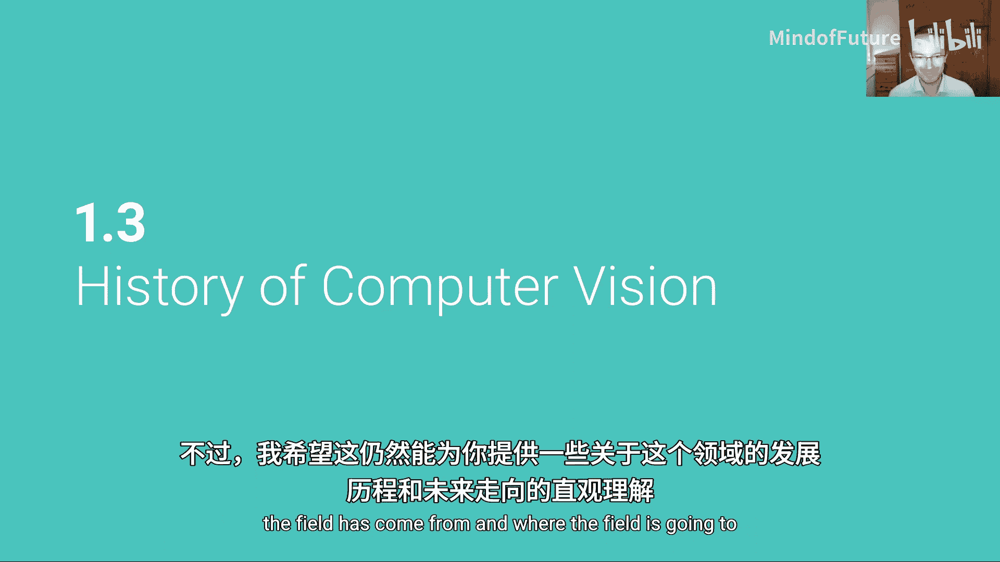

在本节课中，我们将简要回顾计算机视觉领域在过去约50年里的发展历程。这是一个高度浓缩且带有个人视角的总结，但希望能为你提供一些关于该领域从何而来、又将走向何方的直觉。

## 计算机视觉的“史前”时期

在计算机发明之前，人类感知的研究早已开始。例如，透视投影过程在15世纪就由达·芬奇描述过。约翰·海因里希·朗伯（Lambertian反射以其命名）为光度学领域做出了重要贡献。卡尔·弗里德里希·高斯则贡献了最小二乘法，这是一个在包括计算机视觉在内的所有科学领域都非常有用的工具。19世纪，查尔斯·惠斯通研究了立体视觉和产生立体图像的问题。

以下是几个重要的“史前”里程碑：
*   **达·芬奇的透视仪**：一种通过在玻璃表面作画来精确捕捉透视效果的工具。
*   **达盖尔银版法（1839年）**：路易·达盖尔发明的首个公开可用的摄影工艺。
*   **印度大三角测量**：一项持续数十年的项目，通过三角测量和手动“光束法平差”等技术，精确测量了整个印度次大陆，并证明了珠穆朗玛峰是世界最高峰。

## 计算机视觉研究的发展浪潮

上一节我们了解了计算机诞生前的视觉研究。现在，让我们进入更近的历史。计算机视觉研究的发展可以大致分为几个阶段：
*   **1960年代**：早期方法，检测线条并拟合简单几何块来理解世界，但很快发现低级视觉比预想的更困难。
*   **1970年代**：兴趣转向低级视觉研究，立体视觉、光流、从明暗恢复形状等技术得到发展。
*   **1980年代**：反向传播算法的发明使神经网络复兴，首个自动驾驶模型被提出。
*   **1990年代**：马尔可夫随机场和概率图模型流行，用于解决立体视觉等任务中的歧义问题。
*   **2000年代**：SIFT等特征描述子和检测器出现，实现了真正的大规模运动恢复结构和三维重建。
*   **2010年代至今**：神经网络在拥有大数据集的任务上超越传统方法，成为主导技术，推动了领域的快速发展和商业化。

## 1950-1960年代：早期探索与过高期望

上一节我们概述了发展脉络，本节我们将具体看看早期的重要工作。1957年，出现了首个立体图像相关的模拟实现，用于从航拍图像恢复数字高程模型。1958年，罗森布拉特发明了感知机，这是一个使用感知机算法训练的简单线性分类器，能够分类简单模式（如区分男女）。然而，当时对其期望过高，预言十年内将出现能行走、交谈、有意识的计算机，这并未实现。

1963年，拉里·罗伯茨在其博士论文中研究了“三维固体的机器感知”，旨在从图像线条的拓扑结构恢复物体的三维结构，以用于机器人操作。这标志着计算机视觉与机器人学的早期结合。然而，该系统非常脆弱，仅适用于简单场景。1966年，明斯基和佩珀特在麻省理工学院的暑期项目中试图“解决”计算机视觉问题，但低估了其挑战性。

## 1970年代：聚焦低级视觉与内在图像

上一节我们看到早期系统非常脆弱。因此，研究重点转向了更鲁棒的低级视觉方法。1970年，麻省理工学院的研究人员开发了“复制积木”演示，使用积木世界感知算法让机器人复制一组积木的排列。这促使人们认识到需要改进低级视觉（如边缘检测）。

1971年，霍恩发表了关于从明暗恢复形状的著名技术报告，研究如何从单张二维图像的 shading 信息恢复三维形状。这是一个病态问题，需要平滑性约束来正则化。公式可以表示为寻找表面法向 **n** 和深度 **z**，使得图像强度 **I(x, y)** 符合反射模型，例如朗伯模型：**I = ρ (n · l)**，其中 **ρ** 是反射率，**l** 是光源方向。

1978年，内在图像被提出作为一种中间表示。其思想是将图像分解为不同的本征成分（如反射率、阴影），形成不同的二维图层，以帮助下游任务（如目标检测）对光照变化更鲁棒。

## 1980年代：几何基础、优化与神经网络复兴

上一节我们讨论了从单图像恢复形状的挑战。本节我们来看看利用多视图几何和优化方法的重要进展。1980年，伍德拉姆提出了光度立体视觉，通过使用多张已知或未知光源位置的图像，无需重度平滑约束即可恢复表面法向。假设朗伯表面，对于每个像素，至少需要三个不同光照方向的观测 **I₁, I₂, I₃**，可以求解表面法向 **n**。

1981年，朗格-希金斯重新引入了本质矩阵，论文为《从两个投影重建场景的计算机算法》。本质矩阵 **E** 定义了双视图几何，将一个图像上的点映射到另一个图像上的对极线，是立体视觉技术的基石。其性质是：对于对应点 **x** 和 **x'**，满足 **x'ᵀ E x = 0**。

同样在1981年，早期立体匹配方法通过引入动态规划（如维特比算法）来沿扫描线添加平滑性和遮挡约束，以克服歧义，但会导致扫描线间的条纹伪影。同年，霍恩和申克发表了光流领域最著名的论文《确定光流》，提出了第一个变分算法，将先验约束整合到数学框架中，以恢复稠密光流场。

1984年，离散马尔可夫随机场被用作编码立体匹配或光流等问题先验知识的方法，催生了变分推断、置信传播、图割等多种优化算法。

1980年代也是基于部件模型（如1986年的超二次曲面）流行的时期，这些模型用少量参数表示基本三维形状部件。同时，1986年，鲁梅尔哈特和威廉姆斯推广了用于训练神经网络的反向传播算法，它通过动态规划高效计算损失函数对百万级参数的梯度，至今仍是深度学习的主力算法。代码概念如下：
```python
# 反向传播核心思想：链式法则
def backward(loss, parameters):
    grads = compute_gradient(loss, parameters) # 通过链式法则计算梯度
    update_parameters(parameters, grads) # 使用梯度更新参数
```
1986年，首个自动驾驶汽车在欧洲的普罗米修斯项目中得到演示，时速达40公里。1988年，卡内基梅隆大学的ALVINN成为首个使用神经网络进行自动驾驶的汽车，它直接将输入图像映射为转向控制。

## 1990年代：运动恢复结构、三维重建与特征提取

上一节我们看到了80年代在几何、优化和神经网络方面的基础工作。进入90年代，这些思想催生了更强大的三维视觉技术。1992年，托马斯和坎纳德发表了著名的因子分解法论文，允许从静态场景的二维图像序列中估计三维结构，在仿射情况下可通过奇异值分解求解。

1992年，迭代最近点算法被提出，用于配准两个点云，通过迭代优化刚体或非刚性变换使点云对齐。目标是最小化对应点之间的距离。

1996年，体积融合技术被引入计算机图形学，通过将表面隐式表示为空间离散场的零水平集，并聚合多个观测，来融合物体的多个局部视图。

1998年，福赛斯和卡托尔提出了基于水平集方法的多视图立体视觉，将立体视觉表述为直接优化三维表面（表示为水平集）的重建误差，并考虑了可见性，支持灵活的拓扑结构。

同样在1998年，图割算法开始流行，它是一种能有效求解包含一元（单像素）和二元（像素间）项的马尔可夫随机场能量最小化问题的算法，实现了全局推理，相比逐行扫描方法结果更一致。

1998年，莱坎等人提出了卷积神经网络，通过卷积和池化实现空间不变性，并权重共享减少参数量。但当时仅在MNIST数据集上表现良好，未引起计算机视觉社区足够重视。

1999年，布莱恩和维特实现了可变形模型用于单视图三维人脸重建，他们基于200个激光扫描人脸建立子空间模型，并拟合新图像的几何和外观。同年，尺度不变特征变换被提出，这是一种检测和描述图像中显著局部特征的算法，为图像拼接、三维重建等应用奠定了基础。

## 2000年代：互联网规模的重建与数据集的兴起

上一节我们看到了SIFT等特征如何赋能三维重建。本节我们来看看这些技术如何扩展到互联网规模。2006年，斯内夫利和塞利斯基的“照片旅游”论文展示了从网络照片进行大规模三维重建，关键因素是SIFT特征、强大计算资源和巧妙的大规模光束法平差管线。

2007年，Furukawa和Ponce的PMVS（基于块的多视图立体）论文首次展示了各种物体高质量、高鲁棒性的三维重建。2009年，“一日建成罗马”项目实现了从数万张网络照片重建整个城市地标的三维模型。

2011年，微软Kinect相机上市，这是一个廉价的主动式深度传感设备，虽在消费市场未完全成功，但极大地推动了机器人和视觉研究。

2012年，ImageNet大规模视觉识别挑战赛以及AlexNet的突破性表现，证明了深度神经网络在复杂真实世界数据集上的有效性，点燃了计算机视觉和深度学习的研究热潮。数据集的创建变得至关重要。以下是一些著名数据集：
*   **ImageNet**：用于图像分类。
*   **PASCAL VOC**：用于目标检测、分割。
*   **MS COCO**：用于目标检测、分割、字幕生成。
*   **KITTI**：用于自动驾驶场景理解。

## 2010年代至今：深度学习的统治与新兴挑战

上一节我们看到了大数据集如何推动深度学习革命。本节我们将探讨深度学习带来的具体进展和当前挑战。2014年，辛顿等人展示了深度神经网络容易被对抗样本愚弄，即对输入添加微小扰动就能导致错误分类，这引发了对模型鲁棒性的研究。

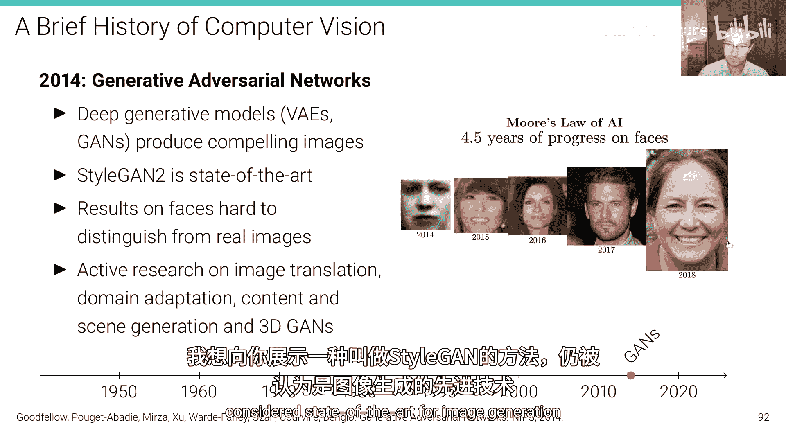

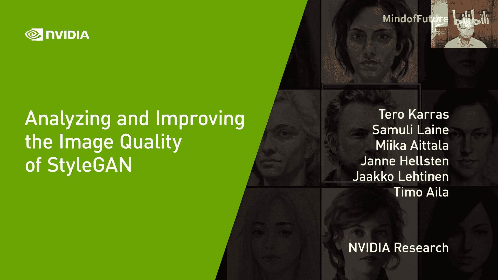

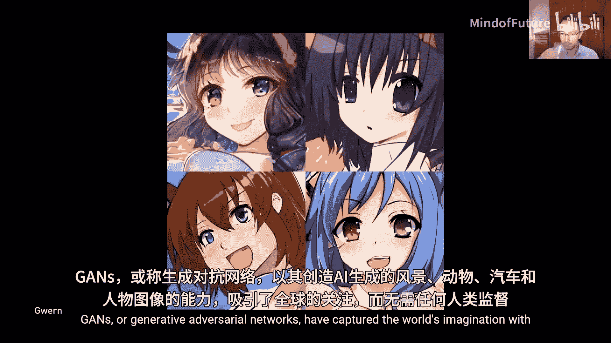

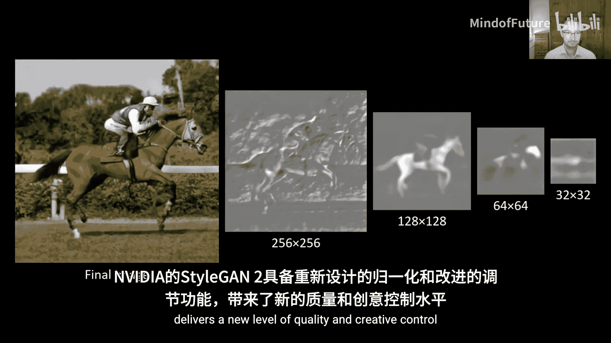

同年，生成对抗网络和变分自编码器的提出，实现了无监督学习下的逼真图像生成。随后的StyleGAN等模型在图像生成质量上达到新高。

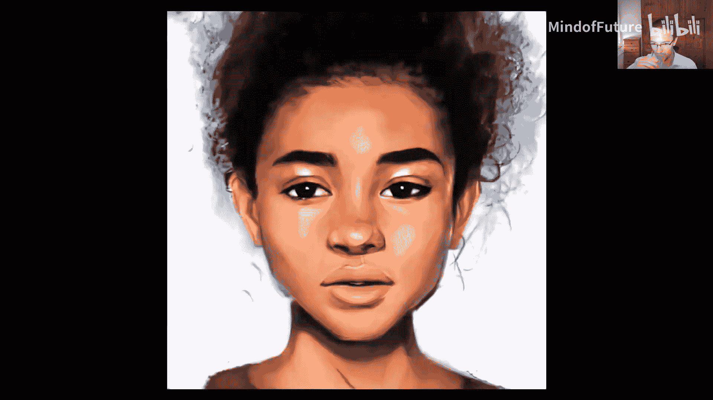

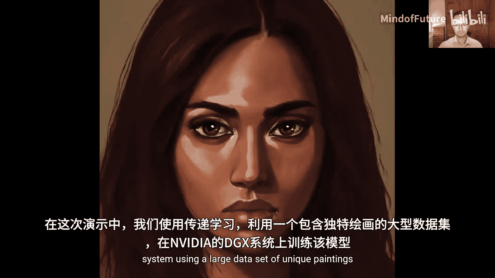

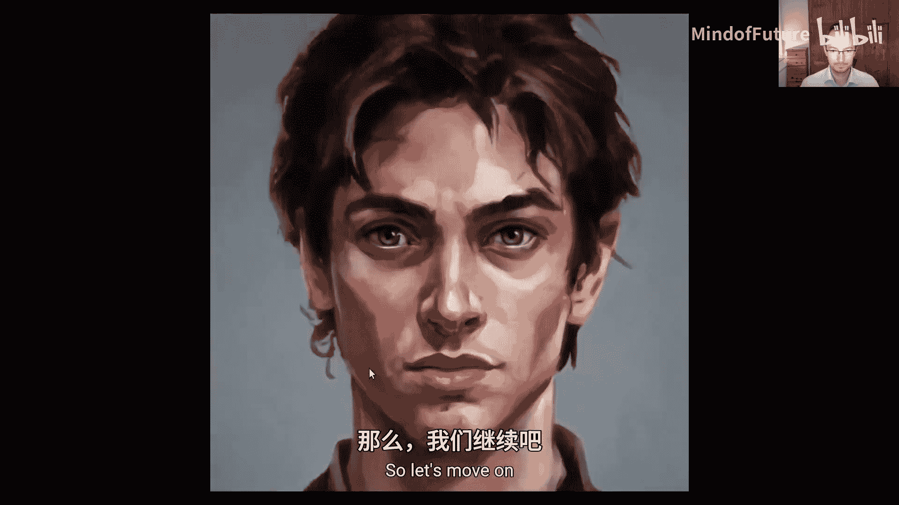

2014年，DeepFace等模型展示了人脸识别性能达到甚至超越人类水平，这得益于传统技术与深度学习的结合。

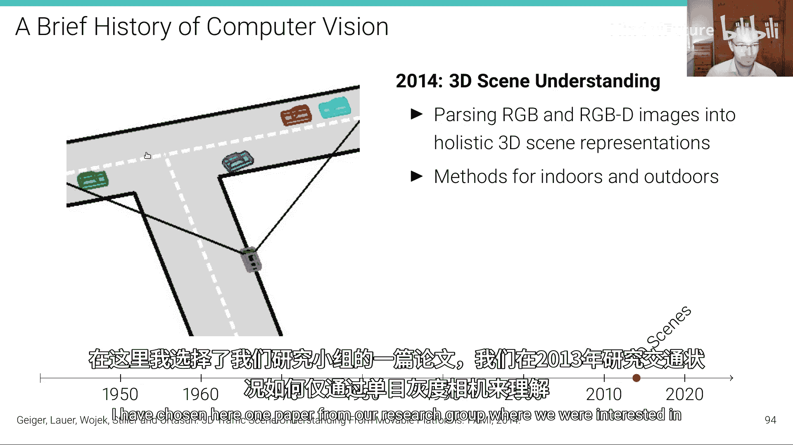

2015年，DeepMind展示了通过深度强化学习直接从图像像素学习玩视频游戏。同年，加特伊等人的论文“使用卷积神经网络进行图像风格迁移”展示了如何将一幅图像的内容与另一幅图像的风格结合。

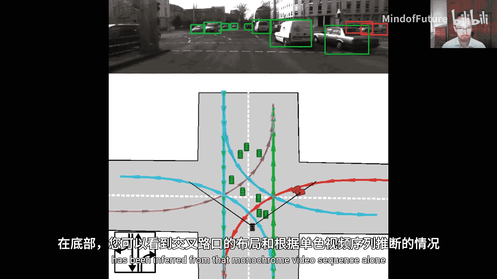

语义分割任务（为每个像素分配类别标签）在2015年后因全卷积网络等模型而性能大幅提升。实例如Mask R-CNN，能够同时进行目标检测和实例分割。

2017年左右，图像描述和视觉问答等新任务兴起，模型能够为图像生成句子或回答关于图像的问题，但仍存在对数据集偏差敏感和缺乏常识的问题。

三维视觉也深度融入深度学习。从使用点云、体素发展到最新的神经隐式表示，这些模型能够从单张图像预测完整的三维模型，包括几何、材质、光照和运动。

## 应用与未来挑战

计算机视觉技术已广泛应用于日常生活和商业产品中，例如：
*   智能手机的人像模式。
*   Skydio 2等自主导航无人机。
*   自动驾驶汽车（仍在发展中）。
*   虚拟现实/增强现实设备（如HoloLens），用于头部追踪、物体检测和定位。
*   人脸识别在安防等领域的应用。

尽管取得了巨大进展，许多挑战依然存在：
*   **数据**：获取大规模、高质量标注数据集成本高昂，推动了对自监督、半监督和交互式学习的研究。
*   **准确性**：在自动驾驶等安全关键领域，需要达到并超越人类的鲁棒性和准确性。
*   **可解释性**：理解深度学习黑盒模型内部的运作机制。
*   **效率**：许多模型，特别是三维模型，对内存和计算要求高，需要更高效的算法和表示。
*   **伦理与法律**：随着技术商业化，相关的伦理、隐私和法律问题日益重要。

## 总结

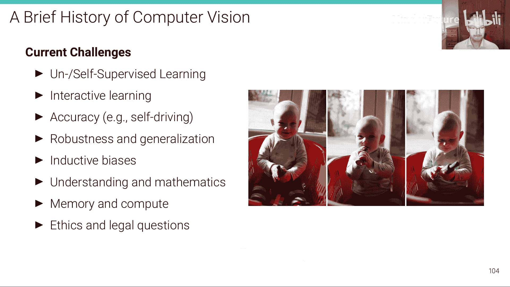

本节课我们一起回顾了计算机视觉从早期几何方法、到低级视觉研究、再到特征工程和优化方法，最终进入以数据驱动的深度学习时代的发展简史。我们看到，许多经典思想在今天与深度学习结合后重新焕发生机。同时，领域仍面临数据、鲁棒性、可解释性、效率和伦理等诸多挑战，等待未来的研究者去探索和解决。