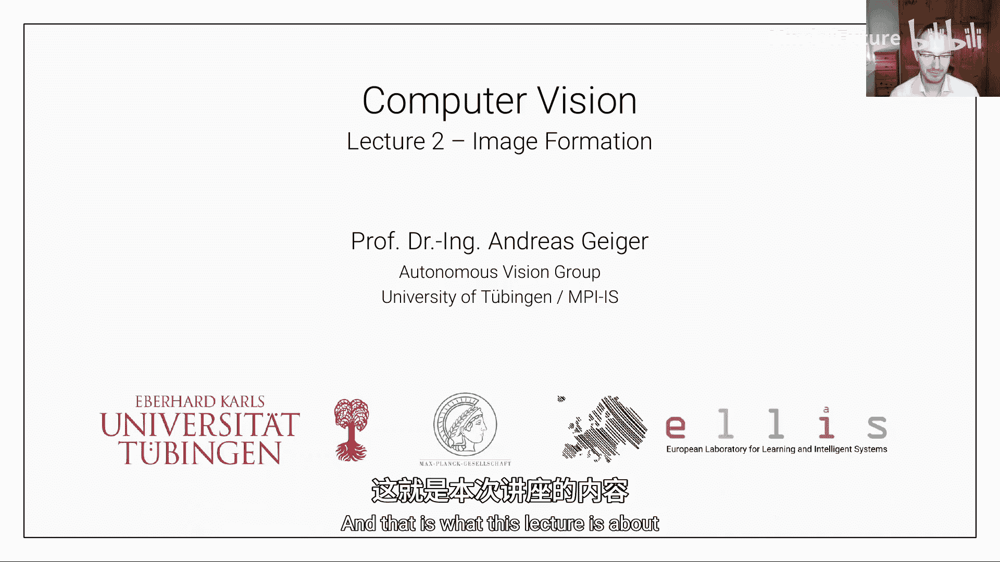
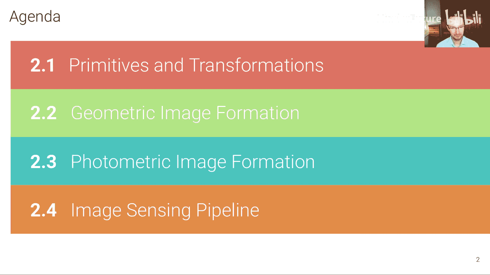

# 004：图像形成 - 基本图元与变换 🖼️➡️📐






在本节课中，我们将要学习计算机视觉的基础：图像形成过程。具体来说，我们将探讨三维场景如何投影到二维图像上。为了建立数学模型来描述这个过程，我们首先需要理解一些基本的几何图元和变换。本节课将介绍这些核心概念，特别是齐次坐标这一强大工具，它能够极大地简化几何关系的表达和计算。

## 基本图元与变换

上一节我们概述了图像形成的整体流程。本节中，我们来看看描述三维形状所需的基本构建块——几何图元，以及如何对它们进行变换。我们将重点介绍点、线和平面，并讨论在二维和三维空间中最基本的变换。

### 二维点

二维点可以用传统的非齐次坐标表示，它是一个包含两个实数标量的二维向量，用于描述图像域中的坐标。

为了更优雅地处理几何问题，我们引入齐次坐标表示。齐次坐标通过增加一个维度来扩展向量空间。对于二维点，这意味着我们使用一个三维空间，但移除了零向量，这个空间称为**投影空间 P²**。

一个二维非齐次坐标点 **x** 可以转换为齐次坐标 **x̃**，方法是在其末尾添加一个 1：
```
x = [x, y]ᵀ  ->  x̃ = [x, y, 1]ᵀ
```
我们使用波浪号（~）表示这是一个齐次坐标向量。所有仅相差一个缩放因子的齐次向量被认为是等价的（即属于同一个等价类）。这意味着齐次坐标**只定义到尺度**。

为什么需要这种看似复杂的表示？因为它带来了诸多好处：可以方便地表示无穷远点、表达平行线的交点、将多个变换组合为线性操作，并且能线性化表示对三维计算机视觉至关重要的投影变换。

要将齐次坐标 **x̃ = [x̃, ỹ, w̃]ᵀ** 转换回非齐次坐标，只需用前两个分量除以最后一个分量：
```
x = [x̃/w̃, ỹ/w̃]ᵀ
```
当齐次向量的最后一个分量 **w̃ = 0** 时，该点被称为**理想点**或**无穷远点**，它无法用非齐次坐标表示。

### 二维线

在齐次坐标中，二维线也可以简洁地表示。一条线可以用一个齐次向量 **l̃ = [a, b, c]ᵀ** 表示。线上所有点 **x̄ = [x, y, 1]ᵀ**（即增广向量）满足以下方程：
```
l̃ᵀ x̄ = ax + by + c = 0
```
这其实就是我们熟悉的直线方程。我们可以将 **l̃** 归一化，使得 **l = [nₓ, nᵧ, d]ᵀ**，其中 **n** 是垂直于直线的单位法向量，**d** 是原点到直线的距离。

一个特殊的线是**无穷远线 l̃∞ = [0, 0, 1]ᵀ**，它穿过所有的无穷远点。

### 点与线的交互

齐次坐标的一个强大之处在于，可以非常简洁地表达点与线之间的关系。

以下是两个关键操作：
*   **两条线的交点**：两条线 **l̃₁** 和 **l̃₂** 的交点 **x̃** 可以通过叉积计算：
    ```
    x̃ = l̃₁ × l̃₂
    ```
*   **连接两点的线**：两个点 **x̃₁** 和 **x̃₂** 所确定的线 **l̃** 也可以通过叉积计算：
    ```
    l̃ = x̃₁ × x̃₂
    ```
这里的叉积可以表示为斜对称矩阵与向量的乘法。例如，向量 **a** 和 **b** 的叉积 **a × b** 可以写为 **[a]ₓ b**，其中 **[a]ₓ** 是 **a** 对应的斜对称矩阵。

**示例**：求两条线 **y=1** 和 **x=2** 的交点。
*   线向量分别为 **l̃₁ = [0, 1, -1]ᵀ** 和 **l̃₂ = [1, 0, -2]ᵀ**。
*   计算叉积：**x̃ = l̃₁ × l̃₂ = [2, 1, 1]ᵀ**。
*   由于最后一个分量为1，可以直接读出非齐次坐标为 **(2, 1)**，这正是两线的交点。

对于平行线，例如 **x=1** 和 **x=2**，其交点计算结果为 **[0, -1, 0]ᵀ**，最后一个分量为0，表示交点在无穷远处，符合预期。

### 从二维到三维

三维点的表示是二维的自然延伸。

一个三维非齐次点 **X = [X, Y, Z]ᵀ** 对应的齐次坐标为 **X̃ = [X, Y, Z, 1]ᵀ**，它位于投影空间 **P³** 中。同样，所有仅相差一个标量因子的齐次向量是等价的。转换方式与二维相同：
```
X = [X̃/Ẃ, Ỹ/Ẃ, Z̃/Ẃ]ᵀ
```

三维平面也可以用齐次坐标表示。一个平面由齐次向量 **ṁ = [A, B, C, D]ᵀ** 表示，平面上所有点 **X̄ = [X, Y, Z, 1]ᵀ** 满足：
```
ṁᵀ X̄ = AX + BY + CZ + D = 0
```
同样可以归一化，使得 **n = [A, B, C]ᵀ** 是单位法向量，**D** 是原点到平面的距离。**无穷远平面**穿过所有无穷远点。

三维线的表示稍复杂，一个常见但非最小化的表示是使用线上的两个点 **P** 和 **Q** 进行参数化：**L(λ) = (1-λ)P + λQ**。它有4个自由度，但用了6个参数。更高效的表示法（如两平面交线或普吕克坐标）可在相关教材中找到。

### 二次曲面

三维空间中，二次曲面（如球体、椭球体、抛物面、双曲面）可以用齐次坐标下的二次方程表示：
```
X̃ᵀ Q X̃ = 0
```
其中 **Q** 是一个4x4的对称矩阵。改变 **Q** 可以得到不同的二次曲面。这些曲面在多视图几何中很有用，也可作为紧凑的基元来建模和理解复杂场景。

## 二维变换

理解了基本图元后，我们来看看如何对它们进行变换。变换在计算机视觉中至关重要，用于描述相机运动、图像配准等。我们将从最简单到最复杂，介绍一个变换层次结构。

所有变换都可以用作用于齐次坐标的矩阵来表示，这使得变换的组合和求逆变得非常容易。

以下是主要的二维变换类型：

1.  **平移变换**
    *   **描述**：将物体移动到新位置。
    *   **自由度**：2 (tₓ, tᵧ)。
    *   **矩阵形式**：
        ```
        [ I   t ]
        [ 0   1 ]
        ```
        其中 **I** 是2x2单位矩阵，**t** 是平移向量。
    *   **保持性质**：欧氏距离、角度、平行性、直线性。

2.  **欧氏变换（刚体变换）**
    *   **描述**：平移 + 旋转。
    *   **自由度**：3 (旋转角 θ, tₓ, tᵧ)。
    *   **矩阵形式**：
        ```
        [ R   t ]
        [ 0   1 ]
        ```
        其中 **R** 是2x2旋转矩阵（**RᵀR = I**, det(R)=1）。
    *   **保持性质**：欧氏距离、角度、平行性、直线性。

3.  **相似变换**
    *   **描述**：平移 + 旋转 + 均匀缩放。
    *   **自由度**：4 (s, θ, tₓ, tᵧ)。
    *   **矩阵形式**：
        ```
        [ sR   t ]
        [ 0    1 ]
        ```
    *   **保持性质**：角度、平行性、直线性（不保持距离）。

4.  **仿射变换**
    *   **描述**：平移 + 线性变换（可包含缩放、剪切、旋转）。
    *   **自由度**：6 (一个任意的2x2矩阵 **A** 的4个元素 + tₓ, tᵧ)。
    *   **矩阵形式**：
        ```
        [ A   t ]
        [ 0   1 ]
        ```
    *   **保持性质**：平行性、直线性（不保持角度和距离）。

5.  **投影变换（单应性变换）**
    *   **描述**：最一般的线性齐次变换。
    *   **自由度**：8 (3x3齐次矩阵，定义到尺度)。
    *   **矩阵形式**：
        ```
        H = [ h₁₁ h₁₂ h₁₃ ]
            [ h₂₁ h₂₂ h₂₃ ]
            [ h₃₁ h₃₂ h₃₃ ]
        ```
        变换为：**x̃‘ = H x̃**。
    *   **保持性质**：直线性（不保持平行性、角度、距离）。

这个变换集合形成了一个嵌套群结构，更严格的变换（如欧氏变换）是更一般变换（如仿射变换）的子集。所有变换都保持其下方变换所保持的性质。

### 共向量的变换

我们知道了如何变换点（**x̃‘ = H x̃**）。那么像直线这样的共向量如何变换呢？

设一条直线由 **l̃** 定义，变换后的直线为 **l̃’**。对于变换后的点 **x̃’**，它仍在变换后的线上，满足 **l̃’ᵀ x̃’ = 0**。代入 **x̃’ = H x̃**，得到 **l̃’ᵀ H x̃ = 0**。由于变换前有 **l̃ᵀ x̃ = 0**，因此可以推导出：
```
l̃’ = H⁻ᵀ l̃
```
即，直线（或法向量等共向量）的变换矩阵是点变换矩阵的**逆的转置**。

## 单应性矩阵估计

在实际应用中，我们经常需要从图像对应点中估计变换矩阵。我们以最一般的投影变换（单应性）为例。

给定两组二维点之间的对应关系 **{xᵢ ↔ xᵢ’}**，它们通过一个单应性矩阵 **H** 相关联：**x̃ᵢ’ = H x̃ᵢ**。由于 **H** 有8个自由度，而每个点对应提供两个约束（x和y坐标），因此我们至少需要**4组**非共线的对应点来求解。

为了处理齐次向量的尺度不确定性，我们将方程改写为叉积形式：
```
x̃ᵢ’ × (H x̃ᵢ) = 0
```
这确保了向量方向一致，而不关心其长度。这个方程可以转化为关于 **H** 元素的线性方程组。每个点对应 **i** 贡献两个线性方程。将所有方程堆叠起来，形成一个形如 **A h = 0** 的方程组，其中 **h** 是将 **H** 矩阵按行展开成的9维向量。

我们需要在约束 **||h|| = 1** 下最小化 **||A h||²**。这可以通过求解**奇异值分解（SVD）** 来解决：**h** 是矩阵 **A** 的**最小奇异值对应的右奇异向量**（即 **A = UDVᵀ** 中 **V** 的最后一列）。这种方法称为**直接线性变换（DLT）算法**。

**应用示例：图像拼接**
我们可以利用单应性估计来创建全景图。假设从同一视点拍摄了两张有重叠区域的图像：
1.  在两幅图像中手动或自动选取至少4组对应点。
2.  使用DLT算法估计将第一幅图像映射到第二幅图像坐标系的单应性矩阵 **H**。
3.  利用 **H** 对第一幅图像进行透视变换（扭曲），使其与第二幅图像对齐。
4.  将变换后的图像与第二幅图像融合，得到更宽视野的全景图。这是智能手机全景拍照功能的基本原理。

---


本节课中我们一起学习了计算机视觉中图像形成的几何基础。我们首先介绍了齐次坐标这一核心概念，它通过升维和尺度等价性，优雅地表示了点、线、面等基本图元，并能处理无穷远元素。接着，我们探讨了从平移、欧氏变换到投影变换的层次结构，了解了它们各自的矩阵表示和几何不变性。最后，我们学习了如何从点对应关系中估计单应性矩阵，并将其应用于图像拼接等实际任务。掌握这些基本的几何图元和变换，是理解后续更复杂的相机模型和三维重建技术的基石。