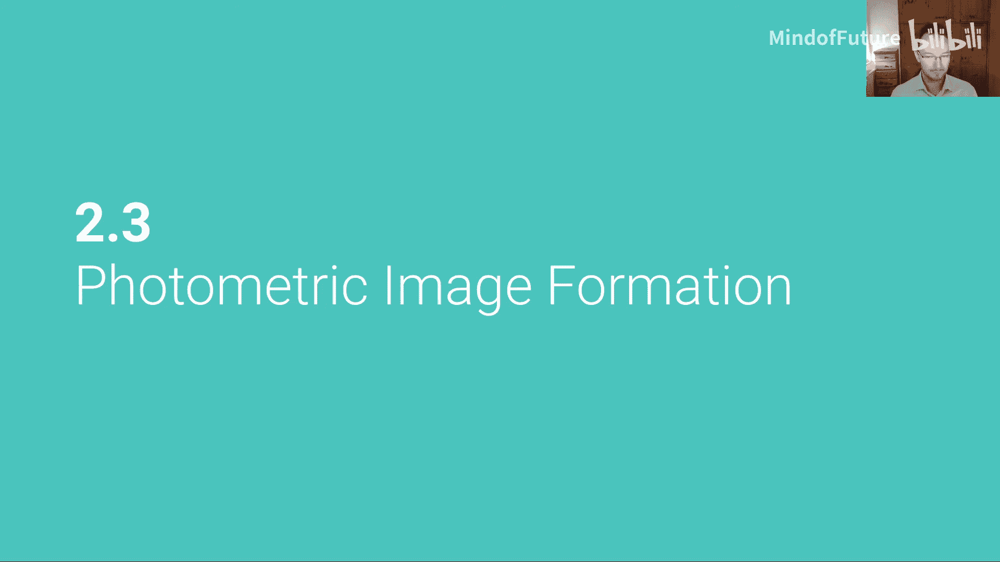
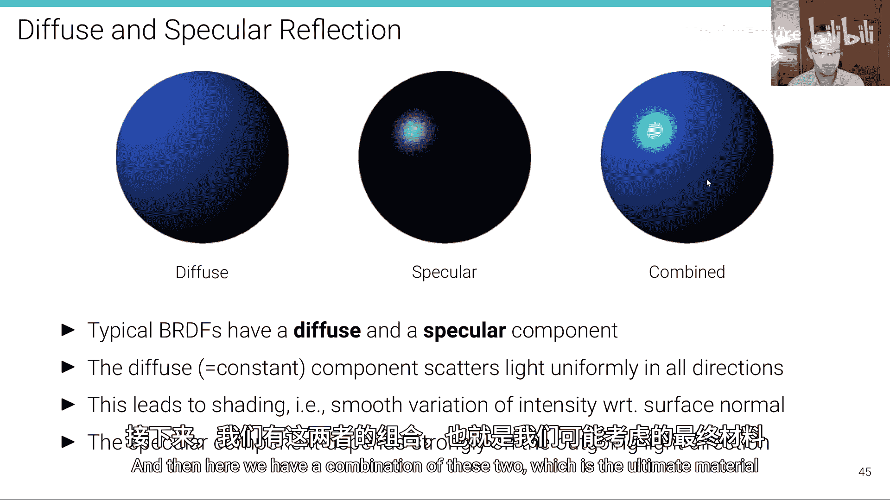
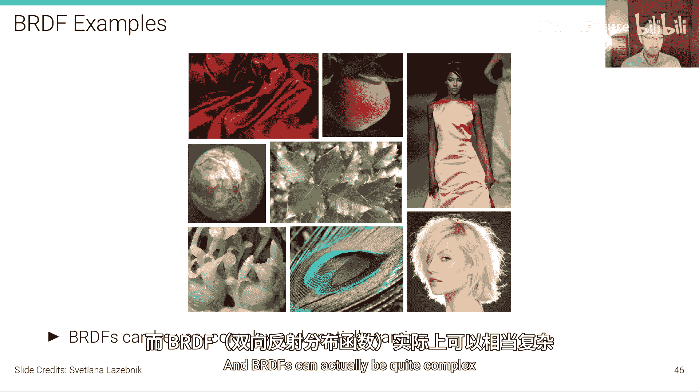
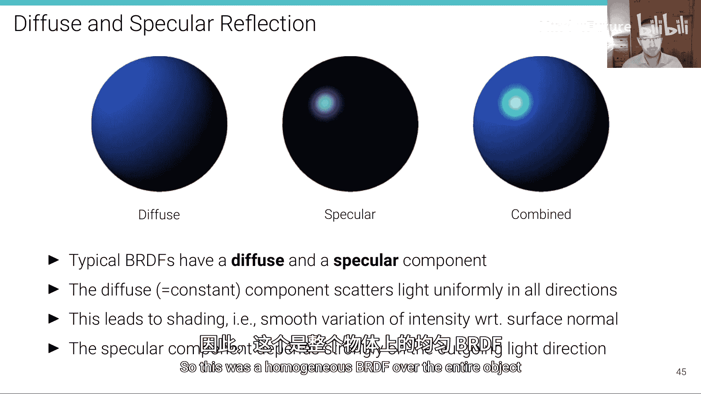
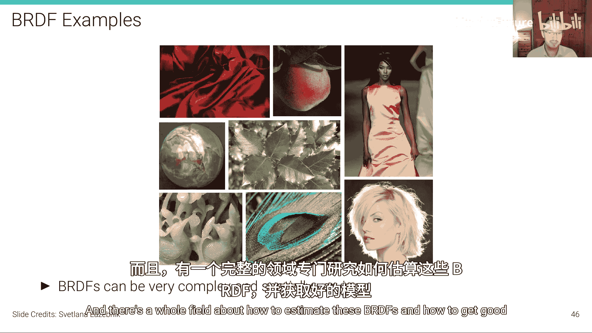
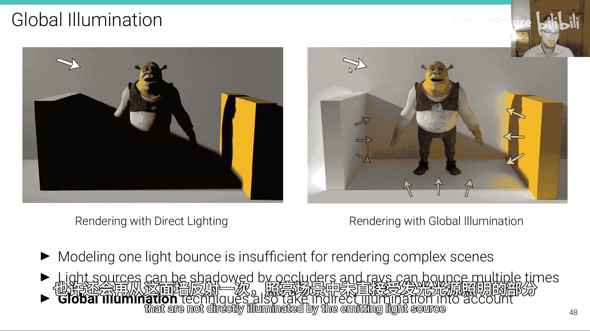
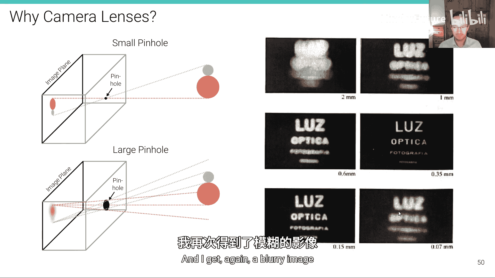
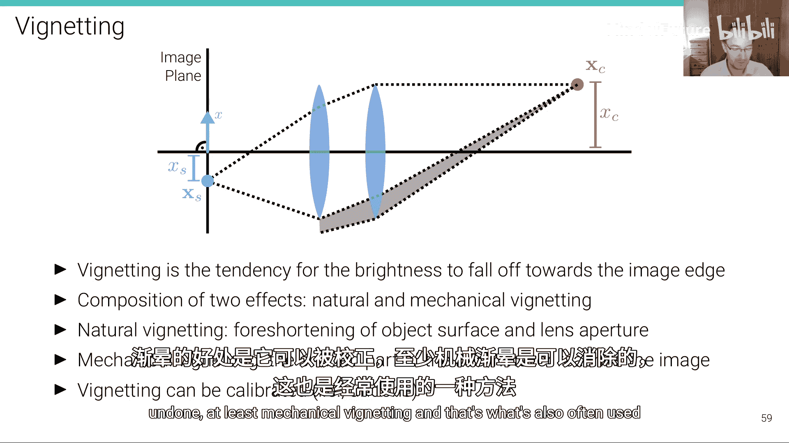
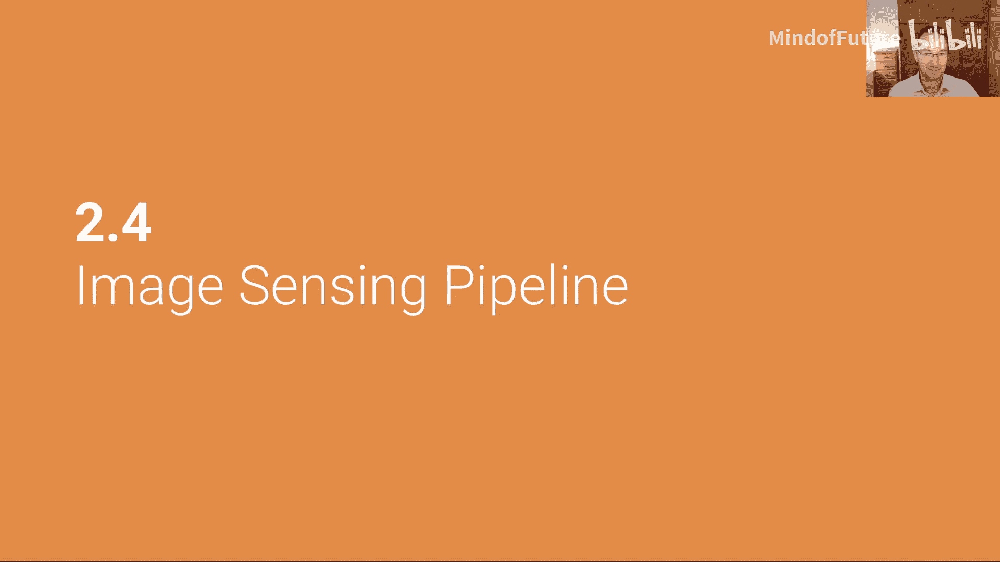

# 006：光度图像形成 📸

在本节课中，我们将要学习光度图像形成过程。我们已经讨论了光线如何在空间中传播，现在我们将探讨光线到达传感器平面后，如何最终形成我们看到的像素强度和颜色图像。

## 从场景到图像

当我们拍摄一个场景时，我们从一个特定的视点（即相机的位置）观察一个光场。这个光场是光线在场景中传播的结果：光线从光源（如灯泡或太阳）发出，穿过场景，照射到物体表面，从表面反射，最终到达传感器平面。

为了精确地建模光线从表面反射的过程，我们使用一个称为**渲染方程**的数学工具。这是计算机图形学中最基础的方程之一。

## 理解渲染方程

为了理解这个方程的基础，我们定义几个变量：
*   设 **P** 为一个三维表面点。
*   设 **V** 为观察方向（从表面点指向相机的方向）。
*   设 **ω_i** 为入射光方向。
*   设 **n** 为该表面点处的法线。

渲染方程描述了从所有可能方向到达点 **P** 的、波长为 **λ** 的光线，有多少被反射到了观察方向 **V** 中。

其核心公式如下：

**L_o(P, V, λ) = L_e(P, V, λ) + ∫_Ω f_r(P, ω_i, V, λ) L_i(P, ω_i, λ) (n · ω_i) dω_i**

让我们分解这个公式：
*   **L_o(P, V, λ)**：从点 **P** 沿方向 **V** 出射的、波长为 **λ** 的光的辐射亮度。
*   **L_e(P, V, λ)**：点 **P** 自身沿方向 **V** 发射的光（例如，如果该点本身是光源）。
*   **∫_Ω**：对以点 **P** 法线为中心的**上半球面 Ω** 上所有可能的入射方向 **ω_i** 进行积分。
*   **f_r(P, ω_i, V, λ)**：**双向反射分布函数**。它决定了在点 **P**，对于给定的入射方向 **ω_i** 和出射方向 **V**，波长为 **λ** 的光有多少被反射。这是描述材料反射特性的核心函数。
*   **L_i(P, ω_i, λ)**：从方向 **ω_i** 入射到点 **P** 的、波长为 **λ** 的光的辐射亮度。
*   **(n · ω_i)**：法线 **n** 与入射方向 **ω_i** 的点积。这个项模拟了**衰减效应**：当光线以非常浅的角度照射表面时，单位面积接收到的光能更少；当光线垂直照射时，接收到的光能最多。

## 双向反射分布函数

BRDF 描述了材料如何反射光线。典型的 BRDF 包含两个主要分量：**漫反射**和**镜面反射**。

以下是这两种反射特性的说明：
*   **纯漫反射表面**：入射光线被均匀地反射到所有方向。这导致 shading（明暗）随着表面法线的变化而平滑变化。例如：石膏、粗糙的墙面。
*   **纯镜面反射表面**：入射光线像镜子一样，被反射到一个特定的方向（即理想镜面反射方向）。例如：完美的镜子。
*   **真实表面**：通常是漫反射和镜面反射的混合。例如：光滑的塑料、上了清漆的木头，它们既有均匀的底色（漫反射），也有高光点（镜面反射）。

BRDF 可以非常复杂，它们可能在物体表面不同位置变化（空间变化），并且可能包含像**菲涅尔效应**这样的现象。菲涅尔效应是指，从表面反射的光量取决于观察角度（例如，看水面时，远处反射强像镜子，近处则能看清水底）。

## 全局光照

光线在场景中通常不会只反射一次。它可能从一个表面反射到另一个表面，然后再进入相机。模拟这种多次反射的效果被称为**全局光照**。全局光照对于生成真实感图像至关重要，它能产生柔和的阴影、颜色渗透（例如，红墙旁边的白墙会略带红色）等效果。没有全局光照的渲染看起来会不自然且生硬。

上一节我们介绍了光线与表面交互的基本原理，本节中我们来看看相机如何捕捉这些光线。

## 为什么需要镜头？

我们讨论过针孔相机模型，它也是带镜头相机的良好近似。但为什么相机不直接用针孔，而要用复杂的镜头系统呢？

原因在于权衡：针孔大小直接影响成像质量。
*   针孔**非常小**：进光量极少，需要极长的曝光时间，导致运动模糊或相机抖动模糊。此外，过小的孔还会产生**衍射效应**，同样导致图像模糊。
*   针孔**稍大**：一个物点发出的多条光线会通过针孔的不同部位，在像平面上形成一个弥散斑，导致图像**模糊**。

因此，为了在合理曝光时间内获得足够亮且清晰的图像，我们需要镜头来汇聚光线。

## 薄透镜模型

最基本的镜头模型是**薄透镜模型**。它假设透镜很薄，且两面为球面。这个模型常用来近似更复杂的真实镜头系统。

薄透镜有几个关键特性：
1.  透镜两侧各有一个**焦点 F**。
2.  平行于主光轴的光线，穿过透镜后汇聚于另一侧的焦点。
3.  穿过透镜中心的光线，方向不变。

利用这些特性和相似三角形原理，我们可以推导出最重要的透镜公式之一：

**1 / d_o + 1 / d_i = 1 / f**

其中：
*   **d_o**：物距（物体到透镜的距离）。
*   **d_i**：像距（透镜到清晰成像平面的距离）。
*   **f**：透镜的焦距。

这个公式建立了物距、像距和焦距之间的关系。对于给定的镜头（固定 **f**）和对焦距离（**d_o**），我们可以计算出需要将传感器放在多远（**d_i**）才能获得清晰图像。反之亦然。

当物距趋于无穷远时，**d_i ≈ f**。这就是为什么焦距为 **f** 的镜头，可以近似看作位于传感器前 **f** 距离处的针孔。

## 景深与光圈

如果传感器平面不在公式计算出的正确像距上，一个物点就会在传感器上形成一个模糊的圆斑，称为**弥散圆**。当弥散圆的大小超过一个像素时，图像就会显得模糊。

控制弥散圆大小（从而控制清晰范围）的一个关键部件是**光圈**。光圈是镜头内部一个可调节大小的孔。

以下是光圈的影响：
*   **光圈大小**：用**F 值**表示，F 值 = 焦距 / 光圈孔径直径。**F 值越小，光圈孔径越大**。
*   **景深**：图像中看起来清晰的距离范围。
    *   **大光圈**：F 值小（如 f/1.4），景深**浅**，背景虚化效果强。
    *   **小光圈**：F 值大（如 f/16），景深**深**，前景和背景都更清晰。
*   **曝光**：大光圈进光多，曝光时间可缩短；小光圈进光少，需要更长的曝光时间。

## 镜头像差

真实镜头并不完美，会产生各种像差，影响图像质量。两种常见的像差是：

1.  **色差**：由于玻璃的折射率随光的波长（颜色）而变化，不同颜色的光会被折射到略微不同的方向。这导致它们无法聚焦在同一个平面上，结果在图像边缘产生彩色镶边和模糊。
    *   **解决方案**：使用由多片不同材质、不同形状透镜组成的复合镜头来校正。

2.  **暗角**：图像边缘比中心暗的现象。它由两部分原因造成：
    *   **自然暗角**：由于光线以更大角度入射到传感器边缘，导致有效进光量减少。
    *   **机械暗角**：镜头筒或内部元件遮挡了射向传感器边缘的部分光束。
    *   **解决方案**：可以在后期处理中通过校准来减轻或消除暗角。

本节课中我们一起学习了光度图像形成的核心概念。我们从**渲染方程**开始，理解了光线如何与表面交互，包括**漫反射**和**镜面反射**，以及**全局光照**的重要性。然后，我们转向相机内部，探讨了为什么需要**镜头**，学习了**薄透镜模型**及其成像公式。最后，我们分析了影响成像质量的关键因素：**景深**与**光圈**的控制，以及**色差**和**暗角**等常见镜头像差。这些知识是理解数字图像如何从真实世界的光线中产生的基石。