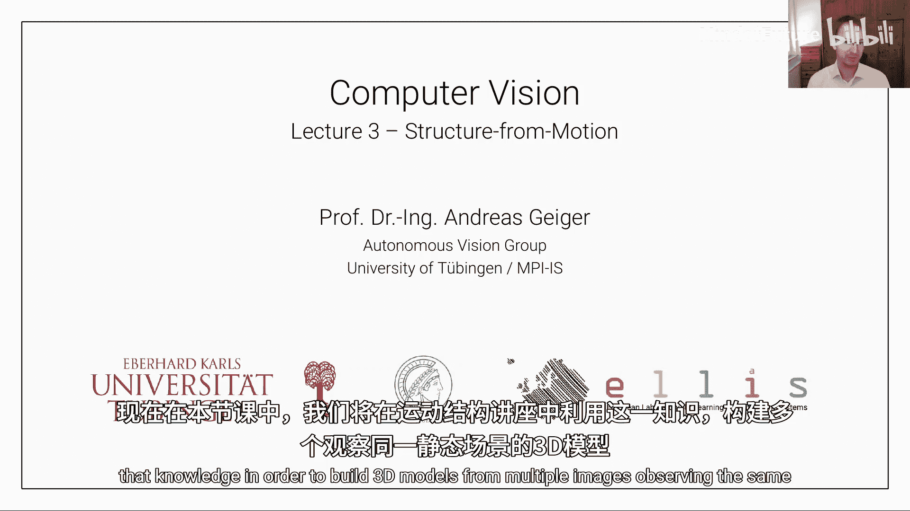
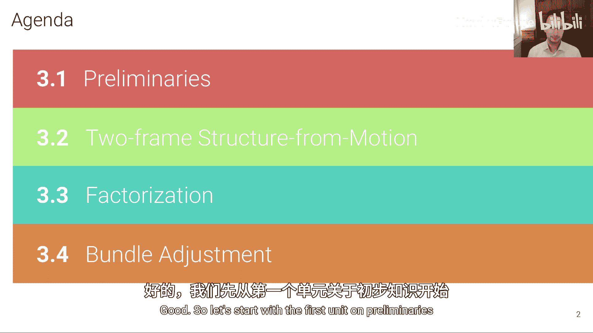
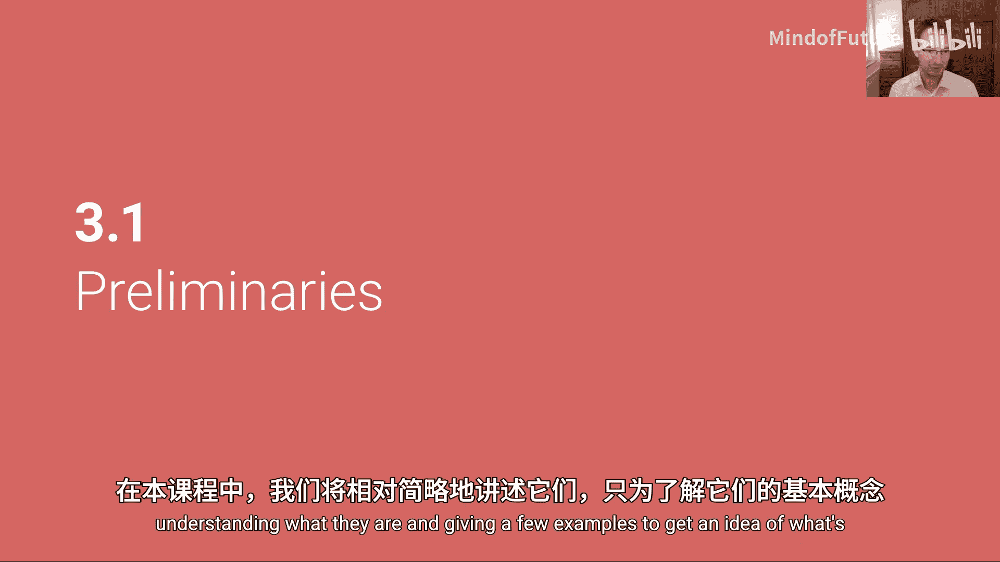
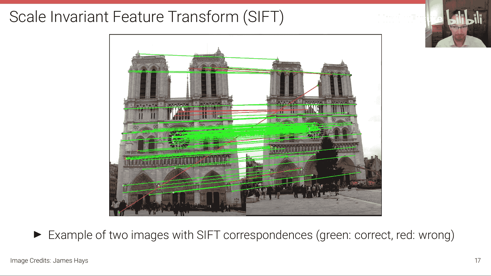

# 008：运动恢复结构 - 预备知识 🎥

在本节课中，我们将学习如何从多张图像中重建三维模型。这是计算机视觉中的一个核心任务，称为“运动恢复结构”。作为开始，我们需要掌握两个重要的预备知识：相机校准和特征检测与描述。

上一节我们讨论了图像形成过程，即三维点如何投影到二维传感器平面。本节中，我们将利用这些知识，从观察同一静态场景的多张图像中构建三维模型。

## 相机校准 📷

运动恢复结构技术，特别是希望获得度量重建时，相机校准是一个基本前提。为了知道光线如何从相机中心发出或如何投影到相机图像平面，首先需要了解相机的参数。

相机校准是寻找相机内参和外参的过程。最常用的方法是使用已知的校准目标，例如棋盘格图案。

以下是相机校准的基本工作流程：

1.  **准备与采集**：打印棋盘格并将其粘贴在非常平坦的表面上。然后，以不同姿态拍摄该棋盘格，确保棋盘格始终完全可见，并能覆盖足够的姿态空间以获得良好的观测数据。
2.  **特征检测**：对于每一张图像，检测棋盘格的角点，并使用亚像素精度算法对其进行细化。
3.  **参数估计**：估计相机的内参和外参。这里的外参指的是棋盘格相对于相机坐标系的姿态。这是一个可行的优化问题，因为观测数据（每个角点提供X和Y两个坐标观测值）远多于待估计的参数数量。

直接非线性优化所有参数是通过最小化重投影误差完成的：将当前估计的三维点投影到图像上，并计算其与图像中检测到的点之间的欧几里得距离，然后尝试最小化这个距离。然而，不能随机初始化所有参数，否则容易陷入局部最小值。因此，需要一个良好的初始化。

例如，张正友等人提出的“一种灵活的新相机标定技术”论文，通过从观测数据构建线性系统，为焦距和主点提供了粗略但优于随机猜测的初始化估计。以此为基础，可以推导出棋盘格姿态的良好初始估计。这些共同构成了非线性优化过程的初始化值，通常使用像Levenberg-Marquardt这样的基于梯度的技术来优化所有参数。

**备注**：存在多种用于不同设置和镜头模型的校准技术。这些方法在算法、假设和使用的校准目标类型上各不相同。但最常见的技术是使用棋盘格或类似图案的方法。

现在我们已经校准了相机，接下来看看如何在不同图像中找到对应的点。

## 特征检测与描述 🔍

为了获得三维重建，我们首先需要在图像中找到彼此对应的点。我们需要找到显著的、独特的、并且能在另一张图像中轻松检测到的点，这些被称为点特征。

点特征描述了图像中局部显著区域的外观。它们可用于描述和匹配从不同视角拍摄的图像。

以下是理想特征应具备的属性：
*   **不变性**：特征应对透视效应和光照变化具有不变性。这意味着即使视角或光照条件改变，同一物理点的特征描述也应保持相似。
*   **区分性**：特征应具有高度的区分性。同一物理点的特征向量应非常相似，而不同点的特征向量应有明显差异。

简单的RGB或强度图像块不具备这些属性。因此，我们需要特征检测和描述方法。其中最著名的方法之一是SIFT（尺度不变特征变换）。

SIFT通过构建尺度空间来实现尺度不变性。它迭代地用高斯滤波器模糊图像，形成尺度金字塔。然后，计算相邻模糊图像之间的差异，得到高斯差分图像。在高斯差分尺度空间中寻找极值点（与周围空间邻域和尺度邻域比较），这些点对应于图像中的斑点（blob），并在多个尺度上被检测到。

检测到兴趣点及其对应尺度后，SIFT会计算该尺度区域的梯度，并根据主导梯度方向对齐描述符区域，从而实现旋转不变性。接着，在旋转后的区域内划分子区域，计算每个子区域内的梯度方向直方图，并将这些直方图连接成一个128维的特征向量。使用直方图使得特征对光照变化和轻微的透视变形（如平移）更具鲁棒性。

继SIFT之后，还提出了多种特征检测器和描述符，如SURF、BRISK、FAST以及近年来的基于深度学习的方法。然而，SIFT因其不变性和鲁棒性具有开创性意义，至今仍被广泛使用。

## 特征匹配 🤝

当我们有两张图像并在其中检测到特征后，就可以进行特征匹配。通常使用高效的最近邻搜索技术（如构建搜索树）来为第一张图像中的每个查询特征，在第二张图像的特征描述子向量空间（如128维空间）中寻找L2距离最近的匹配。

由于匹配可能存在歧义，通常通过计算**最近邻距离与次近邻距离的比值**来过滤模糊匹配。如果该比值很大（例如接近0.8），表明最近邻匹配可能并不正确，因为次优匹配的质量几乎一样好。比值越接近1，歧义性越大。

在本节中，我们介绍了运动恢复结构所需的两项关键预备知识：相机校准与特征检测、描述及匹配。相机校准帮助我们了解成像几何，而稳定的特征及其匹配则是后续估计场景几何的基础。下一节，我们将利用这些匹配好的特征点，开始探讨两帧之间的运动恢复结构。