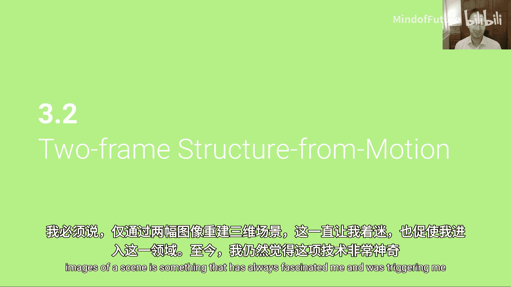
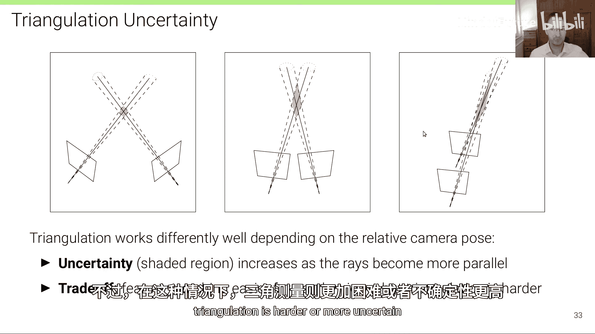

# 009：双视图运动恢复结构（Structure-from-Motion）教程 🎥

在本节课中，我们将要学习双视图运动恢复结构。这是最基础的设置，我们仅有两张从不同视角拍摄的图像，目标是找出两个相机之间的相对运动，以及图像中观测到的投影点所对应的三维空间点的位置。

## 极线几何基础

上一节我们介绍了特征匹配，本节中我们来看看如何利用匹配的特征点来恢复相机姿态和三维结构。所需的关系由双视图极线几何描述。

如上图所示，我们有两个相机。`C1` 和 `C2` 分别是第一和第二相机的光心，`R` 和 `T` 表示两个相机之间的相对姿态（旋转和平移）。一个三维点 `X` 被投影到左图像上的像素 `x̄₁` 和右图像上的像素 `x̄₂`。

三维点 `X` 和两个相机光心 `C1`、`C2` 共同构成了一个平面，称为**极平面**。由于投影是线性的，像素点 `x̄₁` 和 `x̄₂` 也恰好位于这个极平面上。

极线几何的一个重要性质是，它极大地简化了特征点匹配的搜索空间。如果我们已知极线几何，要为左图像中的某个特征点 `x̄₁` 在右图像中寻找对应点，我们无需在整个二维图像域中搜索，而只需沿着一条特定的线——即**极线**——进行搜索。这条极线是极平面与右图像平面的交线。反之亦然。

一旦我们通过相机标定知道了相机的内参矩阵 `K`，以及通过某种方法恢复了相对姿态 `R` 和 `T`，寻找对应点就变得容易得多。然而，为了恢复极线几何本身，我们首先需要在不知道几何关系的情况下，在全图范围内进行特征匹配，这是一个更困难的问题。

所有可能的极线都会通过图像平面上的一个特殊点，称为**极点**。左图像和右图像各有一个极点，它们是相机基线（连接两个光心的线）与各自图像平面的交点。

## 极线约束与本质矩阵

现在的问题是，我们如何用数学公式表达这种关系，并从中恢复出几何参数？

我们从已知相机的内参矩阵 `K₁` 和 `K₂` 开始。对于一个像素坐标 `x̄`（齐次坐标），我们可以通过乘以内参矩阵的逆来得到该像素在相机坐标系下的**射线方向** `x̃`：

`x̃ = K⁻¹ x̄`

这个射线方向与三维点 `X` 的方向是成比例的：`X ∝ x̃`。

同一个三维点 `X` 在两个相机坐标系下的坐标 `X₁` 和 `X₂` 通过刚体变换相关联：

`X₂ = R X₁ + T`

结合射线方向的表达式，并经过一系列的数学推导（包括叉乘和点乘运算），我们可以得到一个核心约束，即**极线约束**：

`x̃₂ᵀ E x̃₁ = 0`

其中，矩阵 `E` 被称为**本质矩阵**，其定义为：

`E = [T]ₓ R`

这里 `[T]ₓ` 是平移向量 `T` 的反对称矩阵。这个公式描述了左右图像中对应点的射线方向必须满足的关系。

本质矩阵 `E` 将一个图像中的点映射到另一个图像中的极线。具体来说：
*   左图像中点 `x̃₁` 在右图像中对应的极线为：`l₂ = E x̃₁`
*   右图像中点 `x̃₂` 在左图像中对应的极线为：`l₁ = Eᵀ x̃₂`

极点也可以通过本质矩阵求得：
*   右图像的极点 `e₂` 是 `E` 的左零空间向量（对应奇异值为0的左奇异向量）。
*   左图像的极点 `e₁` 是 `E` 的右零空间向量（对应奇异值为0的右奇异向量）。

## 从对应点恢复本质矩阵

那么，我们如何从图像对应点中恢复本质矩阵 `E` 呢？

假设我们有 `n` 对通过SIFT等特征匹配得到的对应点 `(x̄₁⁽ⁱ⁾, x̄₂⁽ⁱ⁾)`。对于每一对对应点，我们都可以根据极线约束得到一个方程：

`(x̄₂⁽ⁱ⁾)ᵀ F x̄₁⁽ⁱ⁾ = 0`

这里我们暂时使用像素坐标和**基础矩阵** `F`。当我们已知相机内参时，基础矩阵 `F` 与本质矩阵 `E` 的关系为：

`F = K₂⁻ᵀ E K₁⁻¹`

如果我们已经对图像坐标进行了归一化（即 `x̃ = K⁻¹ x̄`），那么我们就可以直接使用本质矩阵的约束 `x̃₂ᵀ E x̃₁ = 0`。

将方程展开，我们会得到一个关于 `E` 的9个元素的线性齐次方程。由于 `E` 是齐次的（尺度不确定），我们可以通过约束其Frobenius范数为1来固定尺度。以下是求解步骤：

1.  **构建线性系统**：对于每一对归一化后的对应点 `(x̃₁, x̃₂)`，根据方程 `x̃₂ᵀ E x̃₁ = 0` 可以写出一个形如 `A e = 0` 的方程，其中 `e` 是将 `E` 矩阵按行堆叠成的9维向量。
2.  **使用SVD求解**：将所有 `n` 对点对应的方程堆叠起来，形成一个 `n×9` 的矩阵 `A`。我们对 `A` 进行奇异值分解：`A = U Σ Vᵀ`。
3.  **取最小奇异值对应的右奇异向量**：方程 `A e = 0` 在约束 `||e||=1` 下的解，就是 `V` 的最后一列（对应最小奇异值，理想情况下应为0），将其重塑为 `3×3` 的矩阵 `E`。
4.  **强制本质矩阵的秩为2**：由于噪声，上一步得到的 `E` 可能满秩。我们对其再次进行SVD：`E = U Σ Vᵀ`，然后将奇异值矩阵 `Σ` 修正为 `diag(σ₁, σ₂, 0)`，最后重构本质矩阵：`E‘ = U Σ’ Vᵀ`。

**重要提示**：在实际应用中，直接使用像素坐标会导致数值不稳定。Hartley提出的**归一化八点算法**建议先将图像坐标归一化（平移使其均值为0，缩放使其各方向方差为1），再进行上述计算，最后将结果反归一化。这能显著提高算法的鲁棒性。

本质矩阵有5个自由度（旋转3个，平移方向2个），因此理论上最少只需要5对匹配点即可求解，但八点算法因其简单和稳定性而被广泛使用。

## 从本质矩阵恢复旋转和平移

在得到本质矩阵 `E` 后，我们可以从中分解出旋转矩阵 `R` 和平移向量 `T` 的方向（尺度无法确定）。

1.  **恢复平移方向 `T`**：平移向量 `T` 的方向 `T̂`（单位向量）是 `E` 的左零空间向量，即SVD分解 `E = U Σ Vᵀ` 中，`U` 的最后一列（对应最小奇异值）。
2.  **恢复旋转矩阵 `R`**：旋转矩阵 `R` 的恢复稍复杂，通常有两种可能的 `R` 和两种可能的 `T` 方向组合，共四种解。需要通过三角化一个点并检查其深度（是否在两个相机前方）来选出唯一正确的物理解。具体公式和推导可参考相关教材（如Hartley & Zisserman 的 *Multiple View Geometry*）。

## 三角化：恢复三维点坐标

在恢复了相机的相对姿态 `(R, T)` 和内参 `K` 之后，我们就可以通过**三角化**来恢复三维空间点的坐标 `X`。

理想情况下，从两个相机光心出发的射线 `C₁x̄₁` 和 `C₂x̄₂` 应该在三维空间相交于一点 `X`。但由于特征点定位存在噪声，这两条射线通常并不严格相交。

因此，我们的目标是找到一个三维点 `X`，使得它投影回两个图像上的位置，与观测到的特征点位置之间的**重投影误差**最小。

以下是两种主要方法：

**1. 直接线性变换法**
对于每个相机，投影方程可以写为：`λ x̄ = P X`，其中 `P = K [R|T]` 是投影矩阵，`λ` 是深度尺度因子。
通过叉乘消去尺度因子 `λ`，可以得到两个关于 `X` 的线性方程。对于两个视图，我们可以得到四个方程，构成一个齐次线性系统 `A X = 0`。通过对 `A` 进行SVD，取最小奇异值对应的右奇异向量作为 `X` 的解。此方法快速，但不是最优的（在重投影误差意义下）。

**2. 最小化重投影误差（黄金标准）**
这是最优的方法，通过求解以下非线性最小二乘问题来估计 `X`：

`minₓ Σᵢ || π(Pᵢ, X) - x̄ᵢ ||²`

其中 `π(P, X)` 是将三维点 `X` 用投影矩阵 `P` 投影到图像上的函数。这个问题可以使用迭代优化算法（如Levenberg-Marquardt算法）求解，能得到在测量噪声为高斯分布时的最大似然估计。

三角化的精度受相机相对姿态的影响很大。以下是两种典型情况：
*   **基线宽**：相机视角差异大，三角化精度高（不确定性区域小），但特征匹配困难。
*   **基线窄**：相机视角相似，特征匹配容易，但三角化精度低（不确定性区域呈细长状）。

## 基础矩阵

如果相机内参 `K` 未知，我们就不能使用本质矩阵 `E`，而需要使用**基础矩阵** `F`。基础矩阵直接关联两个图像像素坐标之间的关系：

`x̄₂ᵀ F x̄₁ = 0`

基础矩阵 `F` 与本质矩阵 `E` 的关系为：`F = K₂⁻ᵀ E K₁⁻¹`。基础矩阵也是一个 `3×3` 的秩为2的矩阵。我们可以使用与八点算法类似的方法直接从像素对应点中估计 `F`。

然而，仅凭基础矩阵只能得到一个**投影重建**，即三维结构恢复到一个未知的投影变换（射影变形）之下，而不是真实的度量重建。如果需要度量重建，必须额外知道相机的内参信息。

## 总结

本节课中我们一起学习了双视图运动恢复结构的核心流程：
1.  **特征提取与匹配**：获取两幅图像之间的对应点。
2.  **估计极线几何**：
    *   若已知内参，估计**本质矩阵 `E`**，并分解得到相对旋转 `R` 和平移方向 `T`。
    *   若未知内参，估计**基础矩阵 `F`**，得到投影重建。
3.  **三角化**：利用恢复的相机姿态和对应点，通过最小化重投影误差来重建三维点的坐标。

我们了解了极线几何如何将对应点搜索从二维降低到一维，掌握了通过SVD求解本质矩阵/基础矩阵的归一化八点算法，并学习了从这些矩阵中恢复运动参数以及通过三角化恢复结构的基本原理。这些概念是后续学习多视图立体视觉和密集三维重建的基础。