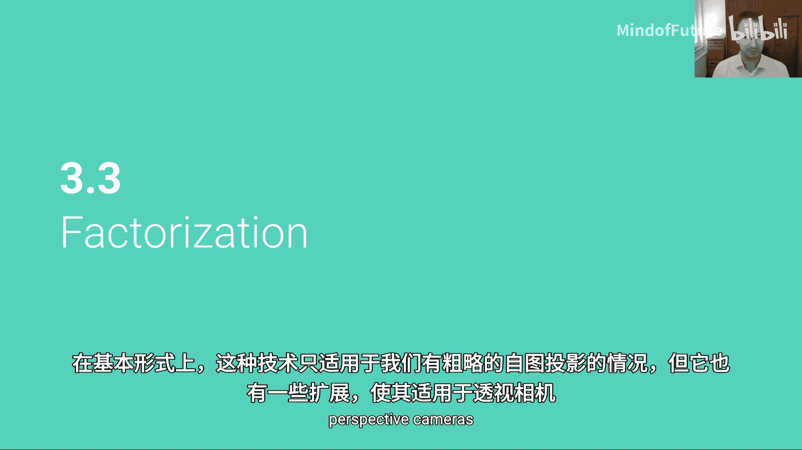
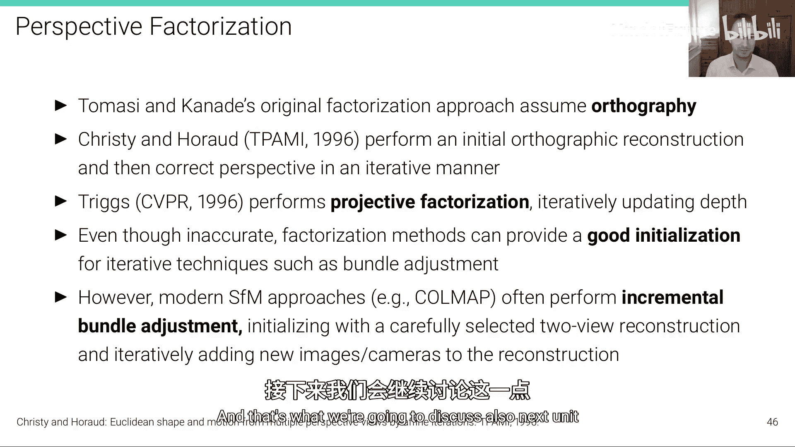

# 010：运动恢复结构 - 矩阵分解法 🧩

在本节课中，我们将要学习一种名为“矩阵分解法”的经典技术，用于从多张图像中同时恢复相机运动和三维结构。这种方法由Tomasi和Kanade提出，在正射投影的简化假设下，能提供一个优雅的闭式解。

到目前为止，我们讨论了如何从两个视图获得对极几何。然而，理想情况下，我们希望通过对场景的多个视图进行联合优化，来同时获得相机姿态和三维重建，以最小化重投影误差。这正是我们接下来要探讨的内容。

## 问题设定与核心思想

首先，我们来看看如何利用超过两个视图进行运动恢复结构。假设我们有一个测量矩阵 **W**，它包含了被追踪特征点的图像坐标。具体来说，我们有 **n** 个帧（或相机）和 **p** 个特征点。例如，我们可能有100个特征点，它们被10个相机连续追踪到。我们假设所有特征点在所有相机中都是可见的（即完整的特征轨迹）。

给定这些观测值，我们的目标是在正射投影的假设下，同时恢复相机运动和三维结构（即与观测轨迹对应的三维点集）。事实证明，对于这种具有完整特征轨迹的正射投影简化设置，我们可以找到一个闭式解。

下图展示了这个过程：在底部，我们有一个图像序列，我们检测并追踪特征点（例如使用光流法），从而在二维空间中得到这些特征轨迹。然后，我们重建出正射相机的相机平面和三维点结构。

## 正射投影模型

那么，这是如何工作的呢？在正射投影下，一个三维点 **X_p** 映射到第 **i** 帧图像中的一个像素，其方式如下：

首先，我们取该三维点（在世界坐标系中表示），并减去相机坐标系相对于世界原点的平移 **T_i**。这样，我们就将该点表达在了相机坐标系中。然后，我们只需将该点投影到该坐标系的 **x** 轴和 **y** 轴上，即可得到像素的 **x** 和 **y** 坐标。

为了消除尺度模糊性，我们不失一般性地假设三维点云是围绕世界坐标系中心分布的（即点云中心在原点）。这是一个我们做出的假设。

## 构建测量矩阵

现在，让 **x_ip** 和 **y_ip** 表示特征点 **p** 在第 **i** 帧中的二维位置。我们对每帧图像中的特征点进行中心化处理（使其均值为零），并将它们收集起来，形成所谓的**测量矩阵**。

我们不仅对要恢复的三维点进行中心化以消除模糊性，还在处理之前对图像坐标中的点进行中心化。中心化后的坐标表示为：
- $\tilde{x}_{ip} = x_{ip} - \frac{1}{p} \sum_{q=1}^{p} x_{iq}$
- $\tilde{y}_{ip} = y_{ip} - \frac{1}{p} \sum_{q=1}^{p} y_{iq}$

然后，我们将这些测量值堆叠成一个大矩阵 **W̃**（注意：这里的波浪号表示中心化坐标，**不是**齐次坐标）：
- **W̃** 是一个 **2n × p** 的矩阵。
- 上半部分是所有帧中所有点的 **x** 坐标。
- 下半部分是所有帧中所有点的 **y** 坐标。

## 线性关系与低秩性

根据正射投影公式和中心化假设，我们可以推导出一个简单的线性关系。中心化的图像 **x** 坐标满足：
$\tilde{x}_{ip} = \mathbf{u}_i^T \mathbf{X}_p$
其中，$\mathbf{u}_i$ 是第 **i** 个相机坐标系 **x** 轴的方向向量（单位向量）。类似地，对于 **y** 坐标有：
$\tilde{y}_{ip} = \mathbf{v}_i^T \mathbf{X}_p$
其中，$\mathbf{v}_i$ 是第 **i** 个相机坐标系 **y** 轴的方向向量。

因此，整个测量矩阵可以写为一个矩阵乘积：
$\mathbf{\tilde{W}} = \mathbf{R} \mathbf{X}$
其中：
- $\mathbf{R}$ 是一个 **2n × 3** 的矩阵，其行由所有相机的 $\mathbf{u}_i$ 和 $\mathbf{v}_i$ 向量堆叠而成。这代表了相机运动（旋转）。
- $\mathbf{X}$ 是一个 **3 × p** 的矩阵，其列是所有三维点 $\mathbf{X}_p$。这代表了场景结构。

这是一个非常简洁的线性关系。在无噪声的情况下，矩阵 **W̃** 是 **R**（秩最多为3）和 **X**（秩最多为3）的乘积，因此其秩最多为 **3**，是一个低秩矩阵。

## 处理噪声与奇异值分解

然而，在实际观测中，由于存在噪声，测量矩阵 **Ŵ**（我们实际得到的）通常是满秩的。因此，我们需要从满秩的 **Ŵ** 中找到一个秩为3的最佳近似矩阵 **W̃**。

这可以通过对 **Ŵ** 进行**奇异值分解** 来实现。我们对 **Ŵ** 进行SVD分解：
$\mathbf{\hat{W}} = \mathbf{U} \boldsymbol{\Sigma} \mathbf{V}^T$
然后，我们只保留最大的三个奇异值及其对应的奇异向量，构造出秩为3的近似矩阵：
$\mathbf{\tilde{W}} \approx \mathbf{U}_3 \boldsymbol{\Sigma}_3 \mathbf{V}_3^T$
其中 $\mathbf{U}_3$、$\boldsymbol{\Sigma}_3$、$\mathbf{V}_3$ 是仅包含前三个分量的截断矩阵。

由此，我们可以得到初始的运动和结构估计：
$\mathbf{\hat{R}} = \mathbf{U}_3 \boldsymbol{\Sigma}_3^{1/2}$
$\mathbf{\hat{X}} = \boldsymbol{\Sigma}_3^{1/2} \mathbf{V}_3^T$

## 解决模糊性：度量约束

然而，上述分解不是唯一的。存在一个任意的 **3×3** 可逆矩阵 **Q**，使得：
$(\mathbf{\hat{R}} \mathbf{Q}) (\mathbf{Q}^{-1} \mathbf{\hat{X}}) = \mathbf{\hat{R}} \mathbf{\hat{X}} = \mathbf{\tilde{W}}$
即，我们得到的是同一个 **W̃**，但 **R** 和 **X** 被一个未知的变换 **Q** 所扭曲。

为了找到正确的 **Q**，我们需要利用相机运动矩阵 **R** 的内在几何约束。回想一下，**R** 的行是相机坐标轴的方向向量 $\mathbf{u}_i$ 和 $\mathbf{v}_i$。它们满足以下**度量约束**：
1.  每个轴都是单位向量：$\|\mathbf{u}_i\| = 1$， $\|\mathbf{v}_i\| = 1$。
2.  同一相机的两个轴相互正交：$\mathbf{u}_i \cdot \mathbf{v}_i = 0$。

这些约束可以转化为关于矩阵 $\mathbf{G} = \mathbf{Q} \mathbf{Q}^T$ 的线性方程组。以下是具体步骤：
- 对于每个相机 **i**，我们有：
    - $(\mathbf{\hat{r}}_{2i-1} \mathbf{Q}) (\mathbf{Q}^T \mathbf{\hat{r}}_{2i-1}^T) = 1$ （对应 $\|\mathbf{u}_i\| = 1$）
    - $(\mathbf{\hat{r}}_{2i} \mathbf{Q}) (\mathbf{Q}^T \mathbf{\hat{r}}_{2i}^T) = 1$ （对应 $\|\mathbf{v}_i\| = 1$）
    - $(\mathbf{\hat{r}}_{2i-1} \mathbf{Q}) (\mathbf{Q}^T \mathbf{\hat{r}}_{2i}^T) = 0$ （对应 $\mathbf{u}_i \cdot \mathbf{v}_i = 0$）
- 这里 $\mathbf{\hat{r}}_k$ 是矩阵 $\mathbf{\hat{R}}$ 的第 **k** 行。

通过求解这些方程，我们可以得到 $\mathbf{G}$，然后通过乔列斯基分解得到 $\mathbf{Q}$。最后，我们得到正确的解：
$\mathbf{R} = \mathbf{\hat{R}} \mathbf{Q}$
$\mathbf{X} = \mathbf{Q}^{-1} \mathbf{\hat{X}}$

## 算法总结与评价

以下是Tomasi-Kanade矩阵分解法的步骤总结：
1.  **输入**：包含噪声的完整特征轨迹测量矩阵 **Ŵ**（2n × p）。
2.  **中心化**：对每帧图像中的特征点坐标进行中心化，得到 **W̃**。
3.  **SVD与低秩近似**：对 **W̃** 进行奇异值分解，并保留前三个奇异值和向量，得到秩为3的近似。
4.  **初始分解**：计算 $\mathbf{\hat{R}} = \mathbf{U}_3 \boldsymbol{\Sigma}_3^{1/2}$ 和 $\mathbf{\hat{X}} = \boldsymbol{\Sigma}_3^{1/2} \mathbf{V}_3^T$。
5.  **求解度量约束**：利用 $\mathbf{\hat{R}}$ 行的单位向量和正交约束，建立并求解关于 $\mathbf{G} = \mathbf{Q}\mathbf{Q}^T$ 的线性方程组，进而通过分解得到 $\mathbf{Q}$。
6.  **消除模糊性**：计算最终解 $\mathbf{R} = \mathbf{\hat{R}} \mathbf{Q}$ 和 $\mathbf{X} = \mathbf{Q}^{-1} \mathbf{\hat{X}}$。
7.  **输出**：相机运动矩阵 **R** 和三维结构矩阵 **X**。

**该算法的优点**：
- 是闭式解，计算速度快。
- 没有局部极小值问题。
- 解确定到一个全局旋转（这是所有运动恢复结构问题的固有模糊性）。

**该算法的局限性**：
- 假设正射投影，这在真实透视相机中是一个近似。
- 要求**完整的特征轨迹**，即每个特征点必须在所有帧中都可见。在实际中，由于遮挡或移出视野，这很难满足。
- 对于大规模场景重建，视角覆盖有限，此假设尤其不成立。

## 扩展与现代方法

尽管有这些限制，矩阵分解法仍然非常重要：
- **处理缺失数据**：可以通过迭代的矩阵补全技术，应用于特征轨迹不完整的场景。
- **扩展到透视投影**：存在一些扩展算法（如Christoph H.的算法），先进行正射重建，然后迭代地校正透视效应。
- **作为初始化**：分解法的结果可以为非线性优化方法（如**光束法平差**）提供一个良好的初始值，后者是运动恢复结构的“金标准”。

然而，在现代大规模运动恢复结构系统（如下一单元将讨论的COLMAP）中，通常不直接使用这种全局多帧重建方法。相反，它们采用**增量式光束法平差**：
1.  从精心选择的两帧开始重建。
2.  迭代地将新图像添加到重建中。
3.  通过新图像中检测到的特征与已重建部分中存在的特征之间的匹配，逐步扩展重建。
这种方法更适合特征可见性不完整的大规模场景。

本节课中，我们一起学习了经典的Tomasi-Kanade矩阵分解法。我们了解了它如何在正射投影和完整轨迹的假设下，通过奇异值分解和度量约束，优雅地同时求解出相机运动和三维结构。虽然其假设在现实中较为严格，但它阐明了运动恢复结构问题的核心数学原理，并为更复杂、更鲁棒的现代方法奠定了基础。