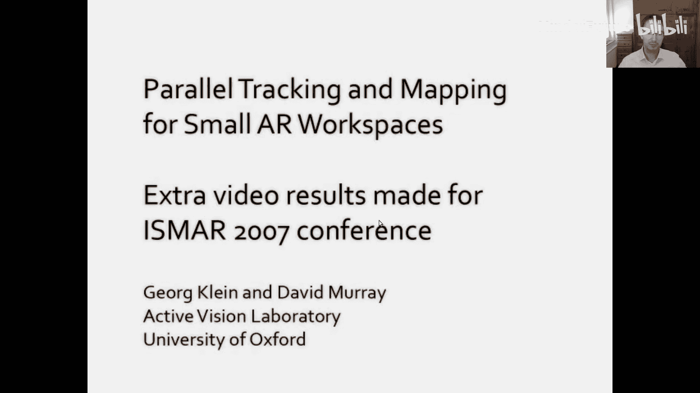
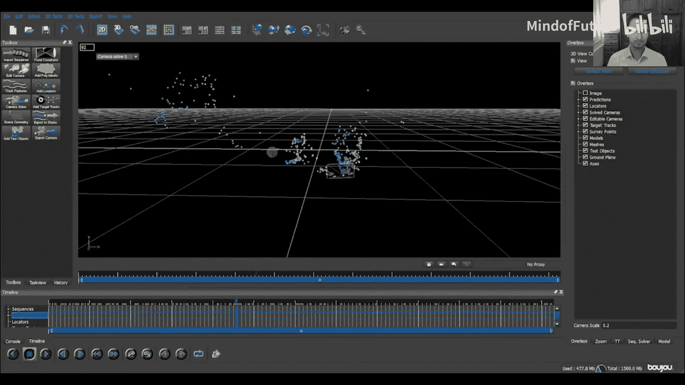

# 011：从运动恢复结构与光束法平差 🎯

在本节课中，我们将要学习计算机视觉中的一个核心算法——光束法平差。这是一种通过联合优化所有相机参数和三维点位置，来最小化重投影误差的“黄金标准”算法。我们将了解其原理、面临的挑战以及在实际大规模三维重建系统中的应用流程。

## 光束法平差原理

上一节我们介绍了从两视图恢复三维结构的基础。本节中我们来看看如何通过优化所有视图和所有三维点来获得更精确的结果，这就是光束法平差。

光束法平差的目标是**最小化重投影误差**，即图像中观测到的特征点与三维点投影到图像平面上的位置之间的距离。通过联合优化所有三维点的位置和所有相机的位姿（包括内参和外参），我们可以得到最优的三维重建结果。

下图左侧是一组具有挑战性的图像，右侧是通过光束法平差恢复出的三维点云和相机位姿（由小三角形表示）。

光束法平差可以形式化地定义为以下优化问题：

**目标**：找到最优的相机参数集合 **{π_i}** 和三维点集合 **{X^W_p}**，以最小化所有观测的重投影误差之和。

**公式**：
```
min_{π_i, X^W_p} Σ_i Σ_p w_ip * || x^s_ip - π_i(X^W_p) ||^2
```
其中：
*   **π_i**：第 i 个相机的投影函数，包含了相机的内参（如焦距、畸变）和外参（旋转 **R_i**、平移 **t_i**）。
*   **X^W_p**：第 p 个三维点在世界坐标系中的坐标。
*   **x^s_ip**：第 p 个三维点在第 i 个相机图像平面上的实际观测坐标。
*   **w_ip**：一个指示权重（通常为0或1），表示第 p 个点是否在第 i 个图像中被观测到。

投影函数 **π_i** 的具体计算过程为：首先将三维点 **X^W_p** 通过刚体变换（**R_i**, **t_i**）转换到第 i 个相机的坐标系，然后通过内参矩阵 **K_i** 投影到图像平面，最后通过除以齐次坐标的最后一维得到二维图像坐标。

## 面临的挑战

虽然光束法平差是优化三维重建的黄金标准，但它也面临两大主要挑战。

### 1. 初始化问题

这个优化问题的能量函数（目标函数）是高度非凸的，因此一个良好的初始估计至关重要。如果初始值离全局最优解太远，优化过程很容易陷入局部最优。

在实践中，通常采用**增量式策略**来初始化：首先精心选择两幅图像进行初始重建，然后迭代地添加新的图像和相机，逐步扩展重建范围。这种方法比直接对所有视图进行联合初始化要稳定得多。

### 2. 优化规模与效率问题

一个大规模场景可能包含成千上万个相机和数百万个三维点，这意味着优化变量数量极其庞大，计算非常耗时。非线性优化的复杂度通常与未知数的数量呈超线性关系。

幸运的是，这个问题通常是**稀疏**的：并非每个三维点都在每个相机中可见。我们可以利用高效的稀疏求解器（例如 **Ceres Solver** 或 **g2o**）来显著加速计算。尽管如此，对于超大规模的重建，光束法平差仍可能需要数小时才能完成。

## 增量式运动恢复结构流程

为了应对上述挑战，现代大规模运动恢复结构系统通常采用一个精心设计的增量式流水线。以下以著名的 **COLMAP** 重建流水线为例进行说明，该流程至今仍能提供最先进的结果。

整个流程主要分为两个阶段：
1.  **特征匹配阶段**：在所有输入图像中寻找并匹配稳健的二维特征。
2.  **增量重建阶段**：从两视图开始，逐步添加图像，进行三角测量和光束法平差，迭代地完善重建结果。

以下是该流程的详细步骤：

### 第一阶段：特征匹配

以下是特征匹配阶段的核心步骤：

1.  **特征提取与描述**：在所有输入图像中检测关键点（如SIFT特征）并计算描述符。
2.  **特征匹配**：在所有图像对之间进行特征匹配，建立对应关系。
3.  **几何验证**：对匹配对进行几何验证（例如，通过估计基础矩阵或本质矩阵），剔除不符合极线几何约束的错误匹配（外点）。这能确保初始匹配的可靠性。
4.  **构建匹配图**：图像作为节点，如果两幅图像之间有足够多的正确匹配，则在它们之间建立一条边。最终形成一个匹配图，其中连接紧密的簇是开始重建的理想起点。

### 第二阶段：增量重建

以下是增量重建阶段的核心步骤：

1.  **初始化**：从匹配图中选择一个连接紧密的图像对，计算它们之间的本质矩阵，并进行三角测量，得到一个初始的两视图三维重建（包括两个相机位姿和一组三维点）。
2.  **图像注册**：寻找一幅与当前已重建模型有足够多特征对应的新图像。利用这些**三维点-二维观测**的对应关系，通过求解 **PnP（Perspective-n-Point）** 问题来估计新相机的位姿。在实践中，常使用 **RANSAC** 算法配合 **P3P** 等最小解算方法来鲁棒地估计位姿并剔除外点。
3.  **三角测量新点**：使用新注册的相机和已有相机，对新的特征匹配进行三角测量，得到新的三维点。
4.  **局部光束法平差**：由于增量添加只影响模型局部，因此通常只对受影响的相机和三维点进行局部光束法平差，以快速优化。
5.  **外点过滤**：剔除重投影误差过大的观测点或位姿异常（如视场角过大、畸变异常）的相机。
6.  **迭代与全局优化**：重复步骤2-5，不断添加新图像。每隔一段时间（例如添加了较多图像后），对整个模型进行一次全局光束法平差，以获得整体最优解。

## 应用与成果

光束法平差及相关技术已催生出许多令人印象深刻的应用。

*   **大规模城市重建**：例如“一日建成罗马”项目，使用从网络爬取的数万张无序照片，自动重建了整个城市的稀疏三维模型，展示了从互联网图片集进行三维重建的潜力。
*   **COLMAP**：该开源软件包进一步提升了重建的精度和完整性，其稀疏重建和后续的密集重建（多视图立体视觉）能生成非常清晰、噪声较少的三维点云。
*   **照片浏览与旅游**：如 **Photo Tourism** 系统，允许用户在三维空间中交互式地浏览大型照片集，系统自动将照片对齐到其拍摄的三维位置，提供了直观的探索体验。
*   **增强现实与机器人**：实时运动恢复结构技术使得机器人能够实时跟踪自身位姿并构建环境地图，从而在真实场景中叠加虚拟物体，实现增强现实效果。
*   **电影工业**：该技术被称为“匹配移动”，可以从实拍的电影序列中恢复出相机运动轨迹，从而将计算机生成的虚拟物体精确地合成到实拍画面中，曾获得艾美奖。



## 总结



本节课中我们一起学习了计算机视觉中的核心优化技术——光束法平差。我们了解到，它通过联合优化所有相机参数和三维点来最小化重投影误差，是三维重建的黄金标准。同时，我们也认识到其面临初始化困难和计算规模庞大的挑战，而**增量式重建流水线**（如COLMAP所采用的）是解决这些挑战的有效方案。最后，我们看到了这项技术在从城市数字化到电影特效等众多领域的革命性应用。掌握光束法平差的原理和流程，是深入理解现代三维视觉系统的关键。