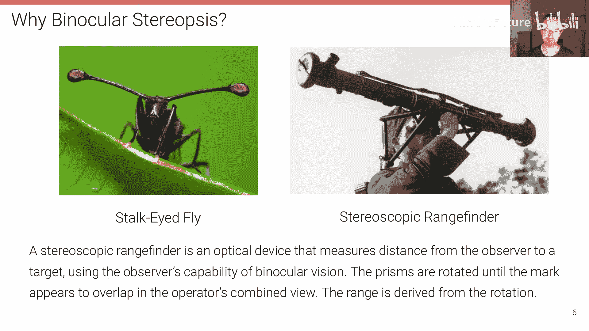
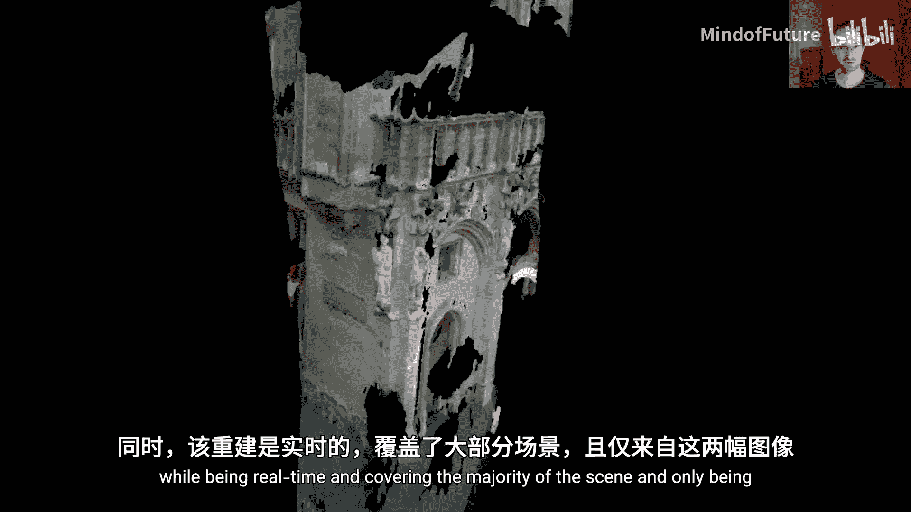
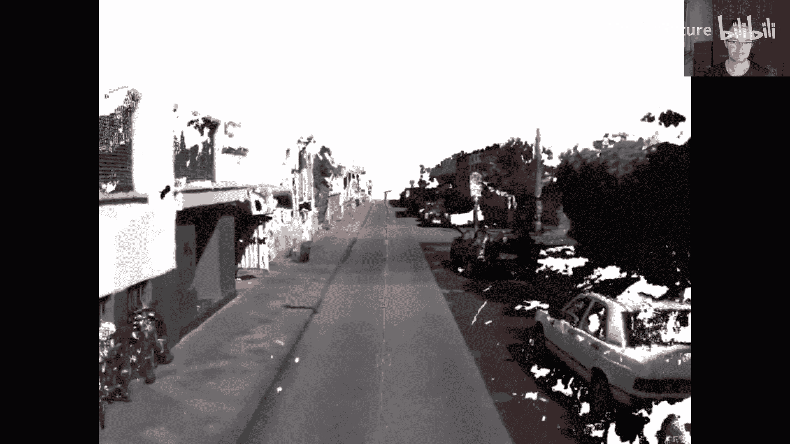
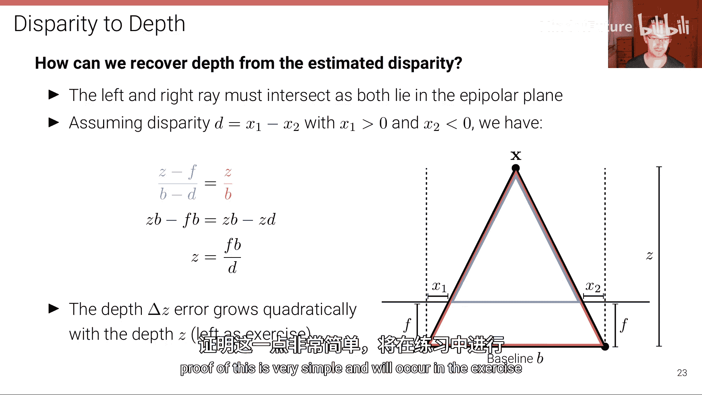

# 012：立体视觉重建 - 预备知识 👁️

在本节课中，我们将要学习密集立体视觉重建的基础知识。我们将从如何从图像中恢复三维结构的一般性问题出发，重点介绍双目立体视觉的核心原理，并详细讲解图像校正这一关键预处理步骤。

上一讲我们讨论了基于稀疏特征点的三维重建技术。本节中，我们来看看如何利用已知相机参数的两张图像，进行更密集的三维重建。

## 从单张图像中恢复三维的线索

从单张图像恢复三维结构是一个不适定问题，但存在多种视觉线索。

以下是几种主要的深度线索：

*   **遮挡**：如果一个物体遮挡了另一个物体，我们可以推断被遮挡的物体位于更远的位置。艺术家常利用此原理。
*   **视差**：当观察者或物体移动时，近处物体相对于远处物体移动得更快。这在立体视觉中被核心利用。
*   **透视**：平行线在图像中汇聚于消失点，这提供了关于场景方向和深度的信息。
*   **对焦/模糊**：人眼或相机镜头需要调整焦距以看清特定物体，导致焦平面外的区域模糊。这种模糊程度（景深）可以暗示深度。
*   **立体视觉**：这是本节课的重点。它利用**三角测量**原理，从两个不同视点拍摄同一场景，通过观察对应点的位移（视差）来恢复三维结构。

## 双目立体视觉的优势

大多数生物拥有两只眼睛，这表明双目系统是感知深度的一种稳健且高效的最小配置。其优势在于，通过增大两个相机中心之间的距离（**基线**），可以提高深度估计的精度。基线越长，三角测量的结果越确定。

## 密集立体视觉的任务与流程

我们的目标是：从两张（基本）静态场景的图像中，重建一个**密集的三维模型**。

以下是典型的处理流程：

1.  **相机标定**：获取相机的内参（`K`）和外参（`R, t`）。
2.  **图像校正**：将图像变换到一种标准配置，使匹配搜索简化为一维。
3.  **计算视差图**：为参考图像（如左图）中的每个像素，在另一图像（右图）的对应极线上寻找最佳匹配点，计算其水平位移（**视差** `d`）。
4.  **剔除异常值**：通过一致性检查或遮挡检测移除错误的匹配。
5.  **从视差计算深度**：利用相机参数和三角测量公式将视差转换为深度（`Z`）。
6.  **构建三维模型**：将带有深度和颜色信息的点云融合成完整的三维模型（如网格）。

## 立体视觉在三维重建管线中的角色

在一个完整的多视图三维重建系统中，密集立体匹配是核心步骤之一。

以下是典型的系统流程：

1.  输入一组图像。
2.  使用增量式光束法平差等技术估计所有相机的位姿。
3.  对于相邻的视图对，利用已知的极线几何进行**密集立体匹配**，为每个视图生成深度图。
4.  使用如截断符号距离函数融合等算法，将所有深度图融合成一个统一、连贯的三维网格模型。

仅使用两个视图称为**双目立体匹配**；使用多于两个视图则称为**多视图立体**。双目方法更快，但可能不如多视图方法精确。

## 极线几何回顾

极线几何是立体视觉的数学基础。对于已标定的相机，其核心约束方程为：

`x2^T * E * x1 = 0`

其中 `E` 是本质矩阵，`x1` 和 `x2` 是归一化相机坐标下的对应点。

最重要的性质是：**左图像中的一点 `x1`，其在右图像中的对应点 `x2` 必然位于对应的极线 `l2` 上**。这将对对应点的搜索从整个二维图像域简化到一维极线上，极大提升了效率。

## 图像校正

为了进一步简化匹配，我们希望极线是水平且平行的。这要求两个图像平面共面且平行于基线。这种配置称为**校正后的**配置。

在实际中，相机很难精确满足此配置。因此，我们通过**图像校正**来达成：计算一个旋转矩阵，将两个相机虚拟地旋转到一个共面且平行于基线的姿态。由于这是绕相机中心的旋转，我们可以通过**单应性变换**来重投影图像，而无需知道场景的三维结构。

在校正后的配置中：
*   极点位于无穷远处。
*   所有极线变为水平且平行。
*   对应点位于左右图像的**同一行**上。

这使得匹配算法只需沿图像行进行搜索，实现起来非常简单高效。

以下是计算左相机校正旋转矩阵 `R_rect` 的一种常用方法：

1.  将新的 X 轴 (`r1`) 设为归一化的基线方向（指向另一相机中心）。
2.  新的 Y 轴 (`r2`) 为原始相机 Z 轴与 `r1` 的叉积。
3.  新的 Z 轴 (`r3`) 为 `r1` 与 `r2` 的叉积。

最终，`R_rect = [r1^T; r2^T; r3^T]`。对右相机需要额外考虑其相对于左相机的旋转。

在实际操作中，我们通常计算从校正后图像坐标到原始图像坐标的逆变换，并通过插值来填充校正后的图像，以避免空洞。

## 从视差到深度

在校正后的理想配置下，深度 `Z` 与视差 `d` 存在简单的反比关系。通过相似三角形原理，可以推导出：

`Z = (f * B) / d`

其中：
*   `Z` 是深度（物体到相机平面的距离）。
*   `f` 是相机的焦距（以像素为单位）。
*   `B` 是两个相机中心之间的距离，即**基线**。
*   `d` 是估计出的**视差**（`x_left - x_right`）。

这个公式表明：
*   视差 `d` 越大（物体在左右图像中移动越多），物体离相机越近（`Z` 越小）。
*   视差 `d` 越小，物体离相机越远（`Z` 越大）。
*   深度估计的误差随距离的平方增长，因此对于远处的物体，深度估计精度较低。

本节课中我们一起学习了立体视觉重建的预备知识。我们回顾了从图像获取三维信息的多种线索，明确了密集双目立体视觉的任务与整体流程，并深入讲解了极线几何的核心作用以及图像校正这一关键步骤。最后，我们推导出了在校正配置下，从视差计算深度的核心公式，为后续学习具体的立体匹配算法打下了坚实的基础。下一节，我们将开始探讨最基础的立体匹配算法——块匹配。