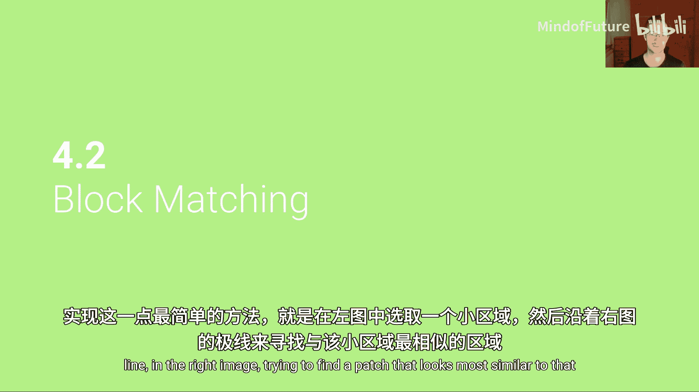
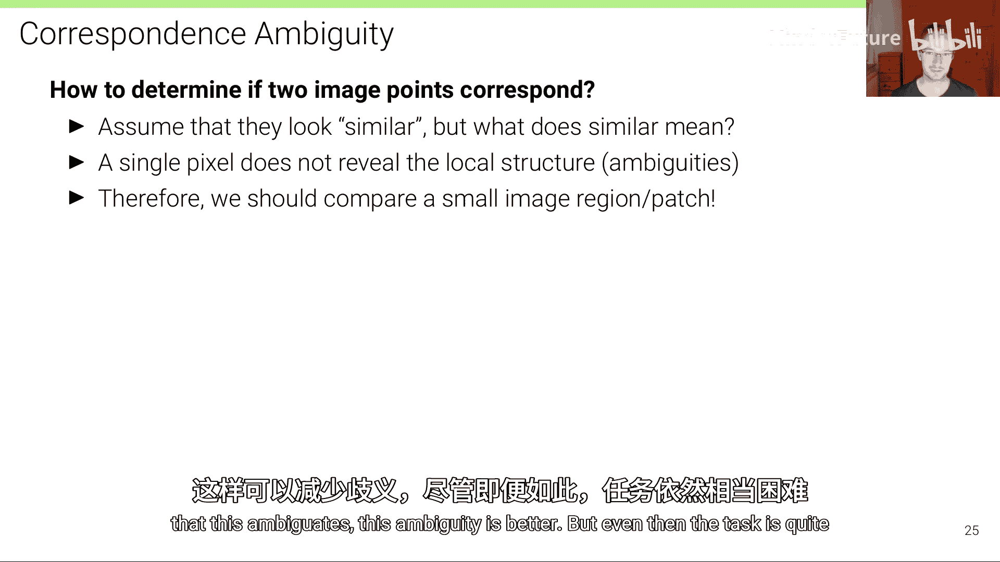
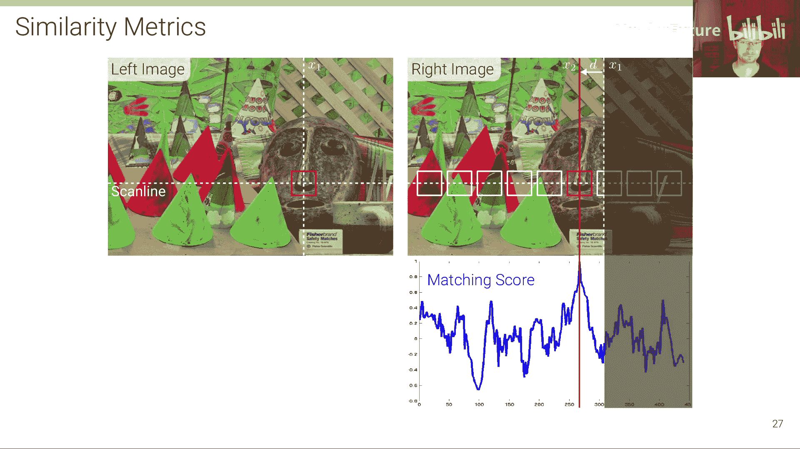
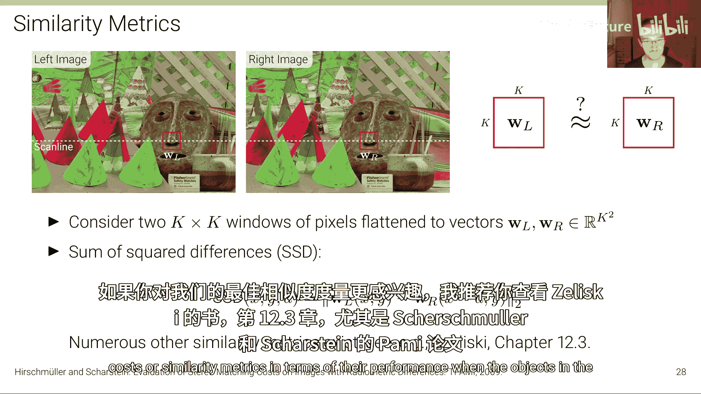
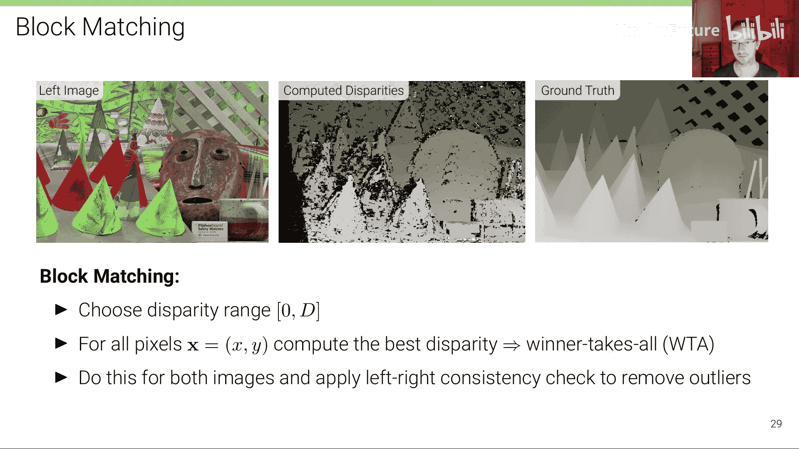
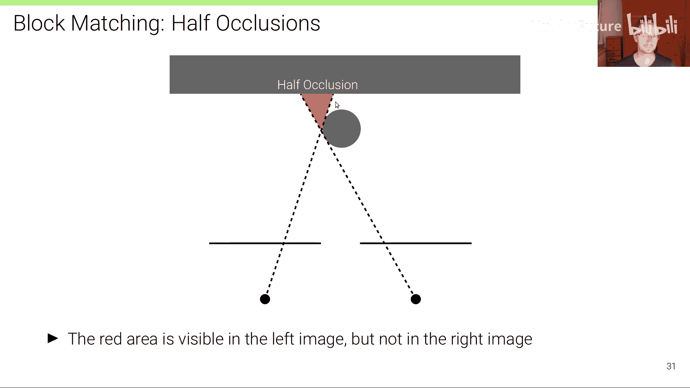
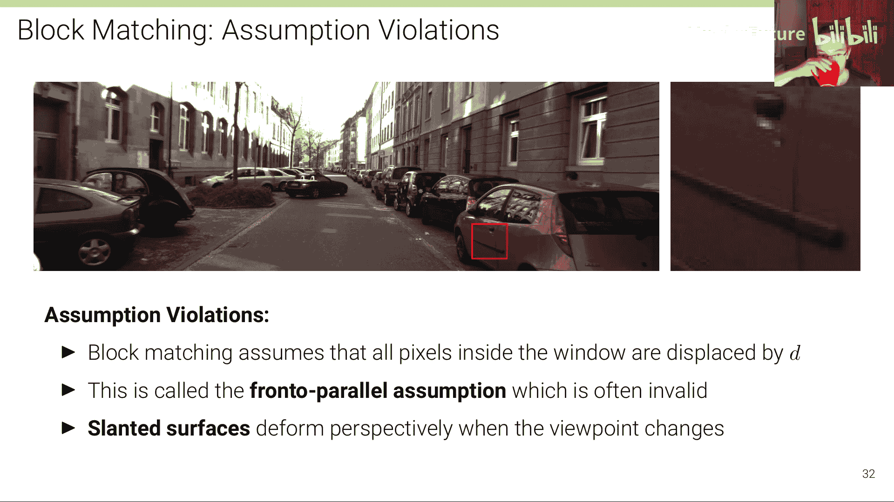
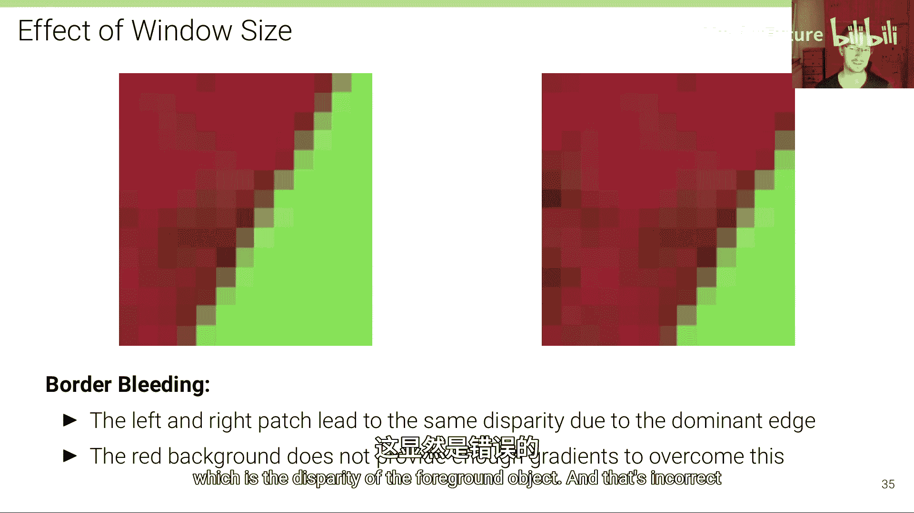
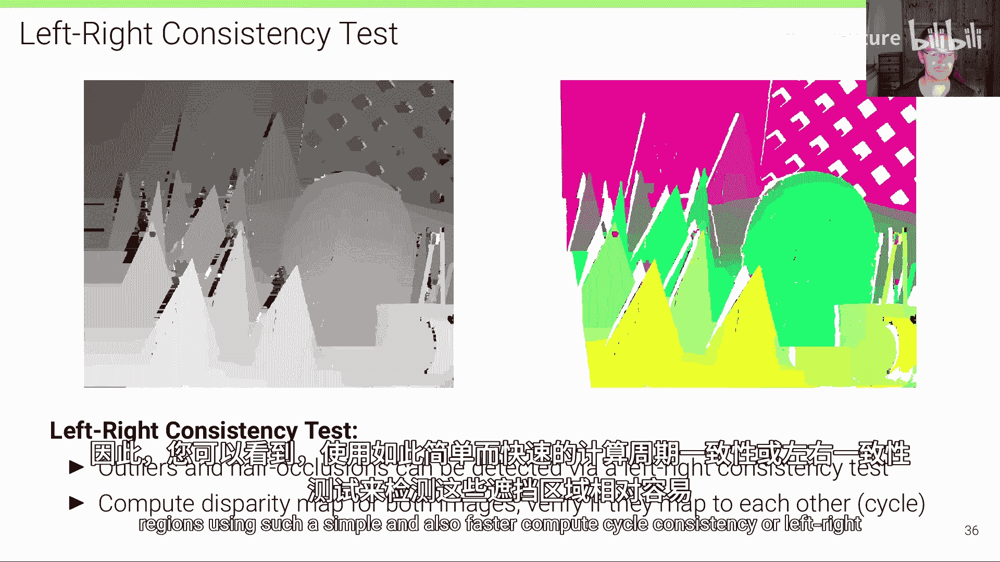

# 013：立体重建 - 块匹配 👁️

在本节课中，我们将学习立体视觉中的一个核心问题：如何从一对已校正的立体图像中计算视差图。我们将重点介绍一种基础且直观的方法——块匹配，并探讨其工作原理、实现步骤以及在实际应用中的局限性。

## 从视差到深度

上一节我们介绍了如何通过视差值计算深度值。本节中，我们来看看一个更根本的问题：在一个已校正的立体视觉系统中，我们如何首先确定每个像素的视差值？

## 块匹配的基本思想

给定左图和右图，我们需要为参考图像（通常是左图）中的每个像素确定一个视差值。这个值代表了该像素在另一幅图像（右图）中沿极线移动的距离。

实现这一目标最简单的方法是**块匹配**。其核心思想是：对于左图中的每个像素，取其周围的一个小图像块（patch），然后在右图的对应极线上滑动，寻找一个看起来最相似的图像块。

## 如何衡量相似性？

如何判断两个图像点是否对应？直观上，它们看起来应该相似。但“相似”具体指什么？如果只比较单个像素的RGB值，会因为噪声和颜色歧义导致大量错误匹配。

因此，在实践中，我们比较的是以该像素为中心的**一个小图像区域**。这能更好地利用局部结构信息，减少歧义。

## 块匹配算法流程

为了更好地理解块匹配，我们以著名的Middlebury立体视觉基准数据集中的一个场景为例。该数据集的优势在于为每个像素提供了精确的视差真值，便于算法评估。

以下是块匹配的工作流程示意图：

1.  **确定搜索范围**：对于左图中位于坐标 `(x1, y)` 的像素，由于图像已校正，其在右图中的对应点必然位于同一水平扫描线（`y` 坐标相同）上。并且，由于视差始终为正，我们只需在右图中从 `x1` 位置向左搜索（即向 `x` 坐标减小的方向）。
2.  **提取与比较图像块**：在左图，以 `(x1, y)` 为中心提取一个 `K x K` 的图像块。在右图，对于每一个候选视差 `d`，在以 `(x1 - d, y)` 为中心的位置提取一个同样大小的图像块。
3.  **计算相似度得分**：使用某种相似性度量，计算左图块与每个右图候选块之间的匹配分数。
4.  **选择最佳匹配**：通常采用“赢家通吃”策略，即选择相似度得分最高的那个候选位置，其对应的视差 `d` 即为该像素的估计视差。

## 相似性度量方法

我们将 `K x K` 的图像块展平为向量，记为 `W_L`（左图块）和 `W_R`（右图块）。以下是两种常用的相似性度量：

1.  **零均值归一化互相关**：该方法先对图像块进行零均值、单位方差归一化，再计算向量点积。它对光照变化有一定鲁棒性。
    *   **公式**：`ZNCC = ( (W_L - mean(W_L)) / std(W_L) ) · ( (W_R - mean(W_R)) / std(W_R) )`

2.  **平方差和**：计算两个图像块向量对应元素差值的平方和。值越小，表示越相似。
    *   **公式**：`SSD = Σ (W_L[i] - W_R[i])^2`

不同的度量方法各有优劣。若想深入了解，推荐查阅相关文献，如Scharstein和Szeliski的论文，其中系统比较了多种度量在辐射差异图像上的性能。

## 完整的块匹配算法与结果

完整的块匹配算法步骤如下：
1.  设定要搜索的视差范围 `[0, d_max]`。
2.  对于参考图像（如左图）中的每个像素，遍历所有可能的视差值 `d`，计算其与右图中对应块的相似度。
3.  为每个像素独立地选择相似度最优的视差值（赢家通吃策略）。

我们也可以交换参考图像的角色，计算以右图为参考的视差图。这样做的一个巨大优势是能够进行**左右一致性检查**，以剔除错误匹配（外点）。

## 块匹配的局限性与挑战

观察块匹配生成的视差图，我们会发现一些典型问题：

1.  **半遮挡区域**：场景中某些区域只在其中一幅图像中可见。例如，位于图像最左侧的物体，从右相机视角看可能完全不可见。对于这些像素，无法找到正确的对应点，因此无法估计视差，在视差图中显示为黑色区域。

    

2.  **前端平行假设的违反**：块匹配的一个核心假设是：所比较的图像块内，所有像素都具有相同的视差（即经历了相同的平移）。这仅在场景中的平面与图像平面平行（前端平行）时才严格成立。对于倾斜或弯曲的表面，当视角变化时，图像块会发生透视形变，而不仅仅是平移，这会导致匹配错误。

    

3.  **窗口大小的权衡**：选择图像块（窗口）大小时面临一个根本矛盾：
    *   **小窗口**：对细节保持更好，更少违反前端平行假设，但包含的纹理信息少，容易因匹配歧义而产生噪声。
    *   **大窗口**：包含更多纹理信息，匹配更鲁棒，结果更平滑，但会严重违反前端平行假设，导致**边界膨胀**效应——前景物体的视差会“渗入”背景区域，使得物体边界处的视差不准确。

    

## 改进策略：左右一致性检查

为了缓解上述问题并剔除外点，一个有效的方法是执行**左右一致性检查**。其原理是：
1.  分别计算以左图为参考的视差图 `D_L` 和以右图为参考的视差图 `D_R`。
2.  对于左图中的像素 `p`，其视差为 `D_L(p)`。根据此视差，在右图中找到对应的像素 `q`。
3.  查看右图中像素 `q` 的视差 `D_R(q)`。根据 `D_R(q)` 应该能将我们带回到左图中的原始像素 `p` 或其附近。
4.  如果 `|D_L(p) - D_R(q)|` 超过一个阈值，则认为 `p` 点的视差估计不一致，可能是错误的，予以剔除。半遮挡区域非常容易被这种方法检测出来。

## 总结

本节课中我们一起学习了立体视觉中的基础匹配算法——块匹配。我们了解了其通过比较图像块相似性来估计视差的基本流程，介绍了ZNCC和SSD两种相似性度量方法。同时，我们也深入探讨了块匹配的局限性，包括半遮挡问题、违反前端平行假设以及窗口大小选择的权衡。最后，我们介绍了左右一致性检查这一有效工具，用于提升视差图的质量并检测遮挡区域。块匹配虽然简单直观，但其面临的挑战促使了后续更复杂的立体匹配算法的发展。