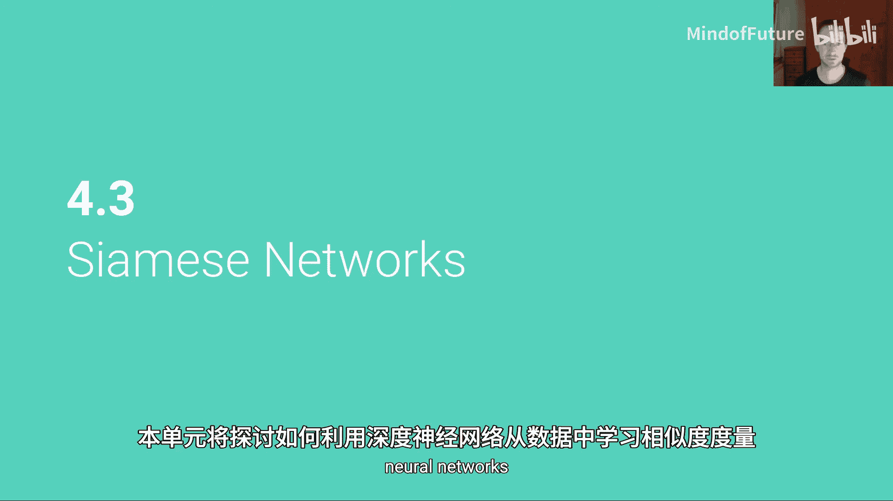
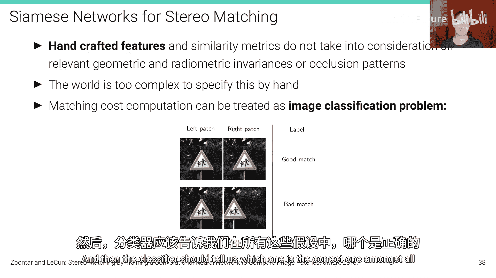
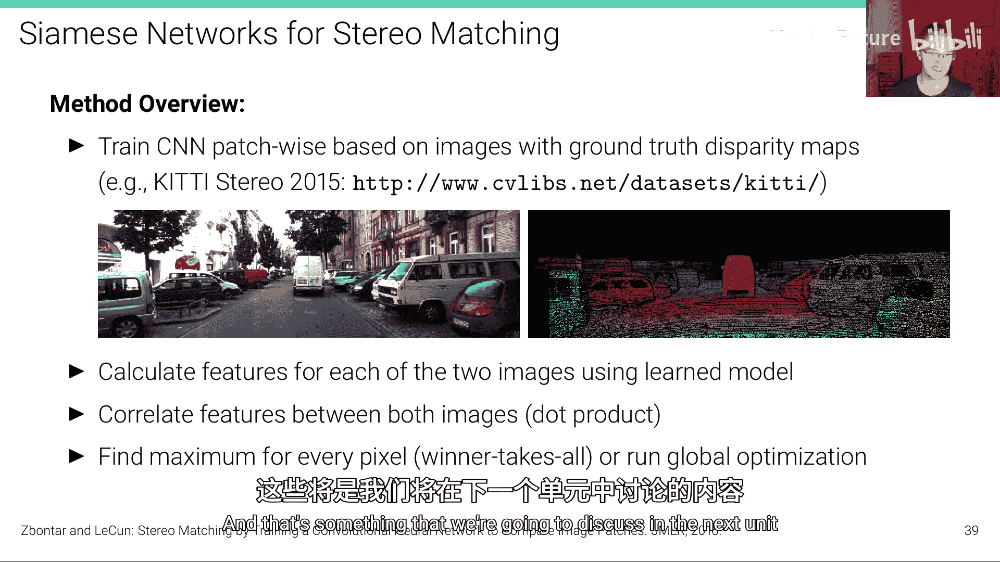
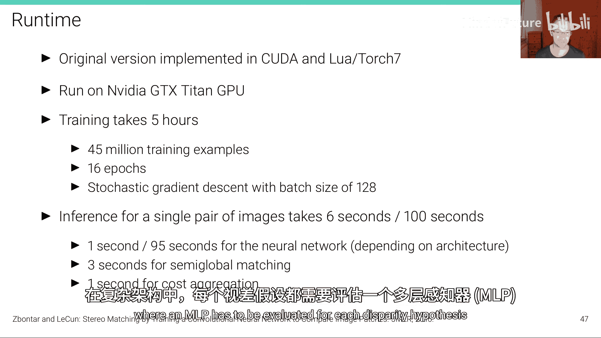

# 014：立体匹配中的孪生网络 🧠

在本节课中，我们将学习如何利用深度神经网络从数据中学习相似性度量，以改进立体匹配中的块匹配方法。上一节我们讨论了简单的手工相似性度量，本节我们将看到如何通过学习来获得更优的度量。

## 动机与核心思想

手工设计的特征和相似性度量无法全面考虑所有相关的几何、辐射度不变性以及遮挡模式。深度学习已经革新了识别任务，例如，过去使用手工设计的SIFT描述符，而现在所有特征都是学习得到的。我们希望在此应用相同的原理，但依然保持在块匹配的框架内，即使用相似的匹配算法，只是希望获得更好的相似性度量。世界过于复杂，难以手工指定，因此需要学习。

一篇开创性论文指出，匹配代价的计算实际上可以视为一个图像分类问题。其背后的思想很简单：如果我们从左图像和右图像中各取一个图像块，并且已知真实的视差（这需要一个带有视差标注的数据集），我们就可以根据真实视差给这些图像块打标签。例如，如果位移正确，则图像块相似，视为“好匹配”；如果视差略有偏差，则视为“坏匹配”。这样，我们就可以将其转化为一个分类问题：对于一个特定的左图像块，尝试对右图像中所有可能的右图像块进行分类，分类器应能告诉我们哪个是正确的匹配。

## 方法概述 🧩

该方法假设存在一个大型标注数据集。早期的大型标注视差数据集之一是KITTI数据集（2012和2015年），它提供了超过200张标注图像以及更多带有真实视差的原始图像，可用于训练模型。需要说明的是，本节讨论的孪生网络相比我们将在最后一节讨论的端到端立体估计技术，仍然更加标签高效和数据高效，因为它们只学习特征和相似性矩阵，但仍需要相当数量的数据进行训练。

训练好这样一个“图像块分类器”后，我们可以使用这个学习到的模型为左右两幅图像计算特征，然后使用简单的点积或更复杂的多层感知机来关联这些特征以比较图像块。接着，我们可以为每个像素找到最大值（即上一节讨论的“赢家通吃”策略），或者如论文中所做，为了获得稍好的性能，可以运行一个结合了问题平滑性假设的全局优化算法（这将在下一节讨论）。

因此，在本节中，我们仍然专注于块匹配的设置。

## 网络架构

原始论文提出了两种用于此匹配问题的架构。

**1. 学习相似性架构**
在这种架构中，我们取左图像的一个块和右图像的一个块，通过卷积计算特征，然后将这些特征**拼接**起来，再输入一个全连接的多层感知机，由该MLP输出这两个块的相似性分数。它仍然是孪生网络（两个分支相同且共享参数），但随后需要这个昂贵的MLP部分进行计算。

**2. 余弦相似性架构**
更简单的方法是移除这个MLP，将所有相似性度量的计算负担转移到特征上。具体做法是：使用卷积网络为两幅图像的所有像素计算特征（推理时可重用计算，速度很快），然后对所有像素在通道维度上进行**归一化**，最后计算这两个归一化特征向量之间的简单**点积**，该点积直接作为相似性分数，这被称为余弦相似性。

这两种架构在推理时，孪生分支部分（共享权重）可以快速在整个图像上运行。而点积操作（需要计算 W × H × D 次）比运行一个MLP要快得多。因此，整个评估过程比“学习相似性”模型快大约两个数量级。有趣的是，这并没有导致性能显著下降，两种架构性能大致相当。由于其速度快，后续许多工作都采用了这种架构。

## 训练过程 🔄

这些模型的训练集由**图像块三元组**构成，并使用一种特殊的损失函数。

一个三元组包含：
*   一个来自左图像的块（参考块）。
*   一个来自右图像的**负样本**块（不正确的块）。
*   一个来自右图像的**正样本**块（正确的块，根据真实视差精确位移得到）。

这里的 **x** 是二维坐标，即左右图像中的图像坐标。

关键问题是如何选择正负样本。这篇论文采用了**难负样本挖掘**。原因是，如果只是随机选择非正样本的块作为负样本，会导致分类问题过于简单，因为大多数块与正确块看起来非常不同。我们需要寻找那些与正确样本**相似但不正确**的负样本。

具体做法是：
*   **负样本**：中心坐标取为 `(x_left - 视差d) + 偏移量O_neg`，其中偏移量O_neg从一个均匀分布中采样，范围在 `[负样本低阈值, 负样本高阈值]` 内（例如论文中使用-6到-3和+3到+6像素）。
*   **正样本**：中心坐标取为 `(x_left - 视差d) + 偏移量O_pos`，其中偏移量O_pos从一个更小的范围采样（例如论文中使用-1到+1像素）。

这种策略使得分类器需要区分那些看起来很接近但略有偏移的“难”样本，从而学习到更具判别力的特征。

## 损失函数

我们训练模型来预测相似性分数（回归任务，而非分类），使用的是**合页损失**。

**公式**：
`损失 = max(0, 边际值M + S_负 - S_正)`

其中：
*   `S_负` 是网络对（参考块，负样本块）的相似性评分。
*   `S_正` 是网络对（参考块，正样本块）的相似性评分。
*   `M` 是一个可调的超参数（论文中通常使用0.2）。

我们希望正样本的相似性分数 `S_正` 高于负样本的分数 `S_负` 至少一个边际值 `M`。当 `S_正 > S_负 + M` 时，损失为零。这种合页损失和边际值的设计，可以防止那些已经分离得很好的正负样本对继续产生梯度，让模型能够专注于那些难以区分的“难”样本。

## 结果与性能

“赢家通吃”策略的结果显示，在KITTI 2012数据集上，孪生网络的结果比标准块匹配的结果噪声更少、质量更好。这表明学习确实提高了相似性度量的质量。

如果在此基础上运行全局优化（下节内容），可以获得更优的视差图。通过对左右图像分别计算视差并进行一致性检查，可以移除异常值并基于遮挡关系进行着色（例如，半遮挡区域显示为绿色），从而得到非常清晰的视差图。

该算法的原始版本使用CUDA和Lua/Torch 7实现，在一块Titan X GPU上运行。
*   **训练**：使用了4500万个训练样本（小图像块），训练16个周期，耗时约5小时。
*   **推理**：对于一对图像，简单（余弦相似性）架构约需6秒，复杂（学习相似性）架构由于需要为每个视差假设评估MLP，约需100秒。

## 总结

本节课我们一起学习了如何利用孪生网络从数据中学习立体匹配的相似性度量。我们了解了两种主要的网络架构（学习相似性和余弦相似性），探讨了使用难负样本挖掘的三元组训练方法以及合页损失函数。这种方法在保持块匹配框架高效性的同时，显著提升了匹配质量，为后续的全局优化步骤奠定了更好的基础。