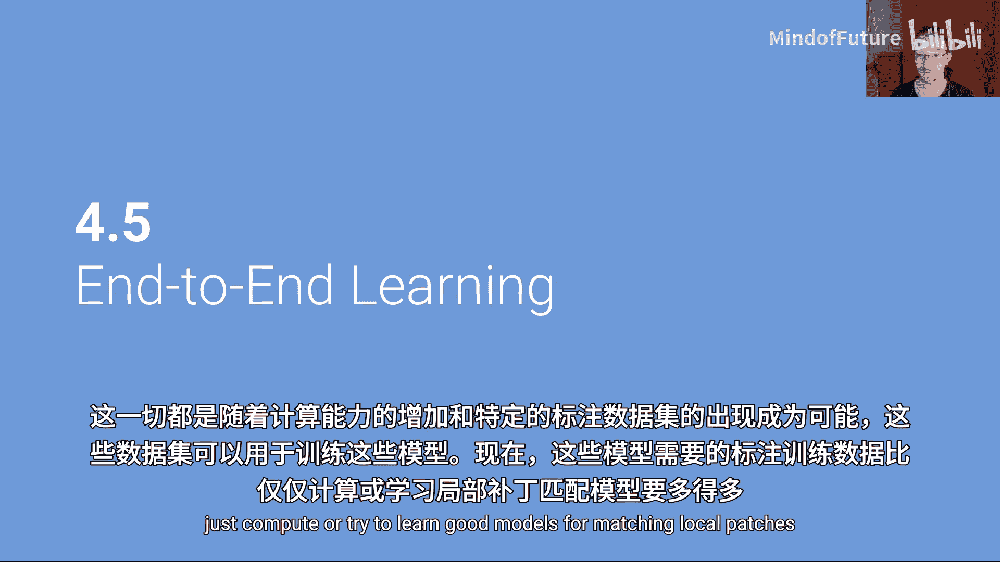
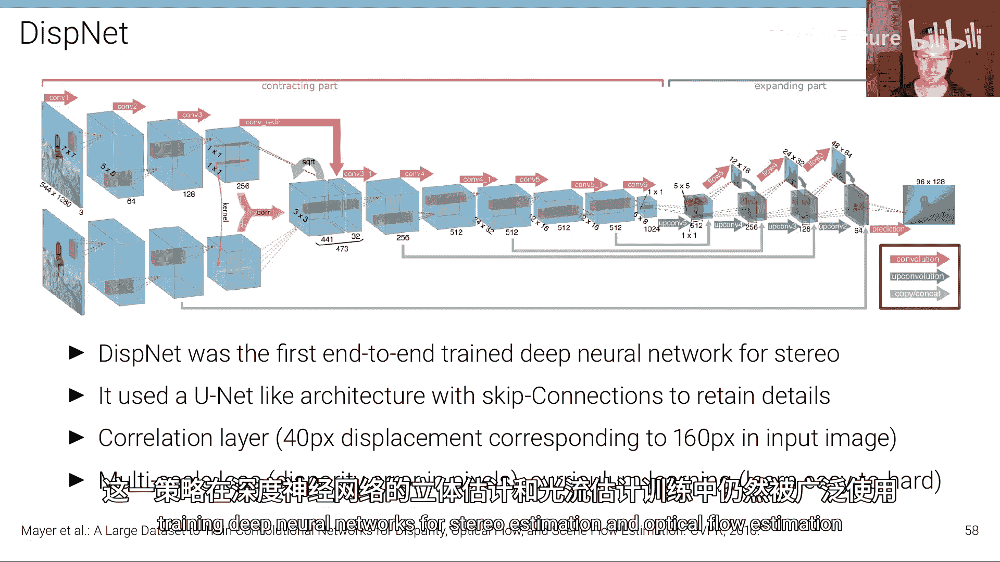
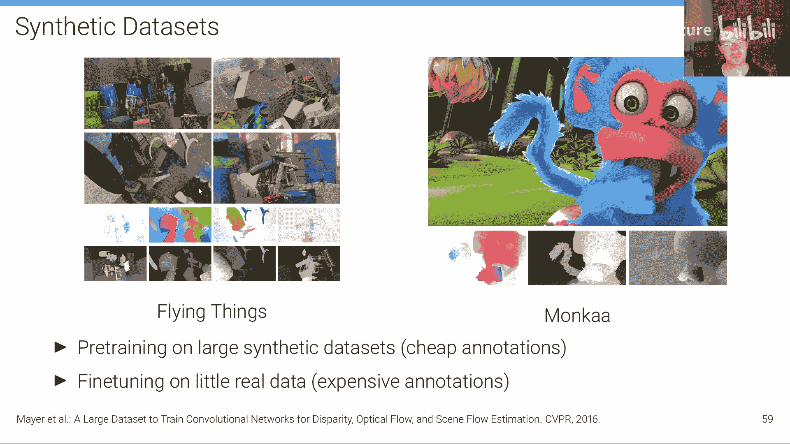
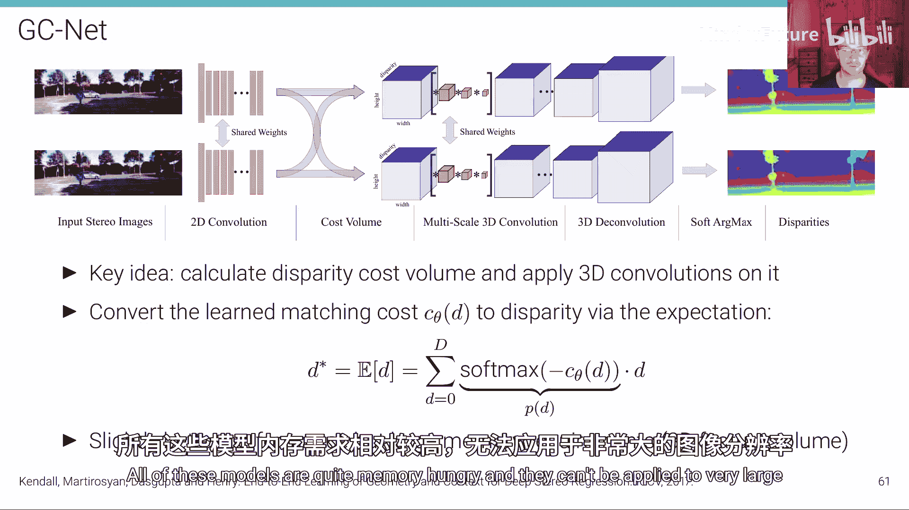
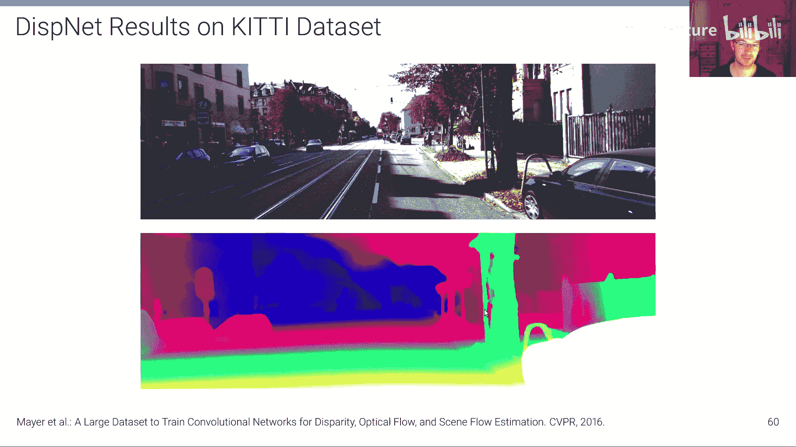
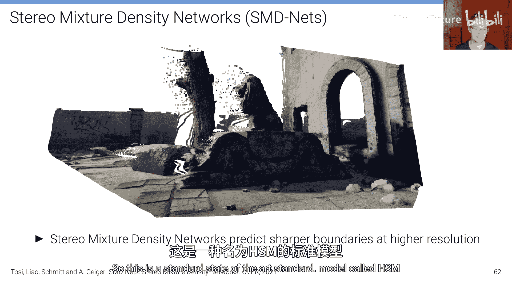
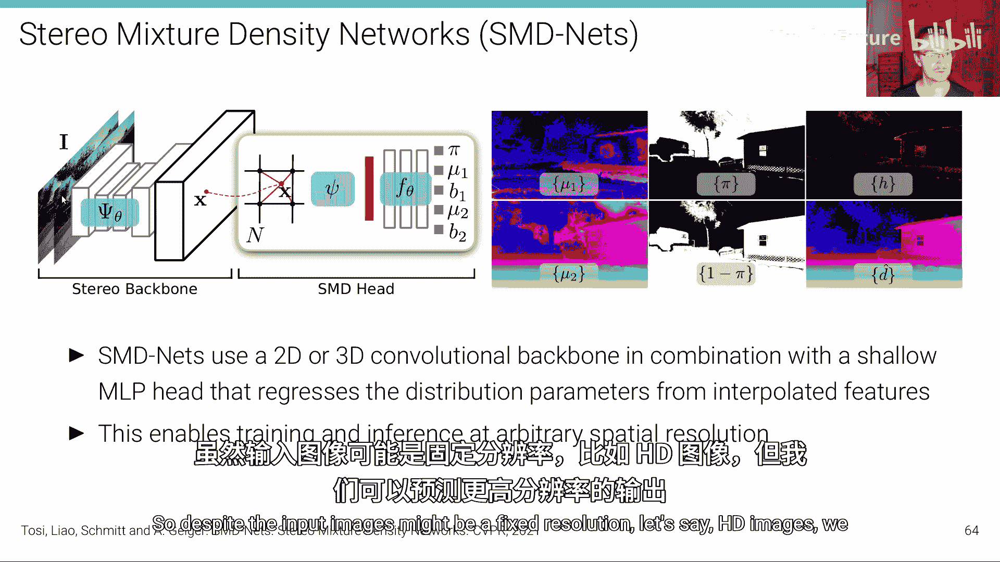
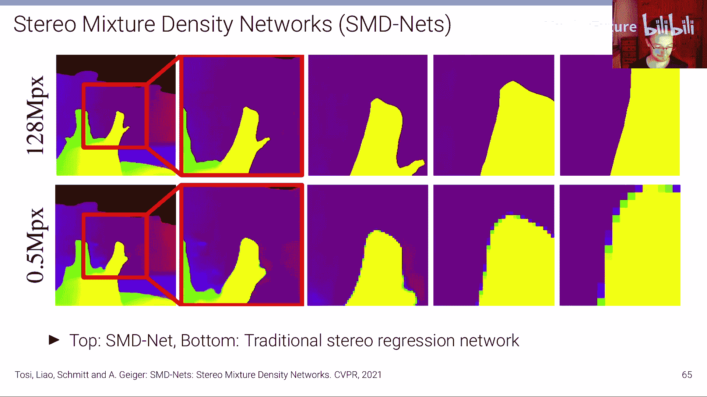

# 016：端到端立体视觉重建 🧠

在本节课中，我们将学习端到端学习的立体视觉重建算法。这些算法不仅学习匹配代价，而且直接将整张图像作为输入，通过深度神经网络直接输出视差图。我们将了解这一领域的关键模型、训练策略、数据集挑战以及最新的技术进展。

---

## 模型架构演进

上一节我们回顾了传统的立体匹配方法。本节中，我们将重点介绍完全由数据驱动的端到端深度学习方法。

### DispNet：开创性的端到端模型

第一个推动该领域发展的模型是 **DispNet**。它是一个端到端训练的深度神经网络，用于立体视觉。

*   **输入**：一对左右立体图像。
*   **架构**：采用类似U-Net的编码器-解码器结构，包含下采样卷积、跳跃连接和上卷积操作，以恢复高分辨率细节。
*   **输出**：直接回归预测出视差图。
*   **关键特性**：在网络的较低分辨率层，引入了一个**相关层**，用于在特征级别进行匹配，这借鉴了传统块匹配的思想。网络在此之后合并为单分支。

**训练细节**：
*   **损失函数**：采用多尺度损失，不仅在最终层计算预测视差与真实视差的差异，也在中间层对下采样后的真实值计算损失。
*   **课程学习**：为防止过拟合，采用课程学习策略。模型首先在简单场景、低分辨率数据上训练，然后逐步增加数据集的难度，直至达到目标数据集的复杂度。

---

## 数据挑战与解决方案

训练这些深度模型需要大量带标注的数据，但获取真实世界的立体图像及其精确视差真值非常困难。

以下是解决数据问题的关键方法：

1.  **真实数据集（如KITTI）**：使用激光雷达扫描获取深度信息，但制作成本高、场景特定（主要是自动驾驶）。
2.  **合成数据集**：通过渲染3D资产生成图像和对应的深度图，标注成本极低。尽管合成数据与真实数据在外观上差异巨大，但模型仍能表现出良好的泛化能力。常用的合成数据集包括 **FlyingThings3D** 和 **Monkaa**。

模型先在大型合成数据集上进行预训练，然后在较小的真实数据集（如KITTI）上进行少量迭代的微调，即可获得不错的效果。

---

## 性能提升：GC-Net

在DispNet之后，**GC-Net** 通过一个关键改进获得了更好的性能。

*   **核心思想**：显式构建一个**视差代价体积**（类似于传统方法），然后对其应用**3D卷积**进行滤波和优化。
*   **与DispNet的区别**：DispNet在相关层后主要使用2D卷积；而GC-Net在构建代价体积后，使用3D卷积和3D反卷积来处理这个三维空间中的匹配信息。
*   **输出形式**：GC-Net将视差估计视为分类问题，为每个像素的每个候选视差级别预测一个匹配代价，然后通过`softmax`将其转换为概率分布，最终取期望值作为该像素的预测视差。
    *   **公式**：`预测视差 = Σ (每个视差候选值 d * 其概率 P(d))`
    *   其中，`P(d) = softmax( - 代价(d) )`
*   **缺点**：3D卷积非常消耗内存，限制了可用的批处理大小和输入分辨率。

---

## 前沿进展：立体混合密度网络

现有模型存在两个主要问题：内存消耗大导致难以处理高分辨率图像，以及神经网络固有的平滑性会导致物体边缘出现“模糊”或“出血”的伪影。

**立体混合密度网络** 旨在解决这些问题：

1.  **混合密度预测**：不再为每个像素回归单个视差值，而是预测一个**多模态的视差分布**（例如，双模态拉普拉斯混合分布）。这允许模型在物体边界处表示两个截然不同的视差模式，从而能够建模尖锐的视差不连续性。
    *   **代码概念**：模型输出每个像素的分布参数（如均值、尺度、混合权重）。
2.  **连续查询头**：在标准骨干网络之上，增加一个**SMD头部**（一个多层感知机）。它可以通过双线性插值，在图像的**任意连续坐标位置**查询特征，并预测该位置的混合分布参数。这实现了**任意空间分辨率**的训练和推理。

**效果**：相比传统方法（如HSMNet），该方法能预测更清晰的物体边界，并且能以远高于输入图像的分辨率（例如从HD到128兆像素）输出视差图，同时避免了边缘伪影。

---

本节课中，我们一起学习了端到端立体视觉重建的发展历程。我们从开创性的DispNet模型开始，了解了其U-Net架构和课程学习策略。接着，探讨了训练这些模型所面临的数据集挑战以及合成数据的解决方案。然后，我们分析了性能更优的GC-Net，它通过3D卷积处理代价体积。最后，我们介绍了最新的立体混合密度网络，它通过预测多模态视差分布和实现连续空间查询，显著提升了视差图在边界处的锐度和整体分辨率。这些进展展示了深度学习在立体视觉领域的强大能力和持续创新。