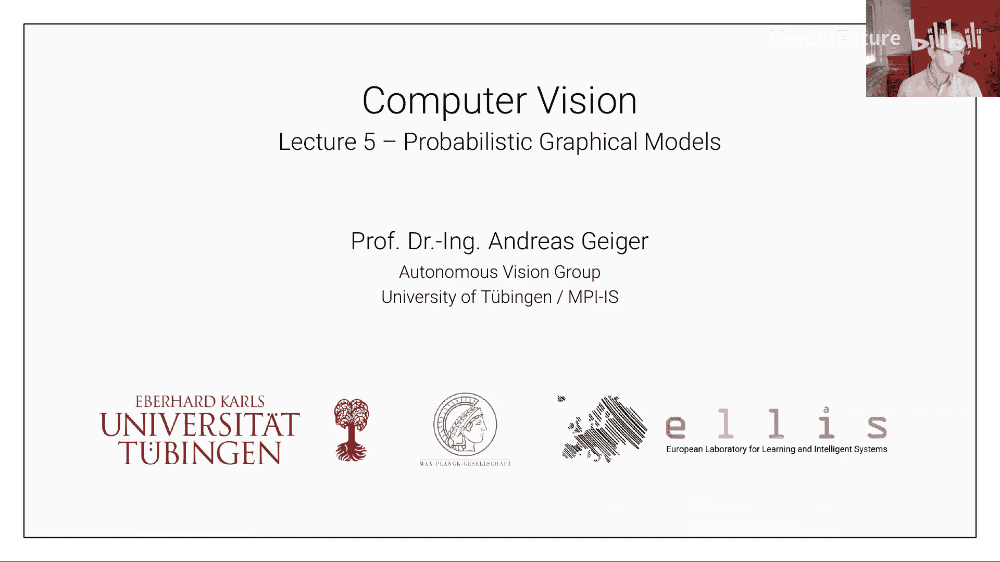
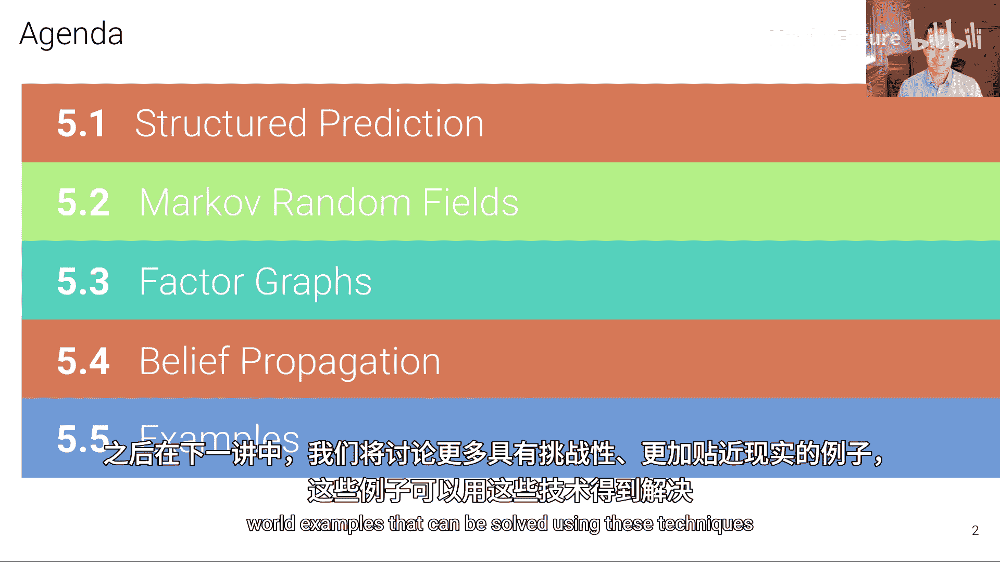
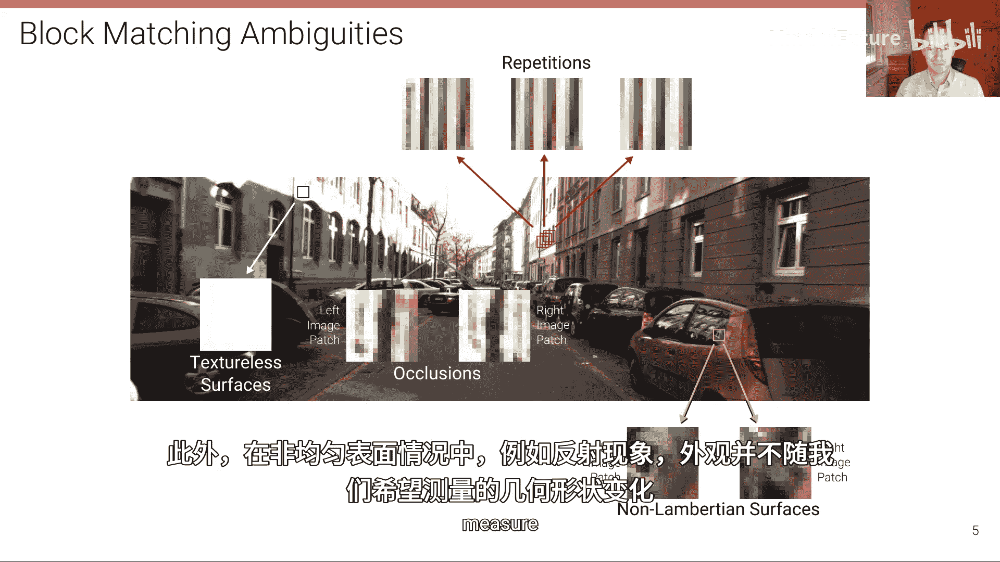
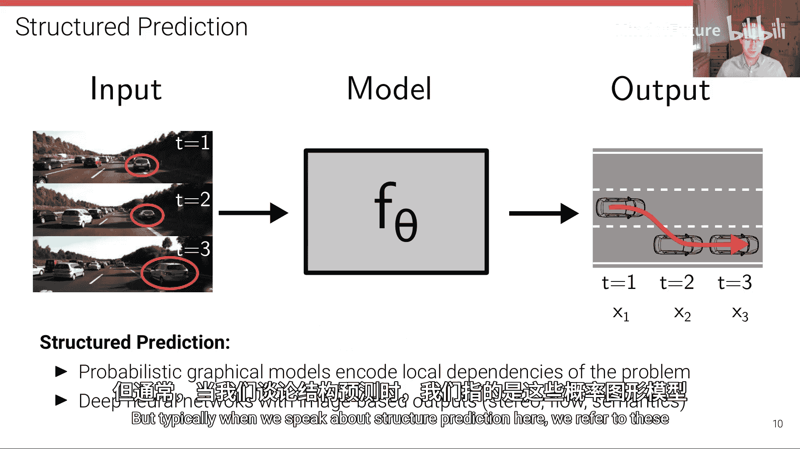
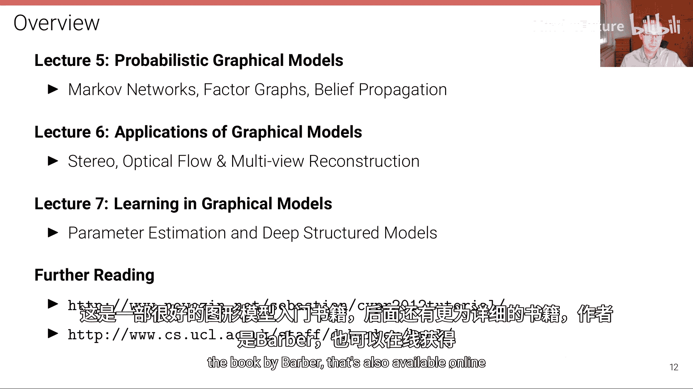

# 017：概率图模型与结构化预测 📊

在本节课中，我们将学习概率图模型的基本概念，特别是它们在解决计算机视觉中“结构化预测”问题时的应用。我们将从问题设定开始，逐步介绍马尔可夫随机场、因子图等核心模型，并了解如何利用它们整合先验知识来解决如立体匹配等存在歧义的问题。

## 从立体匹配到结构化预测 🔍

在上一讲中，我们介绍了立体匹配算法，特别是基于块匹配的方法。这类方法的核心假设是：左右图像中对应的图像块应该看起来相似。然而，在许多情况下，这个相似性假设会失效。

以下是几个典型的失败场景：
*   **纹理缺失区域**：图像区域缺乏可区分的纹理，导致无法唯一匹配。
*   **重复纹理区域**：大量图像块外观相似，造成匹配歧义。
*   **遮挡区域**：前景和背景的变化不一致，导致匹配块的外观发生剧烈改变。
*   **非朗伯表面**：例如存在反射的表面，其外观并不随我们希望测量的几何形状而移动。

为了克服这些歧义，我们可以尝试整合关于真实世界的**先验知识**。在立体匹配中，这意味着了解深度图或视差图的统计特性。例如，布朗大学范围图像数据库的统计表明，除了在物体边界处，深度或视差的变化通常是缓慢的。我们希望将这种“空间平滑”的统计知识整合到匹配算法中，这个过程称为**空间正则化**。

那么，如何整合这种关于视差图统计特性的知识呢？我们可以将问题构建为在**概率图模型**中进行**推断**。这被称为一个**结构化预测**问题，因为我们不再是独立地预测每个像素的视差，而是通过考虑相邻像素之间的局部相互作用（先验知识），一次性预测整个视差图。

这种在规则网格上连接相邻像素（如上、下、左、右）的图结构，可以写成一个能量函数的形式，从而产生一个吉布斯分布。我们的目标是在所有可能的视差图空间中，进行最大后验概率推断，以找到在给定数据约束（匹配成本）和先验平滑约束下最可能的视差图。

## 什么是概率图模型？ 🤔

概率图模型采用概率论的视角，对问题的**依赖关系结构**进行建模。它试图为整个待推断对象（如完整的视差图）建立概率分布，然后在该模型上进行推断。

在深度学习革命之前，图模型在许多计算机视觉领域占主导地位。它们特别适用于**训练数据较少**的场景，并且允许灵活地**整合先验知识**。解决计算机视觉中病态问题的歧义性有两种主要思路：一是整合大量（标注）数据并用深度学习进行端到端训练；二是在数据有限但拥有先验知识时，利用图模型整合这些知识。值得注意的是，图模型的思想也可以与深度学习结合，我们将在第7讲中看到相关例子。

以下是概率图模型的优缺点分析：

**优点：**
*   **可整合先验知识**：能够将领域知识（如深度图统计）编码到模型中。
*   **参数相对较少**：可以从有限的数据中估计参数。
*   **可解释性强**：图结构中的组件通常具有明确的含义，便于理解模型的推断过程。

**缺点：**
*   **建模能力有限**：许多复杂现象难以用简单的图结构准确建模。为了保持推断的可处理性，通常只能使用成对依赖等简单结构，这可能引入误差。
*   **难以利用大数据集**：相关技术通常不够快速，且即使对于简单情况，推断也常常是近似的（例如，在带环的图中进行精确推断是NP难问题）。

## 结构化预测的定义 📐

我们已经提到在图模型中进行推断是一种结构化预测。那么，什么是结构化预测呢？

形式上，结构化预测与传统分类和回归问题相对。在分类或回归中，我们试图建模一个从复杂输入空间（如图像、文本）到**单个**离散（分类）或连续（回归）数值的函数。而在**结构化预测**中，输入同样是复杂的、高维的对象，但**输出也是复杂的结构化对象**。输出可以是图像、文本、蛋白质折叠结构、计算机程序等高维数据。

例如，在立体匹配中，使用孪生网络对每个像素独立计算视差得分，这本质上仍是独立的分类。而在结构化预测中，我们希望一次性推断整个视差图，并考虑像素间的结构关系。另一个简单例子是车辆车道跟踪：输入是含噪声的观测序列，输出是每个时间步车辆所在车道（左、中、右）的状态序列。通过整合“车辆不太可能瞬间跨越车道”这样的先验约束，并将其构建为图模型进行推断，我们就能进行结构化预测。

因此，**概率图模型推断**和**具有图像输出的深度神经网络**都属于结构化预测模型的范畴。但在本课程中，当我们提及结构化预测时，通常特指基于概率图模型的方法。

## 课程路线图与图模型概览 🗺️

图模型种类繁多，有专门的课程讲授。在本课程中，我们将用三讲（第5、6、7讲）的时间来介绍其核心思想，并聚焦于对计算机视觉应用非常重要的一类模型——**无向图模型**，也称为马尔可夫网络或马尔可夫随机场。

以下是这三讲的内容概览：
*   **本讲（第5讲）**：介绍概率图模型基础，涵盖马尔可夫随机场、因子图以及用于求解边缘概率和最大后验解的推断算法——信念传播。
*   **第6讲**：探讨图模型在立体视觉、光流和多视图重建等具体计算机视觉任务中的应用。
*   **第7讲**：讨论图模型中的参数学习（估计），以及如何将图模型与深度学习相结合。

如果你想深入了解图模型，推荐阅读Sebastian Nowozin和Christoph Lampert的教程（附有免费在线书籍），以及Barber的著作（同样可在线获取）。

---

本节课中，我们一起学习了结构化预测问题的由来及其重要性，了解了概率图模型如何通过建模变量间的依赖关系来整合先验知识以解决此类问题。我们明确了结构化预测与分类/回归的区别，并概览了本课程中关于图模型部分的学习路线。下一节，我们将深入探讨我们的核心工具——马尔可夫随机场。