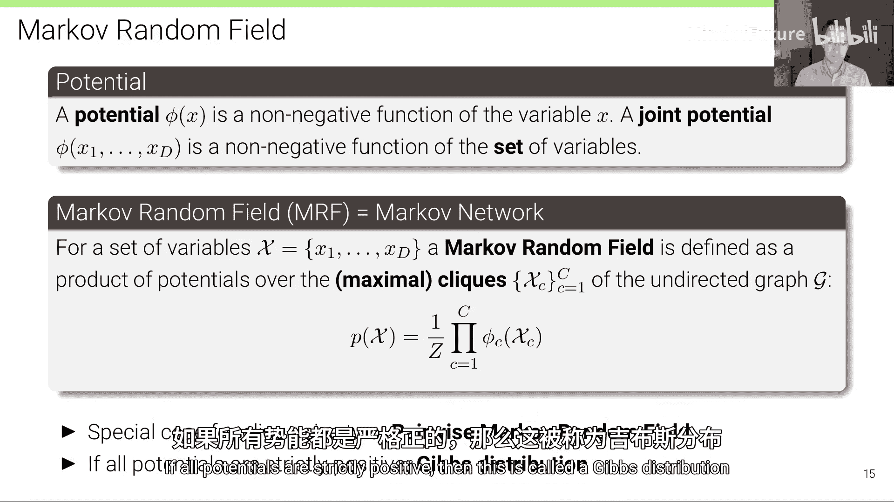
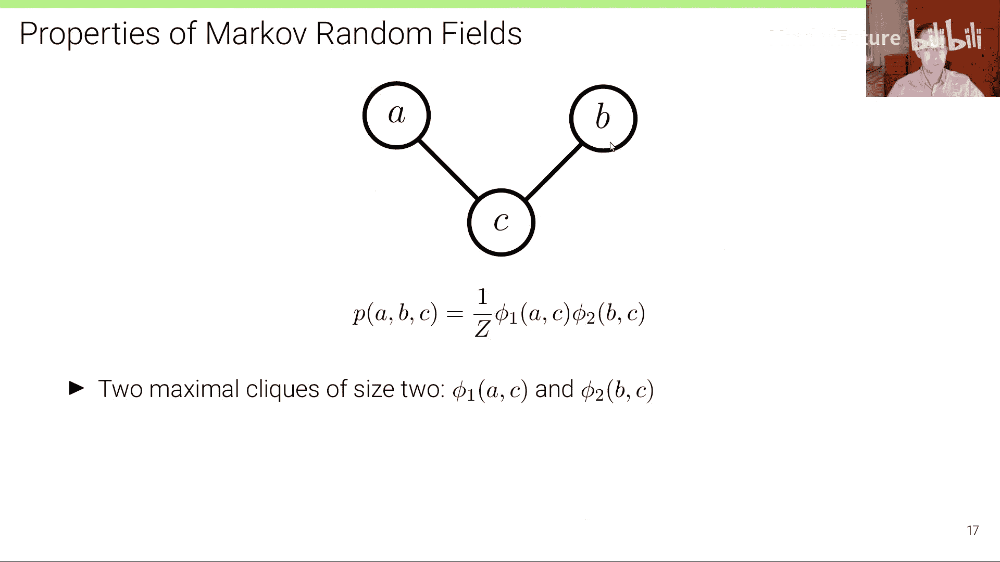
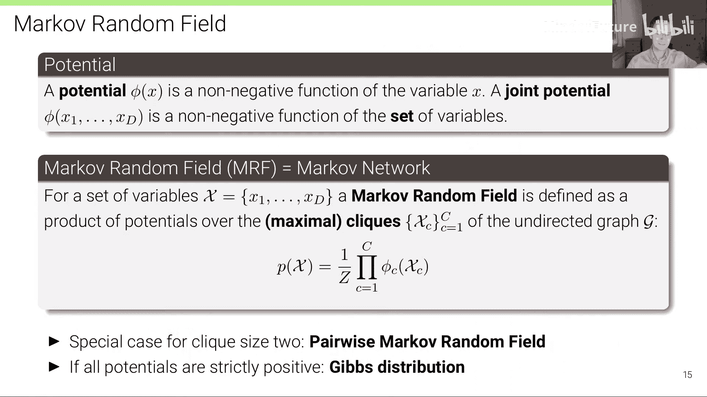
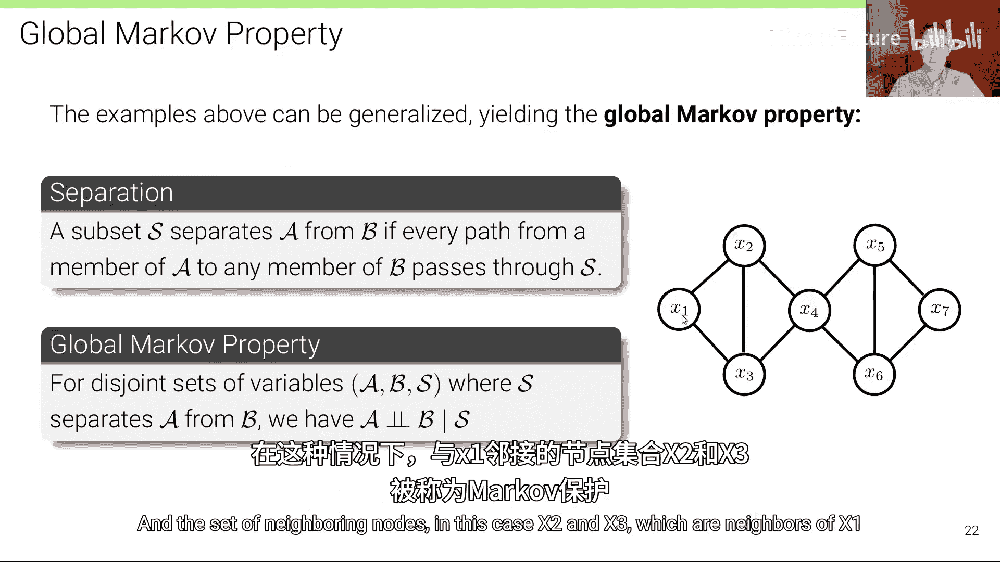
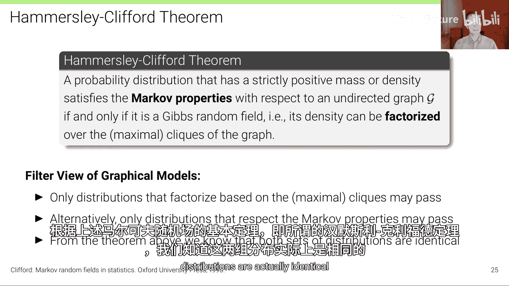

# 018：马尔可夫随机场 🎲

在本节课中，我们将要学习概率图模型中的一种重要模型——马尔可夫随机场。我们将从概率论的基础知识开始回顾，然后深入探讨马尔可夫随机场的定义、性质及其在图模型中的核心作用。

## 概率论回顾

在深入马尔可夫随机场之前，让我们先简要回顾一下概率论的基础知识。

在概率论中，我们讨论的是随机变量，我们会在这些变量上定义分布。本课程，特别是本讲座中，我们主要考虑两种类型的随机变量：离散随机变量和连续随机变量。

对于离散随机变量，变量可以取 C 个值（可以将 C 理解为分类问题中的类别）。变量 x 取值为 c 的概率记为 **P(x = c)**。请注意，对于离散分布，我们通常使用大写字母 P，但为了简便，这里我们统一使用小写 p。

如果 x 是连续随机变量，我们可以写出 x 取值于某个集合的概率。如果这是一个一维随机变量，那么这个集合就是实数空间 R 的一个子集。变量 x 取值于集合 X 的概率记为 **P(x ∈ X)**。变量 x 的分布可以简写为 **p(x)**，这里我们同样不区分离散和连续，为简便起见统一使用小写 p。

现在，有一些关于概率分布的重要性质需要了解，我们将在本讲座中广泛使用这些性质。以下是两个基本规则：求和规则与乘积规则。

求和规则定义了变量的边缘化。当我们有一个联合分布 **p(x, y)** 时，可以通过对想要从分布中移除的变量 y 进行求和（或积分）来得到 x 的边缘分布。公式如下：
**p(x) = Σ_y p(x, y)** （离散变量）
或
**p(x) = ∫ p(x, y) dy** （连续变量）

另一个重要规则是乘积规则。联合分布 **p(x, y)** 等于条件分布 **p(y|x)** 乘以 x 的概率，即：
**p(x, y) = p(y|x) * p(x)**
或者等价地，
**p(y|x) = p(x, y) / p(x)**

作为乘积规则的一个直接推论，我们得到了著名的贝叶斯规则：
**p(y|x) = p(x|y) * p(y) / p(x)**

## 马尔可夫随机场简介

在快速回顾之后，让我们深入探讨马尔可夫随机场。

为了定义马尔可夫随机场，我们首先需要定义什么是势函数。一个势函数 **φ_i(x)** 或 **φ(x)** 是其自变量 x 的一个非负函数。在本讲座的上下文中，x 通常是一个单变量。一个联合势函数 **φ(x1, ..., xT)** 是一组变量的非负函数。通常，所有变量也可以是高维的，但本讲座中，我们考虑每个单独的 x_i 为一维随机变量。势函数是非负的，但不需要归一化。

马尔可夫随机场，简称 MRF，也称为马尔可夫网络，定义如下：对于一组变量 **X = {x1, ..., xT}**，一个马尔可夫随机场被定义为在无向图 G 的所有极大团（或所有团）上的势函数的乘积。公式如下：
**p(X) = (1/Z) * ∏_{c∈C} φ_c(X_c)**
其中，C 是图 G 中的团（或极大团）集合，X_c 是团 c 中包含的变量子集。Z 是归一化常数，称为配分函数，它确保整个表达式是一个正确的概率分布（即对所有状态求和或积分为 1）。

如果图中的团大小均为 1 或 2（即没有连接超过两个变量的团），我们称之为成对马尔可夫随机场。我们在立体视觉中简要展示过的马尔可夫随机场就是一个例子，它包含一元势函数和成对势函数，但没有连接超过两个变量的势函数。

如果所有势函数都严格为正，则称之为吉布斯分布。

## 图、团与极大团

我们谈到了团、极大团和无向图，这些概念具体指什么呢？让我们看一个例子。

这是一个包含 7 个顶点和 11 条边的无向图。图中的每个顶点对应一个随机变量，因此我们有 7 个随机变量。边则对应这些随机变量之间的依赖关系或联系。例如，x2 和 x4 直接相关，而 x2 和 x5 则不直接相关，它们只能通过 x4 间接联系。

团是图中顶点的一个子集，该子集内的所有顶点都两两相连（完全连接）。例如，图中绿色的 {x1, x3} 是一个团，因为 x1 和 x3 相连。红色的 {x1, x2, x3, x4} 也是一个团，因为子集内每两个变量之间都有边连接。类似地，{x4, x5, x6} 和 {x5, x6, x7} 也是团。但 {x4, x5, x6, x7} 不是团，因为缺少 x4 到 x7 的连接。

极大团是指无法通过添加任何其他顶点来扩展的团。在上图中，只有红色的团是极大团。例如，团 {x1, x2, x3, x4} 是极大的，因为无法添加 x5 等顶点而不破坏团的完全连接性质。而团 {x1, x3} 不是极大的，因为可以添加 x2 形成更大的团 {x1, x2, x3}，而这个团仍然不是极大的，因为还可以添加 x4。

这就是无向图模型的基本概念：顶点对应随机变量，边对应关系，以及团和极大团的概念。

## 马尔可夫随机场的性质

现在，让我们通过一个只有三个随机变量的简单例子来看看马尔可夫随机场的一些性质。这个图的连接关系是：A 与 C 相连，C 与 B 相连，但 A 与 B 之间没有直接连接。

如前所述，马尔可夫随机场被定义为无向图上团的势函数的乘积。在这个例子中，我们有两个团（同时也是极大团）：{A, C} 和 {C, B}。因此，这个 MRF 指定的联合分布为：
**p(A, B, C) = (1/Z) * φ1(A, C) * φ2(B, C)**
其中 Z 是配分函数，用于归一化。

第一个性质是：如果我们对变量 C 进行边缘化（求和），那么原本没有直接连接的 A 和 B 会变得相互依赖。我们可以通过证明在边缘化 C 后，**p(A, B) ≠ p(A) * p(B)** 来证实这一点。我们通过构造一个反例（使用二元变量和特定的势函数定义）证明了这一点，表明在一般情况下，该等式不成立。

第二个性质是：如果我们对变量 C 进行条件化（给定 C 的值），那么 A 和 B 会变得条件独立。这可以更简洁地写为：**A ⊥ B | C**。其证明可以通过证明 **p(A, B|C) = p(A|C) * p(B|C)** 来完成，方法与第一个性质的证明类似。

在这个简单的三节点 MRF 中，我们看到：边缘化一个变量会使其相邻变量变得依赖；而条件化一个变量会使其相邻变量变得条件独立。

## 全局与局部马尔可夫性质

后一个陈述（条件独立性）可以推广为所谓的全局马尔可夫性质。

为了定义全局马尔可夫性质，我们首先需要定义分离。考虑一个图，一个顶点子集 S 将子集 A 与子集 B 分离，如果从 A 中任一成员到 B 中任一成员的所有路径都必须经过 S。换句话说，S 屏蔽了 A 和 B 之间的直接相互影响。

全局马尔可夫性质陈述如下：对于不相交的变量子集 A、B 和 S，如果 S 将 A 与 B 分离，那么给定 S 的条件下，A 条件独立于 B。这意味着，通过定义分离属性，我们可以从任何具体的图中推导出一系列条件独立性关系。

从全局马尔可夫性质，我们可以非常简单推导出局部马尔可夫性质。局部马尔可夫性质指出：当条件于其所有邻居时，一个随机变量 X 与图中所有其他变量条件独立。用数学语言表达：
**p(x | X\{x}) = p(x | Neighbors(x))**
其中，X\{x} 表示除 x 之外的所有变量集合。变量 x 的邻居节点集合被称为 x 的马尔可夫毯，因为它像毯子一样将 x 与图中其他变量屏蔽开来。这个性质不仅适用于单个变量，也适用于变量集合。

## 哈密尔顿-克利福德定理

我们讨论了基于极大团的因子分解，也讨论了通过分离从图中推导条件独立性质。这两者之间的关键联系由哈密尔顿-克利福德定理所概括。

该定理指出：一个具有严格正概率质量或密度的概率分布，满足关于一个无向图 G 的马尔可夫性质，当且仅当它是一个吉布斯随机场，即其密度可以按图 G 的极大团进行因子分解。

这个定理意味着，我们从图中读取条件独立性质的方式，与通过极大团势函数乘积定义分布的方式，是等价的。满足图中所有条件独立性质的分布，与按图因子分解定义的分布是同一回事。

另一种看待图模型的方式是过滤器视角。我们可以将图模型视为一个过滤器，只有那些能够基于图中定义的团进行因子分解的概率分布（或者等价地，只有那些尊重该图定义的马尔可夫性质的分布）才能通过这个过滤器。根据哈密尔顿-克利福德定理，我们知道这两组分布实际上是相同的。

## 总结

在本节课中，我们一起学习了马尔可夫随机场的核心概念。我们从概率论基础回顾开始，然后定义了势函数和马尔可夫随机场本身。我们探讨了无向图中的团、极大团以及它们如何用于定义分布的因子分解形式。通过一个三变量例子，我们分析了 MRF 的关键性质：边缘化可能导致依赖，而条件化则产生条件独立。我们进一步将这些性质推广到全局和局部马尔可夫性质，并理解了如何从图结构读取条件独立关系。最后，我们介绍了哈密尔顿-克利福德定理，它建立了图表示的因子分解形式与条件独立性之间的等价关系，这是理解概率图模型表达能力的基石。