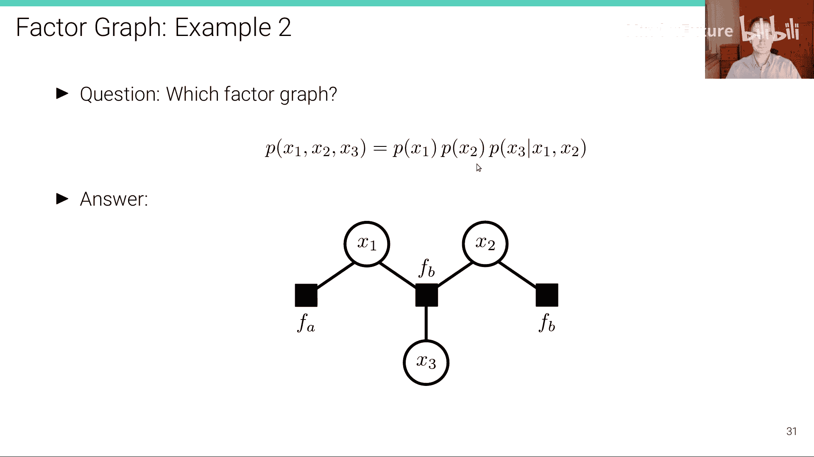

# 019：概率图模型 - 因子图 🧩

在本节课中，我们将学习一种比马尔可夫随机场更精确的图模型表示方法——因子图。我们将了解为什么需要它，如何构建它，以及它如何清晰地表达概率分布的具体分解形式。

## 概述

上一节我们介绍了马尔可夫随机场。虽然可以直接在马尔可夫随机场上进行推断，但本节我们将讨论一种比简单的马尔可夫随机场或马尔可夫网络更精确的图模型，这被称为因子图。

## 为什么需要因子图？

让我们再次考虑马尔可夫随机场。考虑以下通过势函数进行的分解，其中我们有一个联合分布：

**公式**：`P(A, B, C) = (1/Z) * φ₁(A, B) * φ₂(B, C) * φ₃(C, A)`

其中 `Z` 是归一化常数。这个分布由三个不同的势函数定义：一个作用于变量 `A` 和 `B`，一个作用于 `B` 和 `C`，一个作用于 `C` 和 `A`。

对应的马尔可夫网络或马尔可夫随机场的图表示是什么？显然，`A` 和 `B`、`B` 和 `C`、`C` 和 `A` 之间必须有连接。因此我们得到一个像这样的全连接图，将随机变量 `A`、`B`、`C` 两两相连。

然而，这个马尔可夫网络中的最大团是三元团 `{A, B, C}`。因此，存在另一种由该网络表示的分解，它实际上代表了（正如我们现在所知）相同的一组条件独立属性。所以，在条件独立属性方面，这是同一类分布。这个分解如下：

**公式**：`P(A, B, C) = (1/Z) * φ(A, B, C)`

现在，第二种分解更通用。通过拥有这个三元势函数，我们可以建模所有可能的 `φ(A, B, C)`，而这仅通过查看成对关系或双变量函数的乘积是无法实现的。因此，它比第一种分解更丰富。

但是，就马尔可夫网络而言，它们没有区别，因为两者都遵循相同的条件独立假设，尽管第二种更强大。因此，在马尔可夫随机场的情况下，势函数的分解并不是由图唯一指定的。

为了消除这种歧义，我们在图中引入一种额外的节点。这种新的表示方法就是因子图。这种额外类型的节点，我们将使用正方形来将其与随机变量节点（圆形）区分开来。每个这样的正方形被称为一个**因子**。

现在我们可以区分之前的两种情况。中间的因子图表示只有一个团（三元团）的分解。右边的因子图表示有三个团（每个团包含两个变量）的分解。

这两个因子图在条件独立假设方面对应于同一个马尔可夫网络。但是，它们区分了可以表达的不同类型的分布，因此通过使分解形式显式化，允许我们区分不同的分解。

## 因子图的定义

现在，与之前非常相似，我们定义一个因子图，只是将之前使用的势函数 `φ` 替换为现在的因子 `f`，并且我们使用这种更精确的图形表示。

给定一组随机变量 `X = {x₁, ..., xₙ}` 和这些随机变量的子集集合 `C`（这些子集类似于团或势函数的作用域），每个子集是 `X` 的一个子集。我们定义一个函数 `F`，它是所有随机变量的乘积：

**公式**：`F(X) = ∏_{k=1}^{K} f_k(C_k)`

其中 `K` 是因子数量，`C_k` 是第 `k` 个因子作用的变量子集。对于每个子集，我们定义一个函数，现在称为因子，并使用 `f` 来明确表示它是一个因子。

因子图（简称 FG）是一个二分图，其中：
*   每个因子 `f_k` 对应一个方形节点。
*   每个变量 `x_i` 对应一个圆形节点。

它是二分图，意味着因子节点之间没有连接，变量节点之间也没有连接。所有连接都只存在于因子节点和变量节点之间，即存在于不同类型的节点之间。

以下是将一个图转换为二分图的示例。在一边我们有变量，在另一边我们有因子，连接只从上（变量）到下（因子）或反之，而不是在变量之间或因子之间，这就是为什么它被称为二分图。

因此，因子图是一个二分图，每个因子 `f_k` 对应一个方形节点，每个变量 `x_i` 对应一个圆形节点。我们试图在图形上区分因子（它们是函数）和变量。

与之前类似，通过对 `F` 进行归一化，我们得到一个分布：

**公式**：`P(X) = (1/Z) * F(X)`

其中配分函数 `Z` 只是对所有随机变量的整个状态空间求和（或连续情况下积分）`F(X)`。

## 从因子图读取分布

现在，从因子图读取分布以及反之根据分布写出因子图都变得很容易。

那么，这个因子图的分布是什么？我们可以直接读取哪些因子连接到哪些变量，并且可以直接写出因子图（直到归一化常数）。所以我们只需写出：

**公式**：`P(X) ∝ f_A(x₁, x₂) * f_B(x₁, x₂) * f_C(x₂, x₃) * f_D(x₃)`

因为 `f_A` 连接到 `x₁` 和 `x₂`，`f_B` 也连接到 `x₁` 和 `x₂`，依此类推。`f_D` 只连接到 `x₃`。

类似地，我们可以看一个特定的分解，并问：如果我指定了一个像下面这样的分布，对应的因子图是什么？

**公式**：`P(x₁, x₂, x₃) = P(x₁) * P(x₂ | x₁) * P(x₃ | x₁, x₂)`

答案是，这些单独的分布项（如 `P(x₁)`、`P(x₂|x₁)`）都是其自变量的函数。因此，我们可以简单地将它们写成因子 `f`。所以我们有：
*   `f_A(x₁)` 对应 `P(x₁)`，连接到 `x₁`。
*   `f_B(x₁, x₂)` 对应 `P(x₂ | x₁)`，连接到 `x₁` 和 `x₂`。
*   `f_C(x₁, x₂, x₃)` 对应 `P(x₃ | x₁, x₂)`，连接到 `x₁`、`x₂` 和 `x₃`。

## 总结

本节课中，我们一起学习了因子图。因子图通过引入显式的因子节点，提供了一种比马尔可夫随机场更精确的概率分布分解表示方法。它消除了马尔可夫网络中分解形式不唯一的歧义，使得分布的因子化结构一目了然。因子图是一个二分图，清晰地分离了变量和函数（因子），便于我们直接从图读取分布，或根据分布构建图，为后续的概率推断提供了更清晰的基础。