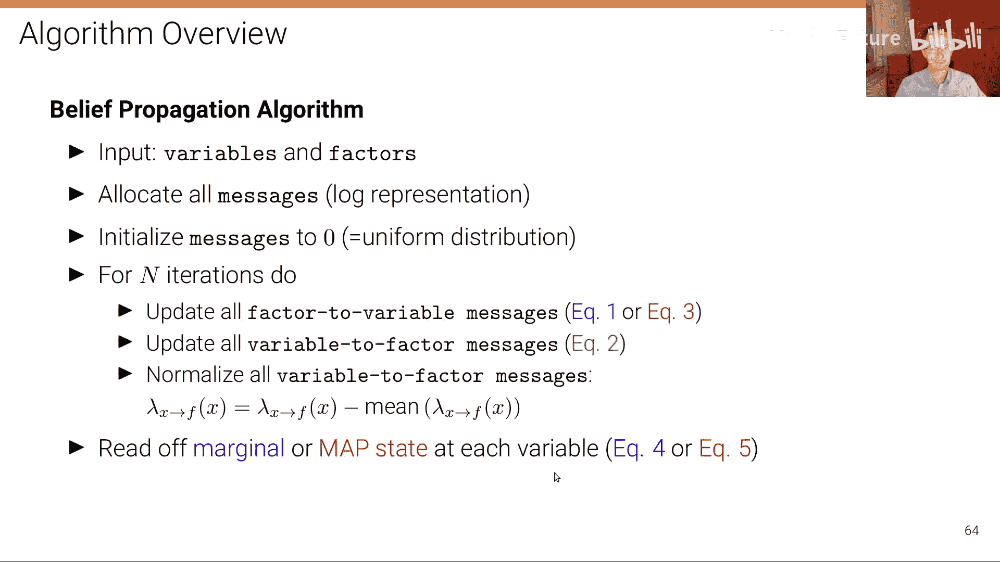

# 020：概率图模型 - 信念传播 🧠

在本节课中，我们将学习如何在概率图模型中进行推理，即如何回答诸如“某个变量子集的边缘分布是什么？”或“在给定概率模型下，随机变量的最可能配置（最大后验解）是什么？”这类问题。我们将重点介绍一种名为**信念传播**的高效算法，它通过消息传递机制，避免了直接计算的指数级复杂度。

## 概述

我们首先会看到，在链式结构的因子图上进行推理。然后，我们将信念传播算法推广到更一般的树状结构图上。最后，我们会讨论当图结构存在环路时，如何应用近似的**环状信念传播**算法。核心思想是利用动态规划，通过局部计算和消息传递来高效求解全局问题。

---

## 链式结构推理 🔗

上一节我们介绍了概率图模型的基本概念。本节中，我们来看看如何在最简单的链式结构上进行推理。

考虑一个简单的链式因子图，其对应的概率分布为：

`P(A, B, C, D) = f1(A, B) * f2(B, C) * f3(C, D)`

如果我们想计算变量 `A` 和 `B` 的联合边缘分布 `P(A, B)`，就需要对变量 `C` 和 `D` 求和：

`P(A, B) = Σ_C Σ_D f1(A, B) * f2(B, C) * f3(C, D)`

如果所有变量都是二元的，直接计算需要求和 `2^2 = 4` 种 `(C, D)` 的组合。对于长度为 `N` 的链，复杂度为 `O(2^N)`，这在 `N` 很大时是不可行的。

我们可以利用因子分解的结构来优化计算。观察上述求和式，发现因子 `f3(C, D)` 只依赖于 `C` 和 `D`，而 `f1` 和 `f2` 不依赖于 `D`。因此，我们可以先将求和操作“拉”到只涉及 `D` 的因子上：

`P(A, B) = Σ_C [ f1(A, B) * f2(B, C) * ( Σ_D f3(C, D) ) ]`

我们定义 `μ_{D→C}(C) = Σ_D f3(C, D)`，这是一个从变量 `D` 发送到变量 `C` 的**消息**，它是一个关于 `C` 的函数（对于离散变量，可以看作一个向量）。

接着，我们可以对 `C` 进行类似操作：

`P(A, B) = Σ_C [ f1(A, B) * f2(B, C) * μ_{D→C}(C) ] = f1(A, B) * ( Σ_C f2(B, C) * μ_{D→C}(C) )`

定义 `μ_{C→B}(B) = Σ_C f2(B, C) * μ_{D→C}(C)`，这是从 `C` 发送到 `B` 的消息。

最后，计算 `P(A)` 时：
`P(A) = Σ_B f1(A, B) * μ_{C→B}(B) = μ_{B→A}(A)`

通过这种方式，我们将一个全局的求和问题，分解为一系列沿着链传递的局部消息计算。对于长度为 `N` 的链，计算复杂度从 `O(2^N)` 降为 `O(N * K^2)`（假设每个变量有 `K` 个状态），实现了指数级到线性级的优化。

---

## 树状结构与信念传播算法 🌳

上一节我们看到了链式结构上的消息传递。本节中，我们将其推广到更一般的树状结构因子图上。

树状结构图没有环路，但可以有分支。此时，消息不仅需要在变量之间传递，还需要在**变量**和**因子**之间传递。这使我们能更清晰地描述算法。

考虑一个树状因子图，其概率分布为：
`P(A, B, C, D, E) = f1(A, B) * f2(B, C, D) * f3(D, E)`

假设我们要计算边缘分布 `P(A, B)`，即对 `C, D, E` 求和。我们可以通过以下步骤传递消息：

1.  **叶子节点初始化**：从图的边缘开始。例如，变量节点 `E` 只连接因子 `f3`，它发送给 `f3` 的消息初始化为 `1`（均匀分布）。因子节点 `f1` 只连接变量 `A` 和 `B`，它发送给 `B` 的消息就是它本身 `f1(A, B)`。
2.  **消息传递**：消息分为两种：
    *   **从变量到因子**：变量将其从其他因子收到的所有消息的乘积，发送给目标因子。
        `μ_{x→f}(x) = Π_{g∈Neighbor(x)\{f\}} μ_{g→x}(x)`
    *   **从因子到变量**：因子对除目标变量外所有关联变量的状态求和（或积分），将因子值与所有来自其他变量的消息的乘积发送出去。
        `μ_{f→x}(x) = Σ_{y∈Neighbor(f)\{x\}} [ f(Neighbor(f)) * Π_{z∈Neighbor(f)\{x\}} μ_{z→f}(z) ]`
3.  **收集消息计算边缘分布**：当所有消息传递完毕（对于树，从叶子到根，再从根到叶子各一次即可），变量 `X` 的边缘分布（未归一化）正比于所有指向它的消息的乘积：
    `P̃(x) ∝ Π_{f∈Neighbor(x)} μ_{f→x}(x)`
    最后进行归一化：`P(x) = P̃(x) / Σ_{x'} P̃(x')`。

以下是算法步骤的简要总结：

*   **初始化**：将叶子变量节点到其唯一邻居因子的消息设为 `1`。将叶子因子节点到其唯一邻居变量的消息设为该因子本身。
*   **迭代更新**：从叶子节点开始，按照变量→因子、因子→变量的顺序，根据上述公式计算并传递消息，直到所有消息不再变化（对于树，两轮即可）。
*   **读取边缘分布**：根据公式计算每个变量的边缘分布。

---

## 最大和积算法与MAP推理 🎯

上一节我们学习了用于计算边缘分布的**和积算法**。本节中，我们来看看另一个密切相关的问题：**最大后验概率**推理，即寻找使联合概率最大的变量配置 `(A*, B*, C*, ...)`。

解决MAP问题的算法称为**最大和积算法**（Max-Product Algorithm），它与和积算法结构完全相同，只是将求和操作 `Σ` 替换为求最大值操作 `max`。

对于链式例子：
`max_{A,B,C,D} P(A,B,C,D) = max_A max_B max_C max_D f1(A,B) * f2(B,C) * f3(C,D)`

同样，我们可以通过传递消息来高效计算：
1.  定义消息：
    `μ^{max}_{D→C}(C) = max_D f3(C, D)`
    `μ^{max}_{C→B}(B) = max_C f2(B, C) * μ^{max}_{D→C}(C)`
    `μ^{max}_{B→A}(A) = max_B f1(A, B) * μ^{max}_{C→B}(B)`
2.  最终，最大概率值为 `max_A μ^{max}_{B→A}(A)`。

但我们需要的是具体的配置 `(A*, B*, C*, D*)`。这需要通过**回溯**来获得：
*   首先，`A* = argmax_A μ^{max}_{B→A}(A)`。
*   然后，将 `A*` 代入，求 `B* = argmax_B f1(A*, B) * μ^{max}_{C→B}(B)`。
*   依次类推，求出 `C*` 和 `D*`。

在树状图上，最大和积算法的消息传递公式与和积算法类似，只需将 `Σ` 换为 `max`。计算完成后，从根节点开始回溯，即可得到全局最优的MAP配置。

---

## 环状图与近似推理 🔄

到目前为止，我们假设图是树或链，没有环路。然而，在计算机视觉中（如图像网格），图通常包含环路。

我们可以直接将信念传播算法应用于带环的图，这被称为**环状信念传播**。但由于环的存在，消息会循环传递，算法可能不收敛，或者收敛到一个近似解，而不再是精确解。

尽管失去了精确性的保证，环状信念传播在许多实际问题中表现得出奇地好。通常的更新策略是：
1.  并行更新所有从因子到变量的消息。
2.  并行更新所有从变量到因子的消息。
3.  重复上述步骤，直到消息变化小于某个阈值或达到最大迭代次数。

---

## 数值计算与算法总结 📝

在实际实现中，直接计算消息的乘积可能导致数值下溢（值太小）或上溢（值太大）。标准的解决方案是使用**对数域**进行计算。

定义对数消息：`λ_{i→j} = log(μ_{i→j})`。
*   **变量到因子**的消息计算从乘积变为求和：`λ_{x→f}(x) = Σ_{g∈Neighbor(x)\{f\}} λ_{g→x}(x)`。
*   **因子到变量**的消息计算涉及对数求和指数（Log-Sum-Exp），需要一些技巧来稳定数值。
*   此外，定期对消息向量进行归一化（例如减去其均值）有助于保持数值稳定性。

以下是和积信念传播算法（对数域）的概要步骤：

1.  **输入**：变量集合、因子集合（定义图模型）。
2.  **初始化**：将所有消息 `λ` 初始化为 `0`（对应均匀分布）。
3.  **迭代更新**：
    a. 对于每个因子 `f` 和其邻居变量 `x`，按公式更新 `λ_{f→x}`。
    b. 对于每个变量 `x` 和其邻居因子 `f`，按公式更新 `λ_{x→f}`。
    c. （可选）对更新后的消息进行归一化（如减去均值）。
4.  **收敛判断**：重复步骤3，直到消息变化很小或达到迭代上限。
5.  **输出边缘分布**：对于每个变量 `x`，计算 `log P̃(x) = Σ_{f∈Neighbor(x)} λ_{f→x}(x)`，然后取指数并归一化得到 `P(x)`。
6.  **输出MAP配置（若使用最大和积）**：对于每个变量 `x`，计算 `log φ(x) = Σ_{f∈Neighbor(x)} λ^{max}_{f→x}(x)`，然后 `x* = argmax_x φ(x)`。注意，对于最大和积，通常需要回溯才能获得一致的全局最优配置，但在许多情况下，直接选取每个变量的最大“边际”状态也能得到很好结果。

---

## 总结

本节课中，我们一起学习了概率图模型中的核心推理算法：
1.  **信念传播（和积算法）**：用于高效计算变量的**边缘分布**。它通过变量与因子之间的消息传递，将全局求和分解为局部计算，极大降低了复杂度。
2.  **最大和积算法**：用于求解**最大后验概率**配置。其框架与和积算法相同，但将求和换为求最大值，并通过回溯获得最优解。
3.  **环状信念传播**：将上述算法应用于带环路的图，虽为近似方法，但在实践中非常有效。
4.  **实现细节**：使用**对数域计算**和**消息归一化**来保证数值稳定性是实际应用中的关键。

这些算法构成了在结构化概率模型（如马尔可夫随机场、条件随机场）中进行概率推理的基础，在图像分割、立体视觉、去噪等计算机视觉任务中有着广泛应用。