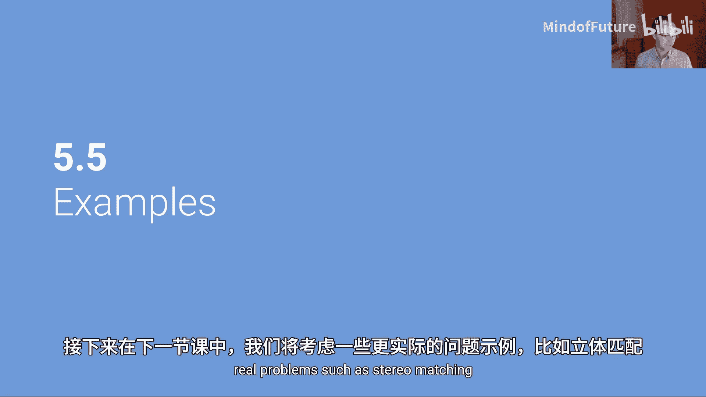
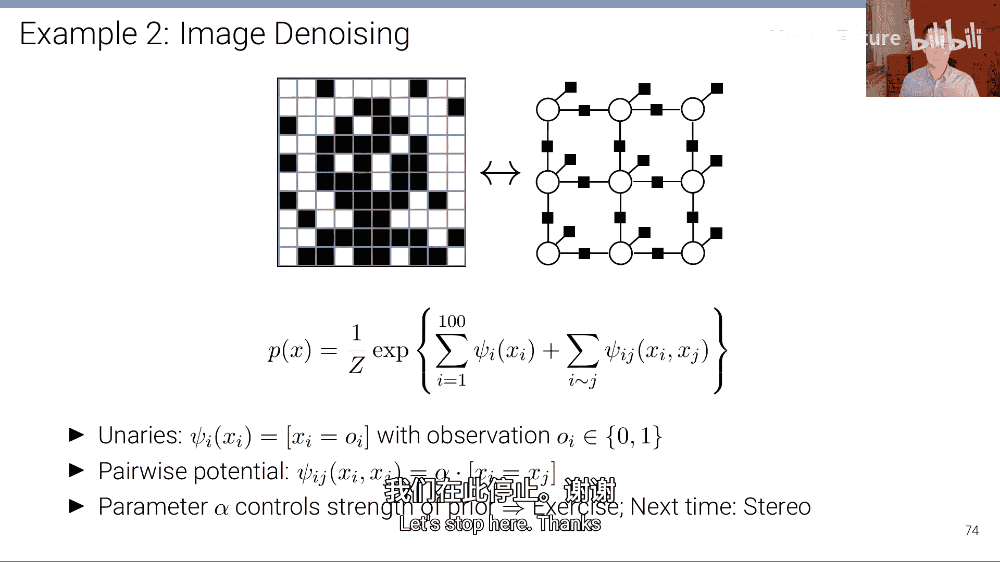

# 021：概率图模型示例 🧩

在本节课中，我们将通过两个简单的例子来学习概率图模型的实际应用。我们将看到如何将先验知识（例如物理约束或图像平滑性）整合到模型中，从而得到比仅依赖观测数据更合理、更可靠的推断结果。

上一节我们介绍了概率图模型的基本概念和推断算法。本节中，我们来看看这些模型如何应用于具体问题。

## 车辆定位示例 🚗

第一个例子是车辆定位问题。我们的目标是在10个连续的时间点上，估计车辆所在的车道位置。

我们有10个随机变量，分别对应每个时间点（T1 到 T10）。每个变量可以取三个状态：车道1、车道2或车道3。下图展示了一种可能的变量配置。

除了这些变量，我们还有观测数据。观测数据以连续的概率分数形式给出，表示在每个时间步，感知模型认为车辆位于各个车道的置信度。例如，在第一个时间步，模型有70%的把握认为车辆在车道1，20%的把握在车道2，10%的把握在车道3。

如果我们简单地、独立地在每个时间步选择观测概率最高的状态，可能会得到物理上不可行的结果（例如车辆瞬间跨越多个车道）。因此，我们需要利用图模型整合先验知识。

以下是该问题的图模型表示：
*   **一元势函数 (Unary Potentials, F1...F10)**：由感知模型的观测概率直接确定。例如，对于第一个时间步，势函数值为 `[0.7, 0.2, 0.1]`。
*   **成对势函数 (Pairwise Potentials, G)**：连接相邻时间步的变量（如X1-X2，X2-X3），用于编码先验知识（例如，车辆更可能保持在原车道或仅变换到相邻车道）。

该模型的概率分布可以分解为：
`P(X) ∝ ∏_i F_i(x_i) * ∏_{(i,j)∈E} G(x_i, x_j)`

其中，成对势函数 `G` 是一个3x3的矩阵。理想情况下，我们应该从训练数据中学习这个矩阵的参数（这将在第7讲中介绍）。在本讲中，我们假设它已给定。一个合理的设置是：停留在原车道的概率最高，变换到相邻车道有一定概率，而跨越两个车道的概率为零。

当我们使用这个结合了一元项和成对项的模型进行概率推断（如计算边缘分布）时，得到的结果会整合先验知识。例如，某个时间步下“车道3”的概率可能会根据相邻时间步的信息发生显著变化。

如果我们应用最大积算法来寻找最大后验概率解，就会得到一条物理上更合理的车辆轨迹，它虽然可能在个别时间步上与观测的“最可能”状态不符，但整体上更符合我们对车辆运动规律的认知。

## 图像去噪示例 🖼️

第二个例子是图像去噪。假设我们有一个质量不佳的黑白相机，它拍摄的10x10像素图像噪声很大。我们的目标是从噪声图像中恢复出干净图像。

我们可以利用与立体匹配类似的特性：相邻像素更可能具有相同的值（颜色）。如果我们只用一元势函数建模，模型会直接输出噪声图像，因为每个像素独立地选择了观测值。

为了整合先验知识，我们需要在模型中添加约束。具体来说，我们观察到在干净图像中，大多数相邻像素对（边）的颜色是相同的。例如，在一张示例图像中，总共有180条邻接边，其中只有34条边连接了不同颜色的像素，而有146条边连接了相同颜色的像素。这意味着颜色保持不变的边是颜色变化的边的4.3倍。

我们可以利用这一点，引入一个平滑性假设。模型现在包含：
*   **一元势函数**：鼓励像素值与观测值一致。对于观测为黑色的像素，如果推断值也是黑色，则势函数值高（例如为1），否则低（例如为0）。我们通常使用对数势函数表示：`θ_i(x_i) = log(1_{x_i = y_i})`，其中 `y_i` 是观测值。
*   **成对势函数**：定义在四连通网格上，鼓励相邻像素取值相同。其形式通常为：
    `θ_{ij}(x_i, x_j) = α * 1_{x_i = x_j}`
    其中 `1_{x_i = x_j}` 是指示函数（两者相等时为1，否则为0），`α` 是一个超参数，控制平滑先验的强度。

整个模型的（对数）概率分布为：
`log P(X) = ∑_i θ_i(x_i) + ∑_{(i,j)∈E} θ_{ij}(x_i, x_j) - log C`

现在，推断算法需要在两个目标之间进行权衡：
1.  **拟合观测数据**：让每个像素的推断值尽量接近观测值。
2.  **满足平滑先验**：让相邻像素的推断值尽量相同。

超参数 `α` 控制着这个权衡。如果 `α` 设为0，则先验失效，输出就是噪声图像。如果 `α` 设置得过大，平滑约束过强，可能导致整张图像变成同一种颜色。通过调整 `α`，我们可以得到不同程度的去噪效果。

本节课中我们一起学习了概率图模型在两个经典问题中的应用：车辆定位和图像去噪。我们看到，通过在图模型中引入一元势函数（对应观测数据）和成对势函数（对应先验知识，如运动平滑性或图像局部一致性），并利用推断算法进行优化，可以得到比单纯依赖观测更合理、更鲁棒的解决方案。下一讲，我们将探讨图模型在更复杂问题（如立体匹配、多视图重建）中的应用，那里会涉及更大的标签集和更高阶的势函数。