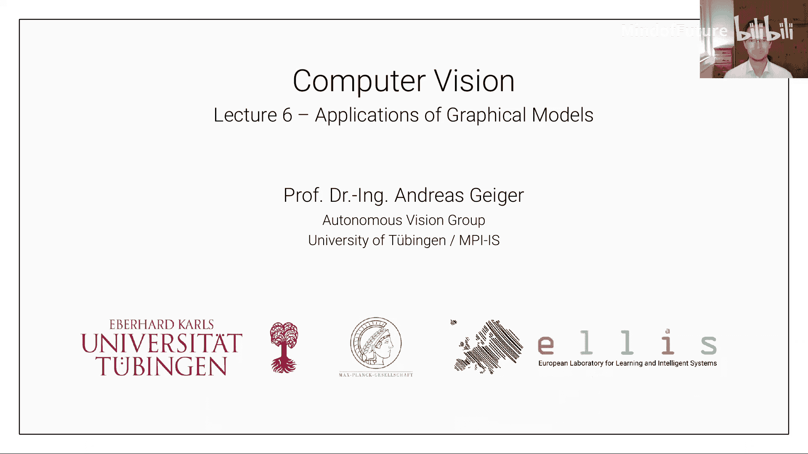
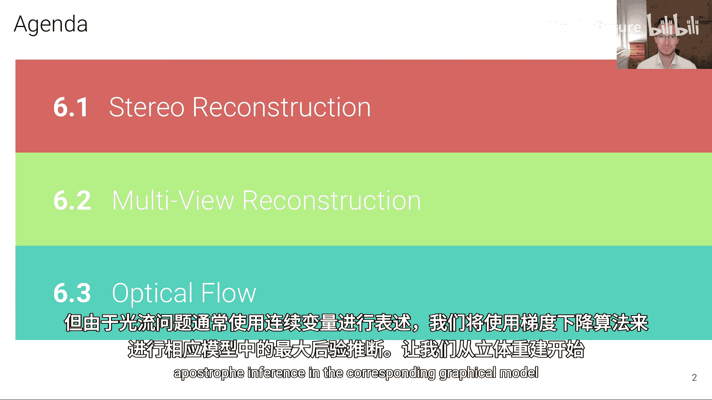
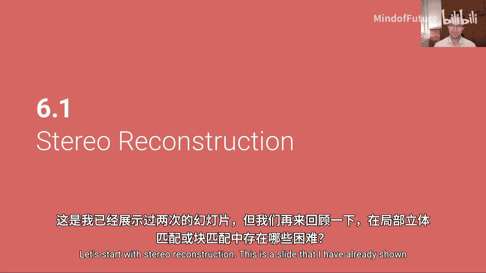
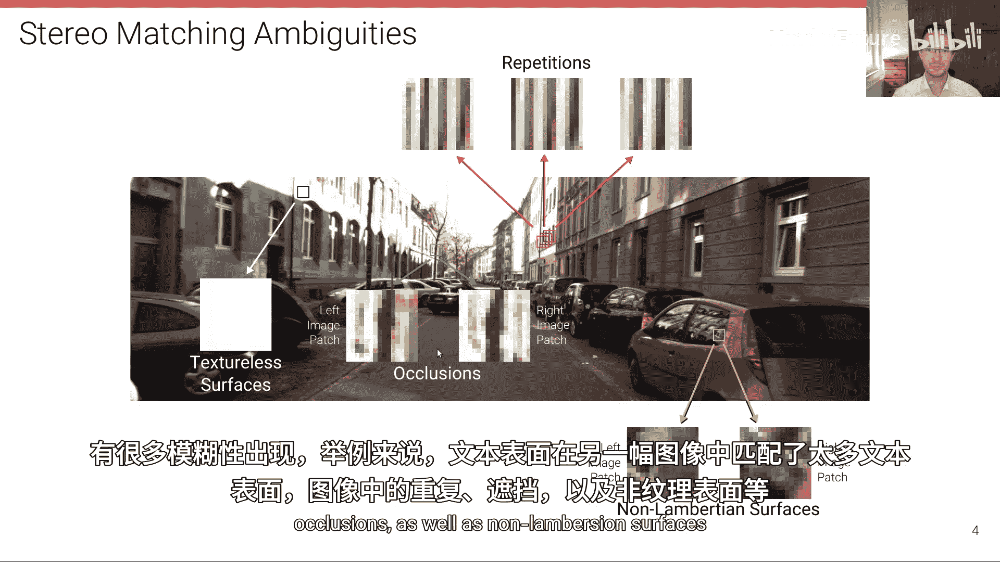
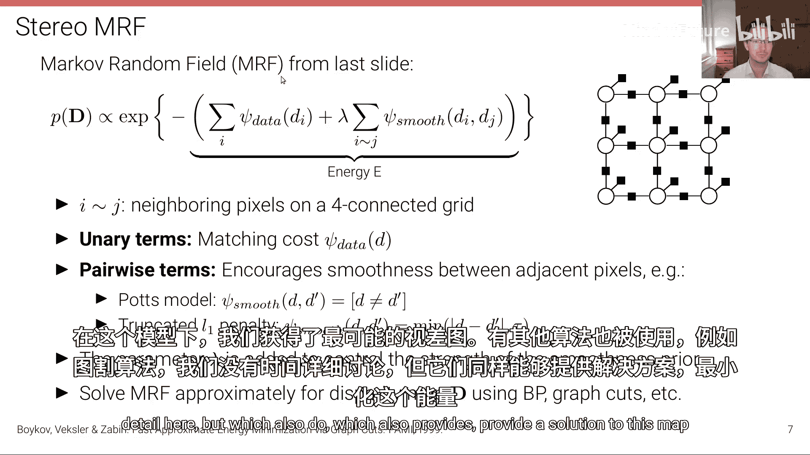
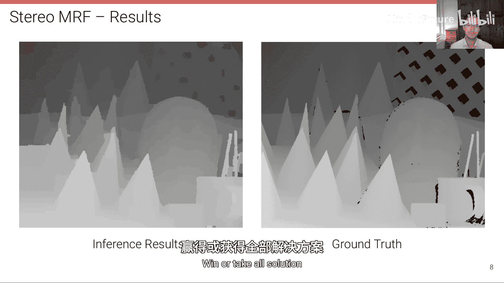
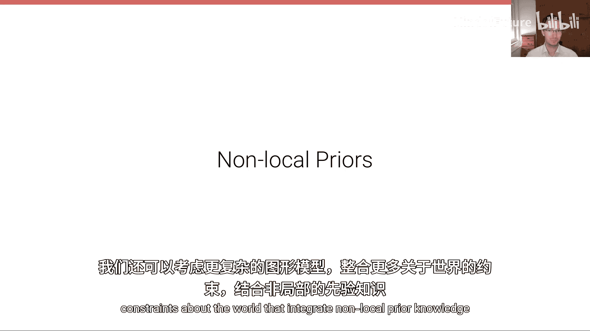
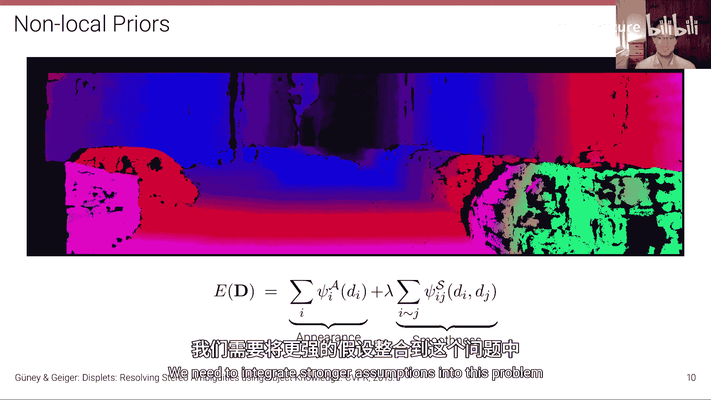
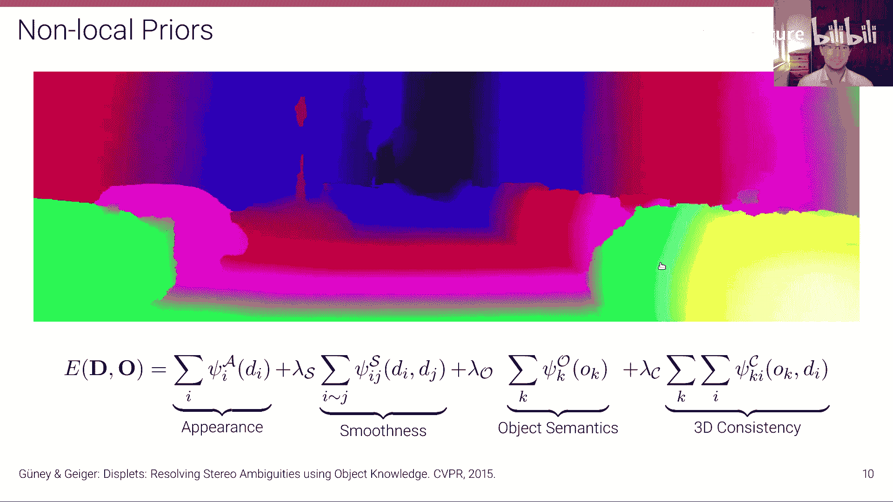
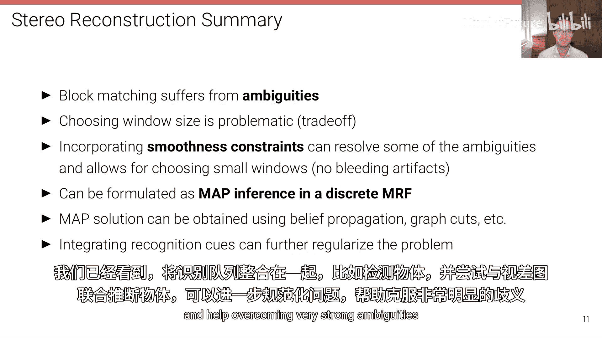

# 022：图模型应用 - 立体重建 🏔️

在本节课中，我们将学习如何将图模型应用于计算机视觉中的经典问题——立体重建。我们将看到，通过引入马尔可夫随机场，可以有效地整合关于场景平滑性的先验知识，从而克服局部立体匹配中的歧义性问题。

在上一讲中，我们介绍了图模型以及一种称为信念传播的推理算法，它可以帮助我们计算最大后验解或边缘概率。本节中，我们将具体探讨图模型在密集立体重建问题中的应用。

## 局部立体匹配的挑战

首先，让我们回顾一下局部立体匹配或块匹配所面临的困难。这些问题主要源于多种歧义性。

以下是导致匹配歧义的主要因素：
*   **无纹理表面**：在另一幅图像中，无纹理区域可能与许多其他无纹理区域匹配。
*   **图像中的重复结构**：场景中重复的图案会导致多个潜在的匹配点。
*   **遮挡**：一个物体遮挡了另一个物体，导致某些像素在另一视图中不可见。
*   **非朗伯表面**：如镜面或光泽表面，其外观随视角变化，违反了亮度恒常性假设。

为了克服这些歧义，我们需要整合关于真实世界统计特性的先验知识。例如，从布朗距离图像数据集等数据集中，我们可以发现深度图的一个关键统计特性：深度在物体边界处变化剧烈，但在其他区域变化缓慢。这反映在深度梯度的概率分布上，即大部分概率质量集中在零附近（平滑区域），但也存在远离零的“长尾”（物体边界）。

## 马尔可夫随机场模型

我们希望将上述统计特性整合到模型中，这可以通过马尔可夫随机场来实现。下图展示了一个四连通网格结构的图模型，对应一个图像。

在这个模型中：
*   每个圆圈代表一个变量，即我们想要推断的该像素的视差值。
*   一元因子（图中连接单个变量的方块）代表匹配代价，可以通过块匹配或孪生网络计算。
*   成对因子（连接相邻变量的边）则整合了我们对视差图平滑性的先验知识。

这是一个非常简单的图模型，可以表述为一个标准的无向马尔可夫网络或马尔可夫随机场，也可以方便地表述为因子图。

我们的目标是求解整个视差图，而不仅仅是单个像素的视差。因此，我们对所有可能的视差图空间建模一个概率分布。这个概率正比于一元因子和成对因子的乘积：

$$
P(\mathbf{D}) \propto \prod_{i} \phi_{\text{data}}(D_i) \prod_{(i,j) \in \mathcal{N}} \psi_{\text{smooth}}(D_i, D_j)
$$

其中，$\mathbf{D}$ 代表整个视差图，$\mathcal{N}$ 表示相邻的像素对。

## 能量最小化公式

我们可以将上述概率最大化问题转化为等价的能量最小化问题，这通常更方便。通过取负对数，我们得到吉布斯能量：

$$
E(\mathbf{D}) = \sum_{i} \Phi_{\text{data}}(D_i) + \lambda \sum_{(i,j) \in \mathcal{N}} \Psi_{\text{smooth}}(D_i, D_j)
$$

其中：
*   $\Phi_{\text{data}}(D_i) = -\log \phi_{\text{data}}(D_i)$ 是数据项（匹配代价）。例如，可以使用平方差和（SSD）：$\Phi_{\text{data}}(D_i) = \sum_{\mathbf{p} \in W} (I_L(\mathbf{p}) - I_R(\mathbf{p} - D_i))^2$，值越小越好。
*   $\Psi_{\text{smooth}}(D_i, D_j) = -\log \psi_{\text{smooth}}(D_i, D_j)$ 是平滑项。一个简单的形式是惩罚相邻像素视差不同的情况。更接近真实统计的是截断 L1 惩罚：$\Psi_{\text{smooth}} = \min(|D_i - D_j|, \tau)$，它在视差差异小于阈值 $\tau$ 时进行线性惩罚，大于阈值时则保持恒定，从而允许在物体边界处存在大的不连续性。
*   $\lambda$ 是正则化强度或权重参数，用于控制平滑先验的强度。如果 $\lambda = 0$，则退化为标准的“赢家通吃”块匹配算法；如果 $\lambda$ 过大，则会导致视差图过度平滑。

## 推理与结果

现在，我们可以使用上一讲中学到的最大乘积信念传播算法来求解这个 MRF，从而获得最大后验解，即该模型下最可能的视差图（近似）。其他算法如图割也可以用于最小化此能量。

下图展示了在 Middlebury cones 场景上使用 MRF 进行推理的结果。

可以看到，与单纯的局部块匹配算法相比，使用 MRF 推理得到的结果有了显著改善。这也解释了为什么在许多现代立体匹配方法（如 Sponar 和 Laoon 的孪生网络）中，由深度网络计算的局部匹配代价通常会辅以 MRF 推理，以克服歧义并进一步提升估计结果。

## 引入更强先验：物体级知识

上面讨论的是一个非常简单的 MRF。我们还可以构建更复杂的图模型，整合更多关于世界的约束，甚至是非局部先验。

在某些具有挑战性的场景（如存在强烈反射）中，简单的局部成对平滑项可能无法处理假设的严重违反。这时，我们需要引入更强的假设。

一种方法是不仅从像素层面推断深度或视差，还从物体层面进行推断。例如，在街景中，我们知道场景中包含许多汽车，并且大致了解汽车的形状。我们可以尝试联合推断视差图和物体信息。

这可以通过在能量函数中增加额外的项来实现：
1.  **语义项**：使推断出的物体的语义与从图像中推断出的语义相似。
2.  **一致性项**：使推断出的 3D 物体与视差图保持一致。

通过整合这种物体级的先验知识，可以进一步正则化问题，得到更好的结果。下图展示了引入物体级知识后，对反射区域等异常值的改善。

## 总结

本节课中，我们一起学习了如何将图模型应用于立体重建问题。

*   **块匹配** 容易受到之前讨论过的匹配歧义影响，并且由于 Lecture 4 中讨论的权衡问题，窗口大小的选择非常棘手。
*   **整合运动约束** 可以解决部分歧义，并允许选择更小的窗口。通过使用图模型整合平滑性约束，我们可以选择更小的窗口，同时增加平滑性参数，从而减少“渗色”伪影。
*   **公式化** 这可以表述为离散 MRF 中的最大后验推理。之前展示的所有结果都是使用最大乘积算法（信念传播算法）推断得到的。图割或其他离散图模型推理算法也可以用于求解。
*   **更强先验** 我们还看到，整合识别线索（如检测物体并尝试与视差图联合推断物体）可以进一步正则化问题，帮助克服非常强的歧义性。

通过本讲，我们理解了图模型为整合先验知识、解决视觉中的不适定问题提供了一个强大而灵活的框架。