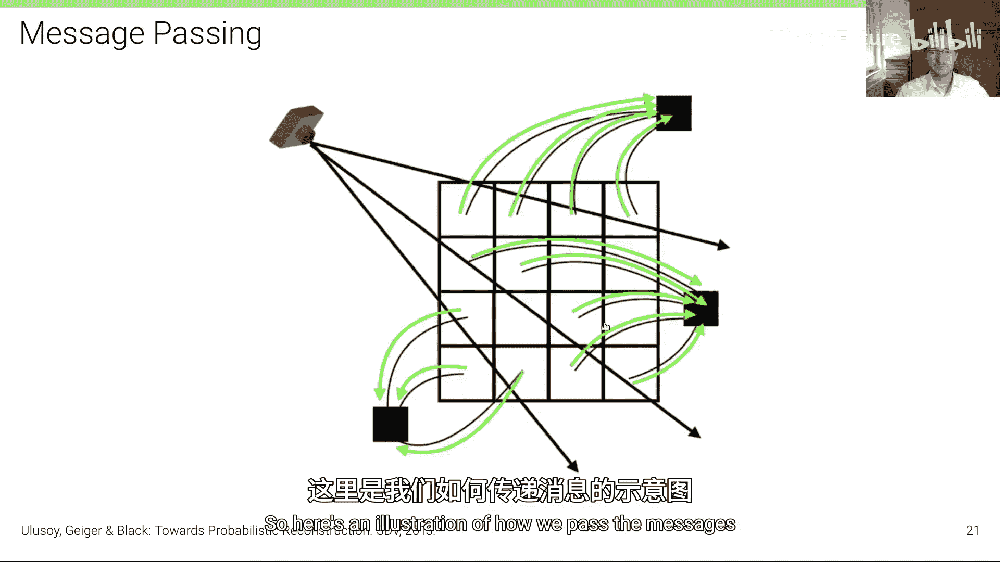
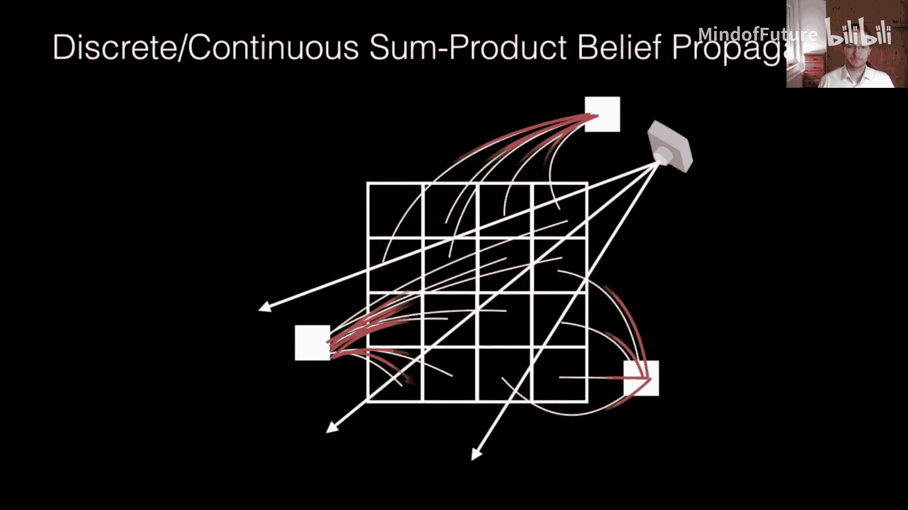
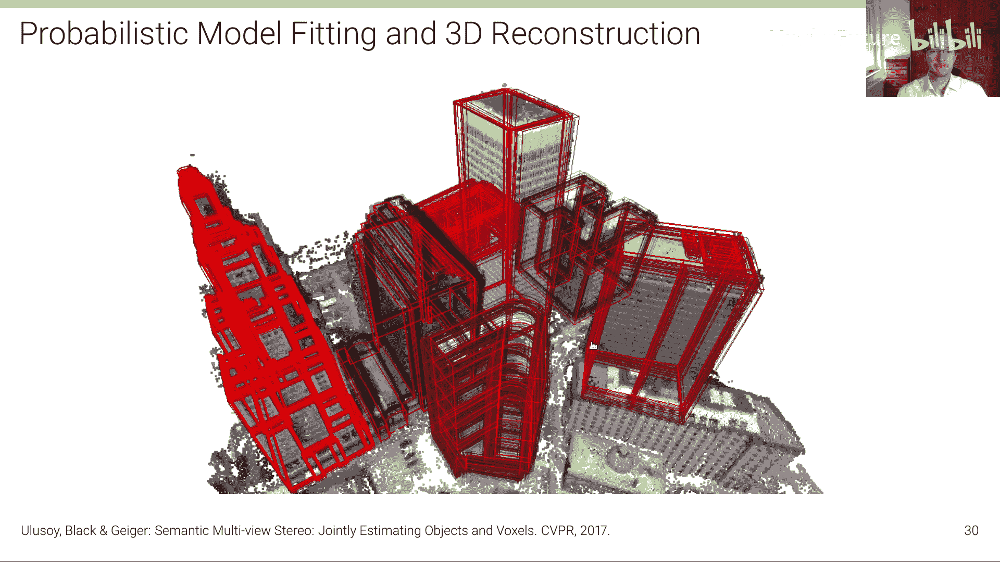
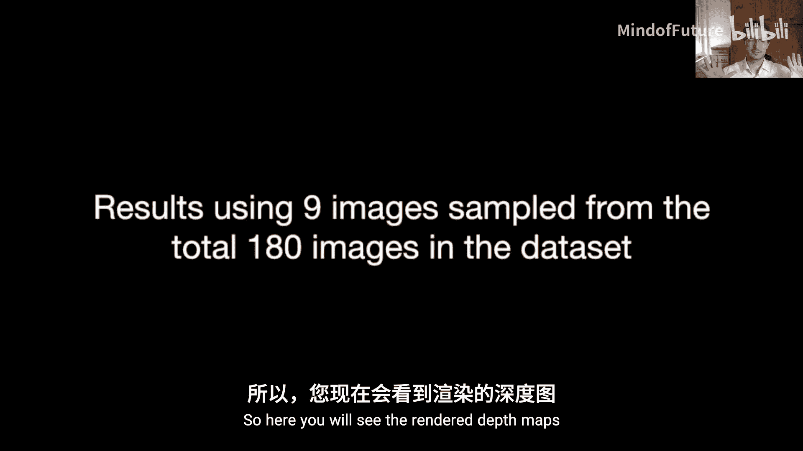
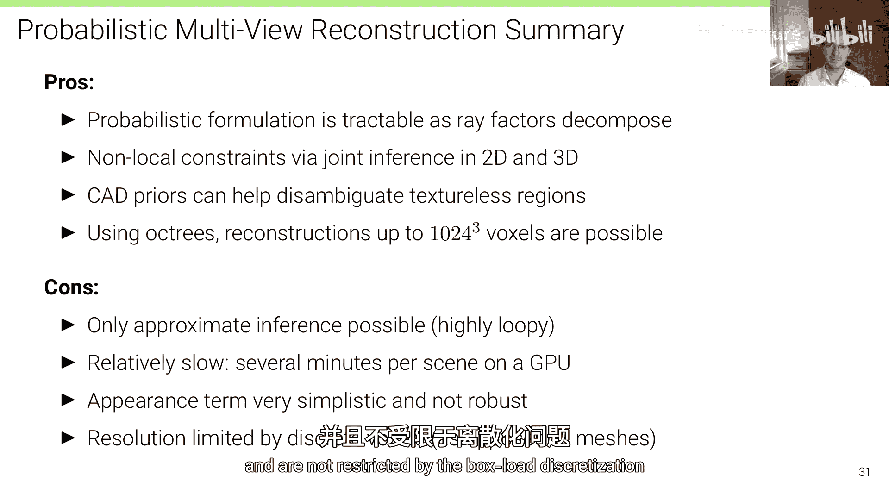

# 023：基于图模型的多视角三维重建应用 🏗️

在本节课中，我们将学习图模型的第二个应用：密集多视角立体视觉三维重建。我们将探讨如何利用概率图模型，从多个视角的图像中重建完整的三维场景，并显式地处理重建过程中的不确定性。

## 概述

上一节我们介绍了图模型的基本概念。本节中，我们将看看如何将其应用于一个具体的计算机视觉问题——从多张图像中重建三维场景。与仅使用两张图像的稀疏重建相比，多视角重建能提供更多约束，从而更好地解决歧义性问题，并实现完整的三维重建，而不仅仅是2.5D的深度图表示。

## 问题定义与挑战

我们的目标是：给定一组输入图像（实践中通常使用50到100张），推断出场景的完整三维体素表示或深度图。

然而，即使使用更多相机，基于图像的三维重建仍然可能是一个高度不适定的问题。例如，在纹理缺失的区域，由于所有像素颜色相近，从不同视角观察时，可能存在多个看似合理的表面，导致重建存在大量歧义。虽然可以通过引入先验（如假设区域是平坦的）来消除部分歧义，但先验越强，假设被违反时可能导致的错误也越大。因此，处理并显式地表达不确定性至关重要。

## 概率图模型表示

我们能否利用概率图模型的力量，以概率化的方式构建密集多视角三维重建问题？答案是肯定的。

以下是我们将要使用的表示方法：
1.  **体素化**：我们将考虑的三维空间离散化为一个离散的体素集合。每个小立方体就是一个体素。在实践中，我们通常使用分辨率高达 `1000 x 1000 x 1000` 的体素网格。
2.  **随机变量**：为每个体素关联两个随机变量：
    *   **体素占用率 `O`**：一个二元随机变量。`O = 1` 表示该体素被占据（有物体），`O = 0` 表示该体素为空。
    *   **体素外观 `A`**：一个实数标量，表示该体素在图像中呈现的亮度（灰度值）。为简化，我们这里仅考虑灰度图像，但可以扩展为三维向量以表示颜色。
3.  **光线表示法**：我们引入一个简写符号来帮助后续建模。对于相机图像平面上的一个像素，其与相机中心定义了一条穿过三维空间的光线 `R`。对于每条光线 `R`，我们定义：
    *   `O_R`：按光线穿过的顺序，收集该光线相交的所有体素的占用率变量 `O_i`。
    *   `A_R`：按光线穿过的顺序，收集该光线相交的所有体素的外观变量 `A_i`。

## 图像形成模型

为了解决这个不适定问题，我们首先需要理解图像形成过程。

直观上，对于一个固体物体，特定像素（对应特定光线 `R`）的颜色，就是该光线穿过的**第一个被占据体素**的颜色。从相机中心沿光线前进，遇到的第一个被占据体素的外观决定了像素值。

我们可以用以下公式精确描述这一过程：

设 `I_R` 表示像素 `R` 的强度（颜色），`O_i` 和 `A_i` 是沿光线 `R` 排序的占用率和外观变量（`i` 从1到 `N_R`，`N_R` 是该光线相交的体素数）。那么：

`I_R = Σ_{i=1}^{N_R} [ (1 - O_1) * (1 - O_2) * ... * (1 - O_{i-1}) * O_i * A_i ]`

这个公式的含义是：求和项中的乘积项 `(1 - O_1)*...*(1 - O_{i-1})*O_i` 仅在 `O_i` 是第一个被占据的体素时为1，否则为0。因此，整个求和的结果就是第一个被占据体素的外观 `A_i`。

## 概率模型构建

我们希望构建一个概率模型来进行推理，从而显式地表达不确定性。

我们定义所有体素占用率变量（`O`）和外观变量（`A`）的联合概率分布 `P(O, A)`。我们将其分解为单点势函数和所谓的“光线因子”的乘积：

`P(O, A) ∝ Π_{voxels} ψ_u(O_i) * Π_{rays R} ψ_R(O_R, A_R)`

*   **单点势函数 `ψ_u`**：表示关于场景占用率的一般先验知识。例如，可以是一个伯努利分布，其超参数 `γ` 控制我们认为体素被占据的先验概率（通常 `γ` 小于0.5，因为场景中大部分体素是空的）。这有助于清理模型推断出的一些离群点。
*   **光线因子 `ψ_R`**：这是模型的核心，它建模了我们想要推断的三维重建与所有观测图像之间的一致性。这是一个高阶势函数，因为它连接了一条光线上所有的 `O` 和 `A` 变量（可能多达数百个）。

光线因子基于我们的图像形成模型构建：

`ψ_R(O_R, A_R) = N(I_R; A_k, σ²)`

其中，`k` 是第一个满足 `O_k = 1` 的索引。`N` 表示高斯分布，均值是第一个被占据体素的外观 `A_k`，方差 `σ²` 是一个可调超参数，用于允许由于噪声和模型简化假设而带来的外观微小偏差。

这个势函数的意义在于：对于所有相机中的所有光线，如果三维重建中每条光线上第一个被占据体素的外观 `A_k` 与对应像素的观测值 `I_R` 越接近，那么整个联合概率 `P(O, A)` 的值就越大。多视角的约束共同作用，使得我们可以推断出与所有图像一致的三维重建，并减少不确定性。

## 概率推理：计算深度分布

我们使用**和积算法**在该模型中进行概率推理。

一个最简单的推理问题是：对于场景中的任意一条光线（可以是输入视角的，也可以是新视角的），沿着这条光线到第一个被占据体素的**深度**是多少？如果我们能回答这个问题，就能重建深度图，进而提取网格等。

设光线 `R` 上第 `k` 个体素到相机中心的距离为 `d_k`。沿该光线的深度 `D` 定义为到第一个被占据体素的距离，因此 `D` 取值于集合 `{d_1, d_2, ..., d_{N_R}}`。

在贝叶斯推理和风险最小化的框架下，最优深度估计 `D*` 是使期望损失（风险）最小的那个值：

`D* = argmin_{d'} E_{P(D)} [ L(D, d') ]`

其中，`P(D)` 是沿光线的深度 `D` 的边际分布。如果我们选择损失 `L` 为平方误差，则最优估计是深度分布的均值；若选择绝对误差，则是中位数。

因此，问题的关键在于计算边际深度分布 `P(D)`。这正是和积算法可以计算的量。

## 推理过程的简化

由于光线因子是高阶的，直接计算消息传递非常复杂，具有指数级复杂度。幸运的是，在这个特定设置下，公式可以大幅简化。

通过一系列推导（具体细节可参考相关论文），计算深度 `D` 等于 `d_k` 的概率 `P(D = d_k)` 的表达式可以简化为：

`P(D = d_k) ∝ [Π_{i=1}^{k-1} μ_{O_i→ψ_R}(0)] * μ_{O_k→ψ_R}(1) * ∫ N(I_R; a_k, σ²) * μ_{A_k→ψ_R}(a_k) da_k`

这个表达式的直观解释很清晰：
*   **第一部分（红色）**：表示前 `k-1` 个体素都必须为空（`O_i = 0`），这样第 `k` 个体素才可能是第一个被占据的。
*   **第二部分（绿色）**：表示第 `k` 个体素被占据（`O_k = 1`）且可见。
*   **第三部分（蓝色）**：表示这第一个被占据体素的外观 `a_k` 应该与观测到的像素值 `I_R` 接近。

这个简化后的表达式不再需要对巨大状态空间进行求和与积分，只需要计算一个一维积分和若干项的乘积，复杂度降为线性。

公式中的 `μ` 代表在和积算法中传递的消息。这些消息通过迭代式的信念传播进行计算：消息从光线因子传递给体素变量，再从体素变量传递给光线因子，直至收敛。

虽然从高阶势函数传回变量的消息计算最初看起来也很复杂，但利用类似的简化技巧，同样可以将其计算复杂度降至线性时间。具体推导较为技术性，在此省略。

## 实现挑战与解决方案

将信念传播应用于多视角立体视觉面临几个挑战：
1.  **混合变量**：模型包含离散（占用率 `O`）和连续（外观 `A`）变量。
2.  **高阶因子**：光线因子是高阶的，且数量巨大（每个像素对应一个因子），计算量大。
3.  **计算效率**：需要处理海量体素和光线。

相应的解决方案包括：
*   **连续信念传播**：通过用高斯混合模型近似消息，并利用重要性采样进行更新，来处理连续变量。
*   **线性时间消息计算**：利用模型结构的特殊性，推导出线性复杂度的精确消息更新公式。
*   **GPU并行化**：采用八叉树等高效数据结构，并在GPU上高度并行化地执行算法，以在合理时间内获得结果。

## 实验结果与扩展

在真实数据集（如Providence城市数据集）上的实验表明，这种概率化方法相比之前不显式处理不确定性的算法（如最大后验推理），性能有所提升，尤其是在纹理缺失区域。

更值得关注的是定性结果：算法不仅能重建几何和外观，还能通过不确定性图（如白色区域表示高不确定性）显式指出哪些区域的重建置信度低（例如镜面反射的玻璃幕墙）。

此外，该方法可以扩展以整合**形状先验知识**。例如，对于城市街景，可以从在线3D模型库中获取粗糙的建筑轮廓模型；对于室内场景，可以获取家具的CAD模型。通过将这些形状作为先验（通常表示为粒子集以建模位姿不确定性），并联合推断几何、外观和物体位姿，可以进一步改善在纹理缺失或具有歧义区域的重建效果。

## 总结与展望

本节课我们一起学习了基于概率图模型的多视角三维重建方法。

**优点**：
*   概率化公式是可行的，因为光线因子可以分解，避免了指数级复杂度。
*   可以通过在2D和3D中进行联合推理来整合非局部约束。
*   能够整合CAD模型等先验知识，帮助消除纹理缺失区域的歧义。
*   能够处理大规模场景（如 `1024^3` 体素）。

**局限性与未来方向**：
*   由于使用带环的高阶马尔可夫随机场，只能进行近似推理。
*   计算速度相对较慢（即使在GPU上也需要数分钟）。
*   外观模型过于简化，未考虑非朗伯体反射、噪声和异常值。
*   分辨率受限于离散体素表示。

在本课程后续内容中，我们将看到一些基于神经网络的隐式表示方法，它们能够解决离散体素表示的分辨率限制问题，并实现更高质量的重建。