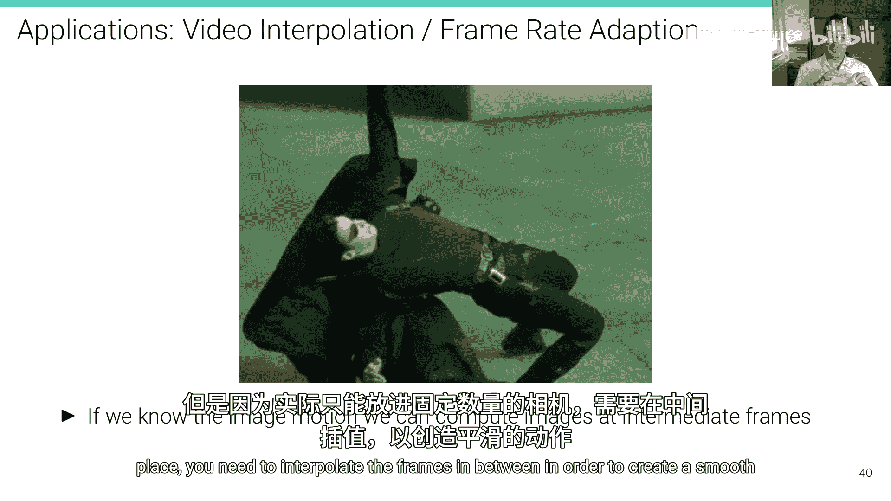
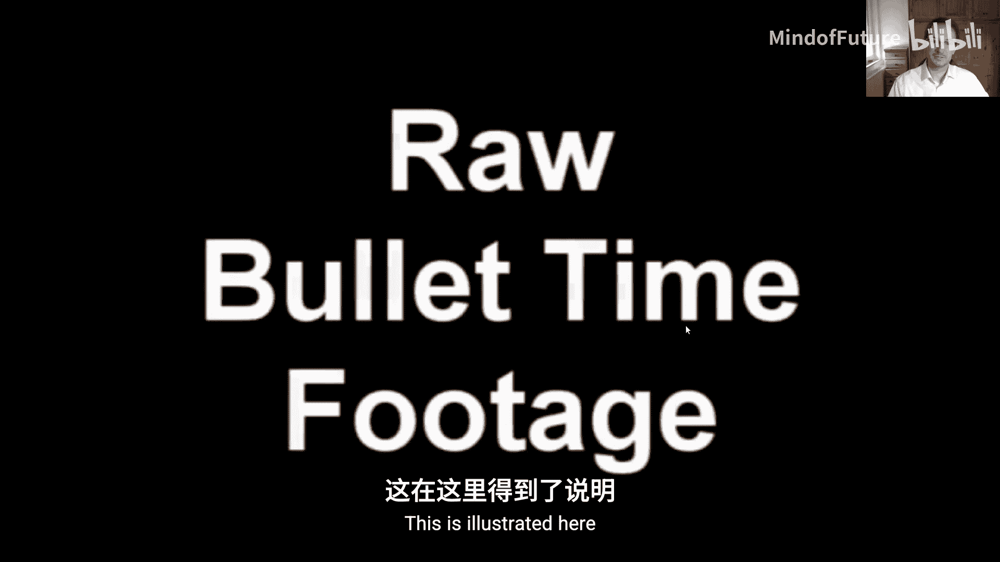
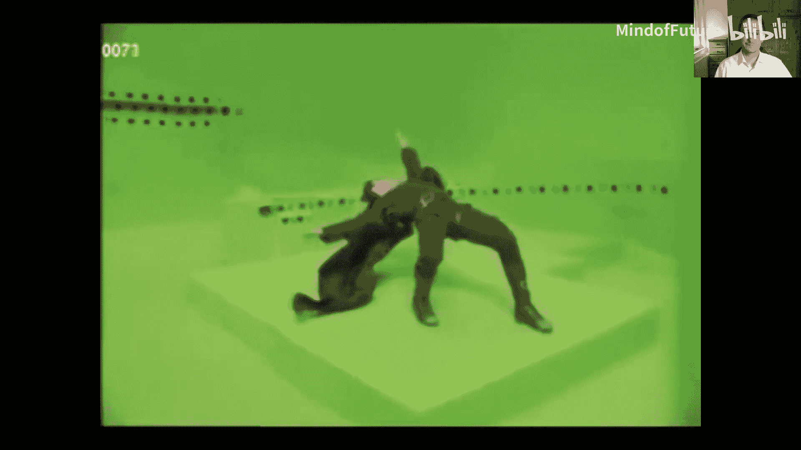
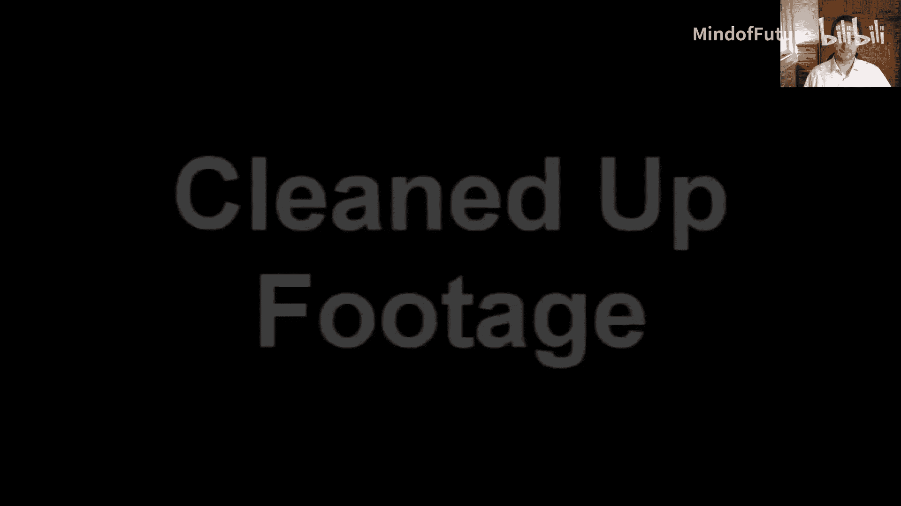
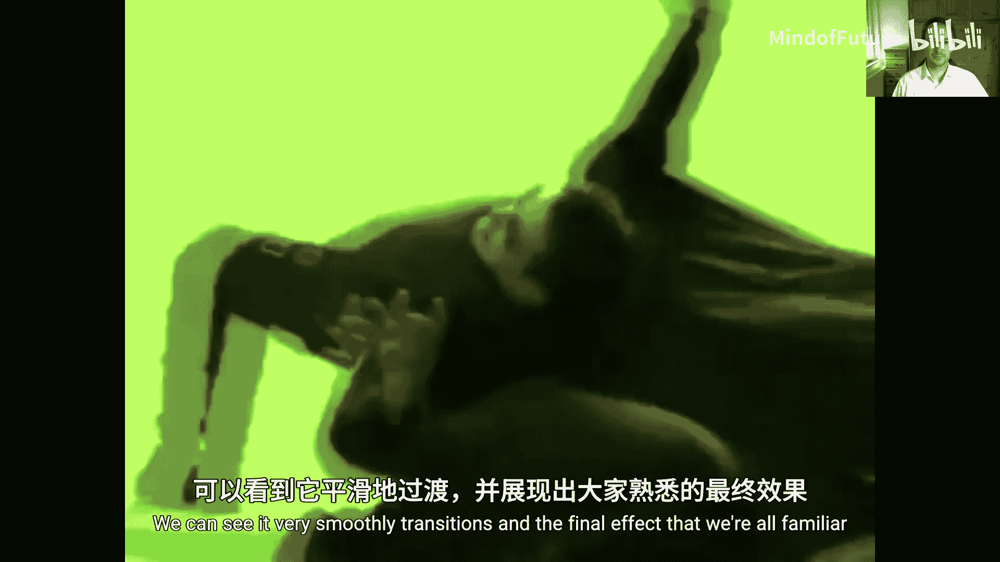
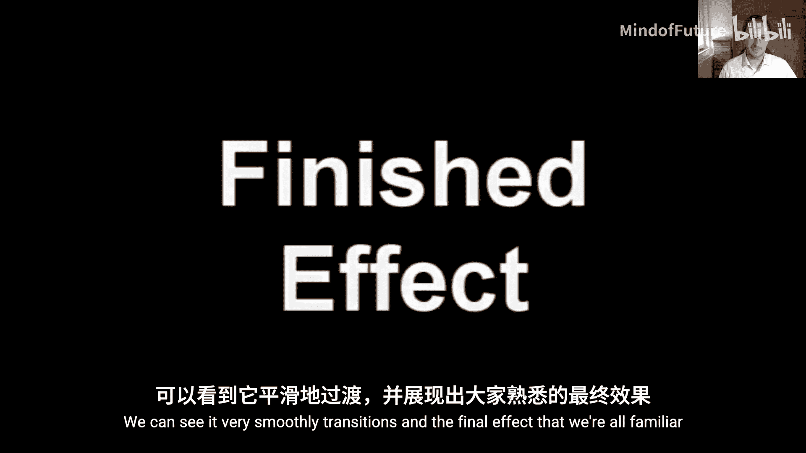
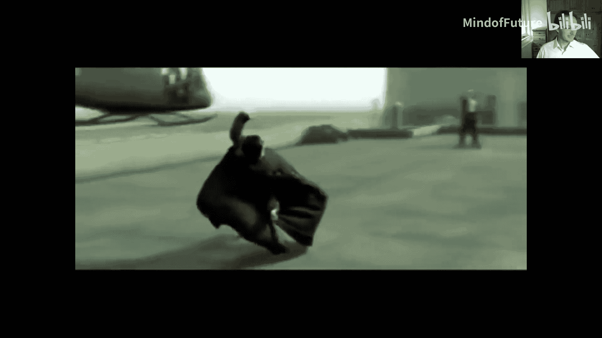
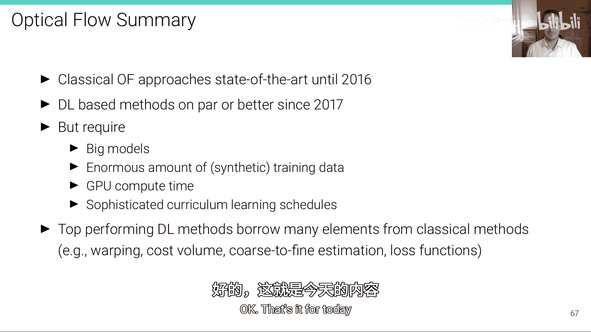

# 024：光流应用 🎥

在本节课中，我们将要学习光流问题，并探讨如何将其表述为马尔可夫随机场中的推理问题。

光流被定义为视觉场景中物体、表面和边缘的视在运动，这种运动是由观察者与场景之间的相对运动引起的。例如，在飞行员降落的场景中，可以观察到扩张点，靠近观察者的点运动幅度较大，而远处的点运动幅度较小。这种像素在图像中的视在运动，可能是由场景中的物体运动或观察者自身运动引起的。在本例中，场景是静态的，但相机相对于场景运动，从而产生了运动场。

光流最初由心理学家 J. Gibson 在 20 世纪 50 年代研究，他分析了动物如何进行低级感知，并将这些想法用于帮助飞行员导航。光流当然与立体视觉有关，两者都是二维估计问题，但关键区别在于：立体视觉是在同一时间拍摄两张图像（或等效地对静态场景拍摄两张图像），而光流不做此假设，这两张图像是在两个时间步拍摄的，对场景没有任何限制。因此，立体视觉只涉及相机运动，而光流涉及相机和物体运动。立体视觉是一个一维估计问题，一旦找到极线几何，就可以沿极线进行一维搜索。而光流是一个完整的二维估计问题，第一幅图像中的一个像素可以位于第二幅图像中的任何像素位置，没有先验约束。此外，不同动物对这两种原理的利用程度也不同，例如，猴子和人类一样拥有前向视觉系统，重叠视野很大，因此深度感知能力很强；而松鼠拥有侧向视觉系统，重叠视野很窄，立体视觉能力不强，但能很好地感知 360 度范围内的运动。

在开始之前，需要定义两个术语：光流和运动场。运动场是我们真正想要测量的东西，它代表了场景中点的实际三维运动在图像平面上的二维投影运动。例如，假设有一个图像平面和相机中心，一个三维点从一处移动到另一处，并投影到图像平面的不同位置，这就是我们想要测量的运动场。但我们无法直接获取它，因为我们不知道这些投影点对应的是同一个物理点。我们只有二维图像投影，没有关于世界的任何三维结构或物理信息。光流则是描述图像中视在运动的二维速度场，这是我们实际可以测量的，即看起来相似的像素的位移。如果图像中有一个角点，其运动是明确的，那么我们可以通过光流匹配这两个角点，此时光流场与运动场相同。在大多数情况下，它们是一致的，因此估计光流是有用的，但并非总是如此。

光流场与运动场并不总是一致。让我们进行一个思想实验：考虑一个朗伯球体（无镜面反射材质），它围绕垂直轴在三维空间中旋转。其二维运动场会显示小球边缘的运动矢量。但由于它是无纹理的朗伯球体，尽管在旋转，其外观并未改变，因此光流场将为零，我们观察不到任何运动。相反，考虑一个静止的镜面球体，其表面有高光。如果我们不移动球体，而是移动光源，那么这个高光就会在球体表面移动。此时，球体是静态的，三维几何未变，因此运动场处处为零。但光流场不为零，因为高光在移动，光流算法会检测到这个高光的运动。这两个例子说明了运动场与光流场的区别。

因此，光流告诉我们关于世界三维结构、观察区域内物体运动以及观察者自身运动的一些信息，这些信息可能是模糊的。它是我们希望估计的运动场的一种替代，并且通常是一个相当准确的替代，除了上述极端情况。与立体视觉相比，我们不能对极线几何做任何假设，它是一个真正的二维估计问题，因此更困难，搜索空间也大得多。动物也利用光流，例如北方塘鹅，这种鸟在水面上方盘旋捕鱼。它需要精确计算入水时机，通过感知水面图案的运动速度（光流），在毫秒级精度内确定撞击水面的时间点，以便及时收拢翅膀。

当然，光流在计算机视觉中也有许多重要应用。其中一个应用是视频插值或帧率适配。如果我们知道两帧之间的图像运动（由光流场表示），就可以对第一帧图像进行扭曲，合成中间时刻的虚拟帧，从而创建人工慢动作效果。例如，在电影制作中，通过环绕演员放置多个摄像机，然后利用光流在摄像机视角之间插值，可以创建出虚拟的、平滑环绕拍摄的“子弹时间”特效。

光流也可用于视频压缩。为了压缩图像序列，我们可以使用光流场预测新帧，然后只存储光流和预测误差。由于光流场是平滑的，它们比单独存储第二幅图像更容易压缩。类似原理被应用于 MPEG 等视频压缩算法中。

在自动驾驶中，如果将视差（深度）与光流结合，可以得到三维运动，这被称为场景流。通过立体相机跟踪随时间变化的帧，可以推断出许多三维点的运动方向。

现在，光流面临一个问题，也许是最著名的问题：孔径问题。孔径问题描述如下：如果只有一个观测点（例如通过一个小孔观察场景），我们能否确定物体如何运动？例如，观察一个物体边缘的一小部分，我们可能无法确定其真实运动方向。一个经典的错觉是，通过小孔观察一条线的运动，可能被感知为斜向运动，而实际上整条线是水平移动的。这意味着单点观测不足以确定光流。从数学上讲，如果只观察单个像素的强度变化，我们无法确定光流，因为光流有两个未知数（x 和 y 方向的运动）。类似的效应也出现在理发店旋转灯柱的错觉中，其产生的光流图案与实际旋转方向垂直。

现在我们知道了光流是什么，接下来需要确定如何计算它。Horn 和 Schunck 的论文《Determining Optical Flow》是该领域的开创性工作，引发了大量后续研究。还有另一篇著名论文是 Lucas-Kanade 光流法，但那是局部光流方法，存在窗口效应。因为我们是在马尔可夫随机场的背景下考虑光流，而 Horn-Schunck 算法与此相关，因为它也做出了平滑性假设。

让我们从数学上表述这个问题。将图像 I 视为连续变量 X, Y, T 的函数，形成一个连续的时空体积。我们想要推断的是一个连续的流场，它由两个一维函数 U(x,y) 和 V(x,y) 表示，分别代表图像平面 x 和 y 方向的流动。这是一个变分问题，我们需要最小化一个能量泛函。在 Horn-Schunck 的原始公式中，能量泛函包含两项：第一项是亮度恒定假设的二次惩罚项，即一个像素根据光流 (U, V) 移动到下一帧时，其亮度应保持不变；第二项是流场变化的正则化项（平滑项），通过最小化流场梯度（U 和 V 的梯度）的平方来实现，这迫使光流在局部邻域内变化平缓。

直接最小化这个能量非常困难，因为能量高度非凸且有许多局部极小值。问题在于第一项中，光流场 U, V 是图像函数的参数，而图像本身高度非线性。解决方案是对亮度恒定假设进行线性化，即采用一阶泰勒近似。线性化后，第一项变成了 U 和 V 的二次项，从而使整个能量函数关于 U 和 V 是凸的（二次的），更容易求解。

当然，在计算机中我们需要离散化。将连续的积分变为对像素的求和，连续函数 U, V 变为离散矩阵。此时，能量函数是关于所有 U、V 变量的二次函数，因此存在唯一最优解，可以通过求解大型稀疏线性系统得到。由于变量数量巨大（与图像像素数相同），通常使用迭代求解器（如梯度下降、高斯-赛德尔迭代）。这种方法的一个问题是，线性化假设只对非常小的运动有效。为了解决大运动问题，通常采用由粗到精的估计策略：首先在低分辨率图像金字塔上估计光流，然后将估计结果上采样，作为下一级更高分辨率图像的初始值，并在此过程中对目标图像进行扭曲，从而逐步细化光流估计。

Horn-Schunck 算法的结果已经相当合理，但流场过于平滑。仔细观察会发现，不同物体之间的光流过渡不够锐利，出现了过度平滑。这是因为为了克服孔径问题和病态性，我们需要将正则化参数 λ 设置得相对较高，但这导致了过度平滑。问题的根源在于我们使用了二次惩罚项（L2 正则化），它对大的变化惩罚过重，不利于保持光流的不连续性（如物体边界处）。因此，需要使用更鲁棒的惩罚函数，使其更符合真实世界的统计特性。

这就将光流问题与 MRF 中的 MAP 推理联系了起来。我们可以将推导出的光流能量函数代入吉布斯分布，从而得到一个概率分布。在此分布上执行 MAP 推理等价于最小化该能量函数。由于此处的 U 和 V 是连续的（不同于立体匹配中的离散变量），我们使用梯度下降进行推理，而非置信传播。二次惩罚项对应于高斯分布假设，但这对于数据项和平滑项都是无效的，因为高斯分布（对应平方损失）对离群点（如遮挡、镜面高光）和流场不连续性不够鲁棒。

解决方案是使用鲁棒的数据项和平滑项惩罚函数。在概率公式中，我们用重尾的学生 t 分布代替高斯分布，这在能量域对应于柯西惩罚函数。学生 t 分布的负对数密度函数增长缓慢，对大的误差惩罚较轻，因此能更好地处理离群值和光流不连续性。与高斯分布相比，学生 t 分布与真实光流梯度等数据的经验分布更匹配。采用这种鲁棒惩罚函数（如 Black 和 Anandan 的方法）后，得到的光流结果边界更加锐利。

最后需要提及，光流不仅可以通过经典的图模型推理或变分技术解决，近年来也广泛采用深度学习。由于获取真实光流标注数据非常困难，深度学习在该领域的发展一度滞后。早期的 FlowNet 模型使用了大量合成数据进行有监督训练，其网络结构类似于 U-Net 或沙漏网络。后续的 FlowNet 2.0 通过堆叠多个网络处理不同尺度运动，在 2017 年达到了先进水平。更近期的研究表明，也可以通过无监督方式训练光流网络，其原理类似于经典方法：利用网络预测前向和后向光流，进行一致性检查，并施加类似于经典方法的数据损失和平滑损失。这种自监督学习方法将在第 12 讲中详细介绍。

总结来说，经典光流方法在 2016-2017 年前一直保持领先，此后深度学习方法达到并超越了经典方法。但深度方法需要大型模型、海量合成训练数据、强大的 GPU 算力和复杂的课程学习策略。目前，最先进的技术无疑是深度学习，因为有了更多更好的数据集（包括真实标注数据）。有趣的是，顶尖的深度学习方法也借鉴了许多经典方法的元素，如扭曲、迭代估计、由粗到精和代价体积等思想。

本节课中，我们一起学习了光流的定义、其与运动场的区别、经典的 Horn-Schunck 算法及其变分公式、由粗到精策略、与马尔可夫随机场的联系、使用鲁棒惩罚函数的重要性，以及深度学习在光流估计中的最新进展。