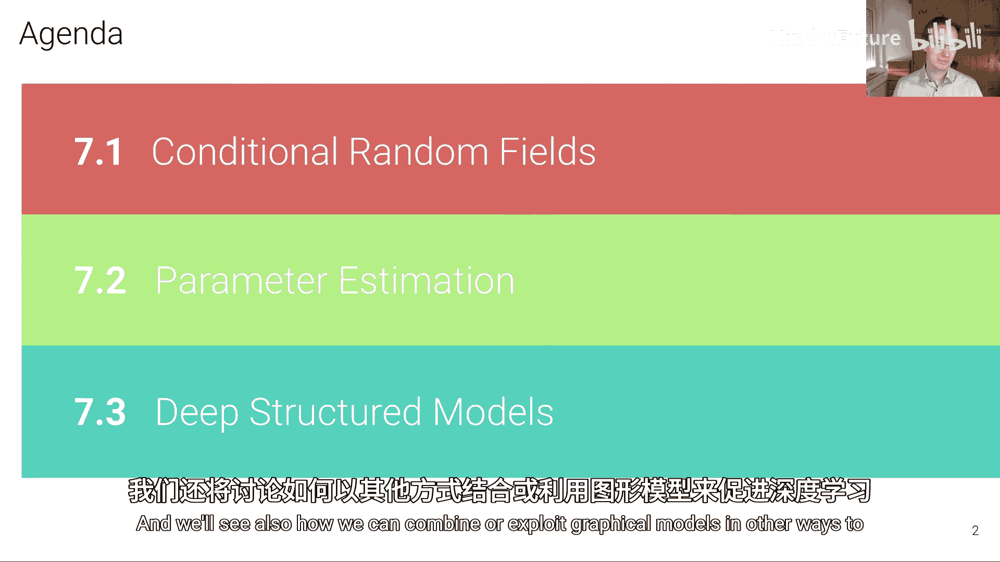
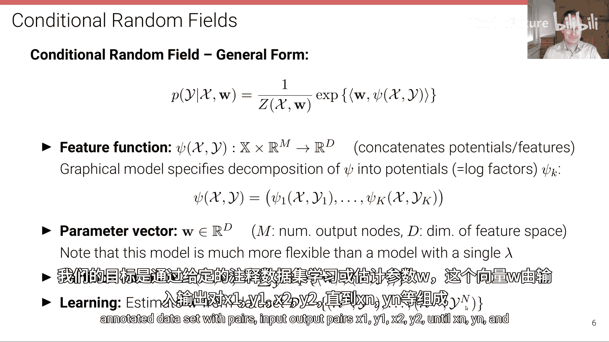
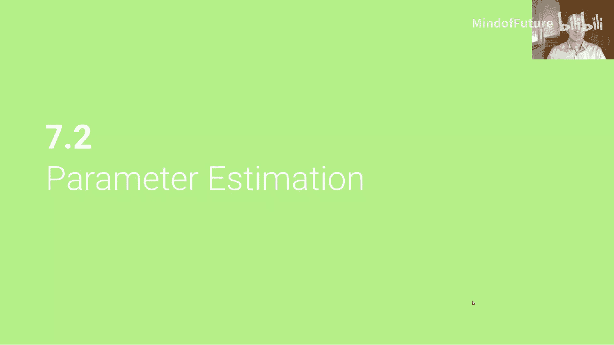

# 025：条件随机场与图模型学习 🧠

在本节课中，我们将学习图模型中的参数估计问题，即如何从数据中学习模型的参数。我们将重点介绍**条件随机场**这一关键概念，它是解决此类学习问题的基础框架。

在第五讲中，我们介绍了图模型和一种基本的推断算法——信念传播算法，用于求解变量的边缘分布或最大后验解。在第六讲中，我们看到了图模型的应用，以及如何将关于问题的先验知识（例如深度图的平滑性）编码到模型中。

到目前为止，我们所见的模型都包含一些参数，例如立体视觉中的平滑度参数 λ。在本讲中，我们将讨论如何根据数据集来估计这些参数。

## 从马尔可夫随机场到条件随机场 🔄

到目前为止，我们讨论的是**马尔可夫随机场**或**因子图**。为了回顾，马尔可夫随机场定义了随机变量的联合概率分布。以一个图像去噪的简单MRF为例，我们有100个随机变量，其分布由一元势函数和相邻像素间的成对势函数之和的指数形式定义，并需要除以配分函数进行归一化。

我们之前讨论的是MRF中的**推断**问题，即估计变量的边缘分布 `P(x_i)` 或寻找最大后验解 `argmax_{x} P(x)`。前者在计算期望时很重要，后者在只需要一个最优估计点时很有用。

本节课我们将讨论**学习**问题：如何从数据集中估计模型参数？在简单例子中只有一个标量参数 λ，但我们可以有更多参数。

**条件随机场**的引入是因为学习需要从更大的数据集中进行，而不仅仅是针对一个特定实例。因此，我们需要以**条件**的形式来表述问题，这引出了**结构化输出学习**。

在结构化输出学习中，我们学习一个带参数 `W` 的映射函数 `F`，它从输入空间 `X` 映射到输出空间 `Y`。关键点在于，输出 `Y` 是复杂的结构化对象，例如图像、语义分割图或文本。

## 条件随机场的定义 📝

在条件随机场中，我们显式地表达了输出 `Y` 对输入 `X` 和参数 `W` 的条件依赖。因此，概率分布写作 `P(Y | X; W)`。

*   **输入 `X`**： 例如一张带噪图像。
*   **输出 `Y`**： 例如对应的去噪图像（即之前MRF中的 `x`）。
*   **参数 `W`**： 需要学习的模型参数。

势函数现在同时是输入 `X` 和输出变量 `Y` 的函数。学习的目标是：给定一个由输入-输出对 `(X_i, Y_i)` 组成的数据集（例如带噪图像和干净图像对），估计最优参数 `W`，使得模型在面对新的、未见过的输入时能做出最佳预测。

## 条件随机场的一般形式 🧮

我们可以将CRF写成更一般的形式。假设模型包含一元、成对或更高阶的势函数，我们可以将所有势函数（特征函数）拼接成一个长的特征向量 `Ψ(X, Y)`。那么条件概率分布可以写为：

`P(Y | X; W) = (1 / Z(X; W)) * exp( <W, Ψ(X, Y)> )`

其中：
*   `W` 是参数向量。
*   `Ψ(X, Y)` 是特征向量，它将输入 `X` 和输出 `Y` 映射到一个 `D` 维特征空间。
*   `< , >` 表示内积运算。
*   `Z(X; W) = Σ_{Y'} exp( <W, Ψ(X, Y')> )` 是配分函数，确保概率归一化。它对所有可能的输出 `Y'` 求和。

这种形式比单一参数灵活得多，因为 `W` 可以为模型定义的每个特征分配不同的权重。特征函数 `Ψ(X, Y)` 通常根据图模型的结构进行分解，例如，将所有一元特征和所有成对特征分别拼接起来。

学习的目标是：从标注数据集 `{(X_1, Y_1), (X_2, Y_2), ..., (X_N, Y_N)}` 中估计参数向量 `W`。

---

本节课中，我们一起学习了图模型中的参数学习问题。我们首先回顾了马尔可夫随机场中的推断任务，然后引出了为进行基于数据集的学习而必须定义的**条件随机场**。我们明确了CRF将输出 `Y` 条件于输入 `X` 的建模方式，并给出了其从具体例子到一般形式的数学定义。下一节中，我们将探讨在这种线性或对数线性参数化下，如何具体求解这个学习问题。