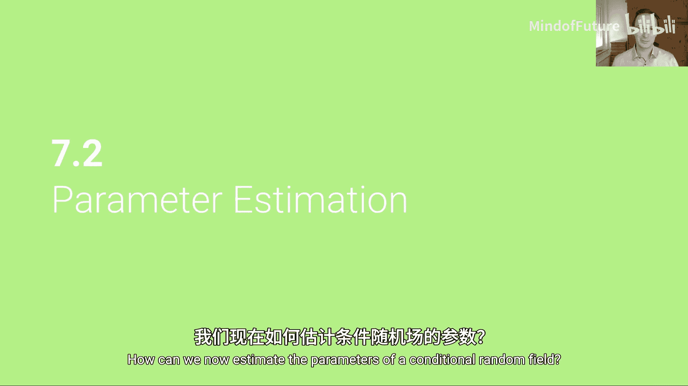
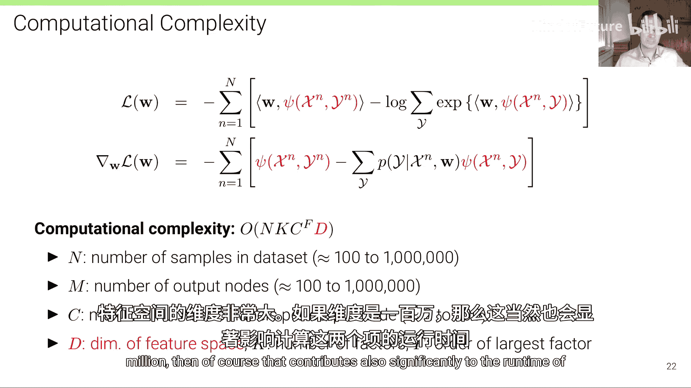
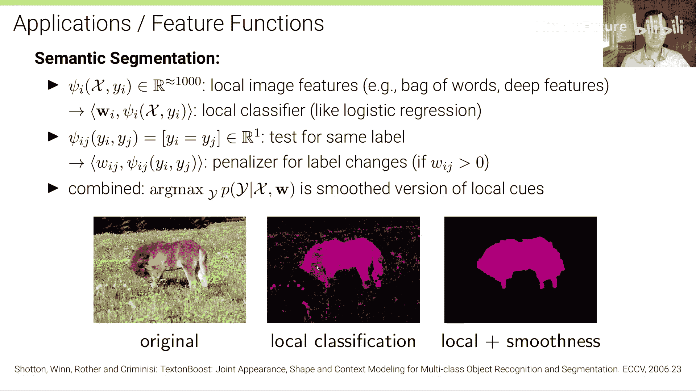
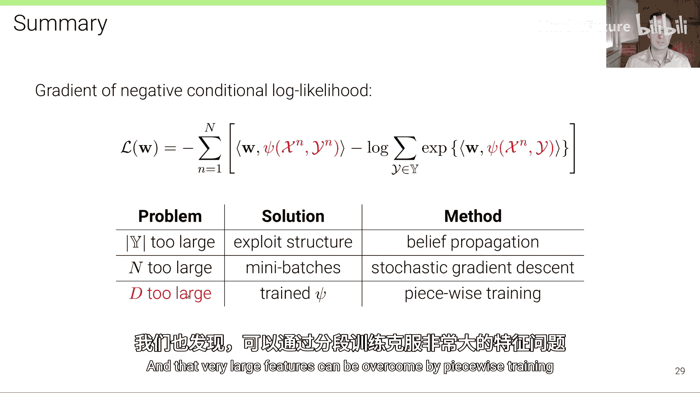

# 026：条件随机场中的参数估计 📊

在本节课中，我们将学习如何估计条件随机场（CRF）的参数。我们将从最大似然估计的目标出发，推导出需要优化的损失函数及其梯度，并探讨如何利用图模型的结构和高效推理算法，使原本计算量巨大的参数学习过程变得可行。

## 概述

我们的目标是，在给定输入数据 **x** 的条件下，找到参数向量 **W**，使得模型预测输出 **y** 的似然概率最大化。这等价于最小化负对数似然损失函数。对于我们所考虑的局部线性模型，这是一个凸优化问题，因此梯度下降法可以找到全局最优解。

## 最大似然估计目标

首先，我们假设数据集中的样本是独立同分布的。因此，整个数据集的条件概率可以分解为各个样本条件概率的乘积。我们的目标是找到参数向量 **W**，使得模型分布尽可能接近数据分布。

数学上，我们希望找到最大似然估计参数 **Ŵ_MLE**：

**Ŵ_MLE = argmax_W P(Y | X, W)**

由于对数函数是单调的，最大化似然等价于最小化负对数似然损失函数 **L(W)**：

**L(W) = -∑_n log P(yⁿ | xⁿ, W)**

其中，**n** 遍历数据集中的所有样本。

## 损失函数与梯度推导

上一节我们明确了优化目标，本节中我们来看看损失函数的具体形式及其梯度。

将CRF的条件概率公式代入损失函数，并应用对数运算法则，我们可以得到：

**L(W) = ∑_n [ -〈W, ψ(xⁿ, yⁿ)〉 + log Z_W(xⁿ) ]**

其中，**〈·, ·〉** 表示内积，**ψ** 是特征函数，**Z_W(xⁿ)** 是配分函数，定义为：

**Z_W(xⁿ) = ∑_y exp(〈W, ψ(xⁿ, y)〉)**

接下来，我们需要计算损失函数 **L(W)** 关于参数 **W** 的梯度。梯度计算如下：

**∇_W L(W) = ∑_n [ -ψ(xⁿ, yⁿ) + E_{y~P(y|xⁿ,W)}[ψ(xⁿ, y)] ]**

梯度的直观解释是：它等于**数据特征**（来自标注样本 **yⁿ**）与**模型期望特征**（在当前参数 **W** 下，模型预测的特征期望值）之间的差值。当模型预测的特征期望与数据特征相匹配时，梯度为零，达到一个临界点。

## 优化方法与计算挑战

我们已经得到了损失函数和梯度的表达式，接下来需要考虑如何优化。最直接的方法是使用梯度下降法及其变种（如线搜索、共轭梯度法）。

然而，计算 **L(W)** 和 **∇_W L(W)** 面临一个巨大的挑战：它们都涉及对输出空间 **y** 的求和。对于像图像分割这样的任务，**y** 的空间是指数级巨大的（例如，对于一个640x480的二进制分割图，有 2^(640*480) 种可能），直接计算是完全不可行的。

计算复杂度主要来自三个方面：
1.  **数据样本数 N**：需要对所有训练样本求和。
2.  **输出空间大小 C^M**：需要对所有可能的输出配置求和，这是主要瓶颈。
3.  **特征维度 D**：需要计算高维特征向量的内积。

## 利用图模型结构实现高效计算

面对指数级的状态空间，我们必须利用图模型的结构来简化计算。关键在于，在CRF中，全局特征向量 **ψ(x, y)** 可以分解为多个局部势函数（因子）的拼接。

例如，在具有一元和二元势函数的模型中：
**〈W, ψ(x, y)〉 = ∑_k 〈W_k, ψ_k(x, y_k)〉**
其中，**y_k** 只涉及第 **k** 个势函数相关的少数变量（如单个像素或相邻像素对）。

这种分解带来了两个关键简化：

**1. 高效计算配分函数：**
配分函数 **Z_W(x)** 现在变成了对因子乘积的求和。对于结构简单的图模型（如树状结构或低团阶数的模型），我们可以使用**置信传播**等消息传递算法高效地计算边际概率，进而得到配分函数，而无需枚举所有状态。

**2. 高效计算特征期望：**
特征期望 **E[ψ(x, y)]** 由于期望的线性性质，可以分解为各个局部特征期望的和：
**E[ψ(x, y)] = ∑_k E[ψ_k(x, y_k)]**
而每个局部期望 **E[ψ_k(x, y_k)]** 只需要在很小的变量子集 **y_k** 上，利用已计算出的边际概率进行求和即可。

通过这种分解，计算复杂度从可怕的 **O(C^M)** 降低到了 **O(K * C^F)**，其中 **F** 是最大因子的阶数（通常为2或3），**K** 是因子数量。这使得学习变得可行。

## 应对大规模数据与高维特征

除了状态空间问题，在实际训练中我们还需应对其他挑战：

**1. 大规模数据集：**
当训练集很大时，每次梯度更新都要遍历所有样本计算损失和梯度，计算量依然很大。解决方案是采用**随机梯度下降（SGD）**。在SGD中，每次迭代只随机抽取一个小批量（Mini-batch）样本来计算梯度并更新参数。虽然需要更多迭代次数，但每次迭代更快，且对内存更友好。

**2. 高维特征：**
特征向量 **ψ** 的维度 **D** 可能很高（例如，来自深度网络的特征），导致内积计算和参数更新变慢。一种常见的策略是进行**分阶段训练**：首先，使用非线性分类器（如SVM、神经网络）单独预训练一元势函数，将其输出（如对数概率）作为CRF中低维的、固定的“特征”。这样，CRF训练时只需要学习相对低维的 pairwise 势函数的权重，从而加速训练和推理。但缺点是，如果一元分类器本身性能很差，CRF也难以修复。

## 应用实例

以下是条件随机场在计算机视觉中的几个典型应用，它们都遵循“局部线索+先验约束”的模式：

*   **语义分割**：输入是图像，输出是每个像素的类别标签。
    *   **一元势函数**：基于像素外观（如颜色、纹理、深度特征）判断其属于某类别的概率。
    *   **二元势函数**：鼓励相邻像素具有相同标签，以产生平滑的分割结果。
*   **手写识别**：输入是字符图像序列，输出是字符标签序列。
    *   **一元势函数**：基于单个字符图像识别其类别。
    *   **二元势函数**：编码语言模型，即某些字符组合（如“qu”）比另一些（如“qz”）更可能出现。
*   **人体姿态估计**：输入是图像，输出是每个像素所属的身体部位。
    *   **一元势函数**：基于局部图像特征分类像素属于哪个身体部位。
    *   **二元/高阶势函数**：编码身体部位之间的空间约束关系（如头通常在躯干上方）。

在这些应用中，CRF的学习过程就是调整一元和二元势函数的权重，使得模型能结合局部预测和全局先验，得到更干净、更一致的结果。

## 总结

本节课中我们一起学习了条件随机场的参数估计方法。我们了解到：

1.  参数估计的目标是通过最大似然估计，使模型分布逼近数据分布，这转化为最小化负对数似然损失函数的凸优化问题。
2.  损失函数及其梯度的计算，核心难点在于对指数级大小输出空间的求和。
3.  通过利用图模型的因子分解结构，我们可以借助**置信传播等推理算法**高效计算配分函数和特征期望，从而将计算变得可行。
4.  对于大规模数据，采用**随机梯度下降（SGD）** 可以有效加速训练。
5.  对于高维特征，**分阶段训练**策略（先预训练强一元分类器）可以简化CRF的训练过程。
6.  在语义分割、手写识别、姿态估计等任务中，CRF通过结合局部分类结果和全局结构化先验，显著提升了预测效果。

因此，训练一个CRF模型本质上是**在高效推理算法的支撑下，进行梯度下降优化，以学习如何最佳地融合局部证据与结构化约束**。