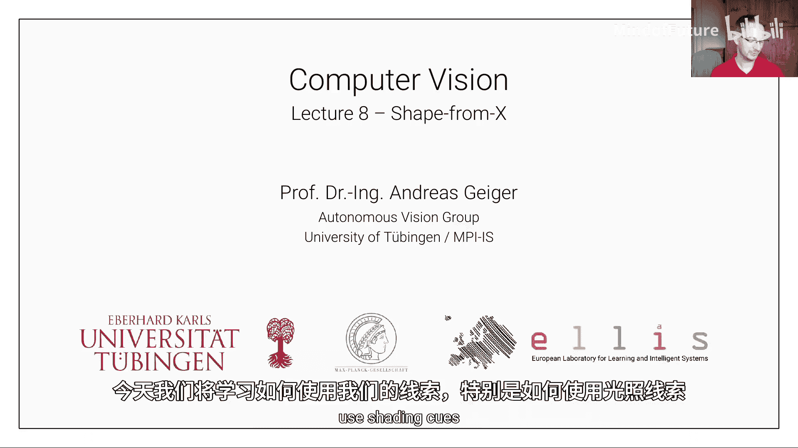
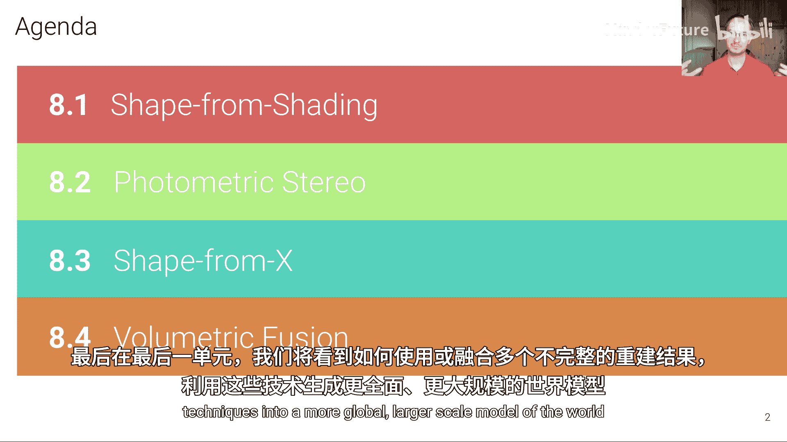
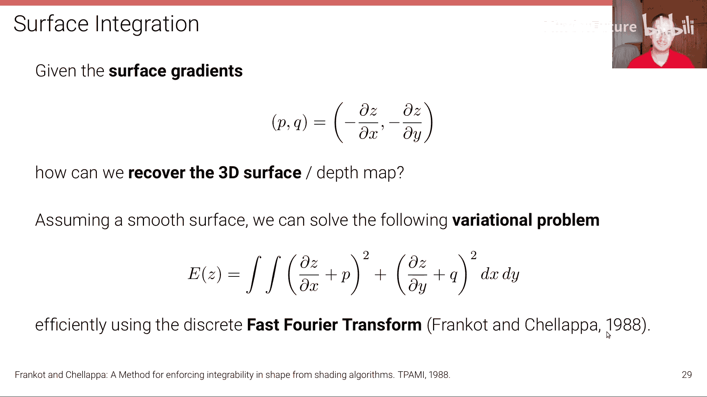
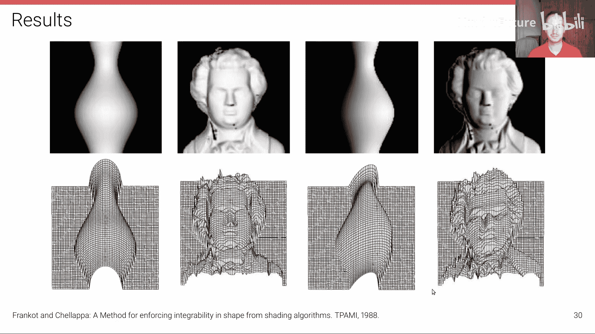
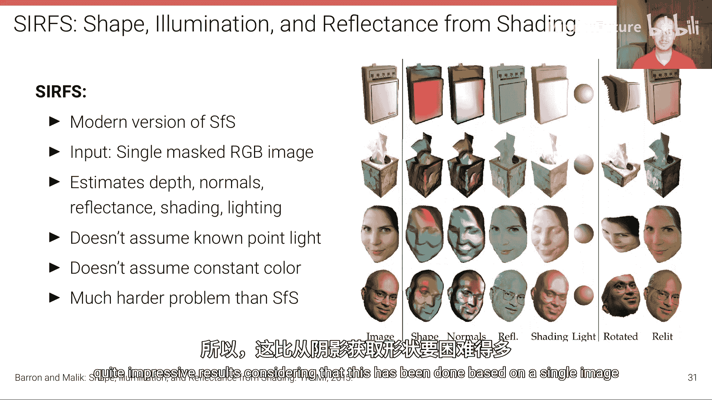
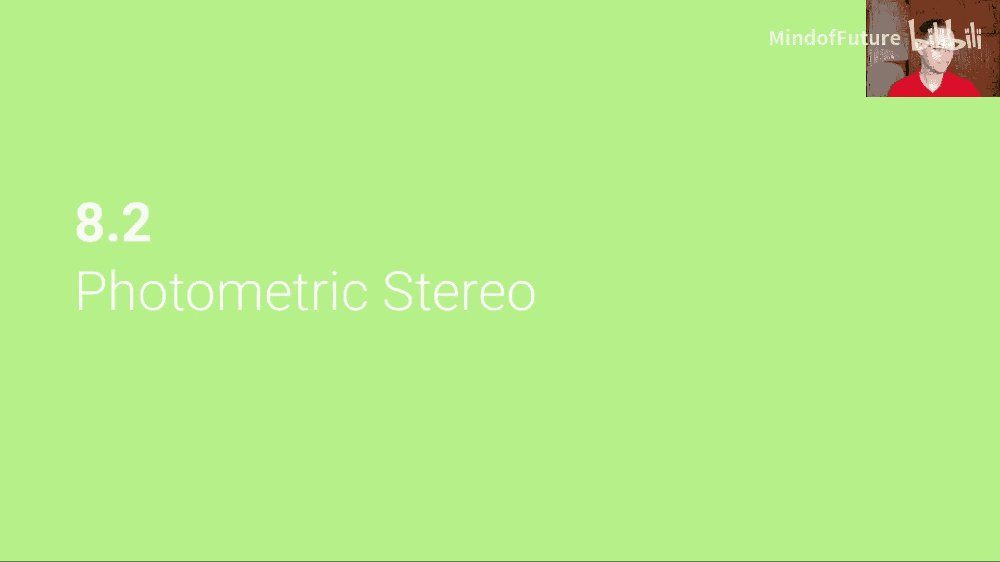

# 028：从X恢复形状 - 从明暗恢复形状 (Shape-from-X - Shape-from-Shading) 👁️






在本节课中，我们将学习如何从图像中恢复三维几何形状，特别是利用“明暗”这一视觉线索。我们将从最基础的“从明暗恢复形状”技术开始，探讨如何仅凭单张图像的亮度变化来推断物体表面的三维信息。

## 概述

在之前的课程中，我们已经学习了两种从图像重建三维几何的技术：双目立体视觉和多视图重建。今天，我们将探讨如何利用其他线索，特别是“明暗”线索。本讲座分为四个部分：首先，我们将讨论“从明暗恢复形状”，这是一种允许我们从单张图像重建三维信息的技术。其次，我们将介绍“光度立体视觉”，可以看作是“从明暗恢复形状”在多光源条件下的推广。第三，我们将概述包括上述技术在内的各种“从X恢复形状”方法。最后，我们将学习如何融合这些技术得到的不完整重建结果，形成一个更全局、更大规模的世界模型。

## 第一单元：从明暗恢复形状 (Shape from Shading)

本节我们将探讨的核心问题是：我们能否仅通过观察单张图像的明暗变化来恢复形状？这里的“明暗”指的是图像中观察到的相对亮度。换句话说，我们想要揭示亮度与形状之间的关系。直观上，这似乎是可能的，就像人类观察图像时，即使不认识物体，也能通过明暗线索对光源位置和物体形状有所感知。

然而，从单张图像解决这个逆问题非常具有挑战性。著名的Adelson和Pentland的“Checker Shadow”错觉就很好地说明了这一点：能够产生完全相同二维像素配置的形状、材质和光照组合是极其庞大的。因此，我们需要引入先验和假设，来找到最可能的三维几何解释。

为了解决问题，我们必须回顾第二讲中提到的图像形成过程，即渲染方程。

### 渲染方程回顾

渲染方程描述了三维表面点P反射到观察方向V的光量。设V为观察方向，S为入射光方向，N为表面法线。方程如下：

```
L_out(V) = L_e(V) + ∫_Ω f_r(P, ω_i -> V) L_in(ω_i) (N · ω_i) dω_i
```

其中：
*   `L_out(V)` 是沿观察方向V的出射光亮度。
*   `L_e(V)` 是表面自发光项（通常不考虑）。
*   `f_r` 是双向反射分布函数，定义了光在表面点P如何反射。
*   `L_in(ω_i)` 是沿方向ω_i的入射光亮度。
*   `(N · ω_i)` 是余弦项，模拟了入射角对接收光量的影响（朗伯余弦定律）。

这是最一般的形式。为了应用于从明暗恢复形状问题，我们需要做出一系列简化假设。

### 关键假设与简化

为了得到一个可解的简单方程，我们做出以下假设：

1.  **朗伯表面 (Lambertian Surface)**：假设物体表面是纯漫反射的。这意味着BRDF是一个常数，称为反照率 (albedo, ρ)。光被均匀地散射到所有方向。
2.  **单一点光源 (Single Point Light Source)**：假设场景由一个位于方向S的远距离点光源照明，没有环境光。这使得对半球面的积分简化为一个点。
3.  **正交投影 (Orthographic Projection)**：假设相机位于无穷远处，观察方向V对所有像素是恒定的。

在这些假设下，渲染方程简化为：

```
L_out = ρ * (N · S) * L_in
```

如果我们进一步将乘积 `ρ * L_in` 吸收到观测到的图像强度 `I` 中（或假设其为1），则得到核心关系：

```
I(x, y) ∝ R(N) = N · S
```

这里，`R(N)` 被称为**反射率图**，它建立了表面法线N与观测图像强度`I`之间的直接联系。我们的目标就是从观测到的`I`反推出`N`。

### 法线参数化：梯度空间

表面法线N是一个三维单位向量，具有两个自由度。为了方便表示，我们使用**梯度空间**。设深度图为`Z(x, y)`，我们定义表面梯度 `p = -∂Z/∂x`, `q = -∂Z/∂y`。那么，表面点`(x, y)`处的法线可以表示为：

```
N = [p, q, 1]^T / sqrt(p^2 + q^2 + 1)
```

这样，我们用法线梯度`(p, q)`这两个变量替代了三维法线。反射率图也可以重写为：

```
R(p, q) = (p*s_x + q*s_y + s_z) / sqrt(p^2 + q^2 + 1)
```

其中 `S = [s_x, s_y, s_z]^T` 是已知的归一化光源方向。

### 问题的病态性与等亮度线

对于一个给定的像素强度观测值 `I`，满足 `R(p, q) = I` 的`(p, q)`组合有很多。在梯度空间中，这些解构成了一条曲线，称为**等亮度线**。下图展示了对于不同的`I`值，等亮度线是椭圆、抛物线或双曲线等圆锥曲线。

这意味着，仅凭单个像素的亮度，我们无法唯一确定其法线。除了`I = 1`（法线与光源方向完全一致）和`I = 0`（法线与光源方向垂直）等特殊情况外，解空间都是一个连续集。

为了获得唯一解，我们需要引入额外的约束。主要有两种思路：1) 在单张图像中增加正则化约束（即经典的从明暗恢复形状）；2) 增加更多的观测（即下一节的光度立体视觉）。

### 从明暗恢复形状的变分公式

经典的从明暗恢复形状方法通过引入以下约束来解决病态问题：

1.  **图像亮度误差**：重建的法线应使预测的亮度`R(p, q)`与观测亮度`I(x, y)`尽可能一致。
2.  **平滑性约束**：假设物体表面是光滑的，即相邻点的法线变化应尽可能小。这通过惩罚`p`和`q`的梯度幅值来实现。
3.  **遮挡边界约束**：假设我们已知物体的分割掩码。在物体的遮挡边界上，表面法线必须与视线方向垂直，并且与边界切线方向垂直。这为边界上的法线提供了强约束。

综合以上约束，我们构建一个能量函数进行优化：

```
E(p, q) = ∫∫ [(I(x,y) - R(p,q))^2 + λ (||∇p||^2 + ||∇q||^2)] dx dy
```

其中`λ`是平滑项权重。在优化时，将遮挡边界上的法线固定为已知值，内部区域的法线初始化为零，然后进行迭代优化直至收敛。

### 从法线图到深度图

优化后我们得到的是表面梯度场`(p, q)`，即法线图。要得到最终的三维形状（深度图`Z`），需要“积分”这些梯度。这可以通过求解另一个变分问题来实现：

```
min_Z ∫∫ [ (∂Z/∂x + p)^2 + (∂Z/∂y + q)^2 ] dx dy
```

这个问题的目标是找到一个深度图`Z`，其梯度与估计出的`(p, q)`场尽可能匹配（注意符号关系：`p = -∂Z/∂x`）。该问题可以利用离散快速傅里叶变换等方法高效求解。

### 结果与扩展

经典的从明暗恢复形状方法在满足其强假设（朗伯表面、单一点光源、已知反照率）的条件下，能够从单张图像恢复出粗糙的形状。然而，结果对光源位置敏感，且容易产生偏差。



现代的研究致力于放松这些强假设。例如，一些工作尝试从单张RGB图像同时估计深度、法线、反射率、着色和光照，这是一个更具挑战性但也更通用的“从明暗恢复形状”问题。



## 总结





在本节中，我们一起学习了“从明暗恢复形状”的基本原理。我们了解到，通过假设朗伯表面、单一点光源和正交投影，可以将复杂的渲染方程简化为图像强度与表面法线点积的直接关系。然而，由于从单个亮度值无法唯一确定法线，我们引入了平滑性约束和遮挡边界约束，构建了一个变分优化问题来求解法线图，并最终通过积分得到深度图。这项技术是理解如何利用光照线索推断三维形状的重要基础。接下来，我们将看到如何通过增加观测来更稳健地解决这个问题，即“光度立体视觉”。