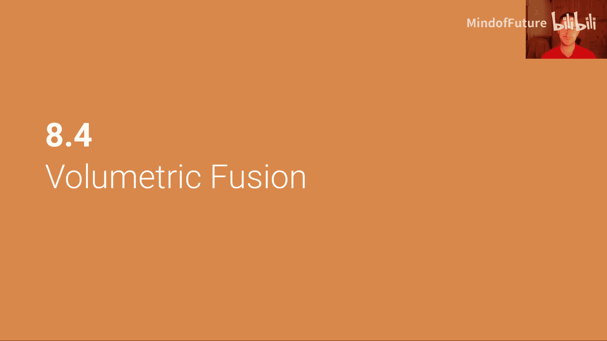
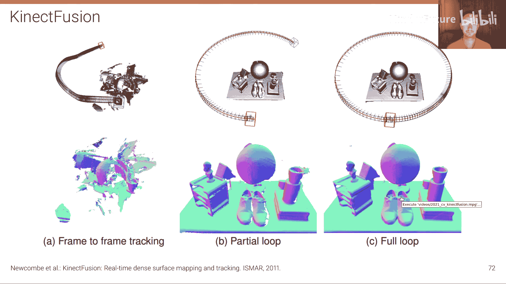
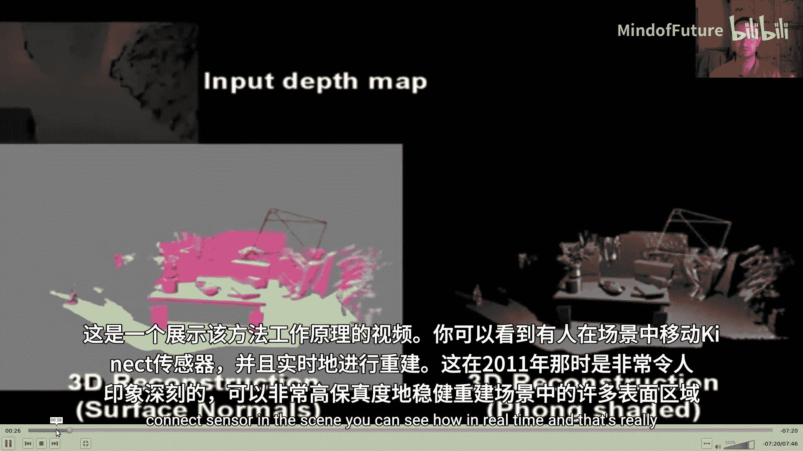
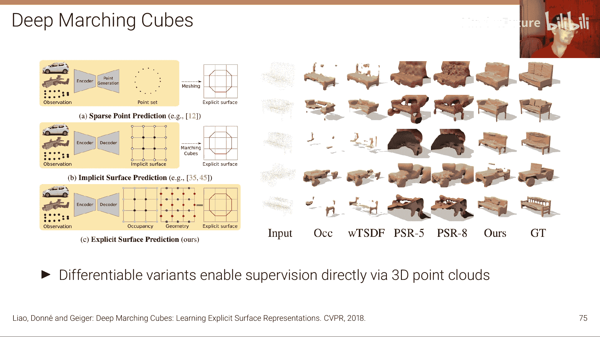

# 031：从形状到体积融合 📦

在本节课中，我们将学习如何将来自多个视角的几何重建结果融合成一个完整、一致的三维场景模型。我们将重点介绍一种因其简洁高效而广泛使用的技术——**体积融合**。

我们已经学习了许多从图像输入重建几何形状的技术。然而，这些重建大多只针对单个物体，或者仅生成单张深度图。在实际应用中，我们通常希望重建整个场景，即由多个物体构成的大规模场景。这就引出了一个关键问题：如何将这些独立的局部重建组合成一个完整、一致的三维场景模型。

## 传统三维重建流程概览

以下是传统三维重建流程的概览图，其输入是一组图像。

我们首先估计相机姿态，可以使用运动恢复结构或光束法平差等技术。根据估计的相机姿态和图像，我们可以利用双目/多目立体视觉、单目视觉、主动视觉或明暗恢复形状等技术来计算密集对应关系。这些计算可能产生的一个中间表示是每张参考图像的深度图。

深度图融合的任务，就是将所有深度图融合成一个一致的三维重建结果，如上图左侧所示。

## 理解体积融合：从显式到隐式表示

为了理解体积融合的工作原理，我们首先需要了解它所使用的表示方法。这种方法使用的不是显式表示，而是形状的**隐式表示**。

### 显式表示 vs. 隐式表示

这里我们看到一个基于网格的表示，这是一个被离散化为一系列顶点和边的圆形。在三维中，这将是顶点和面的集合。这是一种**显式表示**，它通过存储顶点和面来直接描述几何形状。虽然它曾被用于融合，但并非理想的融合表示，并且很难用这种表示来改变拓扑结构。

我们将转而使用**隐式表示**。最简单的隐式表示是简单的参数形式。例如，我们可以将一个圆表示为某个抛物面的水平集。我们有一个函数 **f(x, y) = x² + y² - r²**。当我们将该函数设为零时，就得到了圆的方程。因此，我们通过这样一个函数的水平集隐式地定义了表面形状。

在接下来的课程中，我们将讨论使用神经网络表示这类函数的隐式模型。但这是近期的工作方向，我们首先关注过去20年中的经典方法，即对这种隐式空间的**离散化**。

### 有符号距离函数

具体来说，我们将关注所谓的**有符号距离函数**。它测量空间中每个体素中心到最近表面的距离。我们以适合我们内存和计算能力的分辨率对空间进行离散化。然后，在每个体素中，我们存储一个值，该值被设置为到最近表面的距离。

例如，一个体素的值可能是2.5，表示其中心距离最近表面点2.5个单位。我们使用正负号来指示体素是在物体内部（正）还是外部（负）。在某些定义中，符号可能相反，但重要的是我们定义了有符号距离，从而知道内外。

因此，表面被表示为这个离散隐式表示的水平集，我们需要通过插值来实际找到表面。

### 隐式模型的优势

隐式模型的一个关键优势是它们能够表示任意拓扑结构，并允许拓扑变化。例如，通过改变相应体素的SDF值，可以轻松地关闭物体、移除物体或创建新物体，从而改变表面的连接数量（即拓扑）。相比之下，改变网格的拓扑结构要困难得多，因为需要重新连接顶点。

这里有一个不同拓扑的例子：一个有孔洞的拓扑和一个简单的拓扑。一个更新的工作视频很好地展示了这种隐式模型如何允许改变拓扑，例如在优化过程中从亏格0变为亏格1、2、3、4，增加越来越多的孔洞，这对该表示来说完全没有问题。

## 体积融合的三个步骤

了解了这种表示方法后，体积融合具体怎么做呢？典型的体积融合（假设以深度图为输入）包含三个步骤：

1.  将深度图转换为离散有符号距离场表示。
2.  执行体积融合。
3.  从融合后的有符号距离场中提取网格。

因此，我们先将显式表示转换为隐式表示，在隐式空间中进行融合，然后再转换回显式表示。

### 步骤一：深度图到SDF的转换

不幸的是，问题并不像之前图示那么简单，因为我们通常不知道到表面的真实距离。我们通常只知道沿特定光线方向上的表面深度。因此，SDF融合方法通常假设：到表面的距离可以用沿光线的距离来近似。这是一个近似，在表面附近效果较好。

具体操作时，对于每条光线，我们考虑所有与之相交的体素，取体素中心并测量其沿光线到交点的距离，因为这是我们容易获取的信息。我们将这个距离作为有符号距离填入。例如，用负号表示体素在表面前方，正号表示在表面后方。

对于一个特定的视角，考虑该视角的所有光线（实际上每个像素对应一条光线），我们就可以填充这个离散的SDF表示。在实现中，我们通常会反向操作：将所有体素投影到图像中，查看它们落在哪个像素，并取该像素的深度值。

这样，对于红色相机和蓝色相机，我们分别得到两个离散的SDF表示。这就是深度图到SDF的转换。

### 步骤二：执行体积融合

现在让我们看看如何进行实际的体积融合。为了在一个更简单的例子中说明，我们考虑所有相机都朝同一方向的正交投影情况（这只是为了简化说明，该算法同样适用于视角不同的透视相机）。

在将深度图转换为离散SDF表示后，我们实际上要做的是计算这些离散SDF场的**平均值**，因为这会给我们一个平均后的隐式表面。通过对SDF值进行平均，我们随后提取的隐式表面也将被平均。

让我们看一个例子。考虑一些光线，有些区域同时被红蓝相机看到，有些只被一个相机看到。我们填充红色SDF图和蓝色SDF图，每个体素根据其与对应相机看到的表面的相对位置获得带符号的距离值。

体积融合所做的就是简单地平均这些值。例如，在重叠区域，我们对来自两个相机的SDF值进行加权平均。最终，表面的零水平集（即表面位置）将位于两个原始表面的中间。这样，我们就有效地平均了隐式表面。

### 融合的数学表达

数学上，这可以表示为一个加权平均。融合后的距离 **D(x)** 在体素 **x** 处定义为：

**D(x) = Σᵢ [ wᵢ(x) * dᵢ(x) ] / Σᵢ wᵢ(x)**

其中，**i** 遍历所有相机/图像，**dᵢ(x)** 是来自相机 **i** 的SDF值，**wᵢ(x)** 是相应的权重。**W(x) = Σᵢ wᵢ(x)** 是融合后的总权重。

这种简单的加权平均可以方便地表示为增量更新规则，其优点是计算开销恒定，允许我们一次添加一张图像，将其融合到现有重建中，支持融合成千上万张深度图。

### 关于权重

为什么需要权重？主要有两个原因：
1.  **空间衰减**：在表面前方（空区域），我们确信距离值正确，权重可以较高。在表面后方，我们需要传播内部信息以保持零水平集，但权重应衰减，以避免对薄壁等结构产生错误影响。
2.  **置信度**：对于从远距离、倾斜角度或在物体边界处获得的可能噪声较大的观测，可以赋予较低的全局权重。

这种加权平均之所以是个好主意，是因为它实际上是一个加权最小二乘问题的解。我们寻找一个 **D**，使其在加权意义上最接近所有观测值 **dᵢ**。

### 步骤三：从SDF提取网格

现在，我们有了融合后的离散有符号距离场，如何从中提取网格呢？答案是使用著名的**行进立方体算法**。该算法由Lorensen和Cline于1987年提出，广泛应用于计算机视觉和图形学。

其思想是遍历所有网格单元（可以独立进行），并在检测到符号变化时插入三角形面片。分为两步：
1.  **估计拓扑**：通过查看立方体8个顶点处的SDF值的正负号，确定表面穿过该立方体的方式。在3D中，有256种可能的拓扑，但由于旋转对称性，可归纳为15种基本类型。
2.  **预测顶点位置**：已知拓扑后，需要确定三角形顶点的精确位置。假设SDF值在边上线性变化，顶点应位于SDF值零交叉的位置。例如，如果一条边两端的SDF值分别为 **a** 和 **b**，且符号相反，则零交叉点沿边的位置 **t** 可通过线性插值求得：**t = |a| / (|a| + |b|)**。

对所有网格单元执行此操作，即可得到最终的三角形网格。

## 体积融合的应用实例

### KinectFusion

最著名的应用之一是**KinectFusion**，由Newcombe等人于2011年提出。它是一个实时姿态估计和体积融合系统，使用Kinect等深度传感器作为输入。它使用迭代最近点算法的变种进行实时姿态估计，并利用我们前面介绍的SDF融合技术更新重建。用户可以手持传感器移动，系统实时融合深度帧，逐步构建出完整、高保真的场景三维模型。

### DynamicFusion

KinectFusion的扩展工作是**DynamicFusion**，由同一团队在2015年提出，解决了场景非静态的问题。它通过估计一个将当前帧变形到规范帧的形变场，能够重建非刚性运动的场景，例如运动的人体。

### 结合深度学习的融合

体积融合的一个问题是它假设输入噪声较低，但这并不总是成立。将深度学习集成到估计过程中是有益的。例如，**ONetFusion** 使用3D卷积网络和高效的自适应数据结构，以融合过程中的特征作为输入，输出一个去噪且补全的重建结果。与传统的变分融合方法相比，它能更好地在去除噪声的同时保留细节。

### 端到端可微分重建

另一研究方向是尝试端到端地解决学习问题。传统学习方法是先在离散体素空间学习隐式表示，然后通过行进立方体算法提取网格，监督信号作用于隐式表示。现在，研究者开发了**可微分的行进立方体算法**变体，它能够将拓扑选择和顶点位置预测以概率方式结合，使得梯度可以端到端地反向传播到网络参数。这样，就可以直接使用点云等作为监督信号来训练整个重建系统，而无需依赖隐式表示上的辅助损失函数。

## 总结

本节课中，我们一起学习了**体积融合**技术。我们从理解**隐式表示**（特别是有符号距离函数）的优势开始，详细探讨了体积融合的三个核心步骤：将深度图转换为SDF、在SDF空间进行加权平均融合、以及使用行进立方体算法从融合后的SDF中提取网格。我们还了解了该技术在KinectFusion、DynamicFusion等实时重建系统中的应用，以及如何结合深度学习来提升融合的鲁棒性和质量。体积融合因其原理简单、易于实现和扩展，成为大规模场景三维重建中的一项基础且重要的技术。