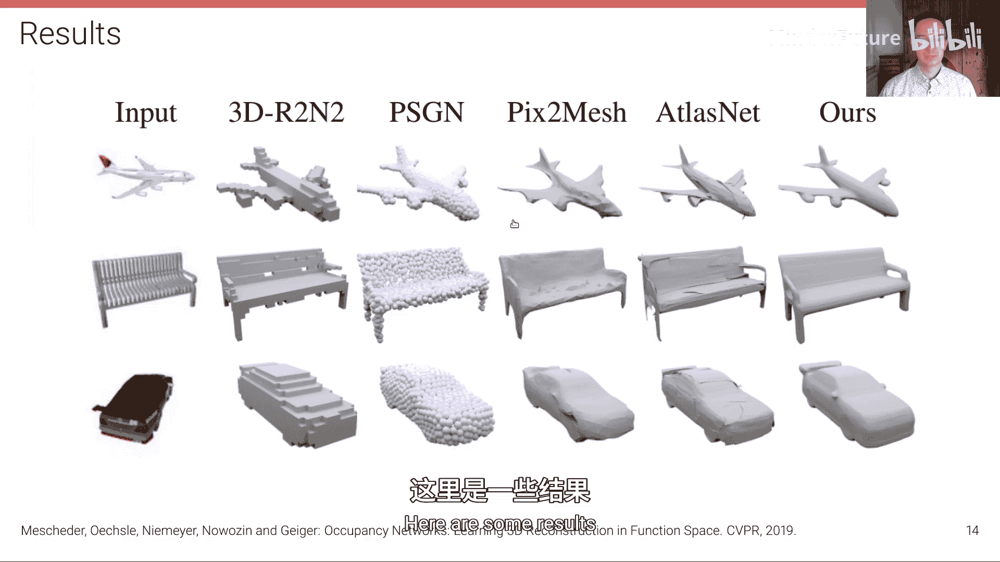
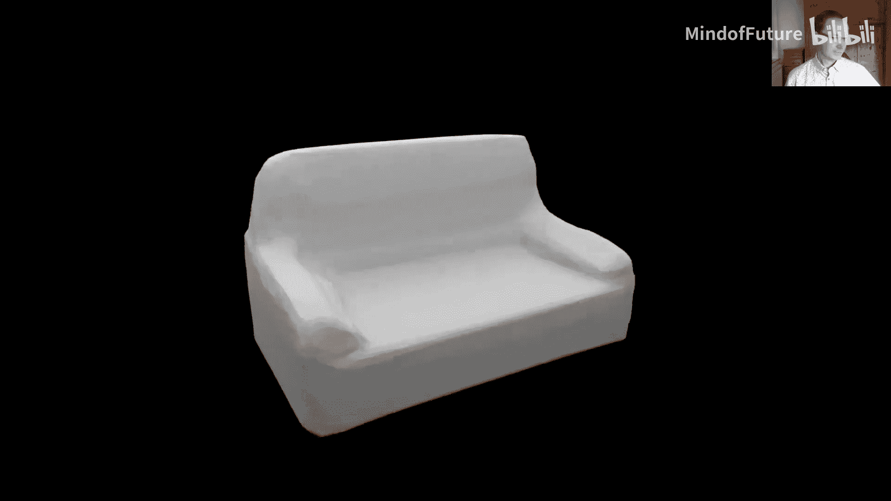
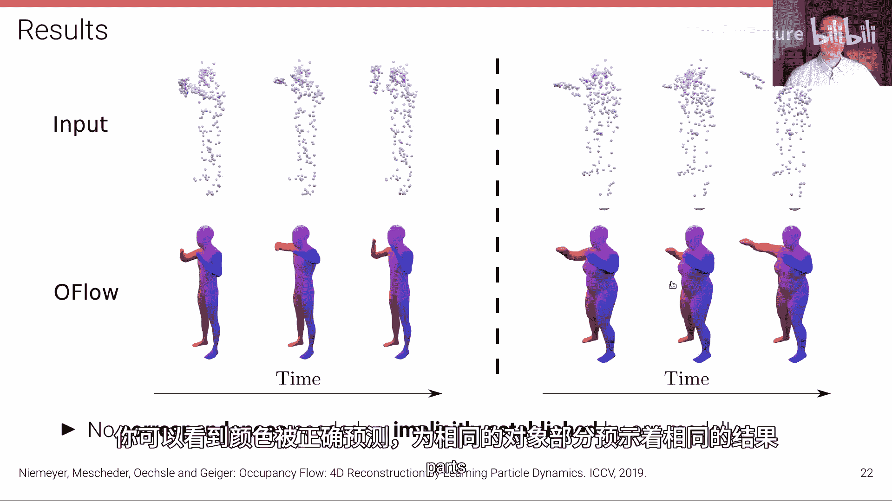
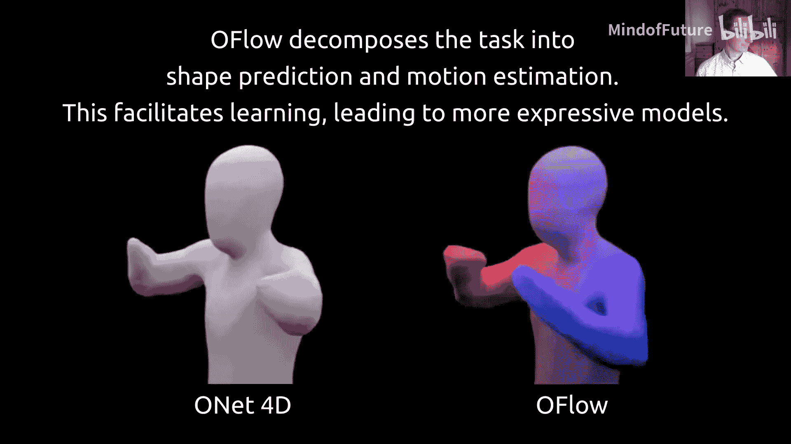
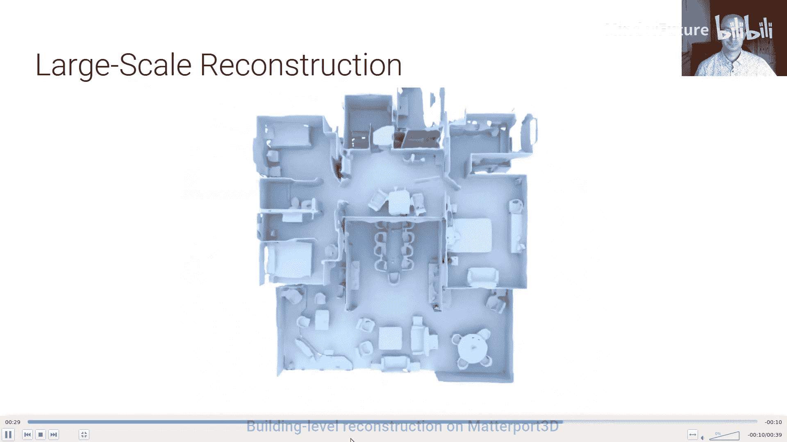

# 032：基于坐标的网络 - 隐式神经表示

在本节课中，我们将要学习一种新颖的3D表示方法——隐式神经表示。我们将探讨如何利用神经网络隐式地表示形状、外观和运动，并了解其相对于传统显式表示方法的优势。

## 单元 1：形状、外观与运动的基本隐式神经表示

上一节我们介绍了课程概述，本节中我们来看看隐式神经表示的基本概念。

这是之前展示过的一张幻灯片，它描述了一个传统的3D重建流程。输入是一组图像，我们推断相机姿态，例如使用光束法平差。然后我们建立密集对应关系，通过立体视觉或多视图立体视觉生成深度图。最后，我们将这些深度图融合成一个更连贯的全局3D场景重建。

这个流程虽然可行，但除了部分环节可能用到学习技术，我们并未广泛使用学习，特别是没有回答一个核心问题：是否可能直接从一张或多张图像，甚至从一张图像出发，获得一个物体的完整3D重建？这正是我们想探讨的：能否从数据中学习3D重建？

这是一个高度依赖机器学习或数据驱动的问题。学习需要数据，幸运的是，在过去十年左右，许多3D数据集已公开可用。例如，通过主动光照扫描系统等技术获取的数据集，或者由艺术家设计的CAD模型集合，如ShapeNet数据集。近期还有像Matterport这样的数据集，尝试重建整个建筑。

如果我们想构建一个模型，学习从一张或多张输入图像直接预测形状，必须回答一个问题：什么是好的输出表示？输入表示很明确，最简单的情况就是一张二维图像，可以用标准的二维卷积网络处理。但解码器应该是什么？特别是，什么是好的输出表示？

以下是人们考虑过的几种输出表示：

*   **体素表示**：这是像素表示在三维中最简单的扩展。体素是像素的三维等价物，它将连续的3D世界离散化为规则的3D网格。虽然易于用神经网络处理，但其主要问题是内存消耗巨大，限制了输出分辨率，且引入了“曼哈顿世界”偏差。
*   **点集表示**：点集将表面离散化为3D点。其难点在于不建模连通性或拓扑结构，需要后处理算法提取表面，且通常能表示的点数有限。
*   **网格表示**：网格将3D空间离散化为顶点和面。问题在于，由于其复杂的结构，神经网络很难预测出不自交的表面。

在我们的CVPR 2019工作中，我们尝试摆脱这些离散化表示，转而隐式地表示表面。其优势在于可以表示任意拓扑结构，理论上支持任意分辨率，且内存占用低，不受限于任何特定的类别模板。

核心思想是不显式地表示3D形状，而是将表面视为一个非线性分类器的决策边界。例如，在二维中，红色点表示物体内部（占据值1），蓝色点表示外部（占据值0）。训练一个分类模型，使其最优地分离内部和外部点，这个决策边界就是我们认为的表面。因此，表面由该模型的参数隐式表示，需要通过后处理步骤提取。

具体来说，我们训练一个分类器，反复从体积中采样点（我们知道它们是在内部还是外部），并调整神经网络的权重，使决策边界越来越接近理想的表面边界。这需要完整的3D监督，即需要能够查询任何3D点是在形状内部还是外部。

重复一下，我们不显式表示3D形状，而是将物体表面视为非线性分类器的决策边界。我们称这个分类器为**占据网络**，因为它是一个带有参数θ的神经网络。它将一个3D位置（即点的坐标）加上某个条件（例如输入图像或点云的编码）映射到一个介于0和1之间的占据概率。如果网络预测1，则该点很可能在物体内部；如果预测0，则很可能在外部。

一些说明：函数f_θ建模了一个连续的占据场。也可以建模有符号距离函数，这在之前的讲座中很有用，但本讲座中我们坚持使用更简单的占据概率模型。

为了实现这个模型，我们需要定义神经网络架构f_θ。我们使用一个非常简单的多层感知机，它是一个由五个块组成的残差网络。我们有一个编码器（例如2D卷积网络）来产生一个固定长度的条件向量。这个条件在多个位置被注入到残差网络中。网络的输入是一批3D点，输出是每个点的占据概率。

我们如何训练这个模型？这是一个简单的分类任务，因此可以使用标准的二元交叉熵损失进行训练。我们还可以构建一个变分占据编码器，这本质上是将变分自编码器模型应用于隐式形状表示的思想。

由于这是一个隐式模型，我们无法直接得到网格。因此，我们必须从这个隐式表示中提取网格。我们使用一种称为多分辨率等值面提取的技术。它通过查询占据网络来增量地构建一个八叉树。我们从粗网格开始，查询网格点，找到跨越表面的单元格，然后细分这些单元格并重复查询，直到达到所需的粒度。最后，我们运行移动立方体算法来提取三角形网格。整个过程大约需要一到三秒。

以下是一些结果：输入是图像，右边是体素、点集、网格生成网络等基线方法的结果，以及我们方法的输出。可以看到，隐式表示能够轻松处理复杂拓扑并产生平滑表面。这同样适用于点云形状重建、体素超分辨率等任务。我们还展示了生成模型的潜在空间插值结果。

## 单元 2：从形状到外观

上一节我们介绍了如何用隐式网络表示形状，本节中我们来看看如何将其扩展到表示外观。

将隐式模型思想扩展到颜色是相当直接的。我们在2020年3DV上发表的工作《学习隐式表面光场》中，尝试通过不仅以输入图像为条件，还以某些3D几何形状为条件，来建模视图相关的外观。我们想训练这个模型，使得之后我们不仅可以改变视角，还可以操控光照。

我们建模一个函数，它将3D点位置、观察方向V和光源位置L映射到一个RGB颜色值。这被称为表面光场。模型概述如下：图像编码器与之前相同，将输入图像编码为潜在向量c。输入形状通过几何编码器编码为全局形状代码s。然后，我们取物体表面的任意点，首先查询一个外观场以获得特征向量，然后这个光照模型（同时以光照设置和观察方向为条件）产生该3D点渲染到图像中的像素颜色。我们最小化预测图像与真实图像之间的重建损失。该模型在通过基于物理的光传输渲染的椅子数据集上进行训练。

以下是一些结果：使用真实几何作为输入时，我们的结果比2D基线方法更一致，能够建模高光和阴影。使用推断几何时，所有输出仅从单个2D RGB图像生成。然而，该模型仅在椅子上训练，因此无法预测椅子以外的物体。

## 单元 3：从外观到运动

上一节我们探讨了外观表示，本节中我们来看看如何表示运动。

表示3D运动的一种简单方法是将占据网络的思想扩展到4D。但这很困难，因为维度灾难，且4D数据较少。因此，我们改为仅使用3D占据网络表示特定时间点的形状，然后通过一个时空连续的矢量场来表示运动。这仍然是一个需要预测的4D函数，但相比随时间演变的形状，它是一个连续得多的对象，因此模型更容易学习。

位置S与速度V之间的关系由一个简单的常微分方程给出。由于ODE是可微的，我们可以将其用于模型中并反向传播梯度。模型尝试给出离散时间点的真实形状，取任意点，通过由速度场（其本身以输入为条件）隐含的ODE将其扭曲到时间t=0的位置，然后让占据网络正确预测该点的类别标签。整个过程是端到端可学习的，并且我们不需要任何通常此类任务所需的对应关系，因为对应关系由模型隐式建立。

以下是一些输入和输出示例，展示了点云补全任务的结果。与朴素的4D占据网络方法相比，这种“占据流”模型表达能力更强，受维度灾难的影响更小。

## 单元 4：从物体到场景

我们讨论了表示形状、外观和运动，但所有这些结果都是在相对小尺度的场景（特别是单个物体）上取得的。我们想知道，是否也能使用这种输出表示来预测更大尺度的场景，例如整个房间甚至整个建筑。

到目前为止，我们所见的隐式神经表示有两个重要的局限性。第一个局限是，我们预测的是一个全局潜在代码作为输入条件。对于一个128维的向量来说，要表示整个场景的所有可能性非常困难，通常会导致几何过于平滑。第二个局限是，这种全连接网络架构本质上无法利用平移等变性，而我们知道这对于建模图像或3D场景至关重要。

如果我们将朴素的隐式占据网络应用于比单个物体更复杂的场景，结果并不理想。模型只能正确预测地面等常见元素，而无法正确预测任何物体。

因此，我们在ECCV 2020上发表的工作《卷积占据网络》中，尝试将隐式建模和卷积网络的优点结合起来，以弥补上述两个局限。我们考虑的任务是基于点云的形状补全。

具体做法是：首先，我们使用点编码器对3D点进行局部编码。我们在一个离散结构（如地平面上的2D网格）上计算局部特征。然后，我们使用一个2D卷积网络在这个“图像”上聚合特征，从而利用平移等变性。要查询某个3D点的占据状态时，我们通过双线性插值获取该点对应的特征，并将插值后的特征和点坐标输入到一个更浅的读出MLP中，以预测内部/外部类别。我们也可以将其扩展到3D体素网格，使用三线性插值。

与朴素占据网络相比，这种方法带来了更高的精度和更快的收敛速度。更重要的是，它允许表示场景。即使在合成房间上训练，也能应用于真实扫描数据。最后，我们可以将此模型扩展为全卷积模型，并应用于像Matterport这样包含多个房间的整个建筑的大型场景。由于模型是全卷积的，我们可以以滑动窗口的方式分块处理，从而生成大规模的重建结果。

---

本节课中我们一起学习了隐式神经表示的核心思想。我们从如何用神经网络隐式表示3D形状开始，了解了占据网络的基本原理。接着，我们探讨了如何将此思想扩展到建模视图相关的外观，即表面光场。然后，我们学习了如何通过结合常微分方程来表示物体的连续运动。最后，我们指出了朴素隐式表示的局限性，并介绍了卷积占据网络如何通过结合局部特征提取和卷积结构，成功地将隐式表示应用于大规模场景的重建。这种表示方法因其灵活性、紧凑性和高质量的输出，已成为计算机视觉领域的一个重要研究方向。