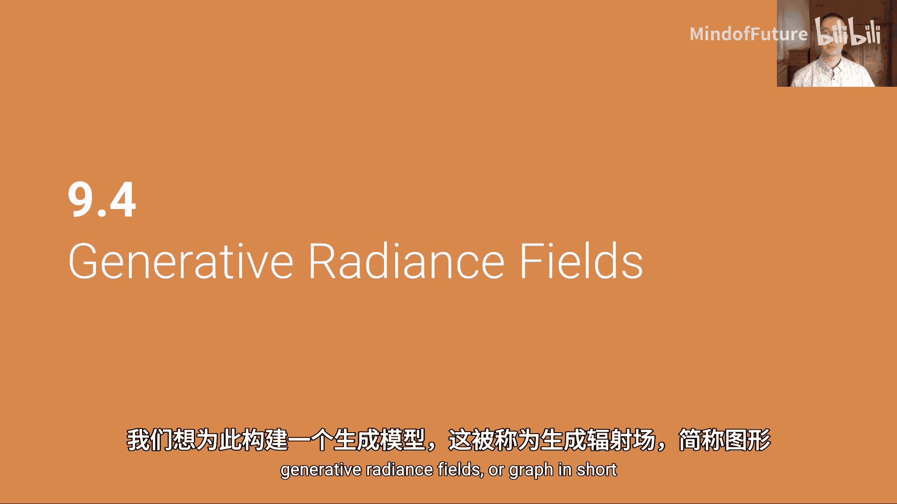
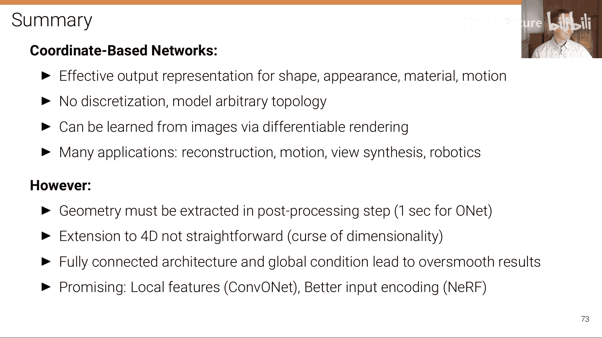

# 035：基于坐标的网络 - 生成式辐射场 🎨

在本节课中，我们将学习如何将上一单元介绍的神经辐射场（NeRF）表示，构建成一个通用的生成式模型。我们将探讨如何仅使用特定物体类别的2D图像集合，来构建一个能够逼真渲染出新图像的生成式3D模型。这与之前优化特定场景的NeRF不同，这里我们假设不知道相机姿态，仅有一组图像。

## 生成对抗网络回顾

在开始之前，让我们快速回顾一下生成对抗网络（GANs）。生成式模型是指任何从数据分布 **P_data** 中学习一个概率分布 **P_model** 来表示该数据分布的模型。

在某些情况下，模型会显式地估计 **P_model**，从而允许评估样本 **x** 的近似似然 **P_model(x)**。但在许多情况下，这是不可行的，模型只能从 **P_model** 中生成样本。GANs 就是这个家族（称为隐式模型家族）的突出例子。这里的“隐式”意味着似然没有被显式表示，而是隐式地存在。

GANs 提供了一个无需显式似然的模型训练框架。其典型结构如下：
*   一个从某个噪声分布中采样的潜在编码 **z**。
*   一个生成器网络 **G**，接收 **z** 并生成数据（例如2D图像）。
*   一个判别器网络 **D**，接收图像并尝试分类它看到的是来自真实数据分布 **P_data** 的真实图像 **x**，还是来自生成器分布 **P_model** 的生成图像 **G(z)**。

我们使用一个两人极小极大博弈范式来训练这个模型，其价值函数定义如下：

**min_G max_D V(D, G) = E_{x~p_data(x)}[log D(x)] + E_{z~p_z(z)}[log(1 - D(G(z)))]**

判别器 **D** 试图最大化其正确分类的能力，而生成器 **G** 试图最小化判别器识破其生成图像的能力。理想情况下，当生成器变得足够好时，判别器将无法区分，对所有样本都赋予0.5的概率。

理论上，在非常强的假设下（例如每次迭代都能达到最优判别器 **D***，且模型有足够容量），这个极小极大博弈能够恢复真实数据分布。但在实践中，我们使用交替优化：先对 **D** 进行几步优化，再对 **G** 进行一步优化，通过足够小的学习率来保持 **D** 接近其最优解。

## 将GAN思想应用于辐射场

现在，让我们将这个思想应用到辐射场上。我们希望为辐射场构建一个生成式模型。具体流程如下：
1.  采样一个潜在编码 **z**，它捕获了3D点位置、观察方向、物体形状和外观信息，以及相机姿态。
2.  对于给定的3D点 **x** 和观察方向 **d**，使用辐射场预测颜色 **c** 和密度 **σ**。
3.  使用体渲染将场景渲染成图像。
4.  目标是让一个应用于该图像的2D判别器无法区分渲染图像和数据集中的真实图像。

整个模型仅使用2D图像进行训练。这就是生成式辐射场（Generative Radiance Fields，简称GRAF）背后的核心思想。一个主要挑战是，由于我们只有图像作为观测，无法直接在3D空间应用判别器，必须使用体渲染，而这个过程很慢。GRAF论文的一个贡献就是如何使这个过程变得可行。

## 逐步构建GRAF模型

接下来，我们一步步构建这个模型。首先，我们有一个基础的辐射场，它接收3D点 **x** 和观察方向 **d**（经过位置编码 **γ**），并映射到颜色 **c** 和密度 **σ**。然后，对于一条射线，我们沿射线采样多个点，为每个点计算颜色和密度，最后应用体渲染（用 **π** 表示）来合成像素颜色。这就是NeRF的工作方式。

GRAF在此基础上增加了两个额外的潜在编码：
*   形状潜在编码 **z_s**
*   外观潜在编码 **z_a**

它们也从标准正态分布中采样，负责对渲染图像的物体形状和外观进行条件建模。

由于渲染整张图像计算量过大，我们改为只渲染一小块图像块（例如32x32像素）。我们随机采样一个2D图像网格的位置和步长，只对这些像素位置执行上述渲染过程。这样，我们得到了一个预测的图像块。

以下是生成图像块的关键步骤：
1.  随机采样相机姿态、形状码 **z_s**、外观码 **z_a** 和图像块采样模式 **ψ**。
2.  对于采样模式确定的每个像素位置，执行NeRF式的体渲染，生成像素颜色。
3.  将所有渲染的像素组合成图像块 **I_hat**。

然后，我们可以应用一个标准的2D卷积判别器。这个判别器非常快，它需要区分生成的图像块和从真实图像中按相同采样模式 **ψ** 随机采样的真实图像块 **I**。

这样，我们就将问题简化了：无需渲染整张图像，只需稀疏采样图像块并进行比较，这大大降低了计算和内存需求，使得在生成对抗网络框架下训练成为可能。图中蓝色部分是生成器（GAN的生成器），红色部分是判别器。判别器是一个类似标准GAN的2D卷积网络，而生成器则生成一个3D结构，并将其渲染成图像块供判别器判断。

## 条件辐射场网络架构

条件辐射场网络架构的设计确保了形状和外观编码的解耦。具体来说：
*   体积密度 **σ** 仅依赖于3D点 **x** 和形状码 **z_s**，而不依赖于观察方向 **d** 和外观码 **z_a**。这迫使网络首先用 **z_s** 来建模形状。
*   预测的颜色 **c** 则额外依赖于观察方向 **d** 和外观码 **z_a**。由于形状信息已在前层处理，颜色预测头具有较小的容量，用于根据这些条件调整颜色，从而能够建模依赖于视角的外观（例如镜面反射材料）。

## 结果展示与总结

GRAF方法能够从无姿态的2D图像集合中学习，生成高分辨率且3D一致的图像。它还能通过独立操纵形状码 **z_s** 和外观码 **z_a** 来分别控制生成物体的形状和外观。

最后，值得一提的是GIRAFFE工作，它扩展了GRAF的思想，用于组合式场景的生成，能够从图像集合中解耦出场景中的不同物体，并因此获得了CVPR 2021最佳论文奖。

## 坐标网络总结

本节课我们一起学习了基于坐标的网络。我们来总结一下：
*   **坐标网络** 是表示形状、外观、材料和运动的一种有效隐式表示。
*   **优点**：它们不需要任何离散化，能够建模任意拓扑结构，并且可以通过可微分渲染从图像中学习。应用领域包括3D重建、运动估计、视图合成，甚至在机器人学和自动驾驶中也显示出应用潜力。
*   **挑战**：由于是隐式表示，提取几何等属性需要后处理步骤；扩展到更高维度会面临维度灾难；全连接架构和全局条件化可能导致结果过于平滑。
*   **未来方向**：包括使用局部特征（如卷积或基于点的特征）、更好的输入编码（如NeRF中的位置编码），以及新的网络架构（如SIREN）。

基于坐标的网络为计算机视觉中的3D内容生成和理解提供了强大而灵活的框架。

---
**本节课中，我们一起学习了如何将神经辐射场扩展为生成式模型（GRAF），它能够仅从无姿态的2D图像中学习生成3D一致且高分辨率的图像。我们还回顾了GAN的基本原理，并总结了基于坐标的网络的总体优势与挑战。**