# 036：图像分类 📸

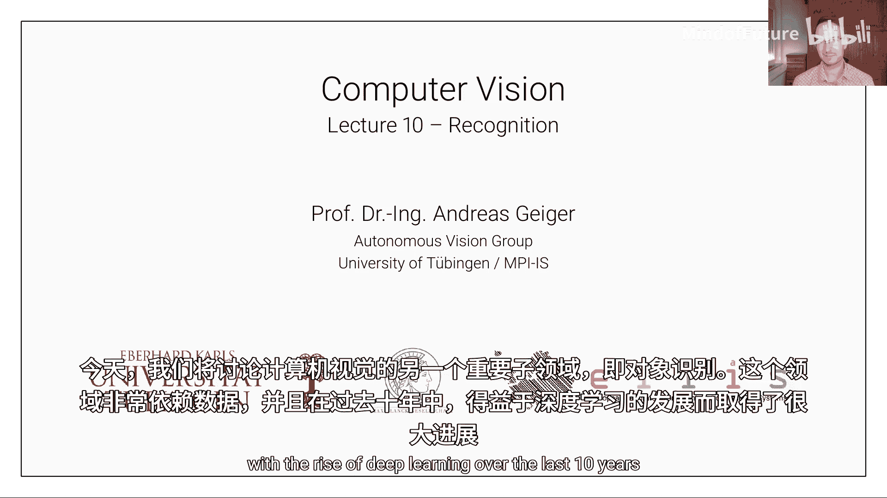

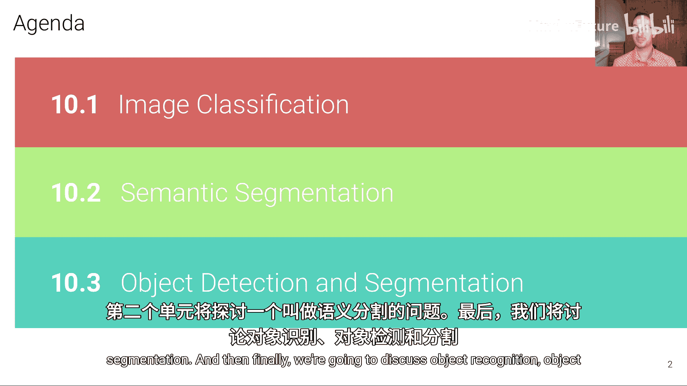

在本节课中，我们将要学习计算机视觉中的一个核心子领域——识别，并重点探讨其基础任务：图像分类。在过去的课程中，我们主要关注了计算机视觉的几何方面。本节我们将转向一个数据驱动且因深度学习而取得巨大进展的领域。

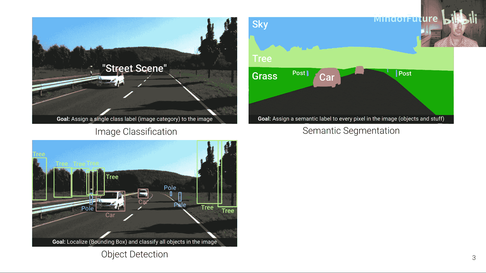

本讲座分为三个单元。在第一单元，我们将介绍计算机视觉的基本宏伟目标之一：图像分类。在第二单元，我们将探讨一个称为语义分割的问题。最后，我们将讨论物体识别、物体检测与分割。

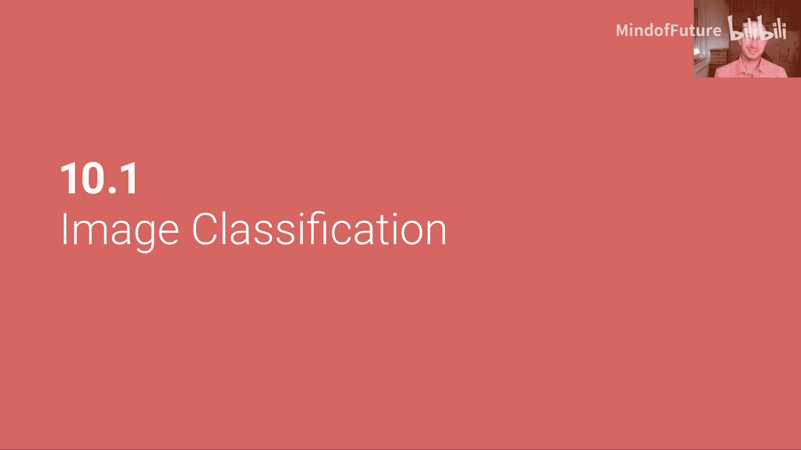

在开始之前，我们先简要了解一下这些问题及其相互之间的区别。

## 识别任务概览

以下是四种主要的识别任务及其区别。

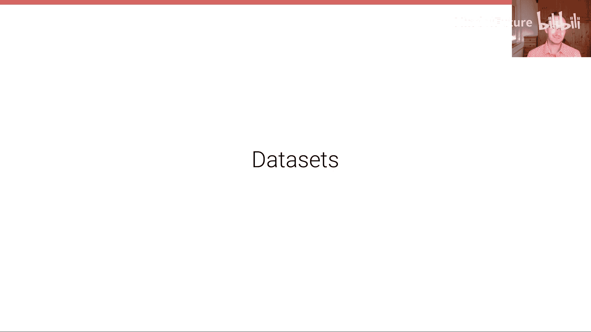

*   **图像分类**：给定一张图像，目标是为整张图像分配一个单一的类别标签（如图像类别）。例如，为一张图像分配“街景”标签。
*   **语义分割**：目标是为图像中的每一个像素分配一个语义类别标签（如“汽车”、“天空”、“树木”）。它不区分同一类别的不同个体。
*   **物体检测**：目标是通过二维边界框定位物体，并对其进行分类。它只针对可数的物体类别（如汽车、行人），而不处理“天空”这类“东西”类别。
*   **语义实例分割**：目标是为属于物体的每个像素同时分配一个语义标签和一个实例标签。这使得即使相邻的同类物体（如两辆汽车）也能被区分开。

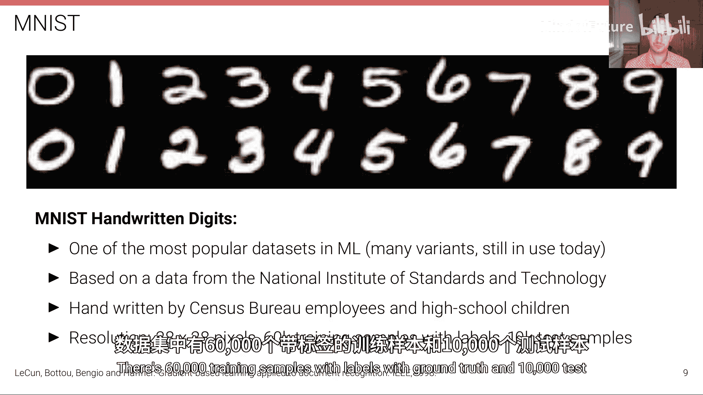

以上是我们要探讨的四个问题。现在，让我们从图像分类开始。

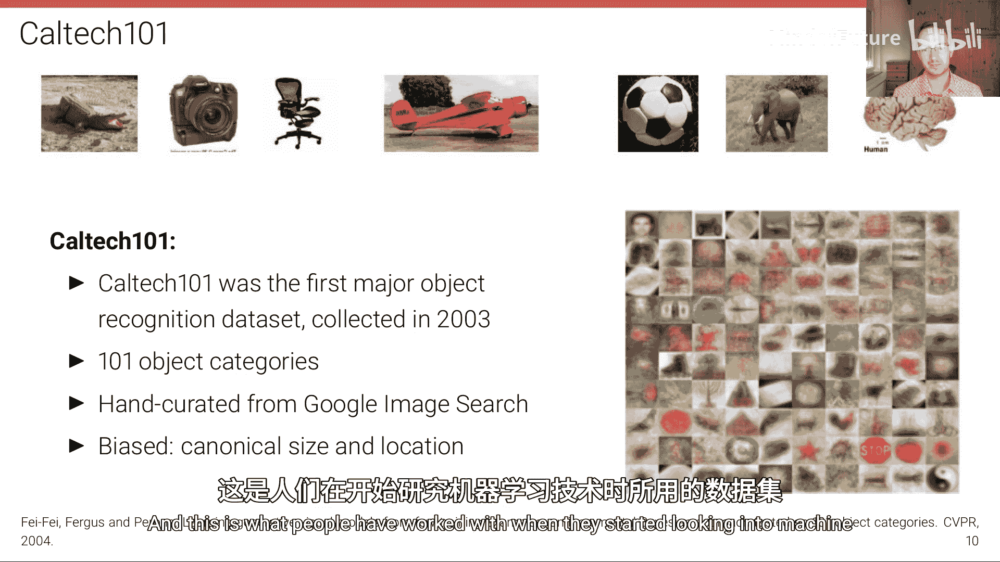

## 图像分类问题

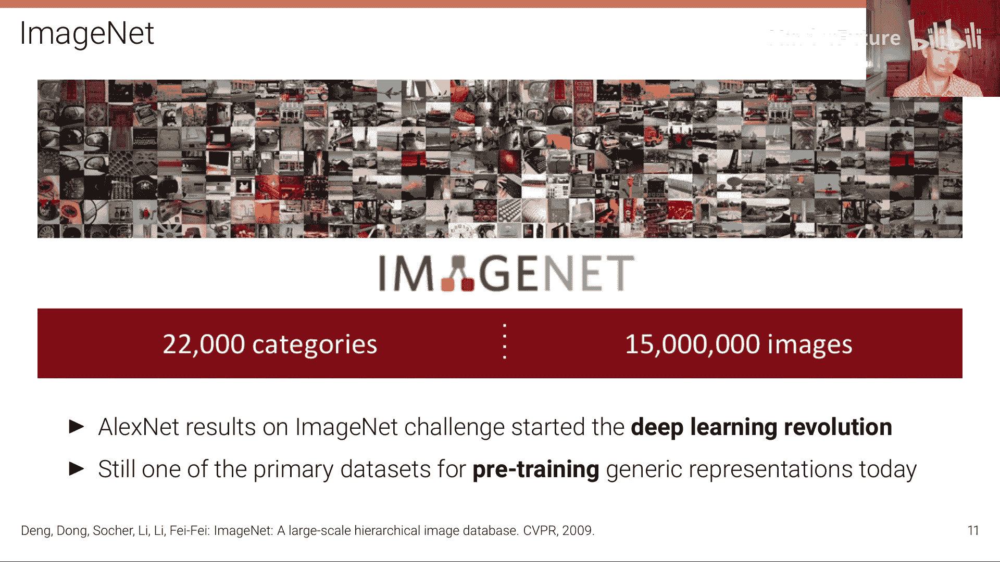

问题定义如下：输入是一张图像，我们希望为该图像分配一个单一的类别标签或图像类别，例如“街景”。

为什么这是一个有趣的问题？首先，它本身可以是一个有用的任务，例如识别手写数字或基于关键词搜索图像。其次，这个规范简单的问题（输入是图像，输出是离散的类别标签）可以使用标准的损失函数（如交叉熵）来学习模型。因此，图像分类长期以来一直是计算机视觉中一个困难且标准化的基准任务，因为它需要对图像内容进行深入理解和推理。

此外，图像分类也被证明是一个有用的高级代理任务，用于学习能够很好地迁移到新任务和新领域的表征。通过在大规模标注数据集上预训练一个分类模型，我们可以获得强大的视觉表征，然后在数据量较小的目标任务（如分割、检测）上进行微调，从而取得优异性能。

那么，我们如何对图像进行分类或归类呢？早期的尝试试图通过手工设计规则来解决这个问题，例如基于边缘和角点关系来推断图像类别。但这些尝试都失败了，因为物体的形状和外观过于复杂，难以手动描述。这正是机器学习和标注数据集在解决此问题上发挥根本作用的原因。

## 经典数据集

让我们看一些在图像分类发展史上具有里程碑意义的数据集。

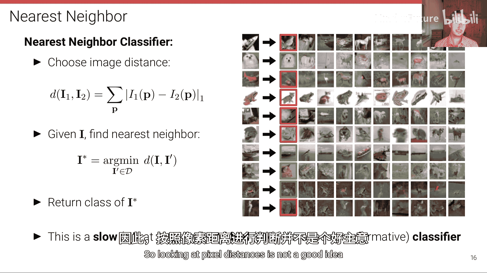

*   **MNIST**：一个在机器学习社区非常著名的数据集，包含手写数字。它有60,000个训练样本和10,000个测试样本，图像分辨率较低。
*   **Caltech 101**：第一个主要的物体识别数据集，包含101个物体类别。图像中的物体通常居中、姿态规范、背景简单，按当今标准来看相对简单。
*   **ImageNet**：一个推动深度学习兴起的关键数据集。它包含约22,000个类别，用于年度挑战赛的通常有1,000类。图像中物体姿态复杂、类别区分难度高，拥有数百万张图像。它至今仍是预训练通用视觉表征的主要数据集之一。

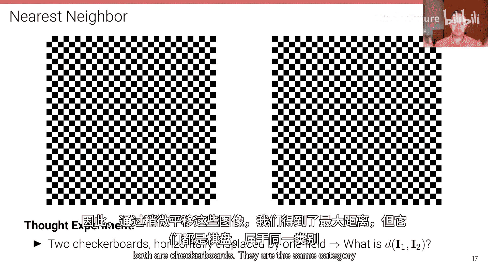

## 图像分类的挑战

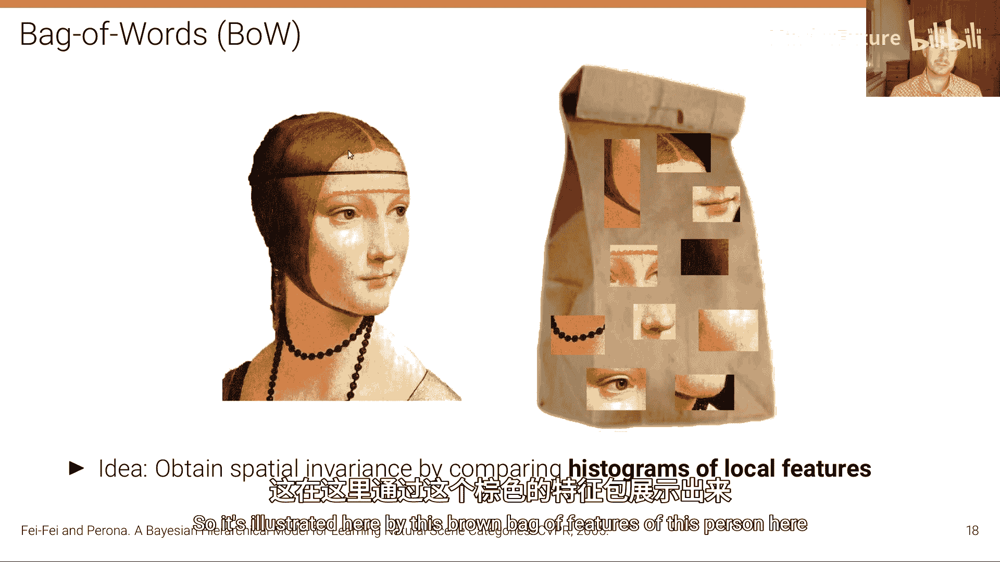

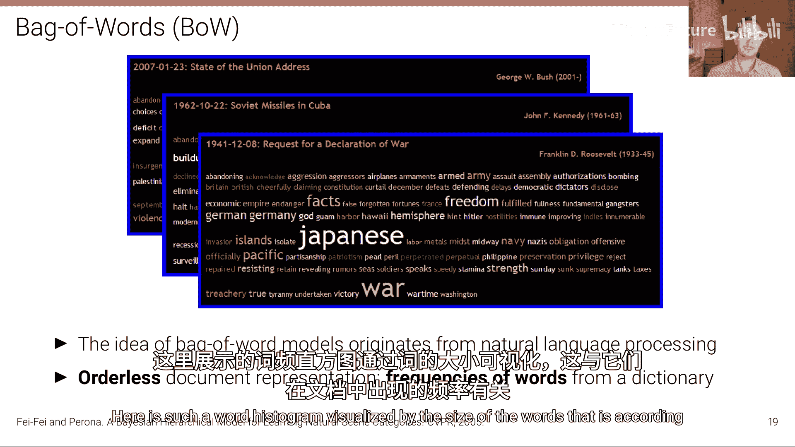

图像分类之所以不简单，主要面临以下挑战：

*   **类别数量庞大**：估计有10,000到30,000个主要图像类别，区分相似类别（如不同犬种、鸟类）很困难。
*   **类内差异**：同一类别的物体（如椅子）在形状、颜色、外观上可能差异巨大。
*   **视角变化**：从不同视角观察同一物体，像素值会发生剧烈变化。
*   **光照变化**：光照条件不同会彻底改变图像的外观和强度。
*   **遮挡**：物体可能被部分遮挡。
*   **背景杂乱**：物体可能存在于复杂背景中。
*   **形变**：某些物体类别（如猫）本身具有很大的形变。

## 从简单模型到深度学习

我们首先看一个简单的模型：最近邻分类器。给定查询图像，它在整个训练集中寻找像素距离（如L1距离）最近的图像，并返回其类别标签。

**最近邻分类公式**：
`预测类别 = argmin_{i' ∈ 训练集} D(I, I')`，其中 `D` 是图像间距离。

然而，这种方法效果不佳。首先，在推理时进行最近邻搜索速度很慢。其次，像素空间中的距离信息量不足，无法捕捉语义相似性。一个思想实验可以说明问题：将棋盘图像水平平移一个格子，两幅图像的像素差异会最大，但它们的类别完全相同。

接下来，社区采用了更成功的**词袋模型**。其核心思想是通过比较局部特征的直方图来获得空间不变性，从而消除特征位置的依赖性。具体步骤是：1) 提取图像局部特征（如SIFT描述子）；2) 对所有训练图像的特征进行聚类（如K-means），形成视觉词汇表；3) 将每张图像的特征量化到最近的视觉词，生成视觉词频直方图；4) 基于这些直方图训练分类器（如SVM）。

词袋模型比原始像素方法好得多，但性能最终会饱和，因为其中包含太多手工设计的组件（如SIFT特征、聚类方法），而学习部分太少。

最终的解决方案是**深度学习**：使用卷积神经网络（CNN）从图像像素端到端地学习整个模型。所有模块（绿色部分）的参数都是可训练的。2012年，AlexNet在ImageNet挑战赛上大幅超越传统方法，标志着深度学习在计算机视觉领域的突破。此后，性能持续提升，并超越了人类水平。

## 卷积神经网络（CNN）回顾

CNN是解决图像分类任务的主要模型。典型的CNN（如VGG网络）包含三种类型的层：

1.  **卷积层**：使用权重共享的卷积核在输入上滑动计算，大幅减少参数量，并引入**平移等变性**（输入平移导致输出相应平移）。
2.  **下采样层（如池化层）**：降低特征图的空间分辨率（如使用2x2最大池化，步长为2），同时增加感受野。池化通常逐通道进行。
3.  **全连接层**：在空间维度被压缩后（例如通过全局平均池化或展平操作），使用全连接层进行最终分类。

一个关键特性是，通过堆叠卷积和池化层，网络最终能够实现**平移不变性**，这对于分类任务至关重要。

## 输出层与损失函数

对于图像分类，我们使用**Softmax输出层**和**交叉熵损失函数**。这是一个自然的选择，因为我们的目标是预测一个类别分布。

我们假设标签 `y` 服从一个由网络参数化的**分类分布**。网络输出一个“得分”向量 `s`，通过Softmax函数将其转换为概率分布：
`P(y=c | x, W) = softmax(s)_c = exp(s_c) / ∑_k exp(s_k)`

然后，我们通过**最大似然估计**来训练网络，这等价于最小化**交叉熵损失**：
`L = - ∑_i ∑_c y_{i,c} log( P(model predicts c | x_i, W) )`
其中 `y_{i,c}` 是第 `i` 个样本的真实标签（one-hot编码）。

Softmax函数鼓励正确类别的得分提高，同时抑制其他类别的得分。它对输入之间的差异敏感，但对所有输入加一个常数不敏感，这一性质可用于实现数值稳定的计算。

## 经典网络架构

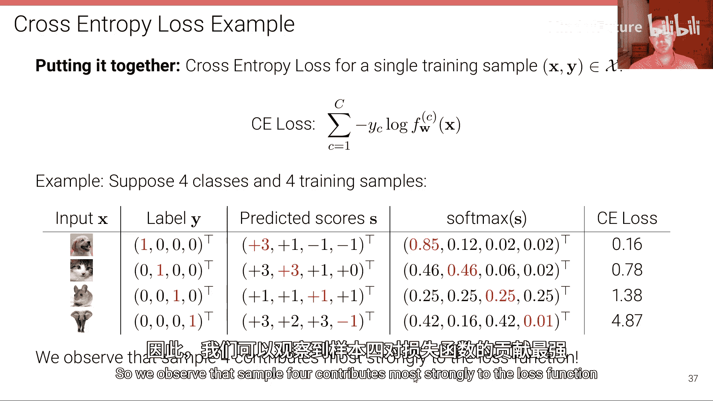

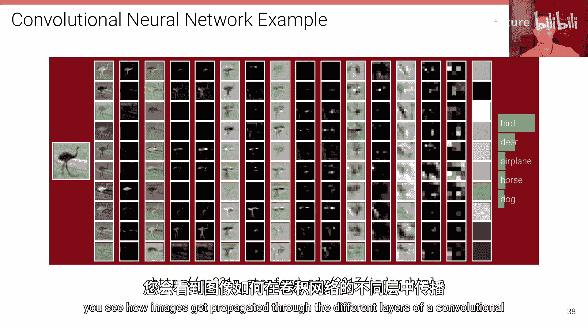

最后，我们简要回顾一些成功的CNN架构：

*   **LeNet-5 (1998)**：早期的成功CNN，结构较浅，主要用于MNIST等小规模问题。
*   **AlexNet (2012)**：深度学习的引爆点，证明了CNN在复杂图像分类任务上的强大能力。
*   **VGGNet (2014)**：表明使用堆叠的3x3小卷积核可以替代大卷积核，在获得相同感受野的同时减少参数量，但全连接层参数仍很多。
*   **Inception / GoogLeNet (2015)**：引入了并行多尺度卷积的“Inception模块”和辅助分类器，以改善梯度流动并训练更深的网络。
*   **ResNet (2016)**：通过引入**残差连接**，让网络层学习残差映射，使得训练极深的网络（如152层）成为可能，成为当前许多领域的主流架构。

这些架构的演进在精度、计算复杂度和参数量之间取得了更好的平衡。

## 总结 🎯

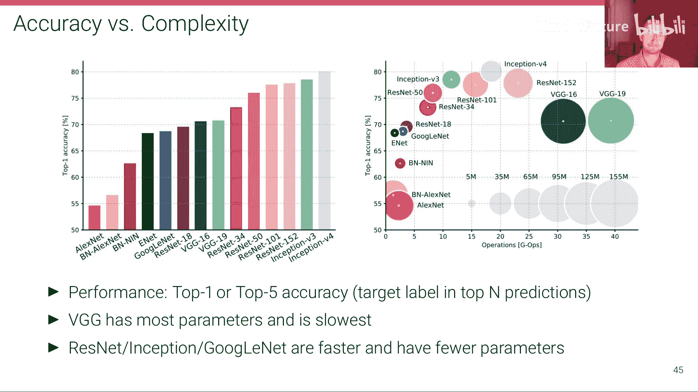

本节课我们一起学习了计算机视觉中识别领域的基础任务——图像分类。我们了解了图像分类的定义、意义及其作为预训练代理任务的价值。回顾了从简单最近邻分类器、词袋模型到深度学习解决方案的发展历程。我们深入探讨了卷积神经网络的核心组件（卷积、池化、全连接层）及其特性，并解释了Softmax输出层与交叉熵损失函数的工作原理。最后，我们简要回顾了推动图像分类性能不断提升的几个关键神经网络架构。理解图像分类是进入更复杂视觉识别任务（如分割、检测）的重要基础。