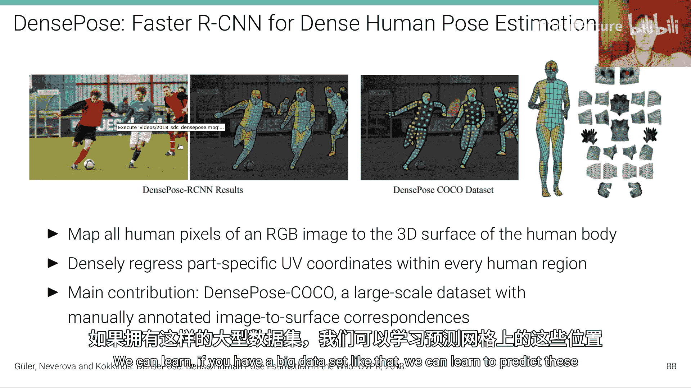
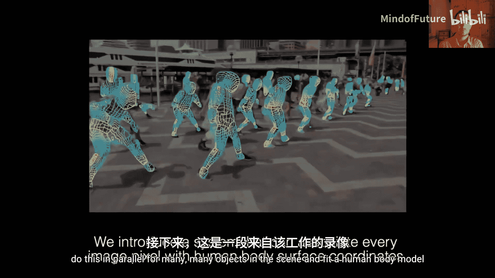
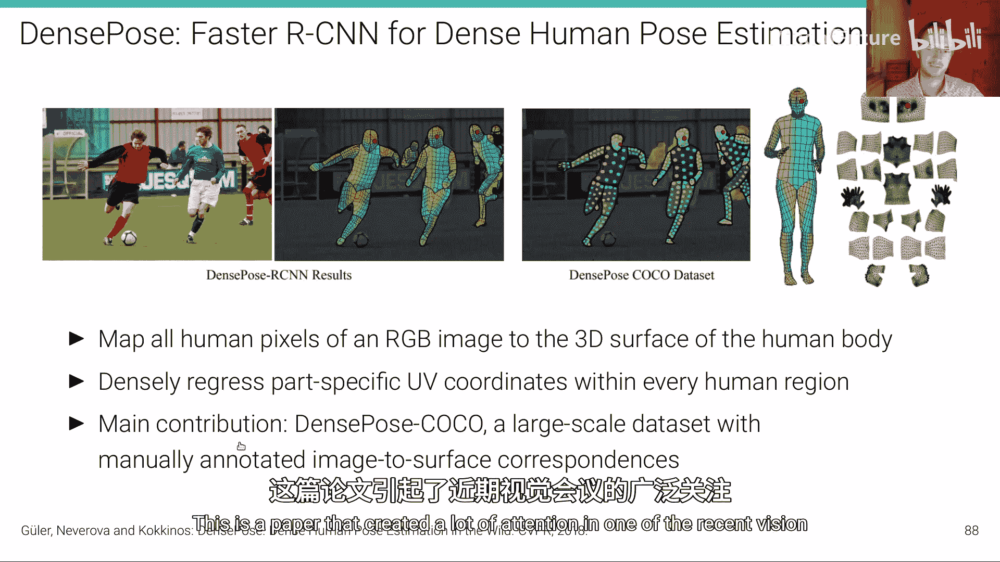

# 038：目标检测与分割 🎯

在本节课中，我们将要学习计算机视觉中的核心任务之一：目标检测，以及与之相关的实例分割等任务。我们将从目标检测的基本定义和评估方法开始，逐步深入到经典的滑动窗口检测、基于深度学习的现代方法，并最终了解如何扩展这些方法来处理更复杂的输出，如像素级分割和3D检测。

## 目标检测概述

目标检测的目标是定位并分类图像中的所有物体。我们不仅需要知道物体是什么（分类），还需要知道它在哪里（定位）。定位通常通过一个紧密贴合物体的二维边界框来表示，同时为每个边界框分配一个类别标签。例如，在一张街景图中，我们需要检测出汽车（类别5）和电线杆（类别7），并为它们各自绘制边界框。

目标检测有广泛的应用，例如自动驾驶中的导航和避障、机器人抓取等。一个典型的例子是Mobileye公司的驾驶辅助系统，它通过摄像头检测前方车辆并估算距离，从而在车辆过于接近时发出警告。

## 问题定义与评估指标

### 输入与输出
*   **输入**：通常是一张RGB图像。对于3D目标检测，输入也可以是激光雷达点云。
*   **输出**：一组带有类别标签和置信度的2D或3D边界框。置信度对于后续处理至关重要，例如，低置信度的预测可能被忽略，而高置信度的预测则需要认真对待。

无论是2D还是3D检测，图像中的物体数量和大小都是未知的，这使得目标检测成为一个复杂的结构化预测问题。

### 交并比
在讨论算法之前，我们需要一个衡量检测好坏的指标。与语义分割类似，我们使用**交并比** 来衡量预测边界框与真实标注框之间的重叠程度。

**公式**：
`IoU = (预测框 ∩ 真实框) / (预测框 ∪ 真实框)`

如果预测框与真实框完全重合，IoU为1。在实践中，IoU达到0.7通常被认为是很好的检测，而低于0.5则被认为是较差的检测。因此，在多数评估场景中，通常将IoU阈值设为0.5。

### 多目标评估：平均精度
对于包含多个物体的图像，我们需要一个更全面的评估指标。以下是评估流程：

首先，目标检测器会为每个预测输出一个置信度。通过改变置信度阈值，我们可以得到不同数量的预测结果（高置信度的预测更少，但更可能正确）。

接着，我们将预测框与真实标注框进行**二分图匹配**（例如使用匈牙利算法），为每个真实框分配一个最匹配的预测框，形成一一对应关系。

匹配完成后，我们可以计算以下数量：
*   **真正例**：正确检测到的物体数量（IoU > 0.5）。
*   **假负例**：未被检测到的真实物体数量。
*   **假正例**：错误的检测数量（包括与任何真实框IoU都小于0.5的预测，以及为同一个真实物体产生的多个冗余预测）。

基于这些数量，我们计算两个关键指标：
*   **精确率**：衡量检测结果的准确性。`精确率 = 真正例 / (真正例 + 假正例)`
*   **召回率**：衡量检测出所有真实物体的能力。`召回率 = 真正例 / (真正例 + 假负例)`

理想的检测器需要同时具备高精确率和高召回率。通过不断调整置信度阈值，我们可以得到一条**精确率-召回率曲线**。

**平均精度** 就是这条曲线下的面积。它通过在不同召回率水平下取对应的最高精确率，然后计算平均值得到。AP值越高，说明检测器的综合性能越好。

## 经典目标检测方法

上一节我们介绍了如何评估目标检测器，本节中我们来看看早期的一些经典检测算法。

### 滑动窗口检测
滑动窗口检测是最直观的方法之一。其核心思想是使用一个固定大小的窗口，以一定的步长遍历整张图像。

以下是其基本步骤：
1.  在图像的每个位置和多种尺度上截取图像块。
2.  对每个图像块提取特征。
3.  使用一个分类器（如SVM）判断该图像块是否包含特定目标（如行人、汽车）。
4.  由于目标附近可能会产生多个高置信度的检测，最后需要应用**非极大值抑制** 来去除冗余的、置信度较低的检测框，只保留最好的一个。

这种方法计算量巨大，因为需要在大量位置和尺度上运行分类器。

### HOG特征与DPM模型
为了改进滑动窗口方法，研究者们设计了更好的特征。方向梯度直方图 特征在2005年被提出，并取得了巨大成功。

HOG特征的计算过程如下：
1.  计算图像的梯度幅值和方向。
2.  将图像划分为小的单元格。
3.  为每个单元格计算一个梯度方向的直方图（用梯度幅值加权）。
4.  将所有单元格的直方图连接成一个长特征向量。

HOG特征对小的平移、旋转和形变具有一定的鲁棒性。然而，对于大的形变（如非刚性物体的不同姿态），HOG特征效果有限。

为了解决非刚性形变问题，**可变形部件模型** 被提出。DPM将物体建模为多个部件的组合，并用弹簧模型描述部件之间的空间关系，允许部件在一定范围内移动。虽然DPM在深度学习时代之前是性能最好的模型之一，但其基于图形模型的推理过程非常缓慢。

## 深度学习时代的目标检测

传统方法在特征设计和计算效率上存在瓶颈。深度学习通过数据驱动的方式学习特征，彻底改变了目标检测领域。自2015年以来，基于深度学习的方法在精度上实现了飞跃。

### 两阶段检测器：R-CNN系列
两阶段检测器首先生成候选区域，然后对每个区域进行分类和精修。

**R-CNN** 是这一系列的开创性工作。其流程如下：
1.  **区域提议**：使用传统算法（如Selective Search）从图像中提取约2000个可能包含物体的候选框。
2.  **特征提取**：将每个候选框裁剪并缩放到固定大小，然后分别输入一个卷积神经网络提取特征。
3.  **分类与回归**：使用提取的特征，一方面通过一个分类器（如SVM）预测类别，另一方面通过一个回归器微调边界框的位置。

R-CNN的主要问题是效率低下，因为它需要为每个候选区域独立运行一次完整的CNN前向传播，计算没有共享。

**Fast R-CNN** 对此进行了改进。它首先使用一个全卷积网络处理整张图像，生成一个共享的特征图。然后，对于每个候选区域，通过一个**感兴趣区域池化** 操作，从特征图中提取固定大小的特征。最后，这些特征被送入一个轻量级的全连接网络进行分类和边界框回归。这种方法实现了特征共享，大大加快了速度。

**Faster R-CNN** 的革新在于用神经网络替代了传统的区域提议算法。它在共享的特征图上运行一个**区域提议网络**。RPN是一个小型网络，它在特征图上滑动，为每个位置预设多个不同尺度和长宽比的**锚框**，并预测每个锚框包含物体的概率以及需要调整的偏移量。这样，区域提议、特征提取、分类和回归全部整合进一个可端到端训练的神经网络中。

### 单阶段检测器
除了两阶段检测器，还有更快的**单阶段检测器**，如YOLO和SSD。它们移除了区域提议阶段，直接在单个网络中从特征图预测边界框和类别。虽然速度更快，但其精度通常略低于精心设计的两阶段检测器。

### 提升检测性能的技术
现代检测器还集成了多种技术来提升性能：

**特征金字塔网络** 解决了多尺度检测问题。传统的CNN特征图随着网络加深，分辨率降低，小物体的信息会丢失。FPN通过自顶向下和横向连接的结构，构建了一个具有强语义信息的多尺度特征金字塔，使得模型能在不同尺度的特征图上进行预测，显著提升了对小物体的检测能力。

**Mask R-CNN** 是在Faster R-CNN基础上扩展的实例分割模型。它在原有的分类和边界框回归分支之外，增加了一个**掩码头**分支。这个分支为每个检测到的物体预测一个像素级的二值掩码，精确勾勒出物体的轮廓。此外，Mask R-CNN将RoI Pooling改进为**RoI Align**，使用双线性插值代替取整操作，使特征对齐更精确，从而提升了分割边界的质量。

## 超越2D框：更丰富的输出

基于上述通用框架，我们可以预测比边界框更丰富的输出。

**DensePose** 的目标是预测人体图像中每个像素在3D人体模型表面上的对应坐标。通过训练一个网络来预测这些坐标，我们可以从单张图像中恢复出详细的人体姿态和表面信息。

**3D目标检测** 将框架扩展到3D领域。例如，PointRCNN直接处理点云数据，其结构与Faster R-CNN类似，但输出是3D空间中的边界框。

**Mesh预测** 则更进一步，旨在为2D检测框内的物体预测其完整的3D网格模型。

## 总结与工具

本节课中我们一起学习了目标检测与分割的核心内容。我们从目标检测的基本定义和评估指标出发，回顾了经典的滑动窗口和HOG特征方法。然后，我们深入探讨了深度学习如何革新这一领域，重点介绍了R-CNN系列两阶段检测器的发展脉络，以及Mask R-CNN如何实现实例分割。最后，我们了解了如何将这一框架扩展到3D检测、人体姿态估计等更复杂的任务。

如果你想亲自尝试这些强大的模型，Facebook AI Research开源的**Detectron2** 工具箱是一个绝佳的起点。它提供了多种先进模型的预训练权重和易于使用的代码，方便大家进行实验和开发。