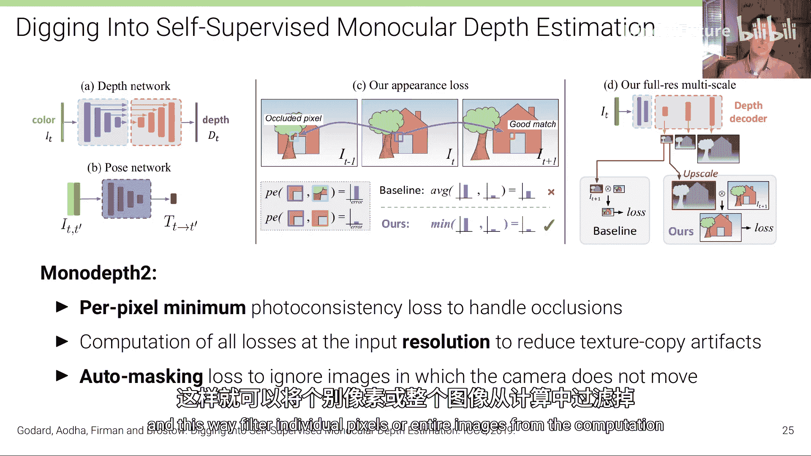
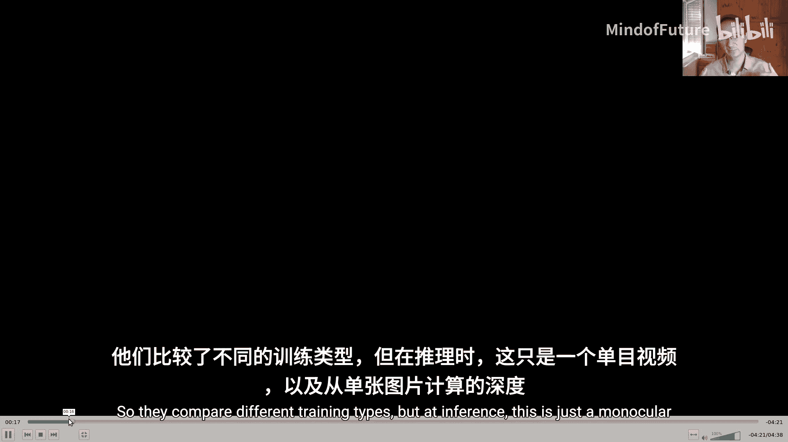
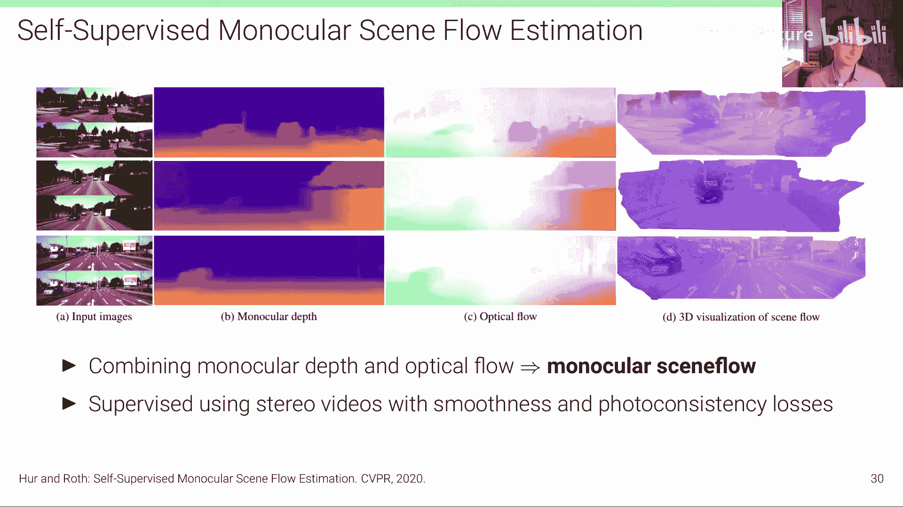

# 040：任务特定模型 🎯

在本节课中，我们将学习自监督学习中的任务特定模型。这些模型专门针对特定的下游任务进行设计，与我们后续将要学习的、旨在学习独立于任何下游任务的通用表示的模型不同。我们将首先探讨如何无监督地学习深度和自身运动。

## 概述

我们将重点介绍一种无需深度或姿态真值标签，仅使用单目视频序列来训练深度估计网络和相机姿态估计网络的方法。其核心思想是利用视频帧之间的**光度一致性**假设来构建损失函数，从而优化网络参数。

## 无监督深度与自身运动学习

上一节我们介绍了任务特定模型的概念。本节中，我们来看看一个具体应用：从单目视频中无监督地学习深度和相机自身运动。

任务设定如下：训练时的输入仅仅是单目视频（可从互联网下载或用车载相机录制）。目标是训练两个神经网络：
*   **深度网络**（绿色）：一个卷积神经网络，以单张图像为输入，输出密集的深度图。这是一个单图像深度预测任务。
*   **姿态网络**（红色）：以两帧图像为输入，预测它们之间的相对相机运动（一个3D旋转矩阵 `R` 和一个3D平移向量 `t`，共6个自由度）。

我们希望在没有任何深度或姿态真值监督的情况下，联合训练这两个网络。这看似困难，但我们将看到其实现原理。

### 核心思想：光度一致性

我们受到经典光流技术的启发，利用**光度一致性**假设。该假设认为，在静态场景、仅存在相机自身运动、且光照恒定的条件下，同一个3D点在相邻帧中投影的像素颜色应该相同。

以下是实现这一思想的具体步骤：

1.  **选取视频帧**：考虑三个连续帧：目标帧 `I_t`（时间 `t`）、前一帧 `I_{t-1}` 和后一帧 `I_{t+1}`。后两者称为源视图。
2.  **网络预测**：深度网络预测目标帧 `I_t` 的深度图 `D_t`。姿态网络分别预测 `I_t` 到 `I_{t-1}` 和 `I_t` 到 `I_{t+1}` 的相对姿态 `T_{t→t-1}` 和 `T_{t→t+1}`。
3.  **图像扭曲**：利用预测的深度 `D_t` 和相对姿态 `T`，我们可以将源视图（`I_{t-1}` 和 `I_{t+1}`）中的像素“扭曲”到目标视图 `I_t` 的坐标系中，生成扭曲后的图像 `Î_{t-1→t}` 和 `Î_{t+1→t}`。
4.  **构建损失**：如果预测的深度和姿态正确，那么扭曲后的源图像像素应与目标图像对应像素颜色一致。因此，我们可以计算它们之间的差异（如RGB值的L1或L2损失）作为**光度一致性损失**。通过最小化这个损失，我们可以反向传播梯度来更新深度网络和姿态网络的参数。

### 投影与扭曲过程

以下是像素从目标帧投影到源帧坐标的数学公式。给定目标帧中的一个像素 `p_t` 及其预测深度 `d_t`，其在源帧中的投影位置 `p_s` 计算如下：

```math
p_s = K * T_{t→s} * d_t * K^{-1} * p_t
```

其中：
*   `K` 是相机内参矩阵。
*   `T_{t→s}` 是预测的从目标帧到源帧的刚体变换（`[R | t]`）。
*   `p_t` 和 `p_s` 是齐次坐标。

由于计算出的 `p_s` 是连续值（亚像素精度），我们需要通过**双线性插值**从源图像 `I_s` 中采样颜色值，以生成扭曲图像 `Î_s`。这个操作是可微分的，允许梯度反向传播。

### 模型架构与损失函数

在实际模型中（如CVPR 2017论文所示），通常会采用以下设计来稳定训练并提升效果：

*   **多尺度预测**：深度网络在不同特征尺度上预测深度图，并在相应尺度上计算光度损失，以改善梯度流动和优化效果。
*   **额外的正则化损失**：
    *   **平滑性损失**：对预测的深度图（或视差图）施加平滑约束，避免陷入不良的局部最优解。这是此类病态优化问题的关键。
    *   **可解释性掩码**：一些模型会额外预测一个掩码，用于在光度损失中重新加权像素，以处理遮挡或非朗伯表面区域。

最终的优化目标是这些损失的加权和。控制光度损失与平滑性损失之间权重的超参数需要仔细调整。

### 效果与局限

令人惊讶的是，早在2017年，这种完全自监督的方法在深度估计任务上的性能就接近了有监督方法。其预测的深度图合理、平滑，并能泛化到训练时未标记的区域（如天空）。

然而，该方法有一个核心假设：**场景是静态的**。因此，在存在动态物体（如移动的车辆、行人）时，模型会失效，因为动态物体违反了光度一致性假设。

## 从立体图像对进行自监督学习 🖼️🔄

为了解决动态场景的问题，另一种自监督深度估计方法是利用**立体图像对**进行训练。立体图像是同时拍摄的，因此不存在动态物体导致的帧间外观变化问题。

其核心思想与单目视频方法完全相同，只是将“相邻帧”替换为“立体图像对”（左视图和右视图）。以下是几种模型变体：

*   **简单模型**：输入左图，预测左图视差，然后利用视差将右图扭曲至左图坐标系，并计算光度损失。但这种方法可能产生伪影。
*   **改进模型**：输入左图，网络同时预测左视差图和右视差图。然后可以：
    1.  用左视差图扭曲右图，与左图计算损失。
    2.  用右视差图扭曲左图，与右图计算损失。
    3.  引入**左右一致性约束**，强制左视差图与右视差图在几何上一致，这有助于消除异常值并提升训练稳定性。

### 后续改进

在后续工作中（如Monodepth2），研究者引入了多项改进以提升自监督单目深度估计的质量：

1.  **最小光度损失**：当使用三个连续帧时，对每个像素，不再计算与所有源帧损失的平均值，而是取**最小值**。这有助于处理遮挡，因为一个像素只要在至少一个源帧中可见，就能提供有效的监督信号。
2.  **多尺度损失计算**：将低分辨率深度图上采样至高分辨率，再计算与高分辨率图像的光度损失，这可以避免“纹理复制”伪影。
3.  **自动掩码**：检测相机是否静止（例如在等红灯时）。如果相机静止，深度估计问题变得病态（任何深度都成立），这类帧会损害训练。通过比较帧间像素的整体变化，可以自动过滤掉这些帧或其中的像素。

这些改进使得自监督深度估计的结果边界更清晰、细节更丰富，性能显著提升。

## 扩展到光流与场景流估计 🌊



同样的自监督思想可以自然地扩展到其他任务，如光流估计。



一种方法（如2018年论文）采用**双向训练**策略：
*   使用一个共享权重的光流网络（FlowNet）。
*   输入图像对 `(I1, I2)`，网络预测前向光流 `F_{1→2}`。
*   交换输入顺序为 `(I2, I1)`，同一网络预测后向光流 `F_{2→1}`。
*   利用预测的光流分别扭曲图像，并计算前向和后向的光度一致性损失。
*   引入**前向后向一致性约束**，鼓励光流场在循环投影后保持一致，这有助于处理遮挡区域。

总损失包括平滑性损失、光度数据损失和一致性损失。这种方法能够产生可靠的无监督光流估计结果。

更进一步，可以结合深度和光流，进行**场景流**的估计（即每个点的3D运动）。同样可以使用自监督方法，例如利用立体视频进行训练，但在推理时仅需单目视频。

## 总结

本节课我们一起学习了自监督学习中的任务特定模型，重点探讨了如何从视频中无监督地学习深度和运动。

*   我们首先介绍了利用**单目视频序列**和**光度一致性**原理，联合训练深度网络与姿态网络的方法。其优势在于无需任何真值标签，但假设场景静态。
*   接着，我们看到了利用**立体图像对**进行自监督深度估计的方法，它天然避免了动态场景问题，并通过左右一致性约束提升了效果。
*   然后，我们了解了诸如最小光度损失、多尺度损失计算和自动掩码等改进技术，它们显著提升了自监督深度估计的质量。
*   最后，我们将这一框架扩展到**光流**和**场景流**估计任务，展示了自监督学习思想的通用性。



这些方法展示了如何利用数据本身的内在结构（如视频帧间的几何关系）作为监督信号，在没有昂贵人工标注的情况下，训练出性能优异的视觉模型。