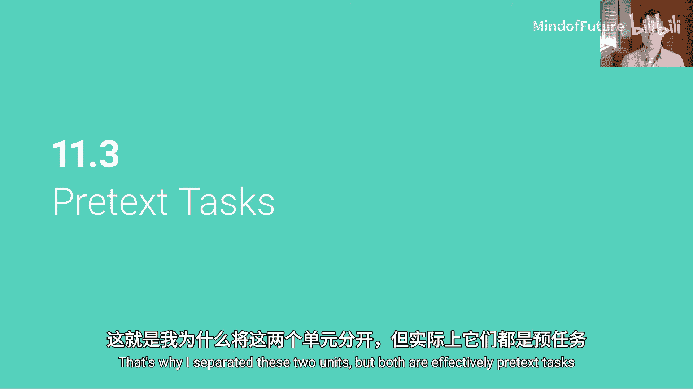
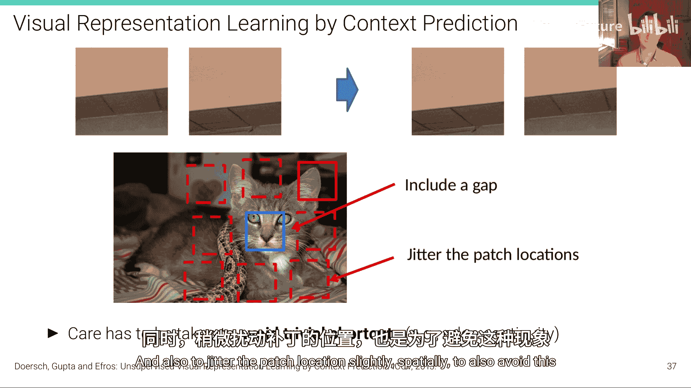
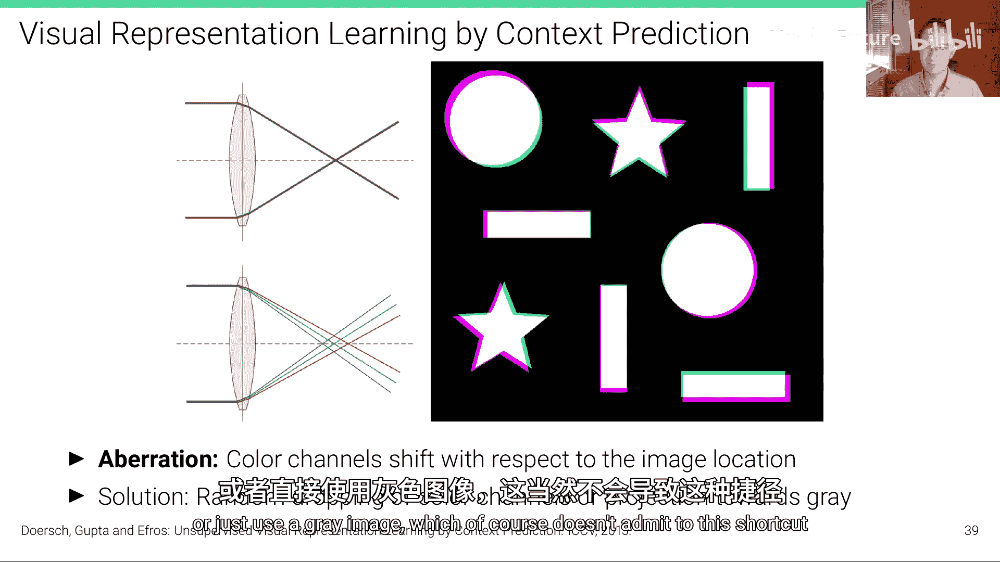
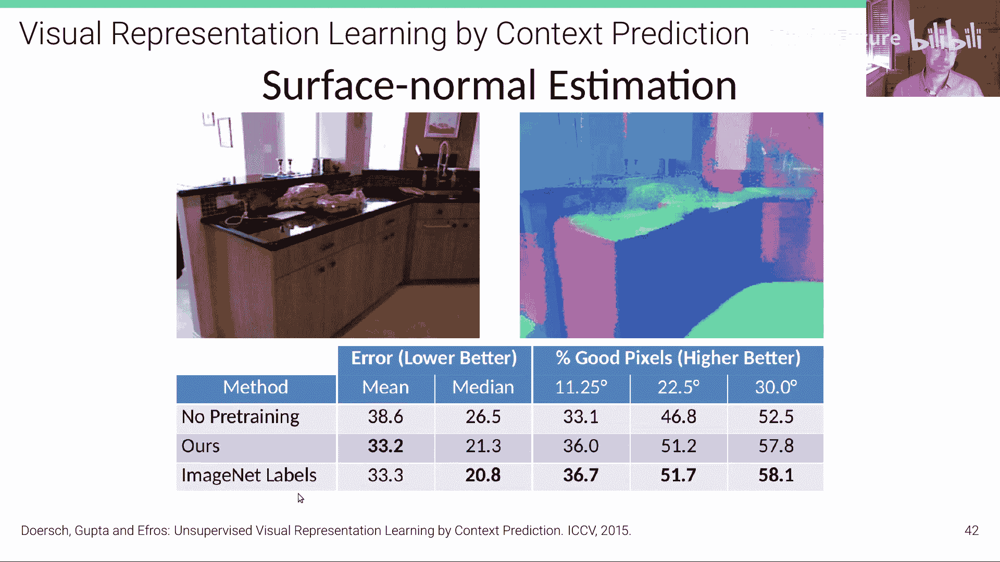
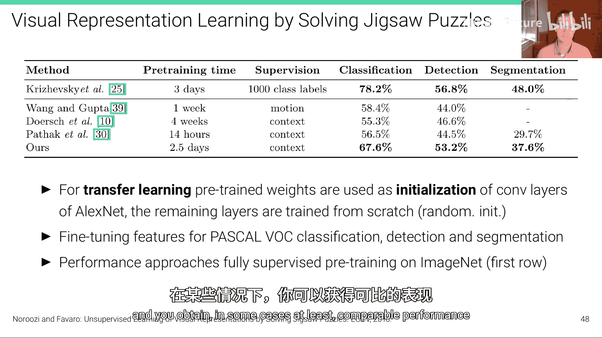
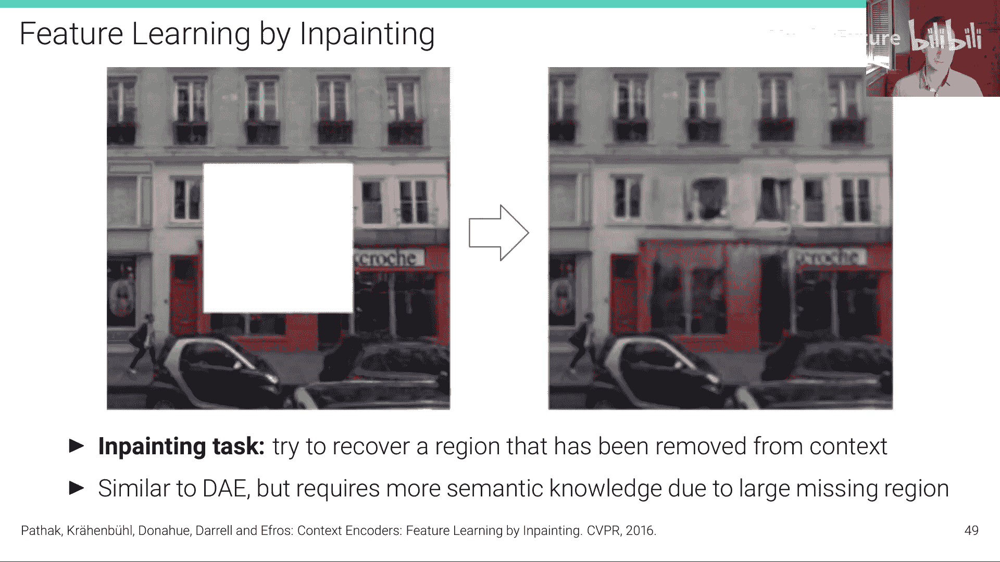
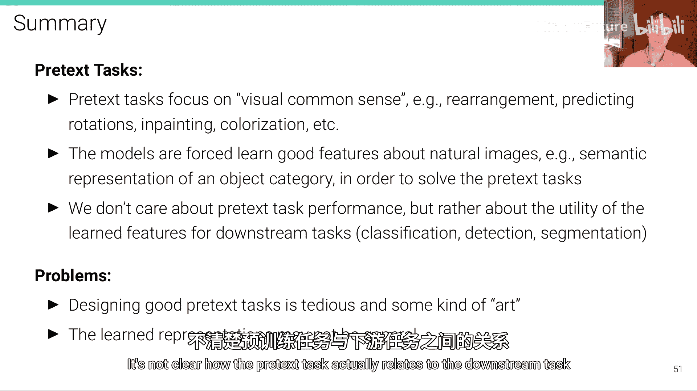
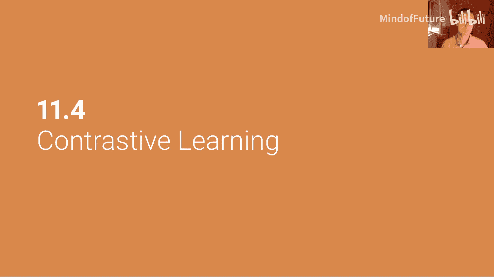

# 041：自监督学习 - 前置任务 🧩

在本节课中，我们将要学习自监督学习中的“前置任务”方法。前置任务是一种巧妙的设计，它允许我们利用大量无标签数据来训练模型，学习到通用的视觉特征表示，这些特征随后可以迁移到我们真正关心的下游任务中，如图像分类或目标检测。

上一节我们介绍了自监督学习的基本概念，本节中我们来看看一种具体的方法：通过设计“前置任务”来学习特征。

## 什么是前置任务？

到目前为止，我们看到的自监督模型都是针对特定下游任务（如单目深度估计、光流估计）量身定制的。现在，我们的目标是学习更通用的神经表征。为此，我们将定义一个所谓的“辅助任务”或“前置任务”。

例如，预测图像的旋转角度。我们将图像随机旋转（比如这只鸟的图片），然后要求模型找出图像原本的正确朝向。我们使用这个前置任务进行预训练，希望它能引导我们学习到良好的特征，以便在后续感兴趣的下游任务中重用。

所以，我们定义一个用于预训练的前置任务（如旋转预测）。当然，我们拥有大量无标签数据，可以从互联网下载数百万甚至数十亿张图片。然后旋转它们，并询问网络：“我做了哪种旋转？”我们可以任意角度旋转，例如，可以取90度的倍数旋转，然后问网络这张图片被旋转了多少度。

这就是前置任务。我们取大量无标签数据，针对前置任务定义一个卷积网络（包含几个卷积层和一些全连接层）。在这个例子中，我们希望分类出四种可能的朝向（90度将是正确答案）。

然后，我们丢弃图中白色的最后几层，只保留卷积层的权重（即所谓的特征提取器），并将其复制用于下游任务。

假设下游任务不是旋转预测，而是分类（例如，我们想分类图片中是否有鸟）。我们只有少量带标签的数据（可能每个类别只有20个实例），无法承担更新网络所有参数的成本。但我们希望在前置任务中学到的参数已经足够好、足够通用、具有某种语义意义，以至于我们只需添加一两个新层（例如一个线性分类器）并仅训练这些层，就能获得良好的模型性能。

通过从前置任务迁移大部分参数，并添加一个需要训练的小型“读出头”（该头可以用较少数据训练），我们可以在目标任务（分类）上评估这个网络。

那么，前置任务的一般定义是什么？根据维基百科，前置任务是为做某事或说某事（可能不准确）而找的借口。它可能基于半真半假的事实，或在误导性虚构的背景下发展。前置任务被用来隐藏行动和言语背后的真实目的或理由。

显然，这不是我们想做的。我们想找到一个与下游任务有一定关联，但又是一个“借口”的任务，用它来代替我们真正想做的事。我们这样做是因为它更容易。就像这个例子：告诉妻子我每晚都去图书馆，比说出真相更容易。

## 前置任务示例

在接下来的内容中，我们将看看文献中提出的一些前置任务。必须承认，这些任务都是手工设计的，目前还没有理论支撑，只有经验证据表明每个任务在实践中效果良好。经验表明，当我们复制这些权重并将其应用于某些下游任务（仅微调某些层或进行少量全网络迭代）时，我们可以用更少的标签数据完成下游任务。

以下是另一个前置任务示例。

### 通过上下文预测学习

这是最早的前置任务之一，由Dosovitskiy等人在ICCV 2015提出。在这个任务中，目标是根据两个图像块预测它们的相对位置。

我们取一个蓝色的中心块，然后针对这个红色块，我们只观察这两个块，并要求网络分类红色块相对于蓝色块是位于哪个位置（例如左上、正上、右上等）。共有8种可能性，因此这是一个8分类任务。

给定蓝色块和红色块，有8种可能的位置来描述红色块相对于蓝色块的位置。上下文预测的目标是预测图像块的相对位置（这是一个离散集合）。

这里的希望同样是，这个任务要求模型学习识别物体及其组成部分。该任务的设计方式是，如果模型没有学到关于物体如何构成的有趣知识，它将无法解决这个任务。

为了更深入理解，让我们玩一个小游戏（这也是那篇论文的预告图）。你能识别红色块相对于蓝色块的位置吗？给你五秒钟时间思考。

如果你看这两个块，你可能会说：“这是公交车的前部，这是公交车的左后部，所以红色块很可能位于蓝色块的右下角。”它不太可能在正下方（因为那样会显示公交车前部），也不太可能在左侧（因为那样会显示一些背景）。同样，对于火车图片，红色块更可能在蓝色块的上方，因为它显示了火车的顶部，而蓝色块显示了底部。

如果一个神经网络想要正确完成同样的任务，你可以看到它必须获得一些关于现实世界物体的知识，而这正是我们在这里要利用的。

这是论文中使用的架构。两个图像块输入，采用类似孪生网络的架构，经过卷积和池化，直到全连接层。然后，全连接层的输出被拼接，再经过少量全连接层进行分类。

这听起来很棒，但必须注意一些问题。特别是，我们必须确保神经网络不会采取任何简单的捷径解决方案。实际上，神经网络不会做你想让它们做的事，它们会做最简单的事。

例如，如果我们取直接相邻的块，神经网络可以不通过理解物体的语义，而是通过观察边缘并尝试对齐边缘来解决问题。如果它看到边缘是对齐的，那么这种块配置（例如左右交换）的可能性就更大。为了避免模型利用这种简单的捷径，这项工作采取的方法是在块之间引入一个小间隙，使它们不直接相邻，这样边缘连续性就无法被利用。同时，对块位置进行轻微的空间抖动，以避免这种现象。

还有一个更微妙的捷径。作者发现，网络实际上很容易预测图像的绝对位置。如果网络仅通过观察一个块就能预测其绝对图像位置，那么块的相对位置显然可以轻松推断出来。为什么会发生这种情况？

作者做了一个小实验来验证和理解这一点。他们随机裁剪图像块，然后训练一个神经网络以监督方式预测每个块的绝对图像位置。结果发现，网络确实能够做到。网络仅观察这个局部块，就能预测出它在图像中的绝对位置（例如，这个块应该出现在图像的右侧）。这是如何可能的？图像位置信息是如何编码在这个局部块中的？

答案是：一些相机镜头会根据图像位置不同地偏移颜色通道。特别是，镜头质量不佳的相机会出现所谓的“色差”问题。色差源于镜头对不同波长的光反射不同，这意味着不同颜色通道存在空间偏移，而这种空间偏移依赖于图像中的位置。模型可以利用这个事实，仅通过观察局部颜色偏移（而忽略纹理、语义和块内内容）来预测位置，这正是发生的情况。

为了避免网络利用这个简单捷径，解决方案是随机丢弃颜色通道、将颜色投影到灰度通道，或直接使用灰度图像（这当然不允许这种捷径）。

在解决了这些简单捷径后，网络实际上能够学习到一些有语义意义的内容，这些内容可以迁移到下游任务。例如，他们将其用于目标检测（使用R-CNN架构）。他们使用这种基于上下文预测的预训练技术（无需任何标签）来训练卷积神经网络特征，然后使用较小的带标签训练集来训练剩余参数并微调神经网络。他们发现，如果不使用任何预训练，结果会显著变差。虽然在这种情况下，性能尚未达到使用ImageNet标签进行预训练的水平（因为这是一个非常语义化的识别任务，确实受益于监督的语义类别），但令人印象深刻的是，其性能已经可以与使用大量数据、完全监督的ImageNet预训练相媲美。

该方法也适用于表面法线估计等完全不同的任务。同样，他们观察到，没有预训练的结果明显更差，而他们的方法有时甚至超过了ImageNet预训练模型。在这种情况下也更有意义，因为表面法线估计与识别任务非常不同，因此用识别数据集来预训练该模型的参数更困难，所以更容易与这里的监督方法竞争。

论文中还研究了网络实际学到了什么视觉表征。一种方法是在特征空间中寻找最近邻。他们比较了随机初始化网络、AlexNet和他们的自监督方法，发现随机初始化通常不会给出有意义的结果，而他们方法检索到的结果在语义上是有意义的，与使用ImageNet预训练检索到的图像块类似。

### 拼图游戏任务

在拼图游戏前置任务中，想法是随机排列图像的3x3平铺版本，并要求网络恢复原始图像（就像玩拼图一样）。因为有9的阶乘种不同的排列，数量非常庞大，这是一个巨大的分类问题，所以他们将自己限制在1000种预定义的随机排列。这些排列是根据汉明距离选择的，以增加难度，他们试图找到特别困难的排列，让模型学得更好。

这是使用的架构：九个打乱的图像块首先被输入，然后送入卷积架构，特征被送入MLP进行1000路分类，然后用于反向传播和训练模型。

同样，在拼图任务中，他们必须确保避免捷径，故事与上一篇论文类似。这些捷径之所以发生，是因为它们对解决前置任务有用，但与目标任务无关，因此我们需要避免它们。

一种捷径是低阶统计量。如果你看相邻的块，它们通常包含相似的低阶统计量（如均值和方差）。他们为解决这个问题应用的方法是根据均值和方差对块进行归一化。同样，他们也处理了边缘连续性问题，通过从更大的单元格中随机选择64x64像素的块，有效地应用了一些抖动和填充。色差问题也类似，他们应用了灰度图像或对每个颜色通道进行几个像素的空间抖动来避免。

捷径学习是深度神经网络学习中的一个普遍而有趣的问题。如果你对捷径学习更感兴趣，我强烈推荐Tübingen大学Matthias Bethge团队的这篇论文《Shortcut Learning in Deep Neural Networks》。

通过解决拼图游戏学到的表征是有意义的。在网络的较早层学到了低阶统计量，随着进入更深的层，你得到了更有语义意义的激活。

他们也将这种表征应用于Pascal VOC分类、检测和分割任务（这是几年前著名的挑战赛之一）。他们发现，在某些情况下（例如目标检测），他们的性能已经可以与使用相同架构、相同预训练时间但无需标签的ImageNet全监督预训练模型相媲美。这表明，你并不一定需要ImageNet数据，也可以使用此类前置任务进行预训练，并在某些情况下获得至少可比的性能。

### 图像修复任务

这是另一个称为“图像修复”的前置任务。它与我们已经见过的去噪自编码器有点相关，但不同之处在于，这里被遮盖的不是单个像素，而是整个大区域。现在的关键任务是尝试仅从上下文恢复被移除的区域。你可以看到模型实际上可以相当不错地完成这项工作。如今（五、六年后）的先进方法比这要好得多，但在2016年，当语义分割和图像级神经推理还相当新的时候，已经可以取得这样的结果。为了让模型真正执行好这个任务，它必须学习一些关于世界结构的知识。这始终是相同的核心理念。

### 图像旋转预测任务

我们已经在开头看到了图像旋转预测任务。目标是预测所显示图像的朝向，图像被人为旋转，输出是一个4分类任务，我们试图恢复真实的朝向。同样，为了恢复正确的朝向，前提是需要语义知识来解决该任务。

## 总结

在本节课中，我们一起学习了自监督学习中的前置任务方法。

前置任务侧重于视觉常识，例如重排、旋转预测、修复、着色等。模型被迫学习关于自然图像的良好特征。例如，为了解决前置任务，它们必须隐式地解决更困难的任务（如对象类别的语义分割）。这就是前置任务被选择的方式。我们并不关心前置任务本身的性能，而是关心所学特征表示对我们实际关心的下游任务（如图像分类、目标检测、语义分割、深度估计、法线预测等）的效用。

然而，这种方法的问题是：设计好的前置任务是繁琐的，并且仍然像一种“黑色艺术”，没有完善的理论指导，因此不清楚如何构建更好的前置任务。另一个问题是，学到的表征可能不够通用，前置任务与下游任务的实际关系并不明确。

这正是我们接下来要探讨的内容。