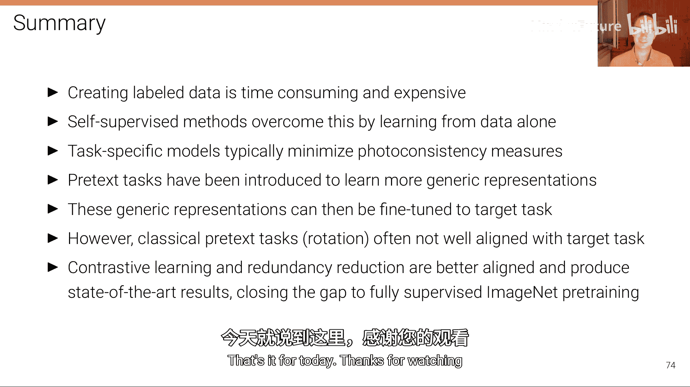

# 042：对比学习


在本节课中，我们将要学习自监督学习中的一种重要范式——对比学习。我们将探讨其核心思想、数学原理、实现方法以及它如何克服传统前置任务的局限性。

## 概述

在前面的章节中，我们讨论了各种前置任务，例如拼图、旋转预测等，用于预训练神经网络。然而，这些任务与下游任务（如图像分类）的关联性并不明确，我们只能凭经验希望它们能对齐。本节介绍的对比学习，旨在通过构建一个更通用的学习目标，使模型学习到的特征表示能更好地服务于下游任务。

## 前置任务的问题

上一节我们介绍了用于预训练神经网络参数的各种前置任务。本节中我们来看看这些方法存在的一个根本问题。

在用于预训练神经网络大量参数的前置任务中，我们考虑的任务乍一看与下游任务完全脱钩。例如，我们尝试解决拼图游戏来预训练神经网络参数，然后为网络附加小型线性层或多层感知机作为“读出头”，并使用少量有标签样本来训练这些读出层的参数，以完成实际的下游任务（如图像分类）。但我们并不知道这个拼图任务是否真的与下游的图像分类任务相关。我们无法确定，正如之前提到的，这里没有理论指导，一切基于经验。

换句话说，我们所做的是强烈希望预训练任务和迁移任务能够对齐，并尝试寻找与下游任务对齐得更好的预训练任务，这正是对比学习的目标。

以下是该问题的另一个图示说明。从拼图等前置任务中学到的特征，其性能表现如下图所示。如果我们在这个网络的不同层附加读出头，下游任务性能（此处为平均精度，越高越好）的变化如图所示。我们观察到，前置任务特征的性能会达到饱和。如果我们使用更后面的、更具语义的层（这些层本应对下游分类任务更有利）并附加线性读出层，性能会饱和甚至在某些点下降。

其原因是，前置任务（如拼图）与图像分类任务差异过大，导致网络的最后几层专门针对前置任务进行了优化。这些层非常擅长解决拼图、上下文预测或旋转估计，但它们并不包含解决图像分类任务所需的语义知识，因此性能会下降。

## 对比学习的核心思想

现在的问题是，能否找到一个更通用的前置任务？首先，理想的预训练特征应该能够表示图像之间的关联。例如，同一只猫的图片，即使经过轻微改动，其特征在特征空间中也应位于相近区域；而不同动物的图片则应位于特征空间的不同区域。同时，特征应对干扰因素保持不变，例如物体的具体位置、光照条件或颜色等。所有这些变体（你可以认出我们之前讨论过的一些前置任务）都应该与原始图像相似。

在对比学习中，我们的做法不是尝试预测已丢失的某些信息，而是直接让这些相似的变体在特征空间中彼此靠近。我们可以使用任何想要的增强方法。从参考图像生成的这些增强图像，在对比学习社区中被称为“视图”。

简而言之，我们希望构建一个模型，使得对于特定的参考图像，其不同视图在特征空间中彼此靠近，而任何其他物体的任何视图则远离该区域。这在直觉层面正是对比学习的目标。

## 数学实现：InfoNCE 损失

我们如何实现这个目标？下图展示了基本概念。你可以看到参考图像 X，以及通过数据增强（如裁剪部分、旋转、改变颜色等）生成的正例 X+。它们都应该相似。同时，我们还有负例 X-，它来自不同的图像或同一图像中远离感兴趣区域的区域。相对于参考图像，这些是正例和负例。

在数学上，给定一个选定的评分函数 s，我们希望学习一个编码器网络 f，使得正样本对 (x, x+) 获得高分，负样本对 (x, x-) 获得低分。换句话说，我们希望 `s(f(x), f(x+)) > s(f(x), f(x-))`。

我们可以将其表述为一个优化问题。考虑以下标准对比学习目标：我们有一个参考图像 x，一个正例 x+，以及 n-1 个负例 x-。

以下是常用的多类交叉熵损失函数，与 ImageNet 分类中使用的类似，区别在于内部包含了评分函数。

**损失函数公式：**
`L = -E[log(exp(s(z, z+)) / (exp(s(z, z+)) + Σ_{j=1}^{n-1} exp(s(z, z-_{j}))))]`

其中，z = f(x)，z+ = f(x+)，z-_{j} = f(x-_{j})。这个损失通常被称为 **InfoNCE 损失**。该目标的一个有趣特性是，其负值 `-L` 是参考图像特征 `f(x)` 与正例特征 `f(x+)` 之间互信息的一个下界。互信息越大，下界越紧。另一个关键点是，我们需要一个大的负样本集才能使这个方法有效。

从这个公式中，我们已经可以看到我们试图遵循的关键思想：**最大化从多个视图提取的特征之间的互信息**，这迫使特征捕获关于更高级别因素的信息。我们的目标是最小化损失，即最大化互信息。

## 设计选择与挑战

以下是这些对比方法可以考虑的几个设计选择，以及相关的一些问题。

### 1. 评分函数
第一个设计选择是评分函数。最常见的评分函数选择是余弦相似度，即特征向量的内积除以它们的范数。

**余弦相似度公式：**
`s(u, v) = (u · v) / (||u|| ||v||)`

### 2. 样本选择
第二个设计选择是如何选择正例和负例样本。
*   **对比预测编码**：样本取自同一图像。相关正例选自邻近区域，不相关的负例选自远处区域。
*   **实例判别**：更常见的方案。假设同一图像中的所有图像块都是相关的（因为都显示了同一个主体，如一棵树），而不相关的负例则来自任何其他随机图像中的随机图像块。这被称为实例判别，因为我们在区分不同的实例。

### 3. 数据增强
第三个设计选择是数据增强。与之前需要精心设计的前置任务不同，在对比学习中，我们可以组合所有想要的增强方法，这对于使这些方法有效至关重要。例如，我们可以裁剪、调整大小、翻转、旋转图像，或从中切掉一个区域；也可以降低颜色饱和度、添加颜色抖动、添加高斯噪声或高斯模糊，或计算边缘。

## 代表性方法：SimCLR

目前该领域表现最好的方法之一是 **SimCLR**。它使用余弦相似度作为评分函数。SimCLR 接收输入参考图像，通过随机采样的增强方法生成两个不同的视图，然后通过我们感兴趣的编码器网络 f 和其后的投影网络 g 进行处理。我们最终想要的是编码器 f 产生的表示 h，而投影网络 g 仅在训练时使用，训练完成后会被丢弃。投影网络有助于更好地训练，因为它允许使用更早层的特征，并且可以投影到更高维的空间。

以下是该方法的核心伪代码：

```python
# 伪代码示例
for x in dataloader:
    # 生成两个增强视图
    view1, view2 = augment(x), augment(x)
    # 通过编码器和投影网络
    h1, z1 = projection(encoder(view1))
    h2, z2 = projection(encoder(view2))
    # 计算 InfoNCE 损失
    loss = InfoNCE_loss(z1, z2, other_negatives_in_batch)
    # 反向传播更新参数
    loss.backward()
```

SimCLR 效果非常好，在 ImageNet 上的性能可以媲美甚至在某些情况下超过有监督的预训练模型。然而，它的一个关键问题是需要非常大的训练批次大小（例如 4096 或 8192）才能达到最佳性能，这导致了巨大的内存需求，通常需要在大型计算集群上进行分布式训练。

## 改进方法：MoCo

为了缓解 SimCLR 对大批次大小的依赖和巨大的内存需求，提出了 **动量对比** 方法。MoCo 的核心思想是维护一个负样本键的队列（可以看作一个环形缓冲区）。在训练时，新的小批次被编码后加入队列，最旧的小批次被移除。关键创新在于：
1.  **动量更新**：用于编码队列中键的编码器，不是直接从查询编码器复制，而是采用动量更新的方式，使其参数变化更平滑，保证了队列中键特征的一致性。
2.  **梯度截断**：反向传播时，梯度只更新查询编码器，而不更新键编码器，因此无需存储队列中所有样本的中间激活，大大降低了内存需求。

这使得 MoCo 能够使用一个非常大的“字典”（负样本队列），同时只需较小的批次大小（如 256）即可达到与 SimCLR 相当甚至更好的性能，从而使其在常规计算设备（如 8 GPU 节点）上变得可行。

## 新范式：Barlow Twins

最近提出的 **Barlow Twins** 方法稍微偏离了经典的对比学习范式，使事情变得更加简单。它不关注样本之间的距离，而是关注神经元之间的冗余度。其核心思想是：神经元应对数据增强保持不变，但彼此之间应尽可能独立。

具体实现是：对同一图像生成两个增强视图，通过编码器得到两个特征向量，然后计算这两个特征向量在批次维度上的互相关矩阵。损失函数鼓励这个互相关矩阵接近单位矩阵：对角线元素接近 1（保证同一神经元在不同视图下的输出相关），非对角线元素接近 0（减少不同神经元之间的冗余）。

**Barlow Twins 损失函数：**
`L = Σ_i (1 - C_ii)^2 + λ Σ_{i≠j} C_ij^2`
其中 C 是互相关矩阵，λ 是权衡系数。

这种方法的主要优点是**不需要负样本**，实现极其简单，并且对批次大小的依赖比 SimCLR 小。它在性能上与最先进的方法相当。

## 总结

本节课中我们一起学习了自监督学习中的对比学习。我们首先回顾了传统前置任务与下游任务可能存在的错位问题。接着，我们深入探讨了对比学习的核心思想：通过拉近同一图像不同增强视图的特征，并推远不同图像的特征，来学习通用的特征表示。

我们介绍了实现这一目标的数学基础——InfoNCE 损失函数，并分析了评分函数、样本选择和数据增强等关键设计选择。然后，我们详细讲解了三个代表性的对比学习方法：
1.  **SimCLR**：一个简单有效的框架，但需要极大的批次大小。
2.  **MoCo**：通过引入动量编码器和负样本队列，显著降低了对内存和批次大小的要求。
3.  **Barlow Twins**：一种新颖的冗余减少方法，无需负样本，实现简单且性能强大。



这些对比学习和冗余减少方法，相比经典的前置任务，能更好地与下游任务对齐，并产生了最先进的结果，正在缩小与全监督 ImageNet 预训练之间的差距。自监督学习通过从数据本身学习，无需任何人工标签，展示了克服数据标注成本高昂这一难题的巨大潜力。