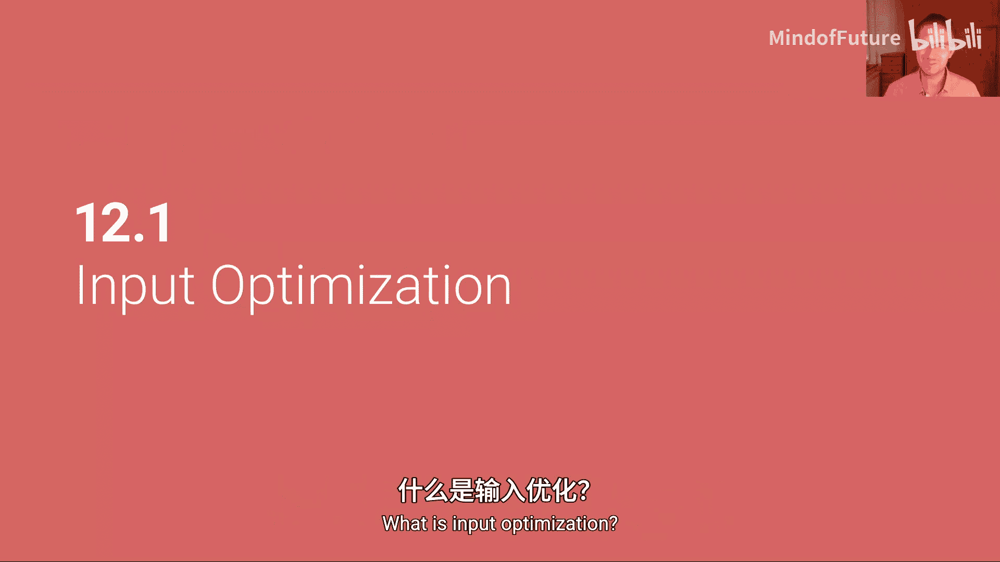
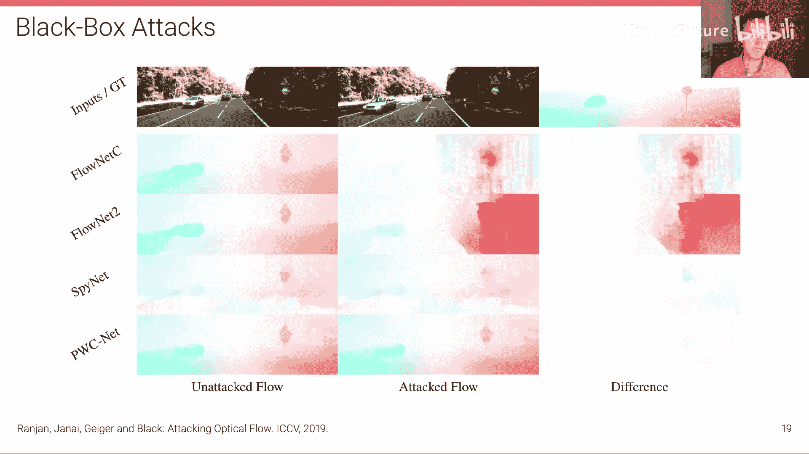
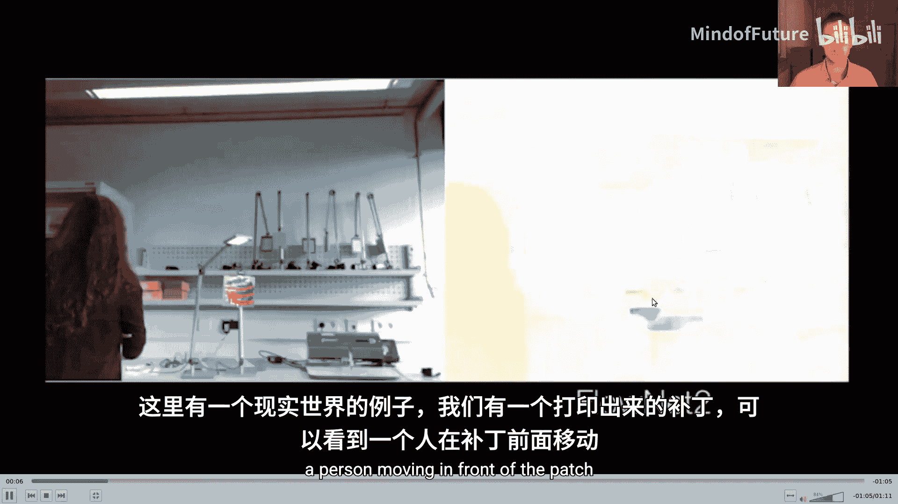
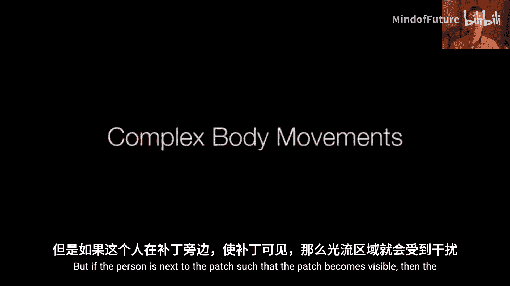
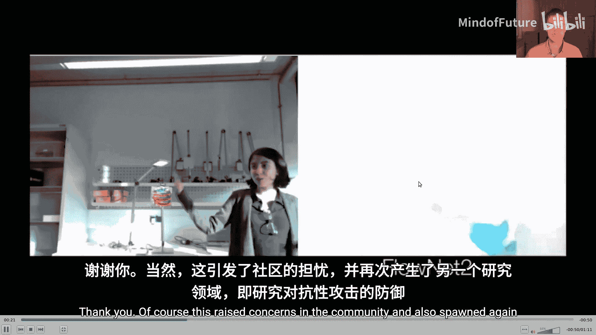
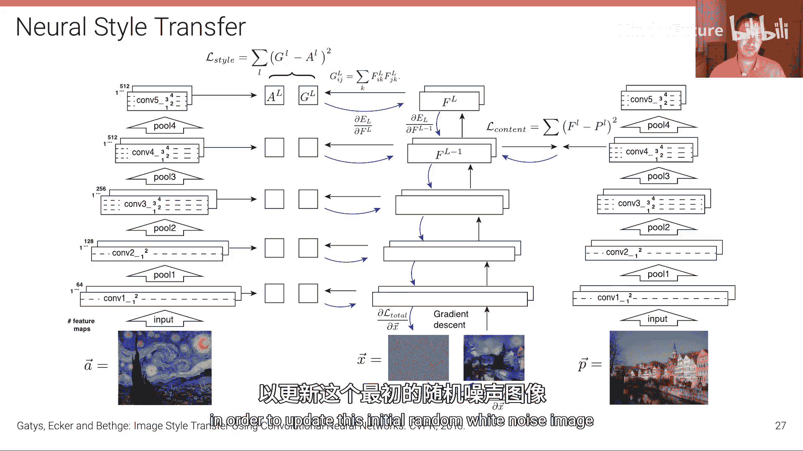

# 043：输入优化技术 🎯

在本节课中，我们将学习计算机视觉中一个有趣且强大的概念：**输入优化**。与之前我们熟悉的优化神经网络权重不同，输入优化技术旨在固定一个预训练好的网络，然后通过反向传播梯度来优化输入图像本身。我们将探讨这一技术在两个截然不同领域的应用：**对抗攻击**和**神经风格迁移**。

## 概述

在之前的课程中，我们学习了如何通过反向传播梯度来优化神经网络的权重参数。然而，计算图具有更大的灵活性。我们可以固定网络的参数，转而将梯度反向传播到输入节点。这被称为输入优化。本节我们将看到两个应用实例：一是生成能够欺骗分类器的**对抗样本**，二是生成融合内容与风格的**艺术图像**。

## 对抗攻击 🔓

上一节我们介绍了输入优化的基本思想。本节中，我们来看看它在对抗攻击领域的应用。对抗攻击揭示了深度神经网络一个令人惊讶的脆弱性：通过对输入图像添加人类难以察觉的微小扰动，就能使网络做出完全错误的预测。

以下是几种主要的对抗攻击方法：

*   **L-BFGS攻击**：这是早期的一种攻击方法。其目标是寻找一个最小的噪声图像 **Δx**，将其添加到原始图像 **x** 上，使得分类器 **f** 以高置信度将结果分类为目标错误类别 **y_t**。其数学形式化如下：
    > **x_adv = x + argmin_{Δx} (||Δx||_2) subject to f(x+Δx) = y_t**

*   **鲁棒性对抗攻击**：这种攻击考虑了现实世界中的各种变换（如视角变化、光照变化）。它通过优化一个在多种变换下都能保持攻击效果的扰动，使得攻击在物理世界中仍然有效。其核心是**期望过变换**方法。

*   **补丁攻击**：与针对整个图像的微小扰动不同，补丁攻击是在图像中添加一个较小的、可见的特定图案。这个补丁被优化为无论放置在场景中的哪个位置，都能导致网络误分类。例如，一个打印出来的小贴纸可以让自动驾驶系统将“停车”标志误认为其他物体。

对抗攻击的成功催生了一个庞大的防御研究领域。主要的防御范式包括：

*   **梯度掩蔽/混淆**：通过隐藏或扭曲模型的梯度信息，使基于梯度的攻击方法失效。
*   **鲁棒性优化/对抗训练**：在训练过程中主动加入对抗样本，让模型学习如何正确分类它们，从而提高鲁棒性。
*   **对抗样本检测**：研究正常样本与对抗样本在分布上的差异，从而在输入模型前将其检测并过滤掉。

## 神经风格迁移 🎨

在了解了如何利用输入优化进行“破坏”后，我们来看看它如何用于“创造”。神经风格迁移是一种利用输入优化生成艺术图像的技术，其目标是将一张图片的**内容**与另一张图片的**风格**融合起来。

以下是神经风格迁移的核心步骤：

1.  **使用预训练网络**：固定一个在ImageNet上预训练好的VGG网络，将其作为特征提取器。
2.  **定义损失函数**：定义两个损失函数来分别约束生成图像的内容和风格。
    *   **内容损失**：确保生成图像在高层特征上与内容图像相似。它计算生成图像和内容图像在特定网络层（如`conv4_2`）的特征图之间的均方误差。
        > **L_content = ||F^l - P^l||^2**
        > 其中，`F^l` 和 `P^l` 分别是生成图像和内容图像在第 `l` 层的特征图。
    *   **风格损失**：确保生成图像在纹理和风格上与风格图像相似。它通过比较生成图像和风格图像在各层特征图的**Gram矩阵**来实现。Gram矩阵计算了不同特征通道之间的相关性，能有效捕捉纹理信息。
        > **G^l_{ij} = Σ_k F^l_{ik} F^l_{jk}**
        > **L_style = Σ_l w_l ||G^l - A^l||^2**
        > 其中，`G^l` 和 `A^l` 分别是生成图像和风格图像在第 `l` 层的Gram矩阵，`w_l` 是各层的权重。
3.  **优化输入**：从一个随机噪声图像开始，将其作为输入送入固定的VGG网络。通过反向传播，计算内容损失和风格损失对输入图像的梯度，并不断更新这个输入图像（而非网络权重），使其总损失最小化。

最终，优化过程会收敛到一张既保留了内容图像主体结构，又具有风格图像艺术特色的新图像。

## 总结

本节课中，我们一起学习了**输入优化**这一核心概念。我们看到，通过固定预训练模型的参数并反向传播梯度至输入，可以实现两种强大的应用：
1.  **对抗攻击**：通过精心构造的微小扰动，可以揭示并利用神经网络的脆弱性，这对模型的安全性和鲁棒性提出了重要挑战。
2.  **神经风格迁移**：通过结合内容损失和风格损失，可以创造出融合不同图像内容与风格的艺术作品，展示了深度学习在创造性任务上的潜力。

这两种技术虽然目的不同，但都体现了深度神经网络计算图的灵活性，以及通过梯度优化解决复杂视觉问题的强大能力。