# 045：人体模型 🧍

在本节课中，我们将要学习计算机视觉中一个重要的主题：人体建模。我们将重点介绍一个在学术界和工业界都非常流行且影响深远的生成式人体模型——SMPL模型。理解人体模型对于分析人类行为、实现人机交互以及创建虚拟角色（如电影或游戏中的角色）都至关重要。

## 概述

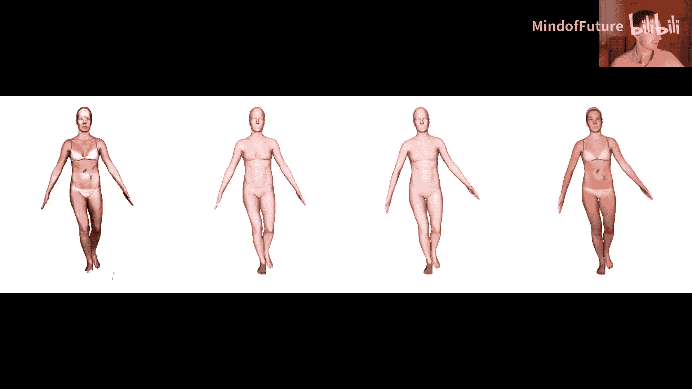

人体通过身体进行互动，如拥抱、协作、舞蹈等。为了理解和模拟这些互动，我们需要一个能够精确表示人体形状和姿态的模型。SMPL模型正是这样一个生成式人体模型，它专注于建模穿着最少衣物的人体，并力求在几何形状和外观上尽可能真实。

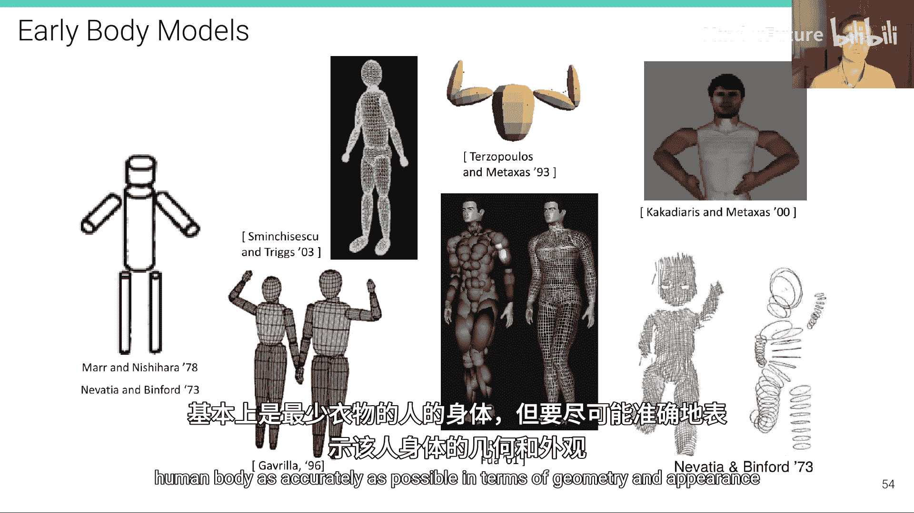

## SMPL模型的目标

SMPL模型的设计目标如下：
*   **真实感**：模型的重建结果应看起来像真人。
*   **精确变形**：模型的变形应像真人身体的变形。
*   **参数精简**：模型应具有少量参数，便于表示、存储和操作。
*   **易于拟合**：模型应易于拟合到扫描数据或图像上，以便理解人体。
*   **易于动画化**：模型应易于动画化，便于在电影或游戏等场景中驱动生成的虚拟角色。

模型的输出是一个三维网格，该网格依赖于姿态、形状、动态和纹理等参数。

## 人体建模的历史与灵感

人体形状和姿态的建模在计算机视觉领域有着悠久的历史，始于上世纪70-80年代。一个核心问题是：什么是好的表示方法？

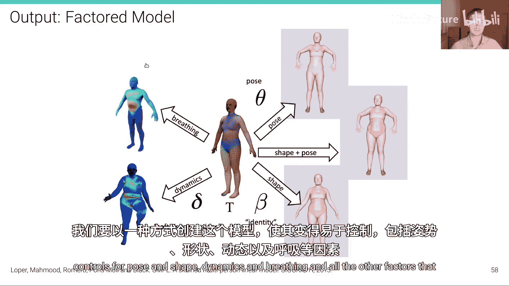

SMPL模型的一大灵感来源于1999年Blanz和Vetter在SIGGRAPH上发表的关于人脸模型的里程碑式工作。该工作可以看作是SMPL模型的前身，但专注于人体的特定部分——面部。该模型能够从单张照片重建高精度的3D人脸形状和纹理，并进行动画处理，即使在今天看来也令人印象深刻。

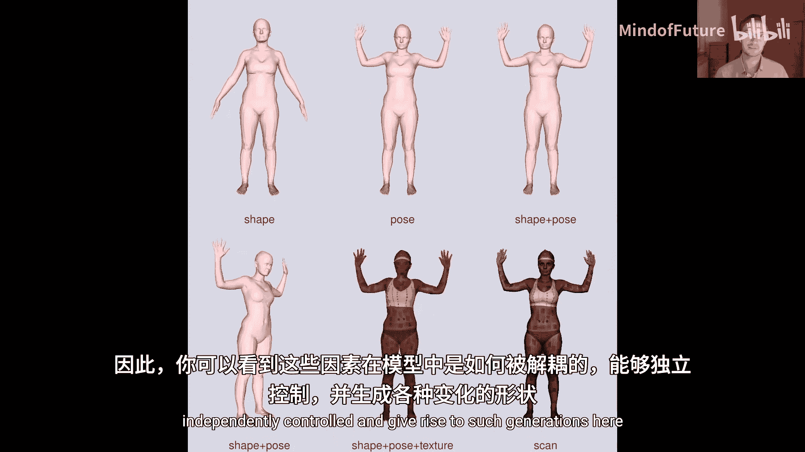

## SMPL模型简介

SMPL是“Skinned Multi-Person Linear Model”的缩写。其核心思想是：收集大量人体扫描数据，并从中创建一个生成式3D模型。这个模型是“因子化”的，意味着我们可以独立控制姿态、形状、动态等不同因素。

例如，在固定姿态下可以改变形状，在固定形状下可以改变姿态，或者同时改变两者。这种解耦设计使得模型能够灵活生成多样化的人体。

## SMPL的技术细节

上一节我们介绍了SMPL模型的基本概念和目标，本节中我们来看看其背后的技术实现。

### 网格表示与注册问题

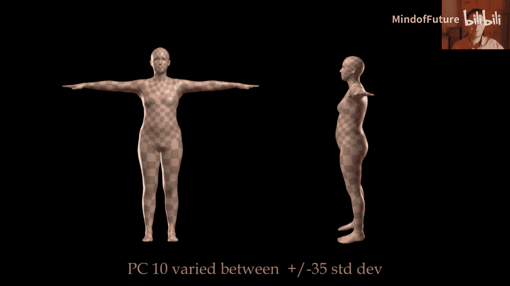

SMPL使用3D网格作为输出表示。一个基础网格由艺术家设计，以匹配大多数人体，它包含约7000个顶点（即21000个数字）。然而，直接在这个高维空间中操作会产生大量无意义的随机形状。我们的目标是在这个空间中找到与训练数据集中人体形状相对应的“合理”设置。

为了实现这一目标，第一步是解决**网格注册**问题。原始的扫描数据只是无序且不完整的3D点云，存在许多伪影和孔洞。我们需要将一个由艺术家设计的模板网格与每个扫描数据对齐。这是一个“先有鸡还是先有蛋”的难题：我们需要训练好的模型参数来将模板变形以匹配观测数据，同时又需要已注册的观测数据来训练模型。

SMPL模型的解决方案是**联合求解模型估计和注册问题**。

### 形状建模：主成分分析

现在，让我们暂时假设注册问题已经解决，所有扫描数据都被转换到了一个标准姿态（例如“T-pose”）。然后，我们可以将每个扫描数据表示为一个向量（顶点坐标减去平均形状），并将所有向量堆叠成一个矩阵。通过对这个矩阵进行**主成分分析**，我们可以得到一个线性模型。

该模型可以表示为：
`M(β) = \bar{T} + \sum_{n=1}^{|\beta|} \beta_n S_n`
其中，`\bar{T}` 是平均形状，`S_n` 是形状基向量（主成分），`β` 是低维的形状参数（例如10维）。通过改变 `β`，我们可以生成不同体型的人体，从整体尺寸到局部细节。

### 姿态变形：从线性混合蒙皮到SMPL

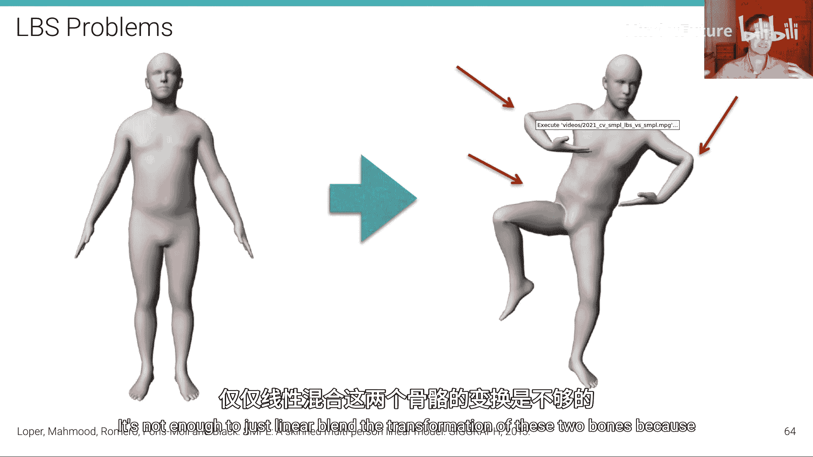

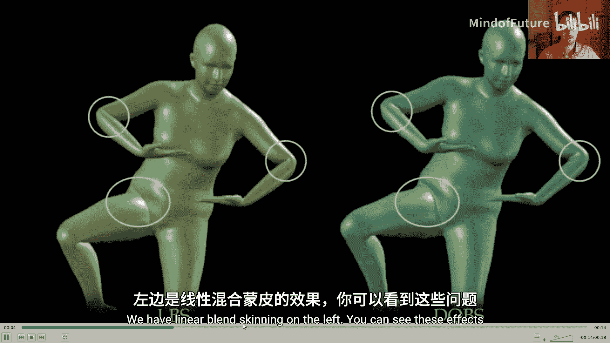

然而，我们最初并没有所有在标准姿态下的注册数据。SMPL通过扩展**线性混合蒙皮** 技术来联合解决注册和建模问题。

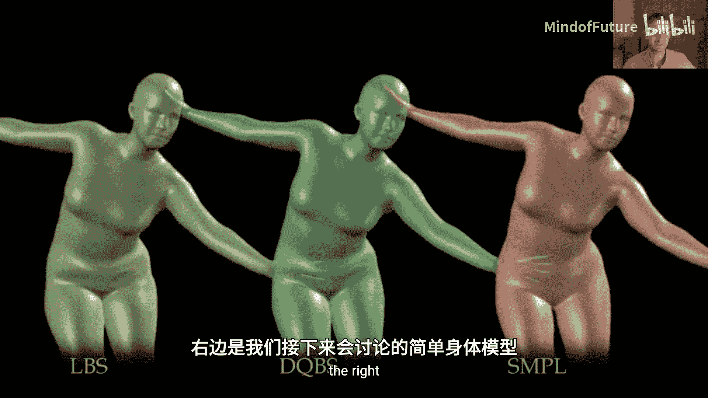

以下是线性混合蒙皮的工作原理：
对于模板网格上的每个顶点 `T_i`，我们通过一个加权和将其变换到目标姿态：
`v_i' = \sum_{k=1}^{K} w_{k,i} G_k(\theta, J) T_i`
其中，`w_{k,i}` 是蒙皮权重（表示第 `k` 根骨骼对顶点 `i` 的影响程度），`G_k` 是第 `k` 根骨骼的刚性变换矩阵（依赖于姿态参数 `θ` 和关节位置 `J`）。在关节处，顶点会受到相邻两根骨骼变换的混合影响，以实现平滑过渡。

但是，线性混合蒙皮过于简单，在关节处会产生不真实的收缩或膨胀等伪影。

### SMPL的改进

SMPL在LBS的基础上引入了三个关键改进，其公式为：
`M(\beta, \theta) = W(T_P(\beta, \theta), J(\beta), \theta, \mathcal{W})`
具体来说：
1.  **关节位置回归**：关节位置 `J` 不再是固定的，而是通过一个函数从形状参数 `β` 回归得到，以适应不同体型（如高矮胖瘦）。
2.  **形状矫正项**：在标准姿态下添加一个与形状参数 `β` 相关的偏移量 `B_S(β)`，以精确建模不同体型的静态形状差异。
3.  **姿态矫正项**：添加一个与姿态参数 `θ` 相关的偏移量 `B_P(θ)`。这是SMPL最关键的创新，它通过在标准姿态下根据目标姿态预先调整网格形状，来补偿LBS在变形时产生的伪影，从而得到更自然、真实的变形效果。

SMPL模型在一个包含数千个扫描数据的大型数据集上训练，优化形状基 `S`、姿态矫正基 `P` 以及其他参数。

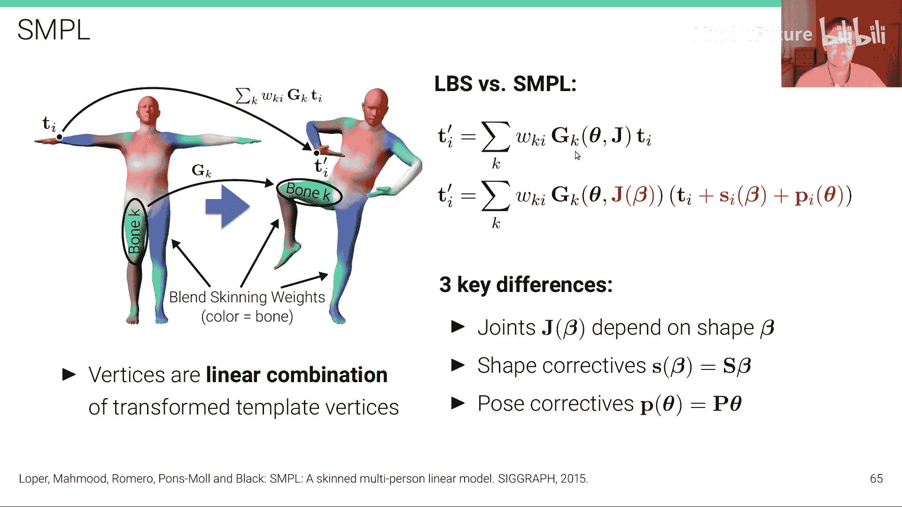

## SMPL模型的应用与扩展

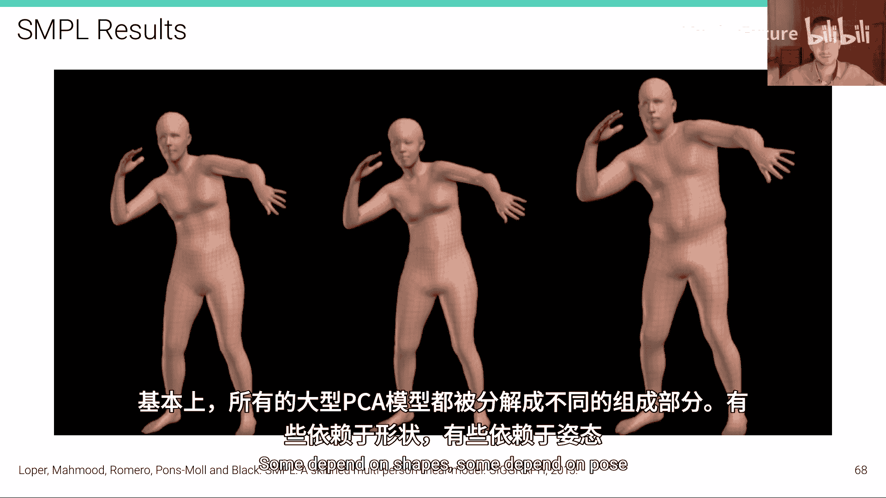

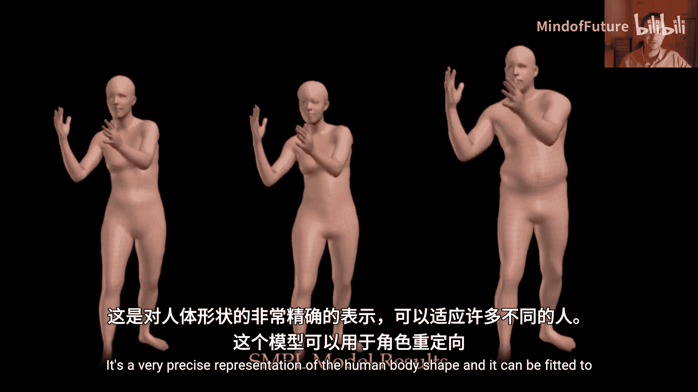

SMPL模型能够精确表示人体形状，并可以拟合到许多人身上。它的应用包括：
*   **运动重定向**：将一个人的运动迁移到另一个具有不同体型的人体模型上。
*   **动态建模**：扩展模型（如DMPL）可以建模软组织随时间变化的动态效果。
*   **单图像人体姿态与形状估计**：利用模型先验知识，仅从单张RGB图像中估计人体的3D姿态和形状。

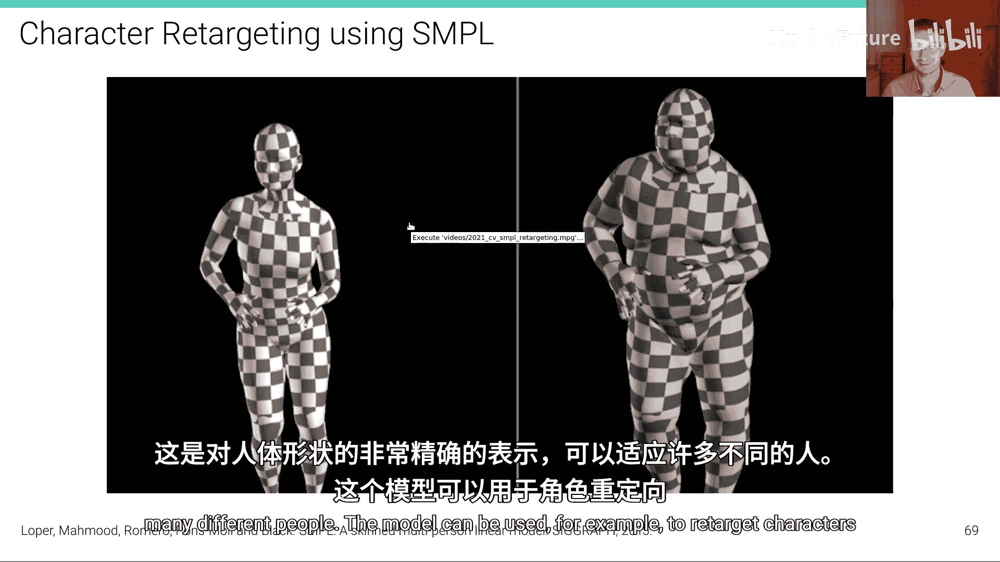

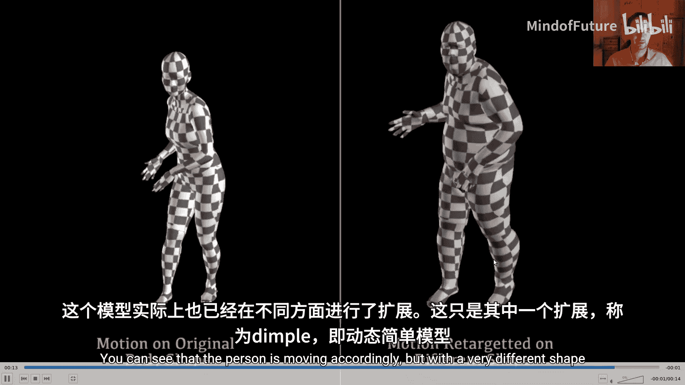

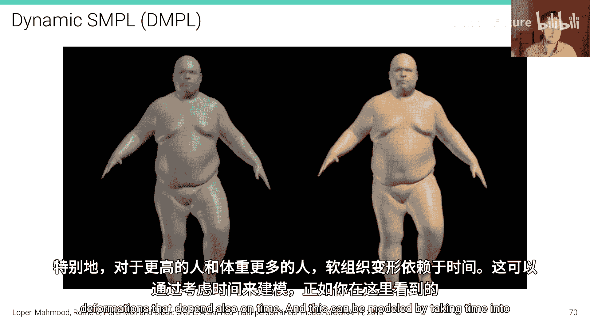

## 当前研究方向与总结

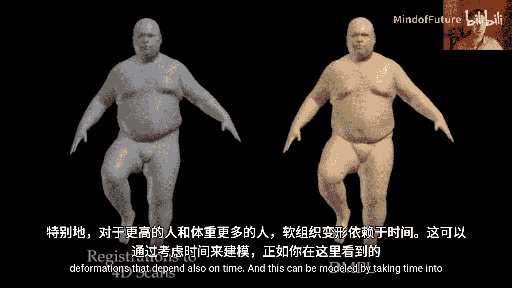

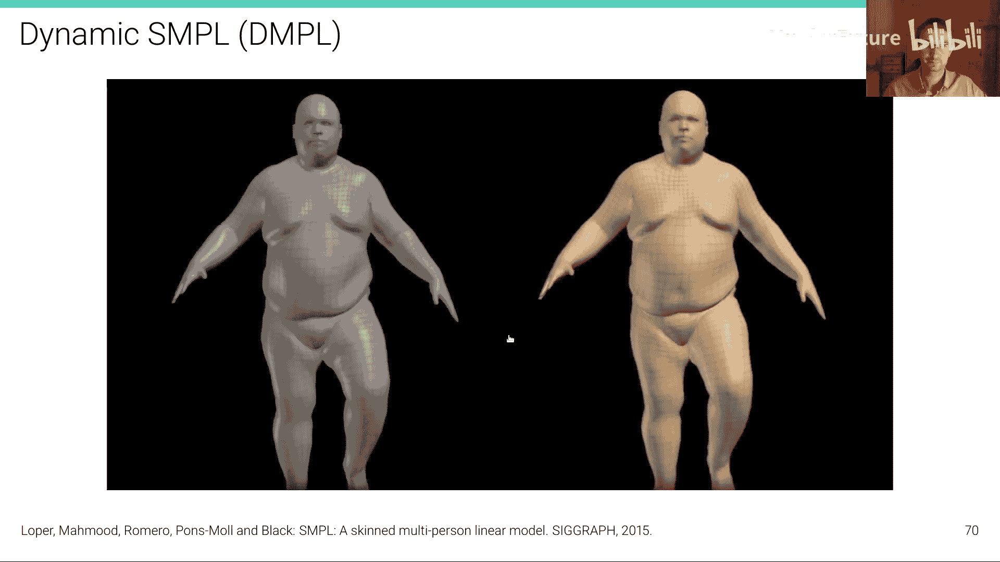

本节课中，我们一起学习了SMPL人体模型。它通过因子化的方式，用少量参数生成真实感强、易于动画化的人体网格，是许多后续工作的基础。

当然，人体建模的研究并未止步。当前的研究方向包括：
*   对**衣物**的建模（比裸体或穿少量衣物的人体更难）。
*   对**外观**和**材质**的真实感建模。
*   对**动态**和**交互**（如人与人、人与环境）的建模。
*   从**极少数据**（如网络摄像头）中学习并创建个性化虚拟化身。

这些方向正在推动计算机视觉中人体建模领域不断向前发展。