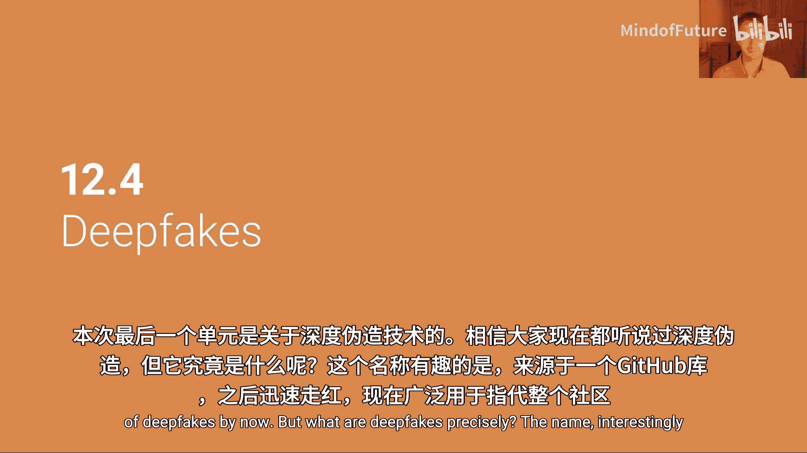
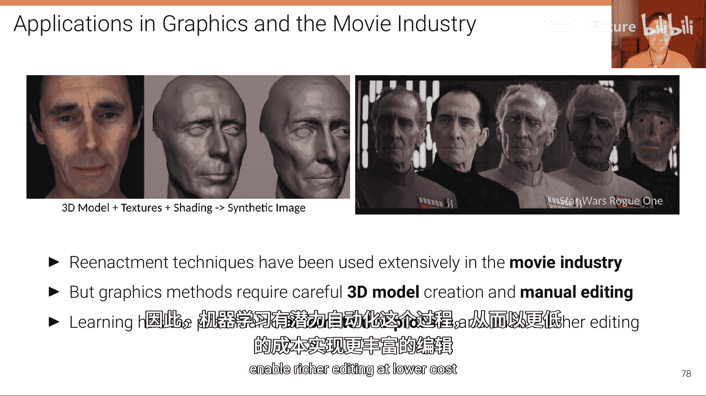
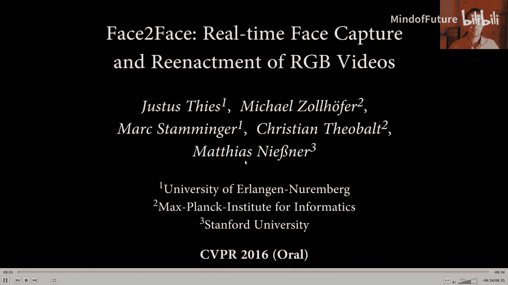
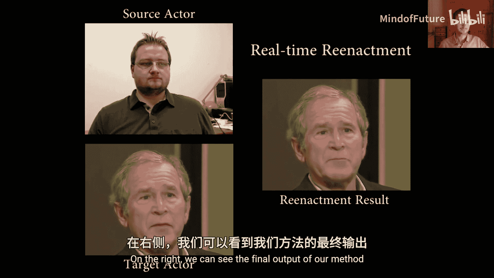
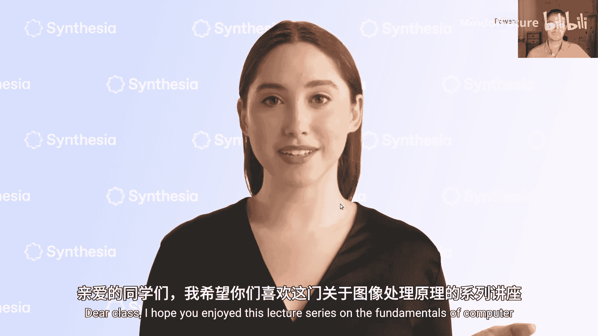

# 046：深度伪造技术 🔍

在本节课中，我们将学习计算机视觉领域的一个重要且备受关注的话题——深度伪造。我们将了解其基本概念、核心技术原理、应用场景以及相关的检测方法。

## 什么是深度伪造？🤔

深度伪造这个名称，有趣的是，最初来源于一个GitHub代码仓库。随后它迅速传播开来，现在被广泛用来指代整个相关技术领域。

以下是该GitHub仓库，这是一个仍在积极维护的仓库，旨在让名为“FaceSwap”的技术对所有人开放。其目的是帮助公众更好地理解该技术的可能性，并意识到该技术带来的影响。

你可以在这里看到一个例子，其中应用了“换脸”技术。该技术用于替换视频中人物的脸部，并以逼真的视频形式播放。它被应用到了一位演员的视频上，但这位演员的脸被替换成了尼古拉斯·凯奇的脸，如右图所示。

## 深度伪造如何工作？⚙️

这个原始的换脸模型实际上相当简单。它的工作方式是提取两个视频中的人脸。

你需要两个视频，并希望交换其中的人脸。你需要录制两个不同人物的视频。从这两个视频的所有帧中提取人脸。一旦提取了人脸，你就为这两个人分别训练一个自动编码器，其中关键的是编码器是共享的。

这样，你可以使用同一个编码器，将这张脸或那张脸映射到同一个潜在空间。编码器共享权重的作用是强制使用同一个潜在空间，以捕捉诸如姿态、表情和光照等在单个视频中会变化的因素。

现在我们有了一个训练好的编码器和两个独立的解码器（分别对应两个人）。在推理时，换脸技术所做的就是简单地交换解码器：用新的身份解码器来解码潜在编码。这样，我们可以获取此人的表情和光照条件，然后用另一个人的外观渲染出来。

正如你所见，它并不完美，在许多情况下，人们仍然相对容易识别。但当然，这项技术自那时起已经进步，取得了许多进展，人们越来越难以识别差异。

以下是这个原始深度伪造换脸技术实际运行的例子。

> “你能有朋友吗？”“是的。”“但你没有感情，对吧？”“不完全是，然而，即使在人类中，友谊有时也较少是情感反应，而更多是一种熟悉感。”“你会习惯某个人，没错。当我经历某些感官输入模式时，我的心理路径会习惯它们。最终会预见到输入，甚至在缺失时会想念它。”

希望你认出了这里被换脸的角色。

## 换脸与面部重演的区别 🎭

换脸只是其中一种技术，实际上是一种非常朴素的技术。也许更有趣的是“面部重演”。换脸和面部重演有什么区别？

这在这里有说明。左边是换脸。在换脸中，我们从一个视频中获取人脸，并将其复制到另一个视频上。我们取这张脸，将其复制到另一个视频中人物的脸上，但我们无法操纵那个视频。目标视频仍然以原始视频中演员的表情运行。我们只是试图用新的外观替换那张脸的样子。因此，输出是背景（包括头发等）和新前景的混合体，并且如你所见，也存在伪影，例如不同的发型混合在一起，这是这种混合过程的明显伪影。

相比之下，在面部重演中，我们感兴趣的是动画。我们在这里做的是，从一个视频中获取表情——仅仅是表情。然后用它来驱动另一个人物。我们这里有那个人物，我们获取那个表情，并试图驱动那个人物，但保持那个人物的身份不变。因此，我们不是取两张图像的混合体，而是仍然保持那个人物、那个身份、那个外观，只是改变那个人物正在做的事情。

这使得它比仅仅换脸能实现更多功能，特别是动画。当然，这对图形和电影行业非常相关，并且已经使用传统的图形技术（如三维重建、材质和光照估计）在电影行业中得到广泛应用。然而，传统方法需要精细的三维模型创建和手动编辑，这相当繁琐且非常昂贵。因此，机器学习有潜力自动化这一过程，从而以更低的成本实现更丰富的编辑。

## 面部重演技术：Face2Face 🎬

这是该领域一些研究小组的成果。我将向你展示的是图宾根大学马蒂亚斯·尼迈尔实验室所做的一些研究。

他们实验室一项特别受欢迎的工作叫做“Face2Face”。Face2Face的目标是实现实时面部重演。对于源视频（即演员的视频），使用普通的网络摄像头捕获。因此，它结合了两个非常困难的问题：实时处理，同时使用非常有限的传感器（只需一个价值约50美元的普通网络摄像头）。

这是如何工作的？这是一项2016年的传统技术，它没有使用大量学习，主要采用计算机图形学技术。它使用了一个人脸模型，比如我们在前一单元展示过的3D形变模型。它通过将这个面部模型非刚性密集对齐到源视频和目标视频来恢复该模型的参数，然后在源视频和目标视频上跟踪这个面部模型的参数。

如果你能做到这一点，你就有了几何估计和两个视频上的外观估计。然后，你就可以开始交换两者，因为通过模型，你有了两者之间的对应关系。这就是所谓的“外观迁移”。你可以像这样获取目标和源，然后用源的表情渲染目标。

以下是该技术的一个小视频演示。

> “我们提出了一种新颖的实时面部重演方法，适用于任何普通网络摄像头。由于我们的方法仅对源演员和目标演员使用RGB数据，因此我们能够实时操纵YouTube视频。我们在此演示了我们的方法在实时设置中的应用。在右侧，源演员通过标准网络摄像头捕获。此输入驱动左侧监视器上显示的视频中人脸的动画。与先前方法的一个显著区别是嘴部内部的重新渲染。为此，我们基于时间和光度相似性，使用训练序列中的视频片段重新合成了目标演员的嘴部内部。正如我们所见，我们能够生成逼真且令人信服的重演结果。这里我们展示了先前实时重演片段的特写。输入视频流显示在左侧，请注意目标演员以中性姿态重新渲染。在右侧，我们可以看到我们方法的最终输出。”

正如你所见，它允许对表情进行相当复杂的操纵，但当然，它不允许对姿态进行任意操纵，并且在这种情况下只影响面部区域。

## 超越传统：神经渲染 🧠

为了超越传统图形技术并提高输出的真实感，这篇名为“Deferred Neural Rendering”的特定论文使用了一种所谓的“神经渲染器”。它基本上只是一个U-Net网络，它接受一个特征表示，并通过这个神经网络进行推理来渲染输出。这样做的好处是，它可以补偿我之前讨论的基于模型的方法可能存在的缺陷。

例如，面部模型可能没有完美对齐，或者人脸可能实际上并不完全符合面部模型。或者由于遮挡或透视缩短效应，可能很难转移某些像素的外观。因此，你需要做的是“幻觉”出内容，而这正是这个神经网络可以做到的。

这个模型所做的与之前的模型非常相似。它也提取一个面部模型，但它结合了一种所谓的“神经纹理”来提取几何形状。对于每个像素，我们都有一个特征向量，用于捕获应存储在该表面点上的部分外观信息。然后，这个神经纹理可以被渲染成一张图像，这就是神经渲染器的输入，其任务是生成逼真的、照片级的输出图像。这样，它可以修复伪影并克服这些问题，因为它有额外的参数可以补偿这些缺陷。

> “嗯，布什41，克林顿，布什43还是奥巴马？为什么？我真的会说克林顿，可能我不得不说克林顿，为什么？坦率地说，他本来会有一点精神的。”

这是一个例子，正如你所见，人类很难（当然，除了这个例子中的男孩们）区分视频是真实的还是伪造的。而这正是引起极大关注的原因，也引起了研究界的兴趣。

## 深度伪造检测 🛡️

因此，现在有许多研究工作关注深度伪造检测：给定一个视频，我如何检测该视频是否被人工操纵过，或者它是否是原始视频。

其基本思想非常简单。我们使用多种技术创建一个包含真实视频和操纵视频的大型数据集。然后，我们可以训练卷积神经网络来尝试区分真实与伪造。我们简单地学习一个二元分类器来检测被操纵的图像。这效果相当好。

这就是这篇名为“FaceForensics++”的论文中收集的数据集。它收集了许多视频，超过200万个被操纵的帧，并且是公开的，因此每个人都可以用它来测试他们的算法、他们的检测算法。它是使用许多深度伪造技术创建的，如左图所示，包括Face2Face和原始的换脸技术等。因此，将不同的深度伪造创建技术结合到一个大数据集中，然后可以用来训练分类模型。

如果你这样做，会发生什么？如果你在相同分布的数据集测试集上测试（即使用相同技术操纵的数据集，例如Face2Face），它会获得非常高的分类准确率。但是，如果你在一个数据集上训练，然后在用不同技术创建的数据集上测试，性能会下降到几乎随机猜测的水平。这意味着这种方法本身泛化能力不强。因此，这是当前的研究课题：如何使这些模型更好地泛化？这里采用的技术是计算机视觉界用来解决这些问题的经典技术，例如自监督学习、迁移学习和联邦学习。

## 深度伪造的积极应用：Synthesia 🚀

马蒂亚斯·尼迈尔的研究小组也在这一领域衍生出了一家初创公司。因为当然，生成这些人工角色不仅仅是一种对抗性的想法，它还可以在许多领域带来益处。例如，在电影中，也许一个角色已经去世，你需要重演该角色；或者在新闻报道中，也许记者无法到场或生病了等等。因此，在许多用例中，你希望有合成角色说话，这正是其中一家名为“Synthesia”的初创公司的重点。

有一个网站，你实际上可以提交自己的视频，提交自己的文本，它会通过人工智能完全生成由这位演员叙述的视频。我想向你展示Synthesia为我提交的文本生成的视频。

> “亲爱的同学们，我希望你们喜欢图宾根大学的这门计算机视觉基础系列讲座。我祝你们考试一切顺利。我说不出比这更好的话了。本讲座到此结束。非常感谢你们一直陪伴我们到最后。当然，我和整个图宾根团队都祝你们考试顺利。我希望在未来的讲座中再次见到你们。谢谢。”

## 总结 📝

在本节课中，我们一起学习了深度伪造技术。我们从其定义和起源开始，了解了基础的换脸技术原理，包括共享编码器和独立解码器的自动编码器架构。接着，我们探讨了更高级的面部重演技术，如Face2Face，它通过3D面部模型参数跟踪和外观迁移实现表情驱动。然后，我们看到了神经渲染如何通过U-Net等网络提升生成结果的真实感，以补偿传统模型的不足。我们也讨论了深度伪造检测面临的挑战，即模型在跨技术泛化上的困难。最后，我们了解了深度伪造技术的积极应用，例如Synthesia在内容创作领域的用例。深度伪造是一把双刃剑，既带来了创新的可能性，也引发了关于真实性和安全性的重要讨论。