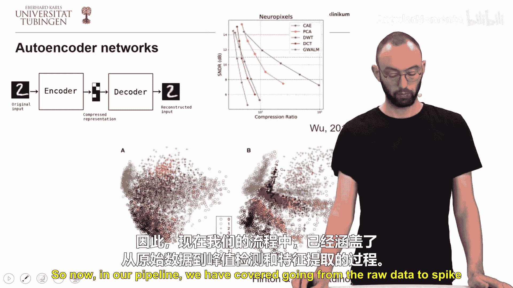
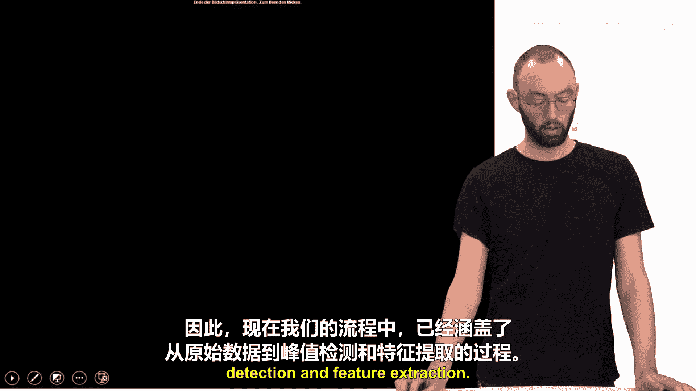

# 001：峰值检测与特征提取 🧠

在本节课中，我们将学习神经数据科学中的第一个核心问题：如何从记录的神经元电信号中检测出动作电位（即“峰值”），并从中提取关键特征，为后续的神经元分类（即“峰值排序”）做准备。

## 概述

神经元电活动的记录方法可以追溯到约70-80年前，由David Hubel和Torsten Wiesel等先驱开发。他们发明了钨丝电极和尖锐电极，能够非常接近大脑中的神经元，记录其膜电位的变化。如今，记录技术已大大发展，但核心目标不变：从复杂的原始信号中识别出单个神经元的电活动。

本课程将聚焦于在**较短时间内**（毫秒级）和**较小空间尺度**上记录神经元活动的技术，例如使用微电极阵列记录单个动作电位（峰值）。我们将从四通道的微丝电极阵列数据入手，学习如何从原始信号中检测峰值并提取特征。

## 记录技术与数据

记录大脑活动的方法多种多样，它们在时间和空间尺度上差异很大。例如，fMRI和PET成像覆盖的是相对较大尺度的活动。本课程主要讨论的是能够监测**单个神经元快速活动**（即动作电位或峰值）的技术。

*   **历史技术**：早期的钨丝微电极结构简单，由一个被绝缘体包裹的导体构成，仅在尖端暴露以测量周围电活动。
*   **微丝电极阵列**：这是钨丝电极的进一步发展。它由四根微丝捆绑而成，每根微丝都是一个独立的记录通道。由于四根微丝在空间上的排列，附近每个神经元的电压信号在每个通道上的特征会略有不同。我们将利用这一原理进行峰值排序。
*   **硅探针与Neuropixels**：现代技术如硅探针，尤其是Neuropixels探针，实现了工程学上的飞跃。它们能在单个探针上集成成百上千个记录位点，从而同时记录数百个神经元的活动。

在本课程中，我们将使用**微丝电极阵列**获取的数据。我们的目标是：从类似下图的四通道同步记录数据中，找出有多少个以及哪些神经元贡献了动作电位。

我们的最终目标是将原始数据转化为清晰标注的数据集，其中包含已识别出的不同神经元对应的峰值波形。

微丝电极阵列峰值排序的原理是**三角测量**。我们利用的是：电极附近的神经元距离某些通道更近，而距离其他通道较远。因此，不同神经元在不同通道上产生的峰值幅度特征不同，这将成为我们区分它们的依据。

## 峰值检测流程

峰值排序的任务流程是：从原始数据出发，**检测峰值** -> **提取特征** -> **对峰值进行聚类**（即排序到不同的神经元）-> **验证**聚类结果的生物学合理性。

让我们从第一步——峰值检测开始。我们拥有的原始信号如下图所示，其中包含我们想要的峰值（向下的小脉冲），也包含非常缓慢的低频波动（局部场电位）以及可能的高频噪声。

为了更清晰地看到峰值，我们需要滤除这些干扰。我们的目标是得到下图这样的信号，其中峰值清晰可见。

### 信号滤波

我们通过**滤波**来去除不需要的频率成分。以下是对时间序列滤波的简要介绍。

*   **低通滤波**：去除高频成分，保留低频趋势。其传递函数显示，低频部分增益高，高频部分增益低。
*   **高通滤波**：去除低频成分，保留高频细节。其传递函数与低通滤波相反。
*   **带通滤波**：只允许特定频率范围内的信号通过。这对于峰值检测非常有用，因为神经元动作电位的主要能量通常集中在**1000 Hz到3000 Hz**之间。

我们使用**巴特沃斯滤波器**来实现带通滤波。这种滤波器的传递函数在通带内尽可能平坦，在截止频率处有较陡的衰减。

在代码练习中，你可以尝试调整这些滤波范围，并查阅文献了解常用的参数。

应用带通滤波后，我们得到主要包含峰值成分的信号。

### 设置检测阈值

接下来，我们需要设置一个阈值，当信号幅度超过（通常是低于，因为记录到的峰值常为负向）此阈值时，我们认为检测到了一个峰值。

一个常见的方法是估计背景噪声的标准差，然后将阈值设为该标准差的若干倍（例如3或4倍）。但问题在于，如果数据中包含大量峰值，会使得标准差的估计产生偏差。

因此，我们使用一个更稳健的估计量，公式如下：

`稳健标准差估计值 = median(|X - median(X)|) / 0.6745`

这个公式的推导基于数据服从高斯分布的假设。中位数绝对偏差（MAD）除以0.6745，可以得到对标准差稳健的估计。

设置好阈值后，我们标记所有幅度超过阈值的时刻，将其视为峰值出现的时间点。这样，我们就从一个30 kHz采样的连续记录，得到了一系列峰值出现的时间点列表。

## 特征提取

检测到峰值后，我们需要提取每个峰值在四个通道上的波形。对于每个峰值时间点，我们截取它周围一小段时间窗口内的信号（例如，峰值前后各0.5毫秒）。

在现代电极（如Neuropixels）记录中，数据维度极高（上百个通道）。为了可视化，常将多通道信号随时间的变化绘制成图像，从中可以清晰看到不同神经元的“空间足迹”。

如果我们直接使用所有数据（例如，4通道 × 32个时间点 = 128维）进行后续分析，可能会面临计算复杂、内存消耗大、模型参数过多等问题。因此，我们需要进行**降维**，提取一小部分能够稳健地区分不同神经元的特征。

好的特征应该能清晰地区分不同神经元的峰值。过去人们使用过一些描述性特征，如峰峰值、波宽、能量等，但这些特征可能相关性强、分布非高斯，有时甚至无法定义。

### 主成分分析

一种常用的降维方法是**主成分分析**。PCA试图找到数据中方差最大的方向，并以此构建一组正交（不相关）的新基。第一个主成分是方差最大的方向，第二个是与第一个正交且方差次大的方向，依此类推。

其目标可以形式化地表示为寻找投影方向，以最大化投影后数据的方差，或最小化重建误差。

通过求解数据协方差矩阵的特征值和特征向量，我们可以得到主成分。对于峰值数据，使用前几个主成分通常就能重构出大部分方差（例如，前3个主成分可解释95%的方差），更高阶的成分可能主要包含噪声。

然而，PCA的局限性在于：**方差最大的方向不一定是最有利于聚类分离的方向**。有时，方差较小的方向反而能更好地区分不同类别的数据点。

### 非线性特征提取方法

为了克服PCA的线性限制，可以使用非线性特征提取方法：

1.  **核主成分分析**：通过非线性核函数计算数据间的相似性（核矩阵），然后对核矩阵进行特征分解。这能够处理原始空间中非线性结构的数据（例如同心圆分布）。
2.  **自编码器网络**：这是一种神经网络结构，包含一个将输入压缩到低维表示的编码器和一个从低维表示重建输入的解码器。通过训练网络最小化重建误差，编码器输出的低维表示就是提取的特征。线性自编码器等价于PCA，而使用非线性激活函数的深度自编码器能够学习更复杂的非线性特征表示。

## 总结

本节课我们一起学习了神经数据科学中峰值处理流程的前两步：

1.  **峰值检测**：我们了解了如何对原始神经电信号进行带通滤波，以突出峰值成分；并学习了如何稳健地估计噪声标准差，从而设置阈值来检测峰值。
2.  **特征提取**：我们探讨了为何需要降维，并介绍了主成分分析这一线性降维方法的基本原理及其局限性。最后，我们简要提及了核PCA和自编码器等非线性特征提取技术，它们能捕获数据中更复杂的结构。

至此，我们已经完成了从原始数据到峰值检测和特征提取的流程。在接下来的课程中，我们将基于这些提取出的特征，进入**峰值聚类**阶段，学习如何将峰值归类到不同的神经元。